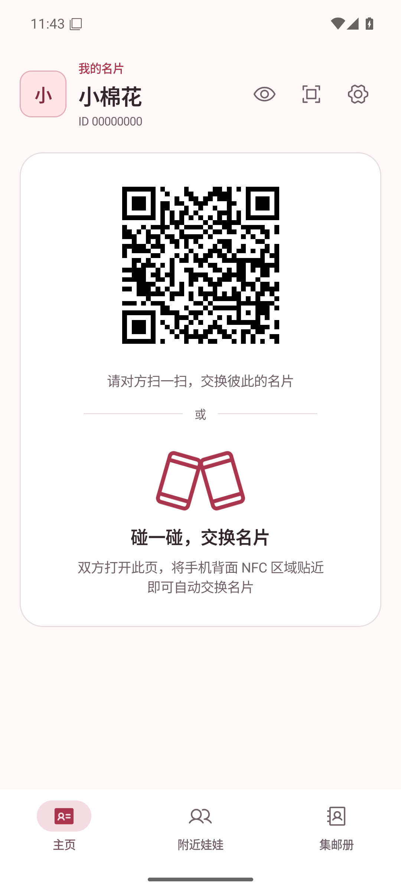
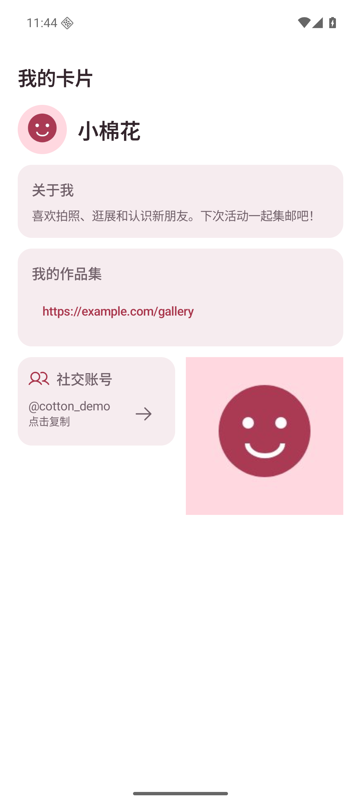

# 碰碰娃（PengWa）

**碰一下，认识一位新娃友。**

碰碰娃是一款面向 **kigurumi（娃娃）玩家**的 Android 线下社交工具。在展会、聚会和外拍时，出示名片、交换联系方式，把认识的娃友收进自己的「集邮册」，也能随手调用系统相机留下合影。

[下载体验版](https://github.com/xh321/PengWa/releases/tag/nightly) · [反馈问题](https://github.com/xh321/PengWa/issues) · [开发文档](#开发与文档)

## 一张名片，留住一次相遇

- **展示你自己**：设置显示名和头像，添加自我介绍、链接、社交账号和小图，自由编辑、排序并预览名片。
- **面对面认识**：通过 NFC 碰一碰或扫描二维码找到对方，再通过蓝牙交换完整名片。
- **发现附近娃友**：在「附近娃娃」查看附近的人，选择对方并申请交换，对方同意后完成交换。
- **收进集邮册**：成功交换后保存对方名片，再次相遇时累加次数，查看最近相遇时间与相遇记录。
- **留下合影**：在娃友名片下拍照或从相册添加照片，支持查看大图和移除。照片按娃友保存在本机，不随名片交换；集邮册右下角的快捷拍照仍保存到相册 `Pictures/PengWa`。
- **应用内更新**：在设置中手动检查 GitHub 新版本，下载并校验后打开系统安装器；正式版与 Nightly 通道分离；默认自动选择线路，优先国内加速、失败回退 GitHub，下载中断可续传。
- **按需保持可见**：可选择开启后台蓝牙广播，通过通知接收交换申请；默认关闭。

名片内置 QQ、微信、bilibili、小红书、X 和 Telegram 社交账号类型，支持复制账号或打开可用的主页链接。

## 界面一览

<p align="center">
  
  
</p>

截图来自 Android 16 / API 36 模拟器中运行的应用，使用合成测试数据。对应页面状态、设备信息和复现步骤见 [主页验证记录](docs/screenshots/card-qr-actions/README.md) 与 [名片验证记录](docs/screenshots/card-packing/README.md)；截图不代表双机交换链路已完成实测。

## 开始使用

1. **安装碰碰娃**：双方使用 Android 10 及以上手机，安装支持当前名片协议的版本。iOS 版暂未提供。
2. **准备你的名片**：首次打开按「创建卡片 → 预览确认 → 扩列」完成引导。名字必填，头像、介绍和联系方式可选；之后可在名片预览中编辑，并在设置中重看扩列图解。
3. **选择认识的方式**：

   | 方式 | 怎么操作 |
   | --- | --- |
   | NFC 碰一碰 | 双方开启 NFC 和蓝牙并保持主页打开，将手机 NFC 感应区贴近；应用自动协调读取与出示，无需选择模式或点击开始。 |
   | 扫二维码 | 一方展示主页二维码，另一方点「扫一扫」，扫码后由对方确认蓝牙交换申请。 |
   | 附近娃娃 | 双方开启蓝牙并允许所需权限，在「附近娃娃」中选中对方，申请并等待同意。 |

4. **在集邮册里重逢**：完整名片成功接收并确认后，对方才会加入集邮册。

**三种入口都需要蓝牙来传输完整名片。** NFC 和二维码用于识别对方，不能独立完成名片导入；NFC 双向识别后可短时自动确认对应设备的交换。

没有 NFC 的手机仍可使用扫码和附近蓝牙。部分手机的钱包应用可能影响 NFC 出示，可按主页提示设置默认钱包；使用原钱包前需手动切回。

## 下载与体验状态

前往 [Nightly 预发布页面](https://github.com/xh321/PengWa/releases/tag/nightly)，下载其中的 APK 安装包。Nightly 随 `main` 分支通过构建和测试后更新，属于开发体验版。

- 需要 **Android 10（API 29）或更新版本**。
- Nightly 包名为 `app.pengwa.debug`，可与正式包 `app.pengwa` 共存。
- Nightly 覆盖更新需维护者配置固定 CI 调试签名；未配置时，不同批次可能无法覆盖安装。签名不同时应用会阻止安装，勿直接卸载旧版以免丢失本地数据，详见 [自更新发布配置](docs/release.md#应用内自更新github-apk-分发)。
- 当前完整卡片的双手机 NFC、蓝牙及实物扫码链路仍待验证，后台广播的长期存活也受系统省电策略影响。详细范围见 [验证记录](docs/screenshots/custom-card/README.md)。

## 数据与权限

名片、集邮册与娃友合影保存在本机；卸载或清除应用数据会删除合影。你主动填写的名片内容会在交换时分享给对方，请只放入愿意公开给娃友的信息。

- **蓝牙**用于发现附近设备和交换名片；停在附近页面或开启后台广播时，附近设备可以读取显示名，并通过稳定身份摘要关联同一身份。
- **NFC**用于碰一碰识别；**相机**用于扫码和调用系统相机拍照；**通知**用于常驻入口与交换申请提醒。
- 后台广播需要常驻通知；重启手机或强行停止后，需要重新打开应用。Android 10、11 的蓝牙扫描还需要打开系统位置信息开关。
- 当前身份标识不具备防冒充认证能力，二维码和 NFC 识别信息也可被复制。

## 开发与文档

项目使用 **Kotlin + Jetpack Compose** 开发，为原生 Android 应用。

本地构建需要 JDK 21、Android SDK platform 37 和 build-tools 36，使用仓库自带的 Gradle Wrapper：

```bash
./gradlew :core:model:test :core:protocol:test testDebugUnitTest  # 所有模块单元测试
./gradlew assembleDebug     # 构建调试 APK
```

调试安装包位于 `app/build/outputs/apk/debug/app-debug.apk`。

| 文档 | 内容 |
| --- | --- |
| [协议规格](docs/protocol.md) | NFC、蓝牙与二维码的识别和名片交换规则 |
| [发布与签名](docs/release.md) | 发布版构建、签名配置与密钥管理 |
| [APK 体积验证](docs/apk-size.md) | DEX 与原生库压缩的实测收益、验证和取舍 |
| [设计系统](docs/design-system.md) | 主题、组件与界面规范 |
| [用户特征与交互约束](docs/user-characteristics.md) | Kigurumi 装扮对触控、视野与核心交换流程的设计要求 |
| [首次使用引导](docs/screenshots/onboarding-white-figures/README.md) | 创建卡片与纯白小人扩列图解、运行截图和验证步骤 |
| [应用图标](docs/app-icon.md) | 图标设计与 Android 资源说明 |
| [模块说明](docs/modules.md) | Gradle 模块职责、依赖与验证方式 |
| [项目背景与开发记录](docs/project-notes.md) | 原始需求、架构取舍、历史验证、预览工具与 CI 说明 |

## 可选使用统计

支持 Aptabase，首次引导最后一步提供默认勾选的「分享使用统计」独立选项，完成引导时保存选择；可取消勾选，也可之后在设置中关闭。既有用户的开关保持原值。
采集页面访问、NFC／扫码识别和蓝牙交换结果，不上传名片身份、联系方式、照片或蓝牙地址。
未配置服务的构建不会上报。配置方法、完整字段和统计口径见 [使用统计](docs/analytics.md)。
