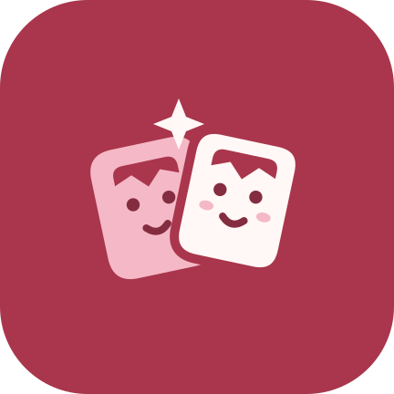

# 碰碰娃应用图标

两张向彼此倾斜的娃娃名片，表达线下「碰一碰、交换名片、收进集邮册」。刘海与笑脸呼应 kigurumi 玩家，相遇处的四角闪光表达碰面的一刻。图形不依赖文字，在桌面小尺寸下仍可辨认。

## 配色与资源

沿用应用的莓红 `#A9364C`，搭配暖白 `#FFF8F6`、浅粉 `#F5B8C6` 和深莓红 `#842D40`。品牌底色固定，不随应用深浅色主题改变；Android 13 及以上的主题图标由桌面根据系统壁纸与主题着色。

- `app/src/main/res/drawable/ic_launcher_foreground.xml`：彩色前景，108 × 108 的 Android VectorDrawable。
- `app/src/main/res/drawable/ic_launcher_monochrome.xml`：仅使用透明度的单色前景，保留名片轮廓、刘海、笑脸和闪光。
- `app/src/main/res/values/launcher_colors.xml`：自适应图标底色。
- `mipmap-anydpi/ic_launcher.xml`：基础自适应图标，覆盖项目最低版本 Android 10。
- `mipmap-anydpi-v33/ic_launcher.xml`：增加 Android 13 主题图标的 monochrome 层。
- `docs/assets/pengwa-icon.svg`：可缩放的品牌设计稿；圆角为展示用途，Android 运行时由桌面施加遮罩。

`AndroidManifest.xml` 的 `icon` 和 `roundIcon` 使用同一个自适应图标，由系统裁成圆形、圆角方形等形状。前景主体位于中央安全区域，背景铺满，保留系统动画所需的外缘空间。全部为原创几何矢量，无位图依赖或新增第三方素材。

## 验证

运行中应用的前后截图、设备信息和复现步骤见 [图标截图记录](screenshots/app-icon/README.md)。设计稿只用于展示图形，不替代设备截图。
