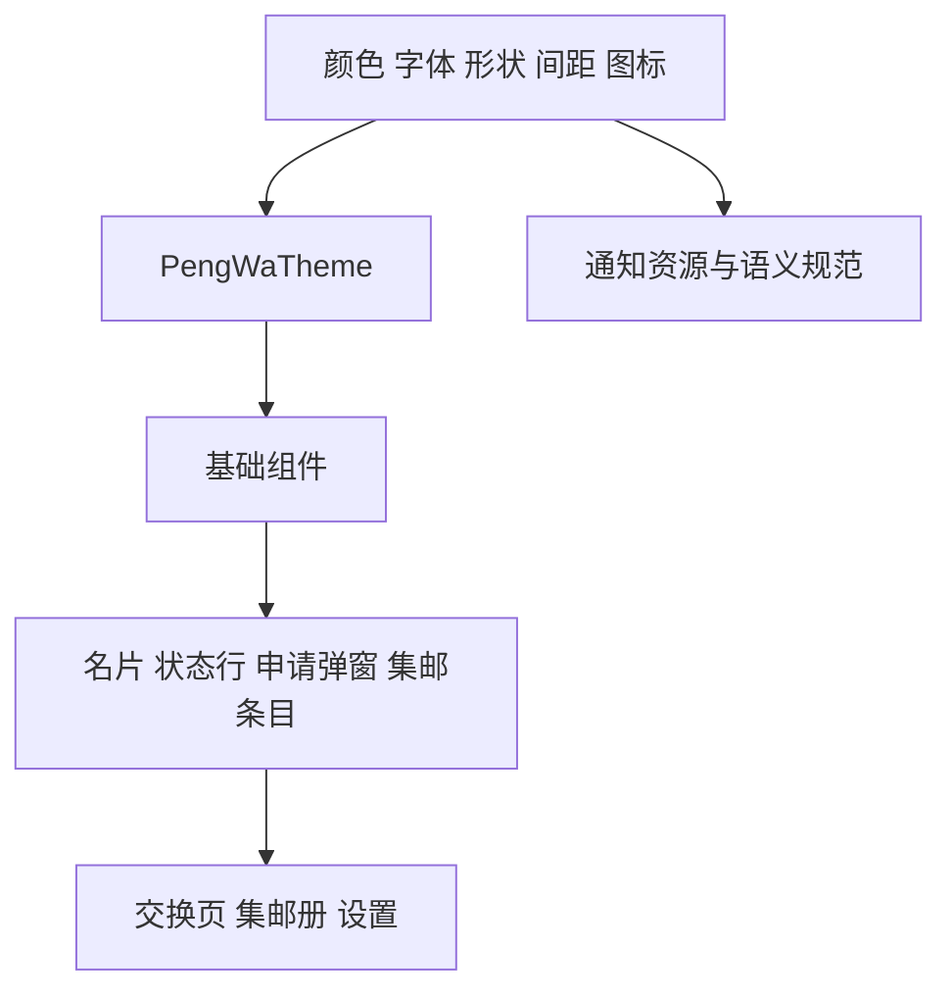

# PengWa 统一设计系统与界面优化方案

> 设计提案，待评审。整理日期：2026 年 11 月 1 日。

## 结论与目标

**建议把碰碰娃做成一本轻盈、亲切的数字集邮手册：用稳定的品牌色、圆润矢量图标和清楚的信息层级，让交换名片更容易理解，让相遇记录更值得收藏。**

技术上延续 Kotlin、Jetpack Compose 和 Material 3，在其上建立 PengWa 的主题与业务组件。优先完成主题、图标、交换页、集邮册和设置弹层的统一，再考虑更复杂的视觉表达。MaterialTheme 本身支持颜色、字体和形状定制，也可扩展额外设计 token。[Android 官方主题说明](https://developer.android.com/develop/ui/compose/designsystems/material3)

### 产品与用户场景

碰碰娃面向 kigurumi 玩家，核心行为是线下扩列、交换身份、记录相遇和拍照。设计应同时满足两种需求：活动现场快速看懂、快速操作；活动结束后回看集邮册，有记住朋友的温度。这一判断来自仓库的产品说明；目前没有用户访谈数据，不据此假定用户年龄、性别或统一审美。[产品场景依据](https://github.com/xh321/PengWa/blob/4ef4be1b525204ec7d9a114bc9b730be096d62ad/README.md)

首期目标：

- **认得出来**：不同手机、不同壁纸下，品牌色和图标保持一致。

- **一眼知道怎么做**：明确当前交换方式、我的角色、设备状态与下一步。

- **记录有主次**：名字和相遇次数突出，ID 与完整时间降低视觉权重。

- **长期能维护**：页面共用 token、组件和状态规则，新增页面能够沿用。

本方案以 2026 年 11 月 1 日读取的 main 提交 `4ef4be1` 为源码基线，并参考仓库 PR 4 的静态预览。本文是设计与迁移提案；概念示意和静态预览不代表运行中应用已完成验收。

## 现状与问题

### 已确认的主要问题

| 问题 | 仓库证据 | 优化方向 |
| --- | --- | --- |
| 品牌视觉没有定型 | Theme.kt 使用默认 lightColorScheme、darkColorScheme；dynamicColor 默认开启；未传入自定义 Typography 和 Shapes | 建立完整浅色、深色品牌主题，首期默认关闭壁纸动态取色 |
| 系统图标呈现占位感 | 底部导航使用房子、书本、试管 emoji；NFC 主图为手机 emoji；拍照按钮为相机 emoji | 统一使用一套本地矢量图标，主视觉单独设计 |
| 首页名字与操作争抢空间 | HomeHeader 将大号单行名字、短 ID、“改名”“设置”并排 | 名片区建立固定层级，长名字可换行，编辑入口降低权重 |
| NFC 信息重复、层级较平 | 图标、状态、角色单选、两段说明、二维码入口集中在居中纵列 | 先选角色，再显示对应的一句话操作说明，设备异常独立呈现 |
| 蓝牙状态有功能但缺少统一表达 | 普通 ListItem、分割线；行内混合按钮、进度、成功文字与错误文字；无人时持续搜索 | 制定统一状态布局；区分搜索过程、暂未发现和操作失败 |
| 集邮册偏数据列表 | 每行展示名字、相遇摘要与短 ID；缺少页面标题与数量概览 | 以名字、次数、最近相遇为主，增加轻量收藏感 |
| 窄屏大字下信息负担较重 | 静态预览中，完整日期和行尾短 ID 占用较多空间，摘要多行展开 | 缩短默认日期表达，次要信息在窄屏下下移 |

对应源码：[主题](https://github.com/xh321/PengWa/blob/4ef4be1b525204ec7d9a114bc9b730be096d62ad/app/src/main/kotlin/app/pengwa/ui/theme/Theme.kt#L14)、[导航](https://github.com/xh321/PengWa/blob/4ef4be1b525204ec7d9a114bc9b730be096d62ad/app/src/main/kotlin/app/pengwa/ui/PengWaRoot.kt#L104)、[首页](https://github.com/xh321/PengWa/blob/4ef4be1b525204ec7d9a114bc9b730be096d62ad/app/src/main/kotlin/app/pengwa/ui/HomeScreen.kt#L103)、[NFC](https://github.com/xh321/PengWa/blob/4ef4be1b525204ec7d9a114bc9b730be096d62ad/app/src/main/kotlin/app/pengwa/ui/NfcPage.kt)、[蓝牙](https://github.com/xh321/PengWa/blob/4ef4be1b525204ec7d9a114bc9b730be096d62ad/app/src/main/kotlin/app/pengwa/ui/BluetoothPage.kt#L163)、[集邮册](https://github.com/xh321/PengWa/blob/4ef4be1b525204ec7d9a114bc9b730be096d62ad/app/src/main/kotlin/app/pengwa/ui/ContactsScreen.kt#L54)、[拍照按钮](https://github.com/xh321/PengWa/blob/4ef4be1b525204ec7d9a114bc9b730be096d62ad/app/src/main/kotlin/app/pengwa/ui/CameraButton.kt)。

静态预览参考：[NFC 浅色](https://github.com/xh321/PengWa/blob/40ddbeec2977c2ae5906ae37d4aa8eefb93eea5f/pr-4/97df4b7d2afd5b651c51d338d8c786c7bc8694ef/nfc-01-light.png)、[蓝牙列表](https://github.com/xh321/PengWa/blob/40ddbeec2977c2ae5906ae37d4aa8eefb93eea5f/pr-4/97df4b7d2afd5b651c51d338d8c786c7bc8694ef/bluetooth-05-light.png)、[集邮册窄屏大字](https://github.com/xh321/PengWa/blob/40ddbeec2977c2ae5906ae37d4aa8eefb93eea5f/pr-4/97df4b7d2afd5b651c51d338d8c786c7bc8694ef/contacts-02-large-font.png)。这些图片是组件级预览，未包含完整首页导航外壳。

### 对廉价感的判断

emoji 的问题主要是视觉不可控：彩色、立体细节与单色控件并置，大小按字体排版，不同系统又会呈现不同画风。它与默认主题、普通列表同时出现时，会加强“功能原型”的感觉。

统一图标能快速改善观感；进一步的品质提升，需要同时处理字重、留白、状态和信息优先级。用户自己在昵称中输入的 emoji 属于内容，应继续正常显示。

## 视觉方向与设计规范

### 推荐方向

**轻量集邮手册**：暖白背景、低饱和莓红、深色文字、圆润图标，辅以少量邮票边、相遇印记和名片重叠图形。趣味集中在品牌主视觉与集邮元素，表单、权限和错误提示保持清楚。

| 方向 | 适合程度 | 取舍 |
| --- | --- | --- |
| 轻量集邮手册 | 首选 | 呼应交换与收藏；现有名字、次数、时间数据即可支撑 |
| 明亮软萌 | 备选 | 更活泼，但大面积糖果色和装饰容易挤压操作信息 |
| 极简工具 | 可用于系统提示 | 清晰耐看，但单独作为整体方向时，圈层记忆点较弱 |

这是视觉方向建议，最终色相可在首轮页面设计中调整。首期以一个完整方向推进，避免不同页面各选一种风格。

### 图标系统与选型

**首选 Phosphor。** 我的风格判断是：它的轮廓圆润，细节克制，适合碰碰娃的亲切感，也能覆盖名片、相机、蓝牙、二维码等清晰的工具语义。默认用 Regular，导航选中用 Fill，空状态适量使用 Duotone；同一层级保持同一种样式。


上图使用 Phosphor 官方 SVG，展示建议配色与状态规则，不是应用截图。图标版权属于 Phosphor Icons，随图保留 [MIT 许可证](assets/phosphor-LICENSE.txt)。[官方素材与 MIT 授权](https://github.com/phosphor-icons/core)

| 图标库 | 风格判断与用途 | 授权及边界 |
| --- | --- | --- |
| Phosphor | 首选；亲切、精致，Regular 与 Fill 适合导航，Duotone 适合轻量插图 | MIT；从官方素材选择需要的 SVG |
| MingCute | 偏活泼、饱满的备选；适合进一步强化可爱感 | 免费版 Core Regular、Core Filled 为 Apache 2.0；Cute 系列属于 Pro |
| Material Symbols Rounded | 需要更强 Android 原生感时的备选 | Apache 2.0；支持 Android Vector Drawable |

来源：[Phosphor](https://github.com/phosphor-icons/core)、[MingCute](https://github.com/mingcute-design/mingcute-icons)、[Material Symbols](https://developers.google.com/fonts/docs/material_symbols)。若改选 MingCute，应整套替换通用图标，保持家族一致。

#### 首批图标映射

| 使用位置 | 建议资源或语义 | 规则 |
| --- | --- | --- |
| 首页导航 | identification-card | 表示交换身份名片；保留文字标签 |
| 集邮册导航 | address-book | 首期表达“收集到的人”；后续可设计更有邮票感的品牌变体 |
| 拍照按钮 | camera | Regular，加“拍照”文字 |
| 蓝牙方式 | bluetooth | 保持熟悉的技术符号 |
| 二维码方式 | qr-code | 与“扫一扫”操作文字区分 |
| 设置入口 | gear-six | 单色，不做高亮装饰 |
| NFC 主视觉 | 定制两张名片靠近的矢量示意 | 明确标注 NFC，图形辅助理解，配操作说明 |
| 实验室 | 同家族实验器具图标 | 仅调试版展示 |

#### 图标尺寸与状态

- 常规图标 **24dp**；行内辅助图标 **20dp**；空状态 **48–64dp**；品牌主视觉独立按构图设计。

- 24dp 下保持原素材比例与留白，Regular 的视觉线重约相当于 1.5dp；优先使用原始路径，避免逐个拉伸或随意加粗。

- 默认色用 onSurfaceVariant；当前导航用 primary 与浅色选中容器，并配合 Fill 和选中语义。

- 有文字的装饰图标不重复朗读；独立图标按钮提供“打开设置”等完整名称。

- Android 操作热区至少 **48×48dp**，图形本身可以小于热区。[Android 触控与无障碍默认行为](https://developer.android.com/develop/ui/compose/accessibility/api-defaults)

- 本地打包少量 Vector Drawable 或 ImageVector，通过 PengWaIcons 集中引用。SVG 导入时检查填充、透明度和裁切；Duotone 保留背景层透明度。版本与许可证一并记录。

### 颜色 token

以下为首版建议值。品牌色、功能状态色各自承担固定含义。首期采用固定品牌主题并跟随系统深浅模式；壁纸动态取色留作后续选项。

| 语义 | 浅色 | 深色 |
| --- | --- | --- |
| primary 主操作与选中 | #A9364C | #FFB1C1 |
| onPrimary 主按钮文字 | #FFFFFF | #5E122B |
| primaryContainer 选中浅底 | #FFE4E8 | #5D2837 |
| onPrimaryContainer | #842D40 | #FFD9E2 |
| background 页面底色 | #FFF8F6 | #1C151A |
| surface 内容表面 | #FFFFFF | #271F25 |
| surfaceContainer 分组底色 | #F6ECEF | #332A31 |
| onSurface 主文字 | #34262D | #EDE0E5 |
| onSurfaceVariant 次文字 | #71616A | #C8B8C1 |
| outlineVariant 装饰分隔 | #E8DDE1 | #51434C |
| success 成功文字 | #256B57 | #9CD8BF |
| successContainer 成功浅底 | #D8F1E7 | #183E32 |

error、warning、focus、inverse、scrim 及其前景色须在主题实现时补齐并成对验收；上表用于确定视觉方向，不作为完整 ColorScheme 直接复制。outlineVariant 只用于装饰分隔，输入边界和焦点边框另设足够对比的 token。二维码独立采用固定黑码白底。

按不透明 sRGB 颜色对计算，浅色主按钮文字约 **6.33∶1**，浅色次文字在白底约 **5.80∶1**，深色主按钮文字约 **7.71∶1**。实际实现仍须复核透明叠加、按压、禁用与系统弹层。

### 字体与布局

使用 Android 系统无衬线字体及中文回退，首期不增加整套字体资源。明确层级比更换字体更优先。

| 用途 | 字号与行高 | 建议字重 |
| --- | --- | --- |
| 页面标题 | 24sp / 32sp | 600 |
| 名片显示名 | 22sp / 30sp | 600 |
| 分组标题 | 18sp / 26sp | 600 |
| 正文与列表名字 | 16sp / 24sp | 400–500 |
| 说明与时间 | 14sp / 20sp | 400 |
| 短 ID 等辅助信息 | 12sp / 16sp | 400 |

以 4dp 为基础，主要间距取 8、12、16、24、32dp。普通手机页面边距 20dp，320dp 窄屏可降至 16dp；内容区在大屏上设合理最大宽度。组件内边距 16dp，同组间距 12dp，组间距 24dp。

小控件圆角 12dp，普通内容面 16dp，名片主视觉与底部弹层 24dp；圆角仅承担层级，不把所有元素做成同尺寸胶囊。大多数组件使用平面与底色区分，浮动按钮和弹层保留轻量层次。

高度不足的横屏窗口使用侧边导航，给二维码保留完整的正方形码区与静区；常规竖屏使用底部导航。横屏码区同时按可用宽度与高度计算大小。

列表与表单高度随内容增长；在 1.5 倍、2 倍系统字体下，将次要信息和操作下移，确保名字、状态和按钮可读。

### 动效与文案

保留原生点击反馈，轻量状态过渡约 120–180ms，角色切换约 180–240ms，页面与弹层沿用平台合适的运动。尊重系统减少动画设置。成功可使用短促触感与一次“入册”反馈，连续收到多次事件时避免排队播放庆祝动画。

文案以动作和结果为主，例如“出示我的名片”“读取对方名片”“等待对方同意”“已加入集邮册”。权限说明用“为什么需要 + 可以做什么”，错误提示附可执行的恢复路径。

## 重点页面与组件方案

### 首页与三种交换方式

按最新交互要求，底部导航使用“主页 / 附近娃娃 / 集邮册”。主页将 NFC 与二维码放在同一位置，一键打开扫码；蓝牙列表独立为“附近娃娃”，不再增加主页内分栏。顶部是我的名片摘要：名字最突出，短 ID 降低权重；“编辑名片”“设置”作为次操作。长名字允许两行或有明确的完整查看方式。

三种方式共用页面边距、标题样式、状态提示、主次操作和成功反馈。以前台目的地与生命周期决定实际生效方式：主页启用当前 NFC 角色，附近娃娃启用蓝牙；集邮册、编辑名片、退后台和息屏关闭前台交换会话。后台广播继续受原有独立设置控制。

建议页面顺序：

```text
我的名片摘要                 编辑 / 设置

当前方式的主内容
当前状态与一句话说明
主操作或角色选择
恢复入口与次操作

主页              附近娃娃             集邮册
```

### NFC

将“出示 / 读取”做成清楚的双选控件，标签可采用“出示我的名片 / 读取对方名片”。先显示角色，再显示对应的名片靠近示意和操作句，帮助两个人建立互补角色。

| 状态 | 主要内容 | 下一步 |
| --- | --- | --- |
| 出示且设备就绪 | 已准备出示；请对方选择读取后靠近手机背面 | 保持本页，可切换角色 |
| 读取且设备就绪 | 正在等待读取；请对方保持出示 | 保持本页 |
| NFC 关闭 | NFC 未开启 | 开启 NFC；二维码作为次操作 |
| 不支持 NFC | 此设备无法使用 NFC | 二维码作为主操作 |
| 相遇记录写入成功 | 已收下对方名片 | 统一成功提示，可查看集邮册 |

二维码下方使用没有底色或边框的独立状态行：感应图标配“碰一碰可用”；不支持时提示“此设备不支持碰一碰”；关闭时提示“碰一碰未开启”并保留开启入口。“可用”只说明设备状态，不能表现为已经连接对方。等待中的轻动效也不代表已探测到手机。双机 NFC 稳定性继续按 README 的未验证项处理。

### 蓝牙

顶部采用“附近娃友 + 数量 + 搜索状态”的紧凑结构，说明“对方同意后才交换”。名单保持单列；每行优先显示名字，其次是当前状态，操作按钮保留明确文字。

| 状态 | 显示与行为 |
| --- | --- |
| 尚未授权或权限被拒 | 说明需要附近设备权限，提供授权或系统设置入口 |
| 蓝牙关闭 | 提供开启蓝牙 |
| 搜索中且暂未发现 | 显示搜索反馈与“让对方也打开蓝牙页” |
| 持续暂未发现 | 继续搜索，同时显示检查权限、靠近或改用二维码的帮助 |
| 正在读取名字 | 使用占位与识别状态；不声称已经识别到具体的人 |
| 可申请 | 显示“申请交换” |
| 发送中或等待同意 | 行内稳定显示进度，避免重复提交 |
| 已交换 | 文字与成功标记，避免仅用品牌色表达 |
| 被拒绝、超时或连接失败 | 使用控制器已知的实际原因与适用恢复动作 |

持续搜索后的帮助只是 UI 引导，不伪造协议超时，不改变扫描策略。信号只表达强、中、弱，不换算成未经校准的距离。调整整行点击与行内按钮的关系，避免重复焦点和重复提交。

### 二维码与扫码

我的二维码放在清楚的名片容器内，名字、用途说明与“扫一扫”分层显示。保留固定黑码白底、完整静区及模块比例；品牌装饰留在码区外。

扫码页清楚显示取景范围、关闭入口和异常提示，权限失败能够返回并恢复。继续保留离开页面释放相机、退出二维码方式恢复亮度的现有机制。

无效码、自己的码、刚扫过的码使用准确文案；当前源码将“自己或重复”合并返回，若细分文案需要额外结果信息，应单独实现并验证，不能只改字符串假装已区分。

### 集邮册

增加“集邮册”标题与已收集人数概览。保留按最近相遇排序的单列结构，首期通过版式、轻量邮票轮廓和本地生成的名字标识建立收藏感，无需先加入头像上传。

每条记录建议展示：名字；“遇见 3 次”小标记；“今天 16:20 / 昨天 / 10 月 31 日”等紧凑日期。跨年时显示年份。重名时仍可查看短 ID；完整 ID 和完整日期可放在轻量记录信息弹层中。这个弹层属于新增展示入口，应在页面迁移时明确实现，不显示没有行为的箭头。

窄屏或大字体下将标记、ID 和时间移到下一行，优先给名字空间。空状态提供“去交换名片”的入口。拍照浮动按钮统一图标与颜色，并用实际按钮尺寸和安全区计算列表底部留白。

照片仍保存到系统相册。合影关联、照片墙、人物主页和云端头像属于后续功能，不在首期视觉改造中承诺。

### 设置弹层与申请弹窗

设置继续使用底部弹层，将“后台蓝牙广播”“常驻通知”整理为统一设置行：标题、简短说明、开关与状态。保留附近的人可看到显示名、同意后交换、后台广播需要常驻通知等关键信息，较长说明可分层展开。

申请弹窗突出对方显示名、申请来源与同意后的结果，明确“同意交换 / 拒绝”。保持现有必须明确处理的业务规则，同时验证 TalkBack 焦点、多个待处理请求和自动过期时的提示。

开关显示用户设置与实际运行状态的区别：蓝牙关闭、权限撤销、通知受限时显示原因，避免只见“已开启”而误认为正在正常广播。

### 通知栏

通知是 RemoteViews，与 Compose 主题分别实现。统一命名、动作语义和必要图标，保留系统通知文字样式及系统外框，让通知跟随系统深浅主题。应用内莓红色不直接套到所有通知控件。折叠态重点是名字与主要入口，展开态补充状态；申请通知明确同意、拒绝。

## 工程落地与迁移计划

### 设计系统结构



使用 MaterialTheme 提供 ColorScheme、Typography、Shapes；用轻量扩展承载间距、成功与警告色等额外 token。基础交互继续采用 Material 组件。Android 官方支持在 MaterialTheme 上扩展额外主题值。[自定义设计系统说明](https://developer.android.com/develop/ui/compose/designsystems/custom)

建议在现有包内组织：

```text
ui/theme/
  Theme.kt       品牌主题与深浅模式策略
  Color.kt       完整颜色映射
  Type.kt        字体层级
  Shape.kt       形状规范
  Tokens.kt      间距与扩展语义
ui/components/
  PengWaIcons
  IdentityCard
  ExchangeStatus
  NearbyPeerRow
  ContactStampRow
  SettingsRow
  ExchangeRequestDialog
res/drawable/
  按需导入并固定版本的图标
```

只抽取被复用或有明确规则的组件；标准按钮通过主题和必要样式统一，避免为每个 Material 控件增加同名空包装。二维码的黑白色是语义明确的主题例外，应集中命名。

现有 NfcPageContent、BluetoothPageContent、QrPageContent、ContactsScreenContent 已有状态与回调接口，可沿用其可预览结构。硬件、数据库、权限申请及生命周期留在外层页面。新增统一状态只做展示映射，不替代原有 NFC、BLE 状态机。

### 分阶段交付

以下是待实施顺序，不表示本轮已创建 PR。

| 阶段 | 范围 | 可评审产物 |
| --- | --- | --- |
| 1 主题与图标 | 颜色、字体、形状、间距；导航、拍照、NFC 占位图替换 | token 表、图标清单、同场景前后对照 |
| 2 交换体验 | 首页名片区、三方式内容、权限与成功失败状态 | NFC、蓝牙、二维码全状态图及交互演示 |
| 3 集邮与设置 | 集邮条目、空状态、信息弹层、设置行、申请弹窗 | 长名字与大字版式、弹层及申请状态 |
| 4 通知与收口 | RemoteViews、完整页面适配、无障碍与回归 | 通知深浅图、完整运行截图与验证记录 |

每阶段替换完整页面或完整组件及其深浅状态，避免同一区域长期混用旧 emoji 和新矢量图标。包体积与启动性能以当前 release 实测值为基线再比较，不预设引入图标必然“零成本”。

### 后续维护

新增用户可见样式先查 token 与组件；新增图标先查 PengWaIcons。设计系统目录记录用途、状态、例外与示例。预览图集扩展覆盖完整首页外壳、首次命名、设置、申请和扫码异常，避免只检查内容组件。

## 验收标准与待确认事项

### 首期验收

- 系统导航、按钮、状态与空状态不再使用占位 emoji；用户昵称中的 emoji 保留。

- 全部通用图标来自选定家族，尺寸、默认色、选中态及无障碍名称遵循统一规则。

- 应用在不同壁纸下保持首期品牌配色；浅色、深色分别验收，二维码始终黑码白底。

- 正常正文目标对比度至少 4.5∶1；关键图形与操作边界至少 3∶1；状态同时提供文字或形状。

- Android 操作热区至少 48×48dp，焦点顺序与界面顺序一致，长名字、错误信息和主按钮可被读屏完整理解。

- 覆盖 320dp 窄屏、常见手机、大屏与横屏；字体比例 1.0、1.5、2.0 下，主要操作可达，键盘、安全区和浮动按钮不遮挡内容。

- 覆盖 NFC 两种角色及异常；蓝牙未授权、关闭、搜索、申请、等待、成功、拒绝与失败；二维码、扫码权限与无效码；空册、多条目、长名字；申请过期和通知状态。

- 切换方式、离开页面、退后台、息屏后，NFC、蓝牙、相机与亮度仍遵循既有运行策略；双机交换单独记录结果。

- 界面修改 PR 附同场景运行中应用的前后截图，注明设备、Android 版本和验证步骤，并使用测试数据。这是仓库 [AGENTS.md](https://github.com/xh321/PengWa/blob/4ef4be1b525204ec7d9a114bc9b730be096d62ad/AGENTS.md) 的交付要求；静态 Layoutlib 预览用于辅助检查。

当前文档完成的是方向与规范评估，以上为后续实现验收项，未标记为已通过。

### 首轮设计评审需要定下的三件事

1. **视觉气质**：以“轻量集邮手册”为基线，还是进一步偏明亮软萌。

2. **图标家族**：优先 Phosphor；若更喜欢 MingCute，则通用图标统一改选它。

3. **品牌色相**：以莓红与暖白为起点，在完整页面上确认，而非只看单个色块。

这三项确定后，下一步应出 NFC 首页、蓝牙列表、集邮册三个完整页面的浅色稿，以及一个深色代表稿；同时展示正常、空、失败和窄屏大字状态，再进入实现。

## 参考依据

### 项目依据

- [源码基线 4ef4be1](https://github.com/xh321/PengWa/tree/4ef4be1b525204ec7d9a114bc9b730be096d62ad)：本次评估的固定版本。

- [README](https://github.com/xh321/PengWa/blob/4ef4be1b525204ec7d9a114bc9b730be096d62ad/README.md)：用户场景、三通道交换约束、后台广播与同意规则、现有验证边界。

- [主题与 UI 目录](https://github.com/xh321/PengWa/tree/4ef4be1b525204ec7d9a114bc9b730be096d62ad/app/src/main/kotlin/app/pengwa/ui)：主题、导航、页面与业务状态展示。

- [预览入口](https://github.com/xh321/PengWa/blob/4ef4be1b525204ec7d9a114bc9b730be096d62ad/app/src/debug/kotlin/app/pengwa/ui/UiPreviews.kt)：静态状态与窄屏大字配置。

- [PR 4 静态预览图片](https://github.com/xh321/PengWa/tree/40ddbeec2977c2ae5906ae37d4aa8eefb93eea5f/pr-4/97df4b7d2afd5b651c51d338d8c786c7bc8694ef)：既有组件的视觉参考。

- [通知布局](https://github.com/xh321/PengWa/tree/4ef4be1b525204ec7d9a114bc9b730be096d62ad/app/src/main/res/layout) 与 [UI 变更截图要求](https://github.com/xh321/PengWa/blob/4ef4be1b525204ec7d9a114bc9b730be096d62ad/AGENTS.md)。

### 设计与接入依据

- [Phosphor 官方素材](https://github.com/phosphor-icons/core)：SVG、不同样式与 MIT 授权。

- [MingCute 官方仓库](https://github.com/mingcute-design/mingcute-icons)：免费 Core 系列、Pro 边界与授权。

- [Material Symbols 指南](https://developers.google.com/fonts/docs/material_symbols)：备选图标与 Android 矢量资源。

- [Material 3 主题](https://developer.android.com/develop/ui/compose/designsystems/material3)、[扩展设计系统](https://developer.android.com/develop/ui/compose/designsystems/custom)、[触控与无障碍默认行为](https://developer.android.com/develop/ui/compose/accessibility/api-defaults)。

页面布局、品牌气质、具体色值和组件命名为本方案的设计建议；官方资料用于支撑主题定制、资源接入和平台交互约束。
