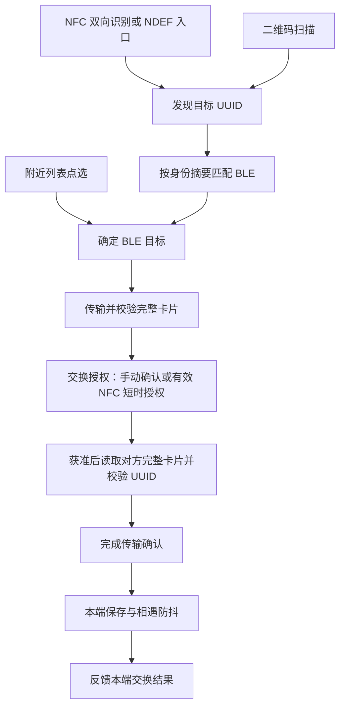

# 碰碰娃开发与工程化方案

- 状态：待评审；本文提出实施方案，不表示改造已落地。
- 编写日期：2026-11-02。
- 适用范围：当前 Android 项目、PR 协作、测试验收及 GitHub APK 分发。
- 评审入口：本文件；后续通过同一路径的 PR 讨论与修订，避免多个方案副本。

## 1. 结论与目标

**保留 Kotlin + Jetpack Compose 和现有八模块结构，先补齐真实交换与发布的质量闭环，再按需求扩展功能。** 不重搭框架，不为尚未确定的 iOS、云同步或大团队协作引入基础设施。

项目已经具备协议状态机、模块化、单元测试、Debug CI、Compose 预览、Nightly 分发和应用内更新。当前最重要的不是增加工具数量，而是让以下结论有可追溯证据：

1. 用户从 NFC、二维码或附近列表识别对方后，确实能通过 BLE 交换完整扩列卡片；失败不能误报成功。
2. 迭代和覆盖安装不会意外丢失身份、集邮册、卡片或本地合影。
3. 每个合并与发布决定都有对应的自动检查、运行记录和负责人。
4. 签名材料不进入非受信构建；Release 优化后的行为经过独立验证。

非目标：本期不做 iOS/KMP、账号服务、云同步、开机自启、密码学身份认证或应用市场接入；不把工程化方案当作这些功能的立项。导出与备份属于后续产品决策，不假定当前已经支持。

## 2. 现状与约束

| 领域 | 当前依据 | 方案判断 |
| --- | --- | --- |
| 平台与构建 | [版本目录](../gradle/libs.versions.toml)、[根构建](../build.gradle.kts)、[应用构建](../app/build.gradle.kts)：原生 Kotlin/Compose，minSdk 29、compileSdk 37、targetSdk 36；JVM 编译目标 17 | 开发与 CI 统一 JDK 21、仓库 Wrapper；升级工具链单独评审，不与业务变更混做 |
| 模块 | [模块说明](modules.md)：一个 app、七个 core 库；model/protocol 为 Kotlin/JVM | 延续现有依赖边界，不再另建平行的 domain/common 层 |
| 交换 | [协议](protocol.md)：三类入口负责识别，完整卡片统一经 BLE 分块、校验与确认 | 识别成功与交换成功严格分离；文档历史描述与当前协议不一致时，以协议及实现为准 |
| 数据 | 自身卡片在 SharedPreferences，集邮册 SQLite v2 增加 card BLOB；合影在本机保存，见[协议存储说明](protocol.md#本地存储与验证)及 README | 保持现有数据格式；不为统一技术栈而迁移 Room/DataStore |
| CI | [主工作流](../.github/workflows/ci.yml) 构建 Debug、运行 JVM/Android 单测及更新清单脚本测试 | 已有自动化不是空白；当前未包含 Lint、Release 构建和设备端到端门禁 |
| UI | [运行截图记录](screenshots/custom-card/README.md)、[预览工作流](../.github/workflows/compose-previews.yml) | Layoutlib 图集辅助评审，不能代替 Android 运行截图，也不等于视觉差异断言 |
| 发布 | [发布说明](release.md)：正式版/Nightly 通道隔离，手动联网检查，下载后验证摘要、APK 身份与签名 | 保留同签名覆盖升级和用户确认；固定 Nightly 签名是否已配置，不能从源码确认 |
| 验证缺口 | [双机待验收项](screenshots/custom-card/README.md#尚未验证不能标为完成)明确保留真实 NFC/BLE、并发申请、不同 MTU/品牌等未验证项 | 历史测试数字和单模拟器截图不作为当前版本的端到端结论 |

本文基于仓库静态调研。没有查询 GitHub 的 Secrets、分支保护和实际 CI 状态，没有读取签名私密文件，也没有重新执行 Android 构建或设备验收。

## 3. 开发架构与业务不变量

### 3.1 依赖方向

沿用现有模块职责，具体依赖图和代码放置规则以[模块说明](modules.md)为准：

- `core:model`：身份、卡片、校验、通用编码；不依赖 Android 和传输协议。
- `core:protocol`：发现、申请、分块与交换状态机；时间由调用者提供，支持 JVM 确定性验证。
- `core:bluetooth` / `core:nfc`：平台适配；不访问 app 单例、通知或业务 UI。
- `core:data`：本地数据与偏好设置；`core:media`：有界图片处理及相册操作。
- `core:designsystem`：主题、通用组件和图标；不承载交换业务。
- `app`：业务页面、状态组装、生命周期、控制器、通知、前台服务及 HCE 服务入口。

开发规则：先找到现有状态机或存储入口再修改，不在 UI、通知和硬件回调中分别实现同一规则。业务复杂度确实增长时才提取小型协作者，不先引入通用事件总线、全套依赖注入框架或强制 feature 模块化。

### 3.2 关键数据流



图为目标业务路径，不代表当前保存结果已经反馈到交换状态，也不代表跨设备原子事务。最后确认或本地写库故障可能导致单侧有记录，必须如实处理，不能承诺“两端同时提交或同时回滚”。

必须保持的不变量：

- NFC/二维码识别不能直接入册；二维码展示、NDEF 拉起不能自动等同于双方同意。
- NFC 私有协议只对刚识别的对应 UUID 提供 30 秒内一次自动同意，不能扩大成全局免确认。
- 未收齐、乱序、越界、非法卡片、身份不匹配、拒绝或超时不产生成功记录。
- 同意前不能读取对方完整卡片；保持现有待处理数量、超时和拒绝冷却规则。
- 每次传输使用卡片快照；途中编辑不能改变当前会话的 total、内容和身份。
- 前台会话结束清理相关扫描、连接和临时缓冲；显式开启后台广播时保留其独立服务策略，不把所有后台能力一律关闭。
- 同一个人的重复相遇经过现有防抖，不以蓝牙 MAC 地址作为长期身份。
- UUID 和摘要用于识别、匹配，不提供防冒充认证；对外说明不得使用“身份已认证”。

### 3.3 UI 与生命周期

延续现有“页面外层处理硬件/权限/生命周期，Content 组件接收状态和回调”的方式。编辑草稿继续由 ViewModel 管理；新增长时操作应明确归属 Activity、ViewModel、前台服务还是协议会话，不让 Composable 重组重新启动任务。

涉及旋转、退后台、通知点击、图片选择器返回、权限撤销的改动，必须写明状态保留与清理规则。运行预览只证明渲染；真实页面负责验证权限和硬件接入。用户可见术语遵循[术语库](terminology.md)，视觉规范遵循[设计系统](design-system.md)。

### 3.4 优先验证的代码级风险

以下为静态证据及风险推断，不是已经复现的故障；先做定向验证，再实施最小修复。

| 优先级 | 证据与风险 | 建议与验收 |
| --- | --- | --- |
| P1：保存结果 | [MeetingRecorder](../core/data/src/main/kotlin/app/pengwa/meeting/MeetingRecorder.kt) 先消费防抖，再异步写库，返回 true 只表示开始记录；传输状态不能据此证明入册 | 将本地保存成功/失败作为独立可观察结果。注入提交失败时不显示已入册、不发成功事件；失败后可重试，成功重试不重复计数；不引入跨设备事务 |
| P1：迟到回调 | [NfcTagExchanger](../core/nfc/src/main/kotlin/app/pengwa/nfc/NfcTagExchanger.kt) 阻塞读取结束后向主线程投递 onPeer，投递点没有再次检查角色/会话。推断：切页或暂停后的旧结果可能触发后续发现 | 定向覆盖读取中切角色、切页、暂停和销毁；旧结果不能激活过期会话。若复现，复用既有会话归属机制，不新增全局状态体系 |
| P1：迁移回归 | 当前存在实际 v1→v2 模拟器验证记录，但不等于持续自动守护存储行为 | 固化旧库合成 fixture，验证时间/次数/身份不变、旧身份不覆盖完整卡片、完整空卡片可清空内容，以及事务失败不半更新 |
| P1：协议兼容 | D2 发现载荷、01 基础身份与 PWC2 完整卡片用途不同；完整字段使用 modified UTF-8，不能随意换普通 UTF-8 | 在现有测试上补缺失的固定字节样例和版本兼容用例，包含非 BMP 字符、旧码只识别、旧 NFC 拒绝及新主动端对旧 GATT 明确失败；不重复已有覆盖 |

ViewModel 草稿当前只保证对应生命周期内保留，不能把旋转保留描述成进程死亡后恢复。上述风险验证与必要修复纳入 M2。

## 4. 数据演进与安全边界

### 4.1 本地数据

- 数据库 schema 变更使用递增版本与明确迁移，不删除重建用户数据；身份和设置键名的改动也视为迁移。
- 迁移验收使用含旧卡片、相遇次数、时间和合影关联的合成数据，从受支持旧版实际升级并重启读取，不能只证明 SQL 执行成功。
- 验证旧式基础身份交换不覆盖已保存完整卡片，完整卡片空内容仍能按协议清空旧内容。
- 修改合影路径或移除逻辑时，同时核对数据库/关联记录和文件生命周期，区分解除关联、应用私有文件和系统相册原图。
- 不承诺降级兼容；schema 变化后的修复采用更高 versionCode 的前向修复版本，不要求用户卸载或清空数据。

### 4.2 外部输入与隐私

沿用现有体积、数量、URL、图片尺寸、编码和分块约束，不因 UI 展示成功放松边界校验。协议改动先更新[协议文档](protocol.md)，明确新旧双方行为，再更新实现和消费者；新增格式不静默丢字段冒充成功。

日志仅记录阶段、状态、错误分类、耗时等诊断信息，不记录完整 UUID、显示名、账号、卡片载荷、照片或蓝牙地址。使用统计继续默认关闭，使用固定事件，不上报异常原文。若启用线上统计，按[统计说明](analytics.md)补齐服务运营主体、部署区域、IP/访问日志与数据保留策略，并验证开启、关闭、重启和断网行为；不承诺关闭后撤回已在途请求。

## 5. 日常开发与协作

### 5.1 一次需求的交付路径


- 需求说明至少包含入口、成功结果、失败结果和是否涉及协议/存储/UI；不以“完成重构”替代用户结果。
- 一个 PR 对应一个可评审目标；签名、工具链升级和业务功能尽量分开，避免无法定位回归。
- 修改公开接口同步迁移所有调用者；除协议文档已明确要求的新旧互通外，不保留废弃别名和无用途兼容层。
- PR 使用[现有模板](../.github/pull_request_template.md)，填写执行过的命令、设备、构建版本及未验证项，不复制历史“全部通过”。
- 协议、数据升级、签名与发布权限改动由相应维护者重点评审。小团队可以一人兼任多个角色，但不能省略检查项。

### 5.2 环境与统一入口

使用 JDK 21、仓库 Gradle Wrapper，Android SDK 包与 CI 保持一致：`platforms;android-37.0`、`build-tools;36.0.0`、`platform-tools`。依赖版本只在版本目录维护；代理、SDK 路径和本机 JDK 路径不写入共享配置。以下使用 `bash ./gradlew`，不依赖 Wrapper 的可执行位。

**现有可执行验证命令**，不是声称 CI 已全部接入：

```bash
# 所有 JVM 与 Android 库/app 单元测试、Debug 构建
bash ./gradlew :core:model:test :core:protocol:test testDebugUnitTest :app:assembleDebug

# Android 模块静态检查；根任务避免只检查 app 而漏库
bash ./gradlew lintDebug

# 在不含签名材料的隔离检出环境验证 Release/R8
bash ./gradlew :app:assembleRelease

# 更新清单、图集与预览发布器的现有脚本测试
python3 -m unittest discover -s scripts -p 'test_*.py'
node --test scripts/test-publish-previews.mjs

# 生成静态评审图集，不是设备端验收
bash scripts/render-previews.sh
```

无签名配置时 Release 预期产物为 `app-release-unsigned.apk`，不能上传发布。正式签名、版本参数、清单生成与上传按[发布说明](release.md)执行。Gradle 配置会尝试读取签名属性，要求不接触密钥的检查必须在无密钥环境运行。

## 6. 质量门禁与验证矩阵

### 6.1 自动化分层

| 层级 | 必须验证的结果 | 工具与实施范围 |
| --- | --- | --- |
| 纯逻辑 | 编码边界、状态转换、授权、重复/乱序/超时、旧版兼容 | 复用 model/protocol JVM 测试；对新增易错边界增加确定性回归测试 |
| Android 适配 | 数据升级、权限撤销、生命周期清理、通知入口 | 复用现有测试；需要系统语义的路径用设备运行验证，不靠 mock 回声证明 |
| 静态与产物 | 所有模块 Lint、Debug 构建、Release/R8 构建 | 建议加入 PR 必须检查；现有 warning 逐项记录负责人，新增 error 阻断合并，不整体关闭规则 |
| 工程脚本 | 更新元数据错误、图集路径、发布来源与不可信附件拒绝 | 将上节已有 Python/Node 测试纳入 CI，避免仅测应用而漏发布工具 |
| UI | 关键状态、窄屏、大字体、浅深色及可点击行为 | Preview 辅助 + 运行中应用截图及操作记录 |
| 硬件与升级 | 双机真实交换、签名覆盖、数据保留、系统安装授权 | 专用测试设备与发布候选 APK；构建和单测不能替代 |

永久测试聚焦消费者可见行为、边界与状态，不锁死函数内部结构、文案副本或无意义的“未抛错”。不为追求覆盖率百分比批量增加低价值测试。

建议工作流调整：PR 保留只读 Debug/单测流程，补 Lint、无密钥 Release 构建和脚本测试；main 才进入可信签名与 Nightly 发布路径。预览渲染与有写权限的评论发布继续隔离，保持默认分支可信代码校验 artifact，不执行 PR 附件脚本。门禁在成功跑通后由维护者配置分支保护；本方案不假定远端已开启。

### 6.2 设备验收用例

| 场景 | 操作与预期 | 证据要求 |
| --- | --- | --- |
| 三入口交换 | 双真机分别走 NFC、真实相机扫码、附近列表；传带头像和四类内容块的卡片，核对双方内容与目标身份 | 两端版本、品牌/型号/API、步骤、结果与日志摘要；NFC 交换角色再做 |
| 授权与异常 | 同意、拒绝、无人处理、双向同时申请；中途断蓝牙、撤权、退后台、移远后重试 | 未完成时不误报入册；记录单侧完成等实际边界，不要求不存在的分布式事务 |
| 前后台 | 设置关闭/开启后台广播，息屏、省电、通知同意/拒绝，再回前台 | 默认关闭；后台不主动扫描；系统拦截通知与杀后台限制如实记录 |
| 系统差异 | 覆盖 Android 10/11、12+ 蓝牙权限分界及当前目标系统；NFC 至少两种品牌组合，钱包争用设备重点覆盖 | 写明已覆盖组合；无设备的组合保留未验收，不外推兼容所有品牌 |
| 数据升级 | 旧版合成数据覆盖安装到候选版，检查身份、次数、时间、完整卡片、合影，杀进程后重读 | 同签名、不卸载、不清数据；对 schema 变更覆盖受支持升级路径 |
| 应用更新 | 连续两版同签名候选包走真实下载、校验、安装授权、确认/取消和覆盖安装 | 数据保留；异签/错误 hash/错误包名被拒绝；打开安装器不计为安装成功 |
| Release 专项 | 使用实际 R8/资源裁剪候选包执行交换、后台通知、照片和更新路径 | 记录 APK SHA-256、证书指纹、提交及构建号，不能只提交 Debug 证据 |

UI 变更严格执行仓库规则：已有界面提供同场景前后截图，新增界面提供新增后截图；使用运行中的 Android 应用，注明设备/API、状态和步骤，使用合成数据。涉及主题与适配时覆盖对应状态。截图缺失即未完成 UI 交付；Compose 图片评论不能抵扣。

## 7. 签名、发布与供应链

### 7.1 优先收紧签名信任边界

当前 `ci.yml` 在共同构建 job 中恢复固定 Nightly 调试密钥，然后执行检出提交的 Gradle 代码，未限制该步骤只在 main 事件运行。**风险推断：能获得 Secret 的同仓 PR 构建可读取该密钥；fork PR 默认无 Secret 不能证明所有 PR 都安全。** 这是待修正的信任边界，不是已经发生泄露的结论。

推荐改造：

1. PR 不注入稳定签名材料，只使用临时 Debug 签名；不授予写仓库权限。
2. 仅受信 main 构建使用独立固定 Nightly 调试签名，并发布该次实际测试过的同一 APK。
3. 固定签名缺失时允许普通构建，但阻断可覆盖更新 Nightly 的正式发布路径，明确失败原因。
4. 正式发布密钥与 Nightly 密钥始终分离；正式签名保持维护者受控操作，不放进 PR 构建环境。
5. 验收核对 PR 步骤没有稳定签名输入，以及连续两次 main APK 的证书一致并可保留数据覆盖安装。Secret 是否已配置由维护者检查，不输出密钥内容。

### 7.2 发布检查与恢复

- 发布前冻结提交与版本号，完成上节 Release 设备矩阵；生成 APK 摘要、证书、版本、变更说明和验证记录。
- `apksigner verify --verbose --print-certs` 校验实际签名 APK，不能仅引用文档中保存的历史指纹；无签名产物不发布。
- 保留 Nightly 唯一资产名、旧 main 提交不覆盖新版本、先上传 APK 再换清单的策略。该流程并非原子发布；窗口失败可重新检查，不隐藏失败。
- 正式版只更新正式通道，Nightly 保持 prerelease、非 latest。正式版本参数显式传入，不复用示例版本号。
- 出现数据风险或严重交换回归时，先停止推广问题版本并说明影响范围；使用相同签名、更高版本号的前向修复，不能建议用户卸载。撤回资产不能修复已安装设备。
- 维护者保管至少两份离线密钥备份并验证可恢复；打包分享仓库时排除 secrets，不把 gitignore 当作备份和防泄露机制。

### 7.3 供应链与资源管理

保留 Action SHA 固定、集中依赖版本、仓库来源限制；后续补充 Wrapper 分发校验和，评估依赖完整性校验与受控升级流程。不在未验证前声称构建逐字节可复现。

依赖更新单独 PR，核对最低系统、体积、权限与开源许可，更新 [third_party](../third_party/README.md) 中受影响声明。静态预览图片分支有 Git 历史，不会随 artifact 保留期自动清除；只放合成数据，制定容量与保留规则。自动化代理权限与模型数据处理政策需要维护者核对，不能从工作流存在推断已安全启用。

## 8. 性能与可观测性

先建立可重复基线，再决定优化，不把“原生”“压缩后 APK 小”当作低内存或低功耗证据。

建议在固定测试设备、固定卡片和相同构建类型记录：冷启动耗时、稳态 PSS、连续交换后的内存回落、不同 MTU 下大卡片耗时、前台扫描与后台广播的息屏耗电、APK 下载大小和安装占用。每次注明提交、设备、系统、操作与采样方法，Release 对比 Release。

第一轮数据只作基线；本方案不虚构当前吞吐、成功率或内存 SLO。出现用户可感知回归或持续资源增长即定位原因；有稳定样本后再确定阻断阈值。不能通过删减卡片内容、放松校验或常开扫描换取表面成功率。

诊断优先复用实验室与现有 NFC/BLE 日志；先保留复现条件、状态阶段、耗时和失败分类，再决定是否需要额外统计。双机日志不写身份与卡片内容，截图上传前脱敏。

## 9. 分阶段实施与验收

阶段表示依赖顺序，不是工期承诺；维护者确认人员和设备后再排期。

| 阶段 | 交付物与改动范围 | 主责角色 | 退出条件 |
| --- | --- | --- | --- |
| M0：信任边界 | 调整 Nightly 签名注入与发布条件，核对远端配置 | 仓库/发布维护者 | PR 无稳定密钥；固定签名缺失不发布可更新 Nightly；连续两版覆盖安装保留数据 |
| M1：自动门禁 | 补 Lint、无密钥 Release 构建、脚本测试及报告；接入分支保护 | Android/工程维护者 | 检查实际跑通；失败不能合并；fork 无签名材料仍能执行普通验证 |
| M2：真实链路 | 双机三入口、异常中断、前后台、Release、升级的验证记录和必要修复 | Android 开发 + 测试/维护者 | 关键矩阵逐项有证据；未完成硬件项不得标通过；UI 变更附所需运行截图 |
| M3：稳定迭代 | 数据/协议演进流程、性能基线、依赖校验与发布清单 | 模块维护者 + 发布维护者 | 至少一个候选版按完整流程发布，问题能定位到提交、产物与设备场景 |

不要求先重构控制器再做 M2；应先用端到端证据定位真实故障，仅在职责耦合阻碍修复或测试时拆分。后续功能开发可以继续，但涉及交换、数据或升级的发布必须满足对应验收门槛。

## 10. 取舍与待评审事项

| 决策 | 推荐 | 未选择方案及原因 |
| --- | --- | --- |
| 应用架构 | 保持现有模块与小型显式组装 | 全面 Clean Architecture/DI/feature 拆分增加迁移面，当前没有收益证据 |
| 本地存储 | 先保障现有 SQLite/SharedPreferences 迁移与行为 | 整体改 Room/DataStore 不能直接补齐双机和数据安全证据 |
| 测试策略 | JVM 状态机 + Android 真实场景，设备证据单列 | 只靠模拟器或 mock 无法验证 NFC 路由与 BLE 栈；纯手测无法稳定守住编码边界 |
| 分发 | 保留受控 APK 与同签名更新 | 上应用市场、引入后端不属于本次工程化前置条件 |

待评审，但不阻塞已明确的 M0/M1 工作：

- 支持设备范围：维护者列出现有真机，确定首个支持矩阵；设备不足时选择借测或缩小对外兼容声明，不能补写“已验证”。
- 维护职责：指定签名保管、发布审批、协议/数据评审和验证记录负责人；小团队可兼任。
- 性能预算：M2/M3 测量后确定卡片耗时、PSS、功耗及产物体积阈值，不先填无依据指标。
- 本地数据可恢复性：是否投入导出/备份需要独立产品与隐私评审；在实现前明确告知卸载/清数据会丢失本机数据，不暗示系统备份必然可恢复。

## 11. 本文交付与验证范围

本次只新增工程方案并在 README 添加入口，不修改应用、协议、CI 或发布行为。UI 截图：不适用，没有用户可见应用界面变更。

文档检查包括本地引用可达性、Markdown 围栏结构，以及方案命令与现有脚本/Gradle 配置的静态核对。Android 构建、双机通信、签名覆盖安装、线上统计和远端权限配置均不是本次文档变更已完成的验证；它们是上述实施阶段的验收工作。
