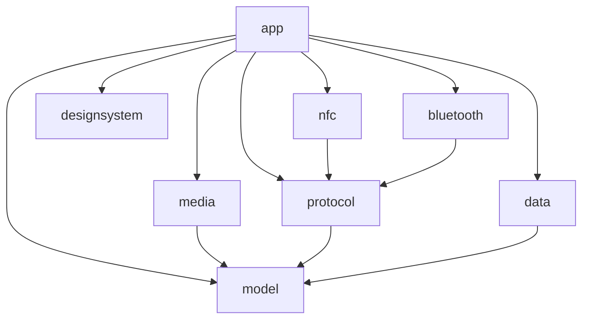

# Gradle 模块

项目分为一个应用模块和七个库模块。包名保持原样，模块边界由 Gradle 依赖约束；`app` 和 `designsystem` 使用 Compose 插件。

| 模块 | 类型 | 职责 | 项目依赖 |
| --- | --- | --- | --- |
| `:core:model` | Kotlin/JVM | 身份、卡片、联系人、显示名规则、共享名片编解码、相遇防抖 | 无 |
| `:core:protocol` | Kotlin/JVM | BLE、NFC、二维码协议、窗口发送、发现定位、交换计时与状态机 | model |
| `:core:data` | Android Library | SQLite、SharedPreferences、相遇落库与事件 | model |
| `:core:bluetooth` | Android Library | Android GATT、扫描、广播、权限 | protocol（公开 model） |
| `:core:designsystem` | Android Library / Compose | 主题、颜色、字体、尺寸规则、通用组件与 Phosphor 图标 | 无 |
| `:core:nfc` | Android Library | NFC 角色调度、IsoDep 读卡、NDEF 启动解析、默认钱包接入 | protocol（公开 model） |
| `:core:media` | Android Library | 有界图片导入/解码、临时照片与相册保存 | model（实现依赖） |
| `:app` | Android Application | 业务界面、导航、应用组装、生命周期、通知、前台服务与 HCE 服务入口 | 上述七个模块 |



## 放置代码的规则

- 不依赖 Android 的模型、校验与通用编码放在 `model`。基础名片格式由 `identity/IdentityCodec.kt` 管理，BLE 预览也复用显示名编码和严格 UTF-8 校验。模型不依赖任何传输协议。
- 通道协议、分块、发现和交换状态机放在 `protocol`。时间由调用方传入，测试直接在 JVM 执行。ZXing 的 `BitMatrix` 和交换状态的 `StateFlow` 属于公开 API，因此相应依赖使用 `api`。
- 本地数据与偏好设置放在 `data`。广播与常驻通知复用 `settings/BooleanSetting`，保持原有 `settings` 文件名、键名及默认关闭的行为；调用方需保留取消监听函数，以持有 SharedPreferences 弱引用的监听器。
- Android 蓝牙通信放在 `bluetooth`，通过 `BleExchangeListener` 和身份提供函数与上层连接，不访问应用单例或通知。
- 主题和无业务依赖的基础组件放在 `designsystem`，`ph_*.xml` 随图标目录迁入该模块；界面通过 `PengWaIcons` 引用图标，不跨模块访问资源类。社媒业务图标仍留在 app。
- Android NFC 能力放在 `nfc`。HCE 服务的 `ComponentName`、诊断日志、显示名片的身份提供函数、当前角色和结果回调由应用传入；库不访问应用单例、`BuildConfig` 或 BLE 总控。读卡继续在后台线程阻塞执行，结果回调继续派发到主线程。具体 HCE 服务和 Manifest 注册保留在应用层。
- 图片与相册操作放在 `media`。FileProvider 的注册、authority 和 paths 仍由 app 配置，临时文件和相册目录保持原样。
- 业务界面和系统服务入口放在 `app`。`BleExchangeController`、`BleBroadcastService`、HCE 服务和通知互相协调且访问应用单例，继续作为组装层维护。库模块不得依赖 `app`、其 `R` 或 `BuildConfig`。

根构建脚本统一库模块的 Android SDK、最低版本和 JVM 17 编译目标。依赖版本统一由 `gradle/libs.versions.toml` 管理；签名、应用 ID、targetSdk、Compose 和截图测试仍在 `app` 配置。

## 验证

```bash
# 纯 Kotlin 层
./gradlew :core:model:test :core:protocol:test

# 所有模块测试、调试包、静态检查和发布包（无密钥时保持未签名）
./gradlew :core:model:test :core:protocol:test testDebugUnitTest :app:assembleDebug lintDebug :app:assembleRelease
```

测试跟随实现迁移；`core/protocol` 中的 `CardCodecTest` 覆盖完整卡片经 BLE 分块传输以及 NFC 仅发现身份的跨通道行为。CI 执行两个 JVM 模块的 test 和根目录 testDebugUnitTest（涵盖所有 Android 模块），并上传各模块报告，避免仅运行 `:app:testDebugUnitTest` 时漏掉库模块测试。

本次本地验证：205 项测试全部通过（model 39、protocol 154、app 12），Debug 与 Release 构建成功，所有 Android 模块的 `lintDebug` 通过，无 error，仍有依赖版本、KTX 建议等 warning。Android 库目前没有独立单元测试，其测试任务为 NO-SOURCE。迁移的 18 个 Phosphor 图标资源与 4 个主题源码文件逐字节比对一致。

本次重构保持 UI 渲染、资源内容、通知文案、数据库版本及通信格式不变，主题与图标仅调整代码和资源归属。UI 截图：不适用。PR 接在性能优化 stack 的窗口下载 PR #28 上方，保留其二进制图片、交换确认、发现定位、窗口发送以及现有附近信号展示和引导页行为。构建与单元测试不能替代真机双端 NFC/BLE 验证。
