# Aptabase 设置界面验证与 PR 图片附录

## 环境

- Android Emulator，AVD `PengWaNavigation` 的独立只读实例，`emulator-5564`。
- Android 16 / API 36，标准分辨率 1080 × 2400，420 dpi，字体 1.0 倍；浅色及深色主题。
- 窄屏：720 × 1280、360 dpi（320dp 宽），字体 1.5 倍。
- 图片由运行中的 Debug 应用通过 `adb exec-out screencap -p` 获取，不是 Layoutlib 图片。
- 变更前使用添加埋点之前构建的 APK；变更后使用当前 APK。设置内容均来自 `SettingsContent`。
- 测试入口使用合成状态，未读取真实联系人，没有真实姓名、ID 或照片；没有配置真实 App Key，截图流程不发送统计。

## 前后截图（可复制到 PR 描述）

真实主页进入的设置弹层，向上展开后截图（测试身份 `TelemetryTest` / 固定合成 ID）：

| 页面 / 状态 | 变更前 | 变更后 |
|---|---|---|
| 设置弹层展开，浅色 | 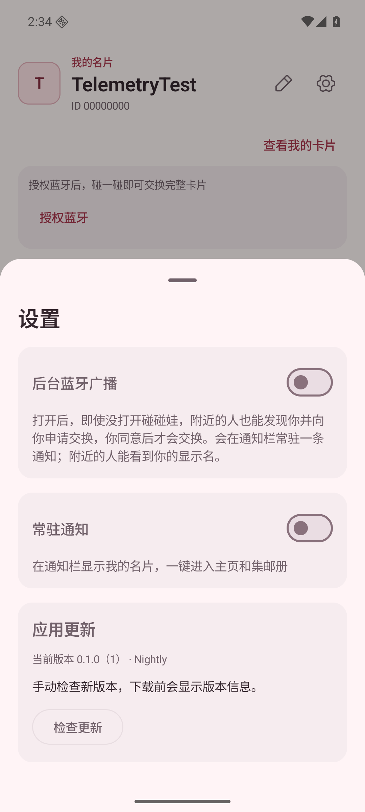 | 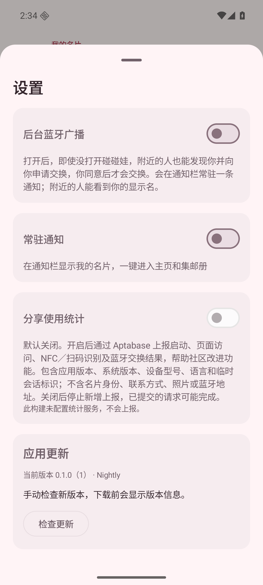 |
| 设置弹层展开，深色 | 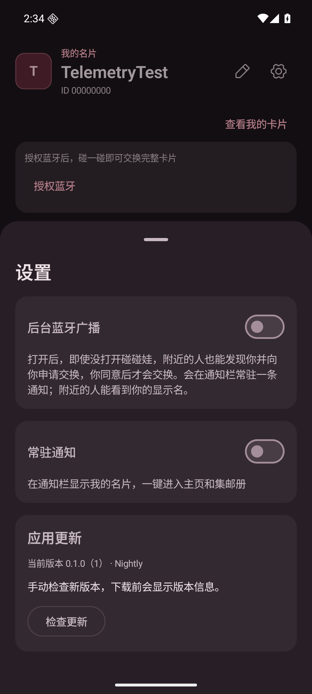 | 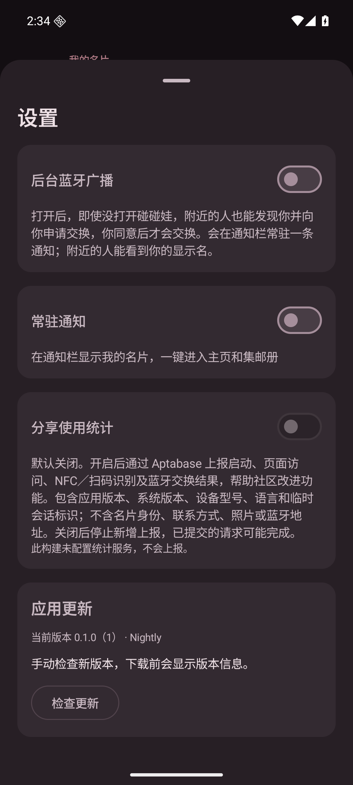 |

完整设置内容与关键状态：

| 页面 / 状态 | 变更前 | 变更后 |
|---|---|---|
| 设置，浅色，未配置统计 | 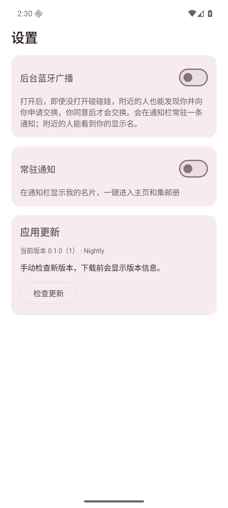 | 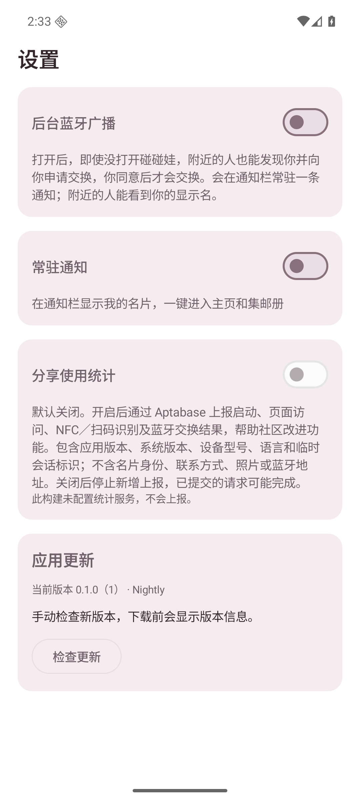 |
| 设置，深色，未配置统计 | 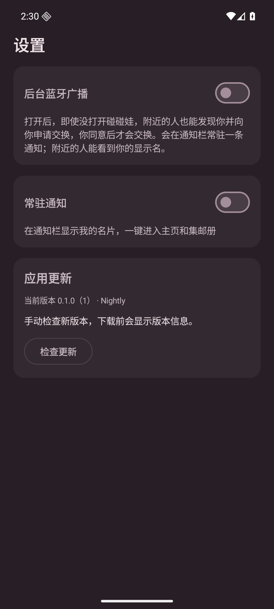 | 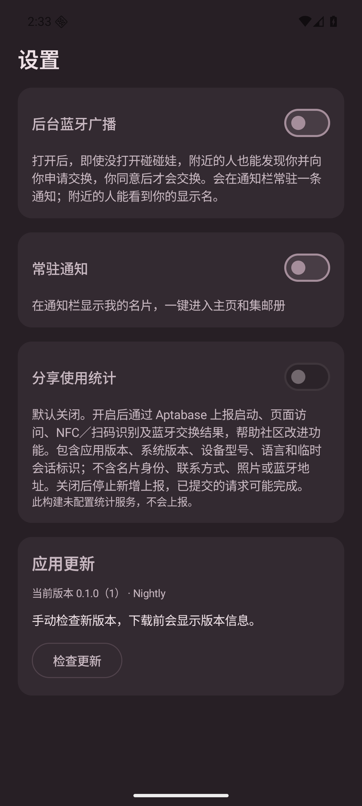 |

| 关键状态 | 浅色 | 深色 |
|---|---|---|
| 已配置，默认关闭 | 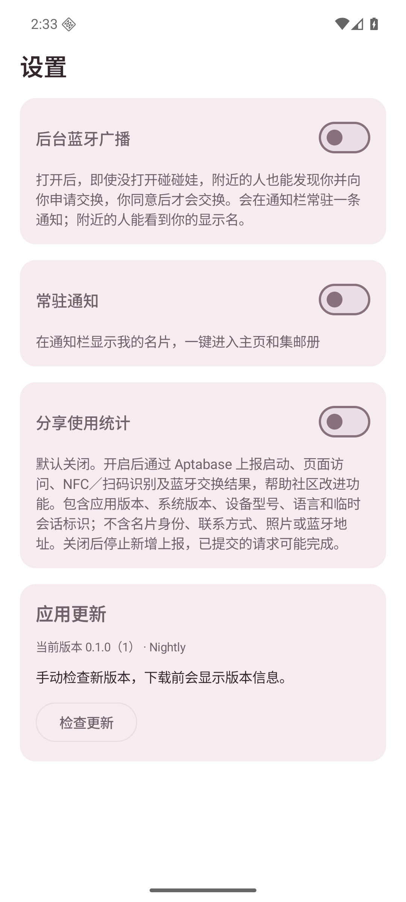 | 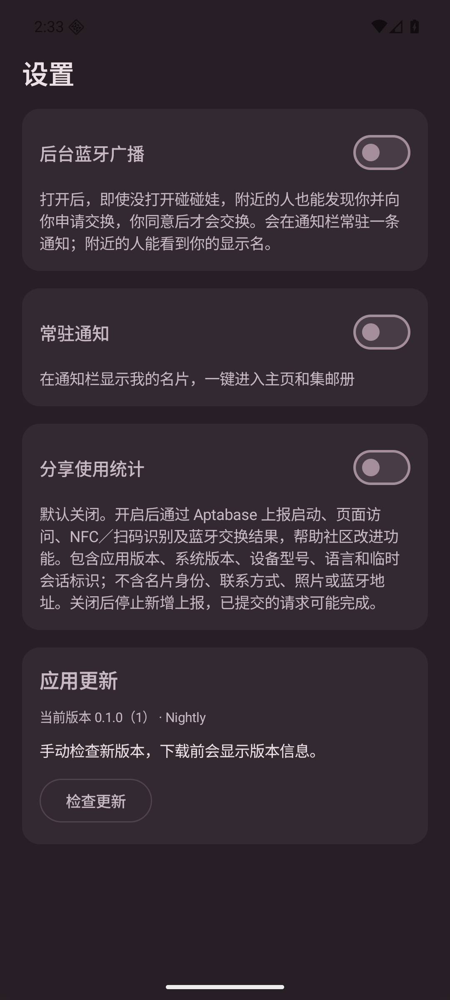 |
| 已配置，用户开启 | 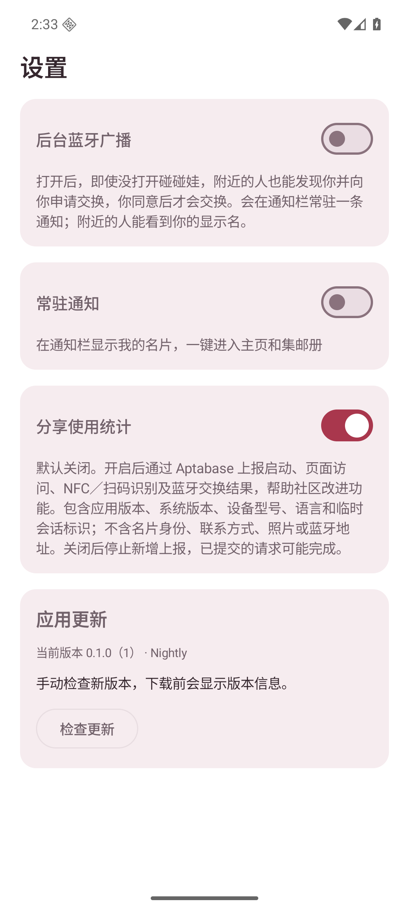 | 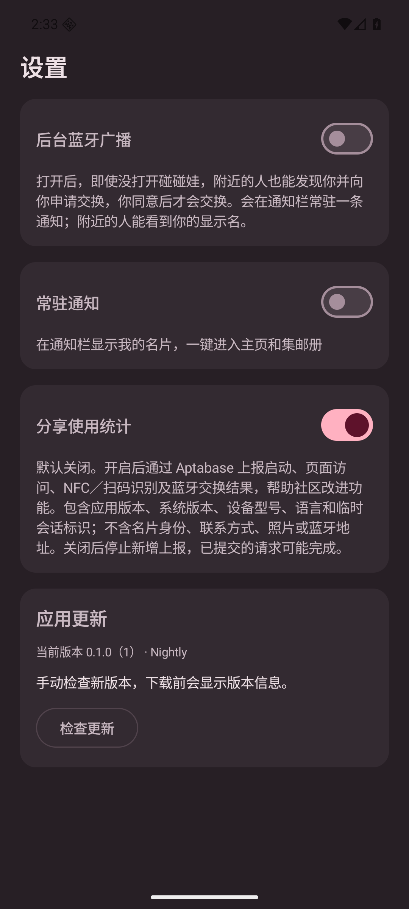 |

320dp 窄屏 / 1.5 倍字体：

| 初始位置 | 滚动到统计设置 |
|---|---|
| 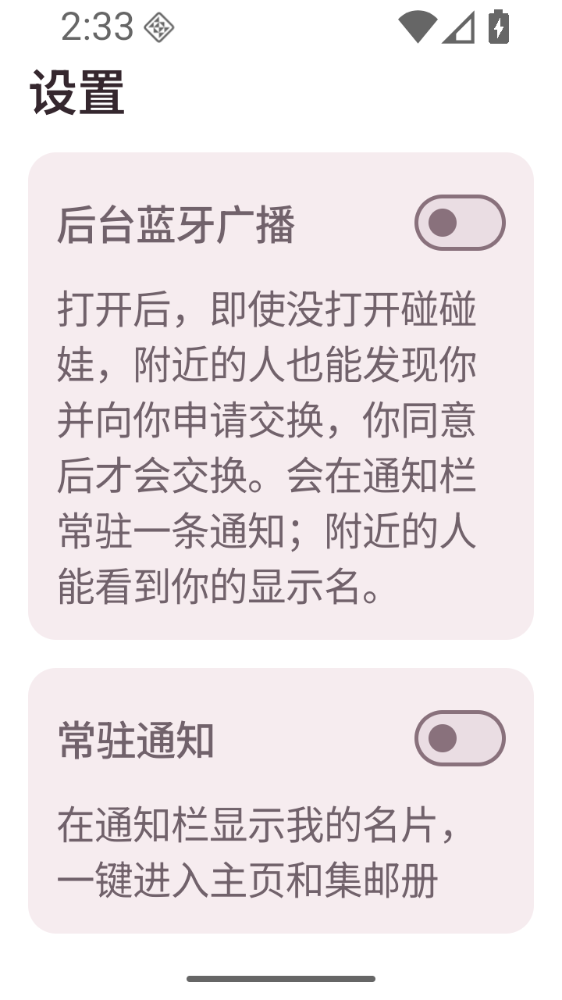 | 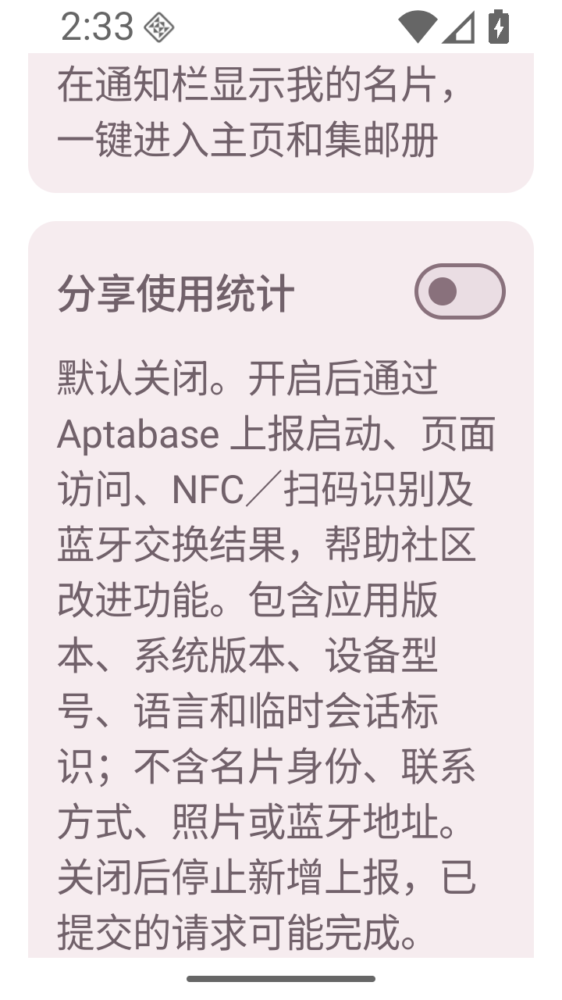 |

## 复现

```sh
bash ./gradlew :app:testDebugUnitTest :app:assembleDebug :app:lintDebug :app:assembleRelease
adb -s emulator-5564 install -r app/build/outputs/apk/debug/app-debug.apk
adb -s emulator-5564 shell cmd uimode night no
adb -s emulator-5564 shell am force-stop app.pengwa.debug
adb -s emulator-5564 shell am start -n app.pengwa.debug/app.pengwa.ui.UiPreviewActivity --es screen analytics --ei sample 0
adb -s emulator-5564 exec-out screencap -p > screenshot.png
```

真实弹层的复现：使用测试身份进入 MainActivity，点击右上角设置图标，再向上拖动弹层把手展开。

`sample=0` 未配置；`sample=1` 已配置关闭；`sample=2` 已配置开启。
后两者仅注入 UI 状态，点击开关只更新预览内存，不操作实际统计服务。
深色用 `cmd uimode night yes`。变更前使用原 APK 的 `--es screen settings` 入口。

窄屏操作：

```sh
adb -s emulator-5564 shell wm size 720x1280
adb -s emulator-5564 shell wm density 360
adb -s emulator-5564 shell settings put system font_scale 1.5
# 重启 analytics sample=1，检查后向上滑动以查看下方说明。
adb -s emulator-5564 shell input swipe 350 1100 350 350 500
# 完成后恢复：
adb -s emulator-5564 shell wm size reset
adb -s emulator-5564 shell wm density reset
adb -s emulator-5564 shell settings put system font_scale 1.0
```

## 已验证与边界

- Debug 单元测试、Debug 构建、Debug lint、Release 构建（含 R8）通过。
- 新增 5 项统计单元测试通过：配置校验、同意前与关闭后不发送、不开启时不补报、SDK 异常隔离、属性白名单。
- 运行中设置内容的浅色 / 深色与窄屏大字体状态已截图；开关使用既有 `SettingsRow` 的整行 Switch 语义。
- 真实主页设置弹层的打开和展开已截图；已配置开关的开/关状态使用预览注入。开关持久化与网络上报尚未端到端验证。
- 真实 App Key 尚未提供，Aptabase 收件、目标网络连通性、真实 NFC / 扫码 / BLE 双机交换埋点尚未实测。
- SDK 不提供可靠离线队列或取消已提交请求的接口，关闭后已提交请求仍可能完成，已在界面与文档说明。

## 行为埋点扩展：统计范围说明更新

此次界面仅更新「分享使用统计」说明，公开新增行为分类；未改变开关默认值和同意机制。
以下截图可直接用于 PR 描述：

| 页面 / 状态 | 变更前 | 变更后 |
|---|---|---|
| 设置，已配置关闭，浅色 | 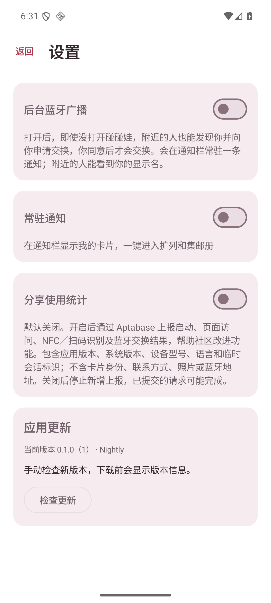 | 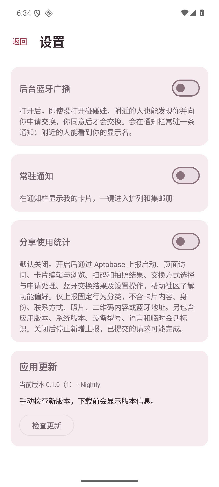 |
| 设置，已配置关闭，深色 | 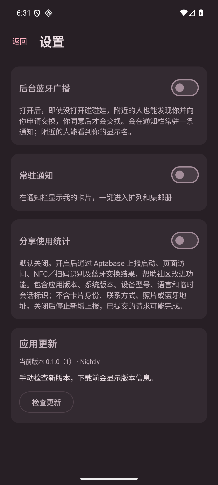 | 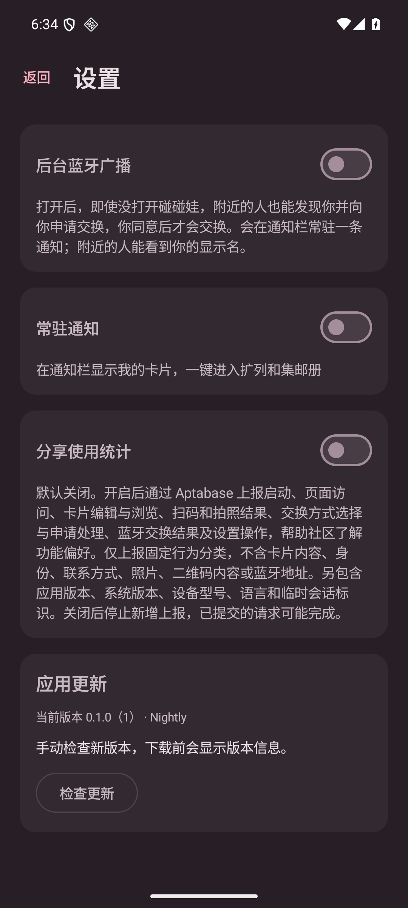 |

- 设备：AVD `PengWaNavigation` 独立只读实例，`emulator-5580`，Android 16 / API 36，1080 × 2400。
- 前后均来自运行中应用的 `UiPreviewActivity --es screen analytics --ei sample 1`，设置组件与生产共用；不是 Layoutlib。
- 前图使用本次修改前本机构建 APK，后图使用本次 `:app:assembleDebug` 产物；通过 `cmd uimode night no/yes` 切换主题，通过 `exec-out screencap -p` 截图。
- 开关为注入的已配置关闭状态，不操作真实统计配置；截图无个人信息，无真实 App Key。
- 本次 Debug 单元测试、Debug 构建、Debug lint 通过。另用真实编译后的 `Analytics` 在 JVM 运行临时 smoke runner，验证全部 45 个固定事件变体的同意门禁、不补报、无配置丢弃及传输异常隔离；不代表 SDK 或云端收件已验证。
- 模拟器生产路径使用合成身份 `TelemetryTest`，执行首次创建、自己的卡片详情、编辑预览/保存/放弃、扫码入口及拒绝相机权限、空集邮册和常驻通知开启请求/拒绝权限；当时统计未配置、未开启。
- 初次进入集邮册遇到只读 AVD 遗留的 v3 数据库与当前 v2 代码不兼容（`Can't downgrade database from version 3 to 2`）；仅清空此独立临时实例的应用数据后完成空集邮册验证，未改数据库版本或降级策略。
- 照片完成/失败/取消、非空集邮册详情、真实二维码识别、NFC/BLE 双机流程及各类真实申请决定尚未在设备上验证；真实 Aptabase 收件仍需项目 App Key 与目标网络。
