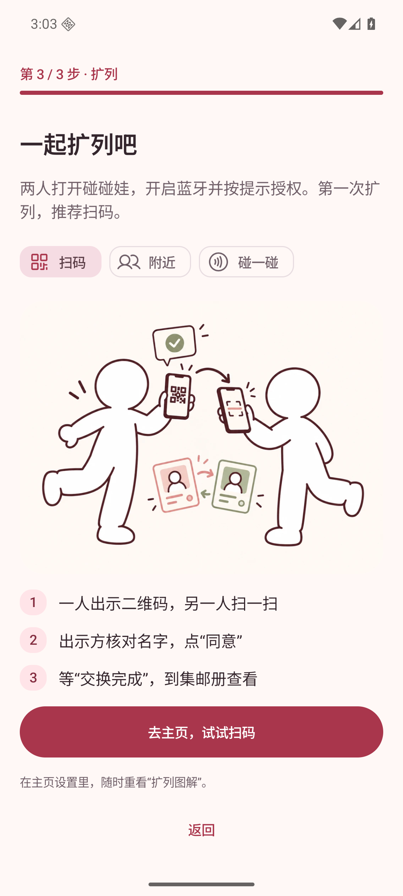
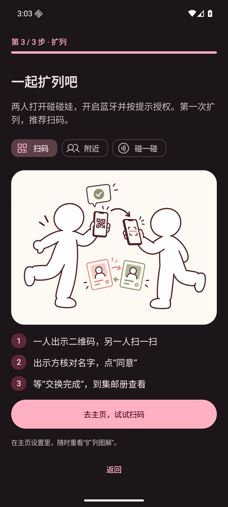
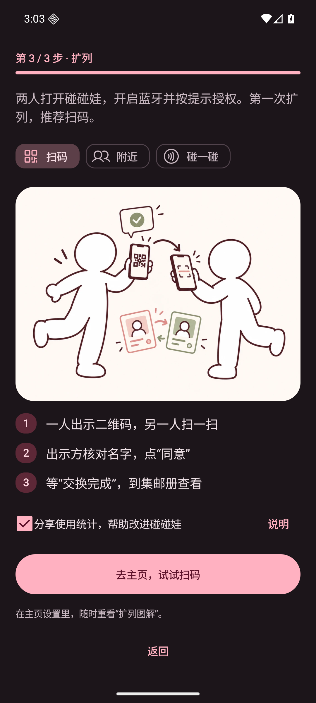
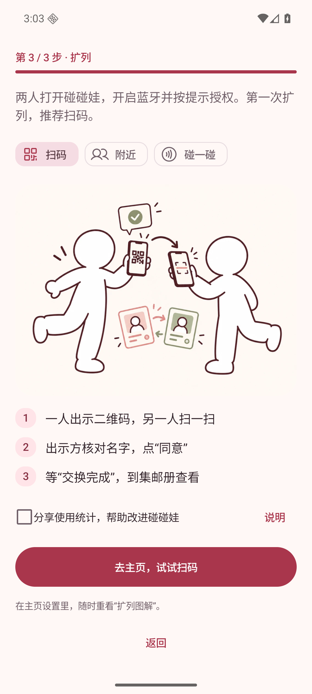
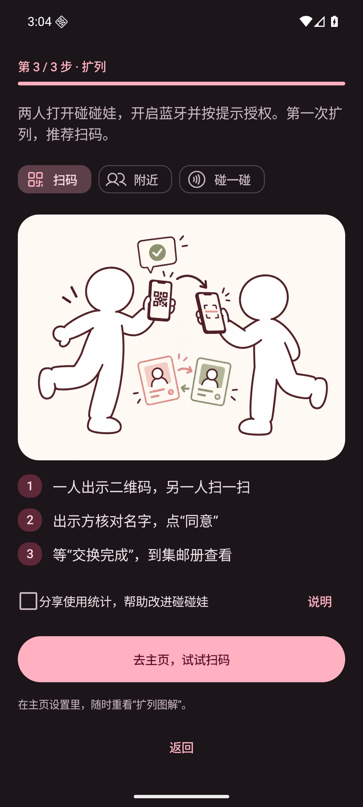
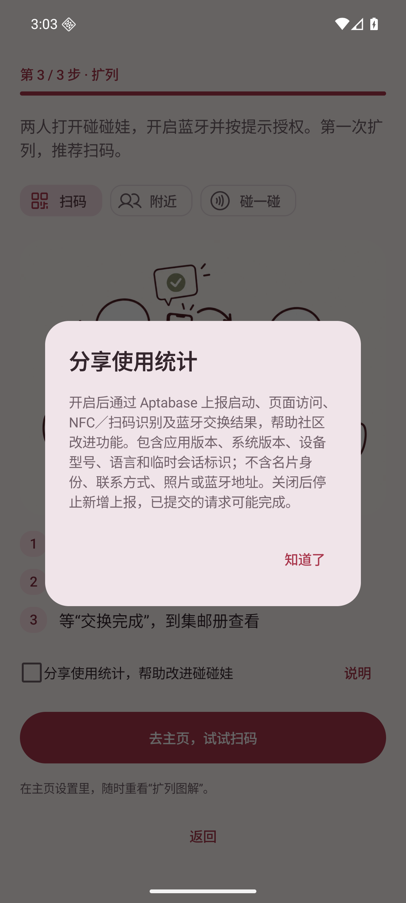
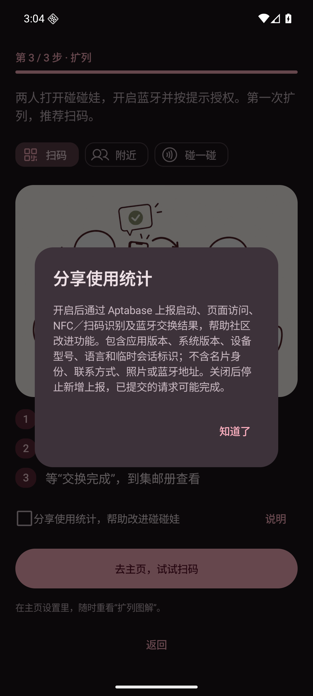
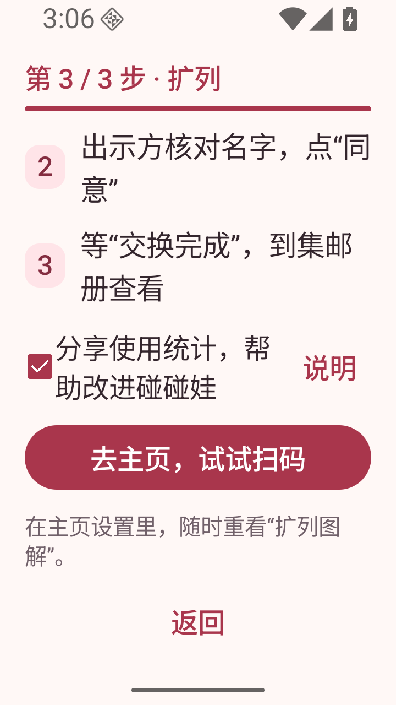
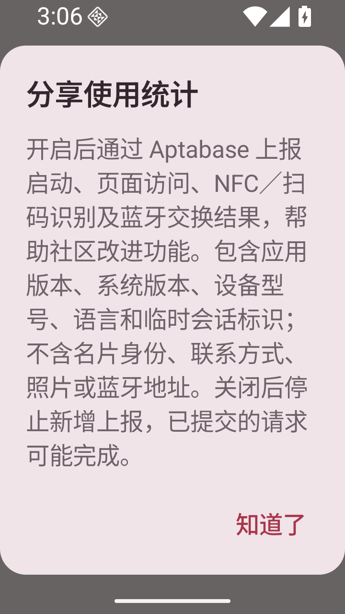

# Aptabase 设置界面验证与 PR 图片附录

## 环境

- Android Emulator，AVD `PengWaNavigation` 的独立只读实例，`emulator-5564`。
- Android 16 / API 36，标准分辨率 1080 × 2400，420 dpi，字体 1.0 倍；浅色及深色主题。
- 窄屏：720 × 1280、360 dpi（320dp 宽），字体 1.5 倍。
- 图片由运行中的 Debug 应用通过 `adb exec-out screencap -p` 获取，不是 Layoutlib 图片。
- 变更前使用主分支 a9ac122 构建的 APK；变更后使用当前 APK。设置内容均来自 `SettingsContent`。
- 测试入口使用合成状态，未读取真实联系人，没有真实姓名、ID 或照片；这些截图使用未配置 App Key 的 APK，不发送统计；另行执行的带配置 Debug 验证见下文。

## 前后截图（可复制到 PR 描述）

真实主页进入的设置弹层，向上展开后截图（测试身份 `TelemetryTest` / 固定合成 ID）：

| 页面 / 状态 | 变更前 | 变更后 |
|---|---|---|
| 设置弹层展开，浅色 |  |  |
| 设置弹层展开，深色 |  |  |

完整设置内容与关键状态：

| 关键状态 | 浅色 | 深色 |
|---|---|---|
| 已配置，关闭 |  |  |
| 已配置，用户开启 |  |  |

320dp 窄屏 / 1.5 倍字体：

| 初始位置 | 滚动到统计设置 |
|---|---|
|  |  |

## 复现

```sh
bash ./gradlew :app:testDebugUnitTest :app:assembleDebug :app:lintDebug :app:assembleRelease
adb -s emulator-5564 install -r app/build/outputs/apk/debug/app-debug.apk
adb -s emulator-5564 shell cmd uimode night no
adb -s emulator-5564 shell am force-stop app.pengwa.debug
adb -s emulator-5564 shell am start -n app.pengwa.debug/app.pengwa.ui.UiPreviewActivity --es screen analytics --ei sample 0
adb -s emulator-5564 exec-out screencap -p > screenshot.png
```

真实弹层的复现：使用测试身份进入 MainActivity，点击右上角设置图标，再向上拖动弹层把手展开。

`sample=0` 未配置；`sample=1` 已配置关闭；`sample=2` 已配置开启。
后两者仅注入 UI 状态，点击开关只更新预览内存，不操作实际统计服务。
深色用 `cmd uimode night yes`。变更前弹层使用 a9ac122 的实际 MainActivity，变更后使用 PR 分支的实际 MainActivity。

窄屏操作：

```sh
adb -s emulator-5564 shell wm size 720x1280
adb -s emulator-5564 shell wm density 360
adb -s emulator-5564 shell settings put system font_scale 1.5
# 重启 analytics sample=1，检查后向上滑动以查看下方说明。
adb -s emulator-5564 shell input swipe 350 1100 350 350 500
# 完成后恢复：
adb -s emulator-5564 shell wm size reset
adb -s emulator-5564 shell wm density reset
adb -s emulator-5564 shell settings put system font_scale 1.0
```

## 已验证与边界

- Debug 单元测试、Debug 构建、Debug lint、Release 构建（含 R8）通过。
- 新增 5 项统计单元测试通过：配置校验、同意前与关闭后不发送、不开启时不补报、SDK 异常隔离、属性白名单。
- 运行中设置内容的浅色 / 深色与窄屏大字体状态已截图；开关使用既有 `SettingsRow` 的整行 Switch 语义。
- 真实主页设置弹层的打开和展开已截图；已配置开关的开/关状态使用预览注入。设置内修改的持久化与网络上报尚未端到端验证；引导最后一步的勾选/取消勾选完成后重启均已验证 DataStore 保存结果，见下方记录。
- App Key 已配置到仓库变量，单次 Debug `integration_test` 接收请求返回 HTTP 200；控制台展示、不同目标网络和真实 NFC / 扫码 / BLE 双机交换埋点尚未核查。
- SDK 不提供可靠离线队列或取消已提交请求的接口，关闭后已提交请求仍可能完成，已在界面与文档说明。


## 引导最后一步：默认勾选的独立选项

此组变更前为 PR 初始提交 `16986a3`，变更后为本 PR 的后续提交；来自同一模拟器实际 MainActivity 的最后一步，滚动到完成按钮，使用固定测试卡片 `TelemetryTest`。

| 页面 / 状态 | 变更前 | 变更后 |
|---|---|---|
| 最后一步，浅色 |  |  |
| 最后一步，深色 |  |  |

| 关键状态 | 浅色 | 深色 |
|---|---|---|
| 用户取消勾选 |  |  |
| 统计说明 |  |  |

复现：全新安装，创建测试卡片并完成预览，进入第 3 / 3 步。滚动到完成按钮上方，确认复选项默认勾选、点击整行可取消、点击「说明」可查看字段；点击完成后重启，检查设置中的统计选择。可用测试数据迁移预置 `identity` 的 `onboarding_step=2` 直接进入最后一步。

已在未配置 App Key 的构建中分别完成取消勾选和默认勾选流程，重启后读取 `files/datastore/settings.preferences_pb`，确认 `usage_analytics` 分别为 false / true；测试不会向真实服务发数据。另用已配置 App Key 的 Debug 包重复执行这两条持久化流程；控制台事件展示仍待核查。


引导最后一步在 320dp / 字体 1.5 倍下的状态（选项文字自然换行，仍为独立一行控件；说明内容可滚动）：

| 引导选择 | 说明弹窗 |
|---|---|
|  |  |
