# 按内容密度设置默认占格

本页记录默认占格初版；当前段落自适应与空位回填见 [排布修正](../card-packing/README.md)。

链接横跨相邻两格，社交账号为紧凑一格；文字与图片为一格，按内容高度排布。列组放在当前最低的可用位置，覆盖的列共同更新高度，避免跨列重叠。网格列数只取决于可用宽度与字体大小，因此只有一个社交块也不会被拉成整行。窄屏或大字体空间不足时，链接自动回退到一列。

社交块点击即可复制完整账号，显示“已复制”反馈；有主页链接时使用独立箭头入口。长账号最多显示两行，复制与无障碍描述保留完整账号。小图继续保持图片原比例及透明轮廓。

## 环境与步骤

运行中的 Debug APK，Android Emulator `sdk_gphone64_x86_64` / AVD `PengWaIcon`，Android 16 / API 36。默认 1080×2400，density 420，字体 1.0。截图均由 adb screencap 获取。姓名、UUID、账号、链接与笑脸图片均为合成测试数据。

```sh
adb -s emulator-5554 shell am force-stop app.pengwa.debug
adb -s emulator-5554 shell am start -n app.pengwa.debug/app.pengwa.ui.UiPreviewActivity --es screen card-masonry
# 六平台：card-social；收到的卡片：card-masonry-received
# 编辑预览：card-masonry-editor，点击“预览”
# 复制反馈：card-social，点击 QQ 卡片
adb -s emulator-5554 shell cmd uimode night yes # no 恢复浅色
# 窄屏大字体：840×1680，font_scale 1.5
# 宽屏：1600×2560，font_scale 1.0
# 最后 wm size reset，font_scale 恢复 1.0
```

## 同场景前后截图

| 页面／状态 | 变更前 | 变更后 |
| --- | --- | --- |
| 混合卡片／浅色 | 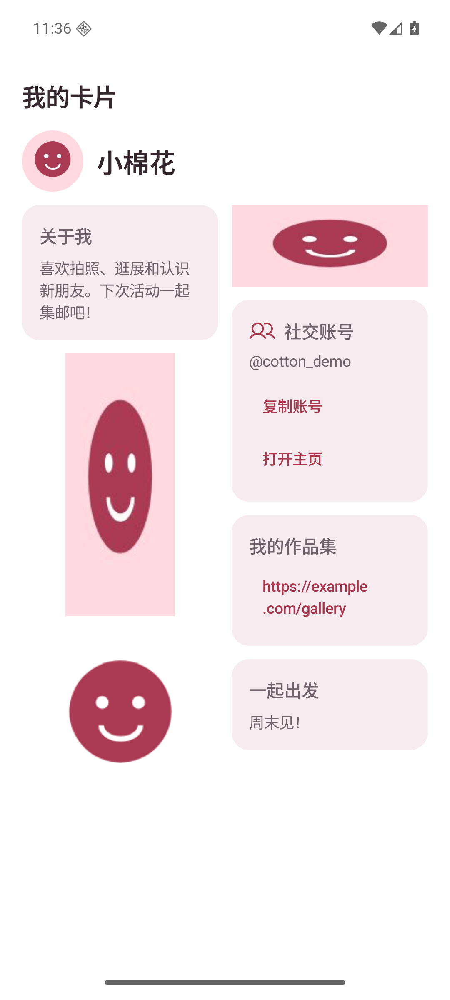 | 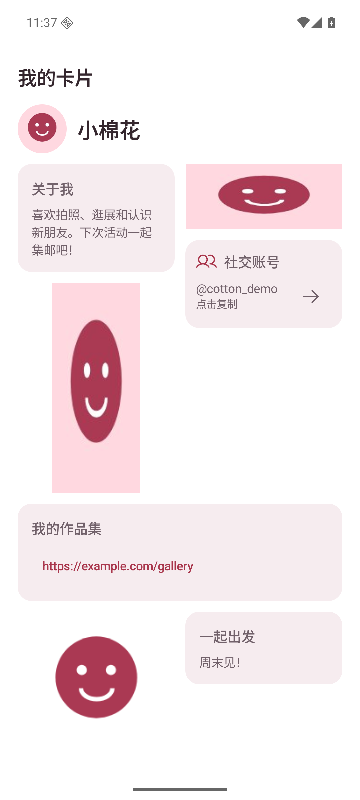 |
| 混合卡片／深色 | 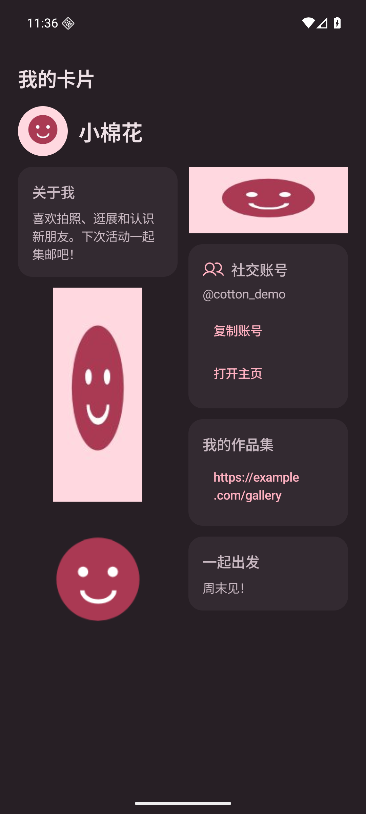 | 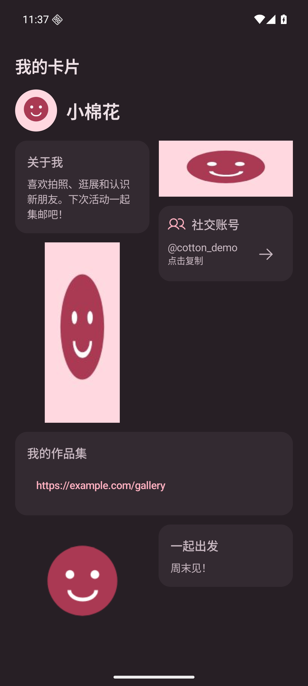 |
| 六平台／浅色 | 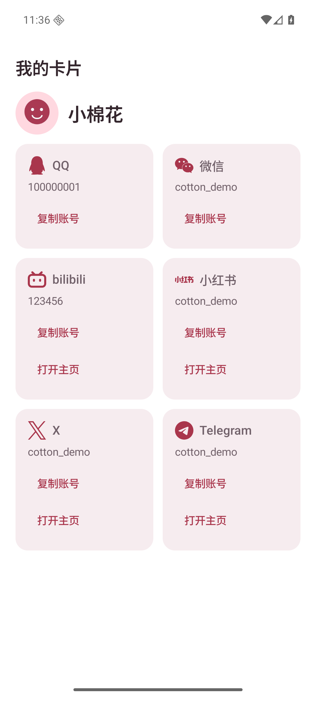 | 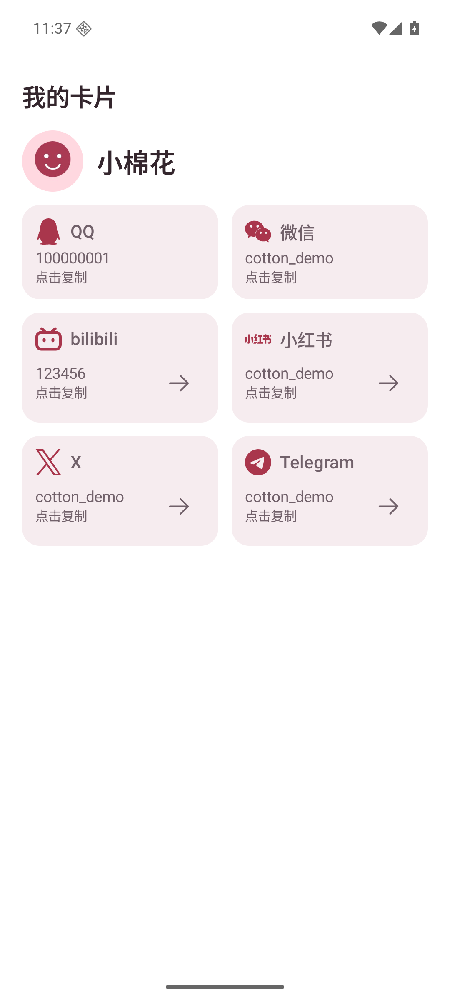 |
| 六平台／深色 | 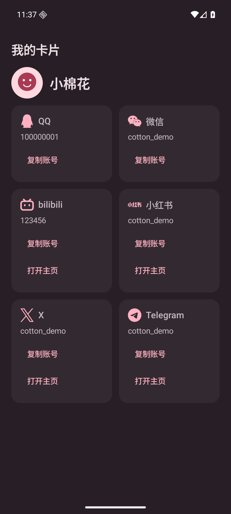 | 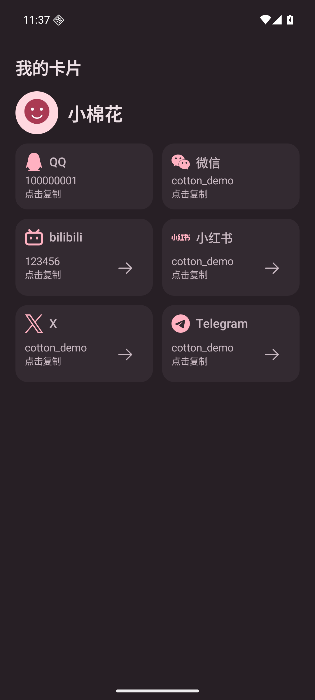 |
| 收到的卡片／浅色 | 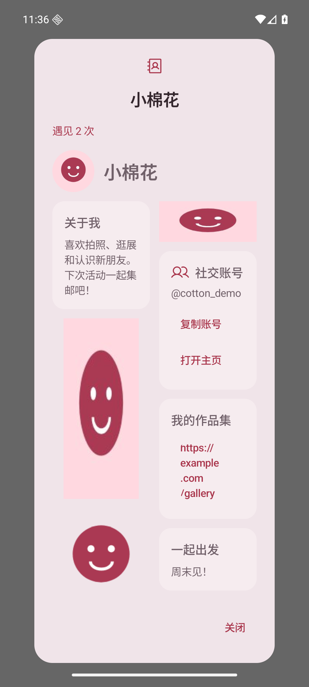 | 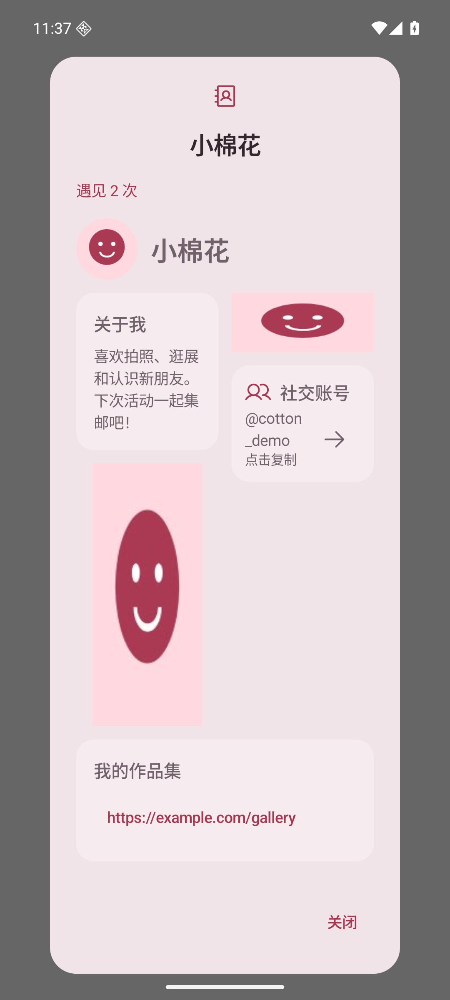 |
| 收到的卡片／深色 | 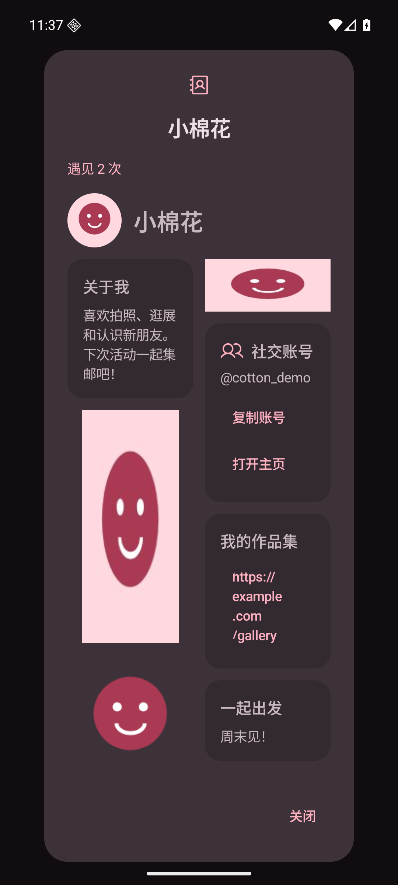 | 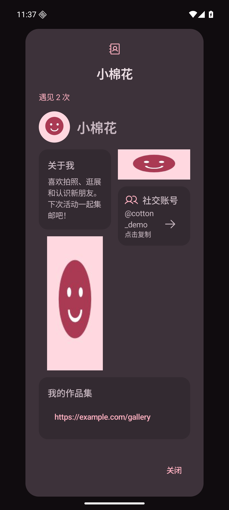 |
| 编辑预览／浅色 | 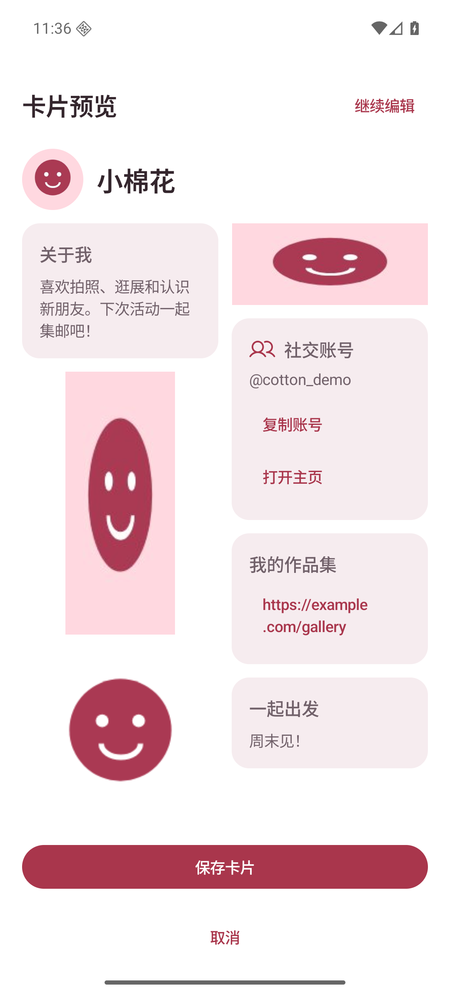 | 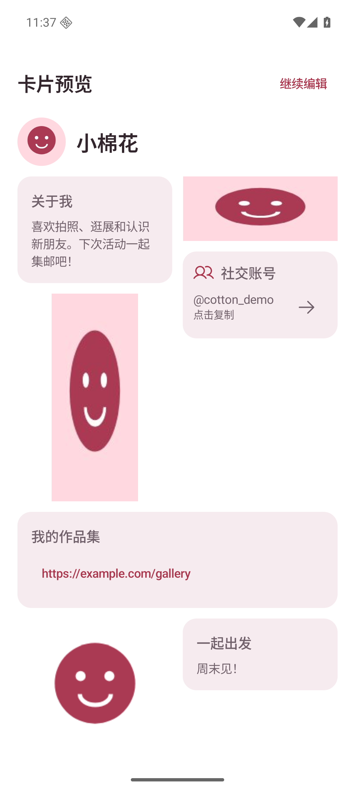 |
| 编辑预览／深色 | 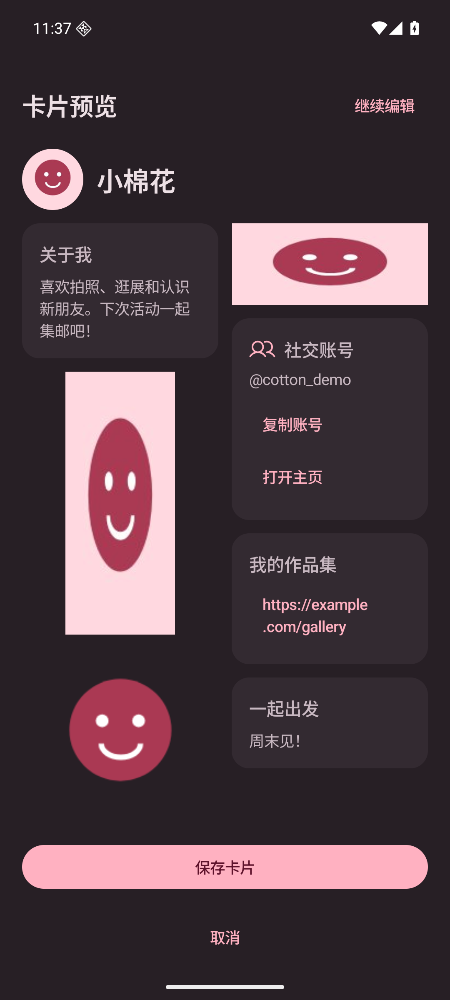 | 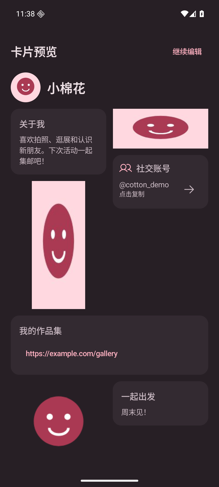 |

[复制反馈](social-copied.png)；[宽屏六平台](social-wide.png)。
窄屏大字体：[混合卡片顶部](../card-masonry/card-narrow-large-font.png)、[下滑后的单列链接](mixed-narrow-link.png)、[收到的卡片](../card-masonry/received-narrow-large-font.png)、[六平台](../social-platforms/card-narrow-large-font.png)。
宽屏三列：[混合卡片](../card-masonry/card-wide.png)，链接占两列，第三列可继续摆放其他块。

## 验证

- 独立工作目录仅包含本 PR 源码，执行 `testDebugUnitTest assembleDebug lintDebug` 成功，183 项单元测试通过，Lint 无 error。
- 模拟器检查混合卡片、收到的卡片、编辑预览的跨列链接与紧凑社交块，以及浅／深主题、窄屏大字体、宽屏三列和复制反馈。
- 本次只调整展示布局，不改变保存或蓝牙传输格式。双真机 BLE / NFC / 扫码交换仍未验证。
