# 自适应瀑布流卡片

卡片内容区按内容高度错落排布：依次把块放入当前较短的列，保持各块自己的高度。
文字、链接、社媒与图片共用同一布局；小图继续只有图片，不增加标题、底框或裁切。

普通手机使用两列，宽屏最多三列；窄屏、大字体或仅一个内容块时减少到一列。
编辑操作仍为可排序列表，点击“预览”后使用与收到的卡片相同的瀑布流。布局自身不新增滚动容器。

## 环境与复现

- Android Emulator `sdk_gphone64_x86_64` / AVD `PengWaIcon`，Android 16 / API 36。
- 普通屏 1080×2400，density 420；窄屏 840×1680（320×640 dp）、1.5 倍字体；宽屏 1600×2560、1 倍字体。
- 全部截图为运行中的 Debug APK，通过 `adb screencap` 获取，使用真实 Compose 组件。
- 变更前后使用同一组 7 个测试内容块：文字、链接、社媒、横图、竖图、透明圆形和短文字。
  姓名、UUID、账号、链接、图片均为合成测试数据，无真实用户信息。

```sh
adb shell am force-stop app.pengwa.debug
adb shell am start -n app.pengwa.debug/app.pengwa.ui.UiPreviewActivity --es screen card-masonry
# 收到的卡片：card-masonry-received
# 编辑页：card-masonry-editor，然后点击“预览”
adb shell cmd uimode night yes  # no 恢复浅色
# 窄屏／大字体：
adb shell wm size 840x1680
adb shell settings put system font_scale 1.5
# 宽屏：
adb shell settings put system font_scale 1.0
adb shell wm size 1600x2560
# 结束后恢复：
adb shell wm size reset
adb shell settings put system font_scale 1.0
```

## 同场景前后对比

| 页面／状态 | 变更前 | 变更后 |
| --- | --- | --- |
| 卡片／浅色 | 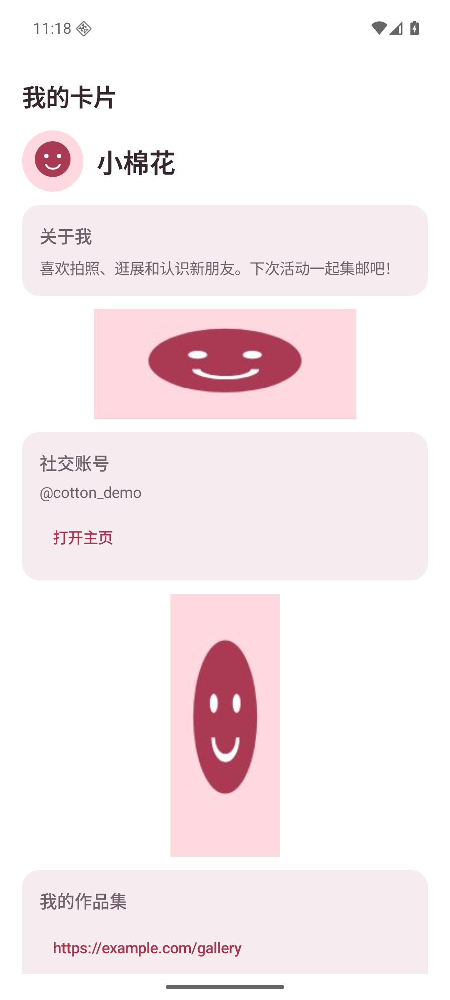 | 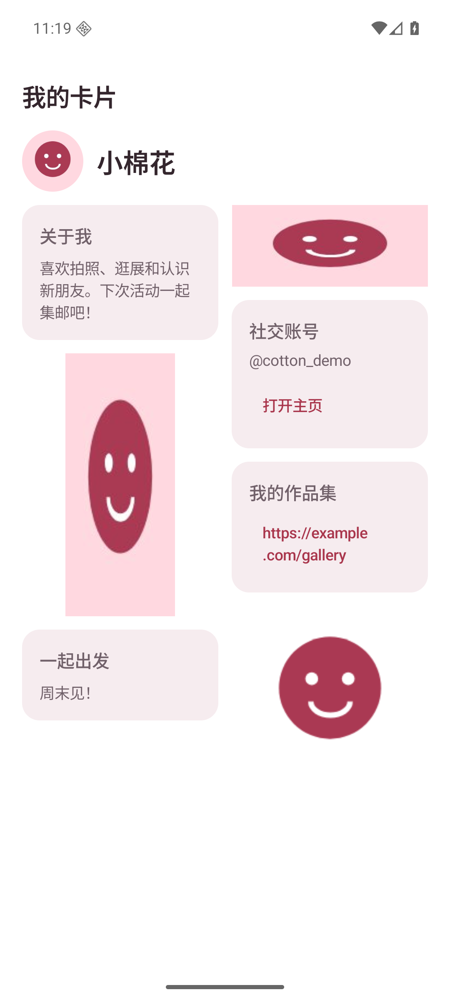 |
| 卡片／深色 | 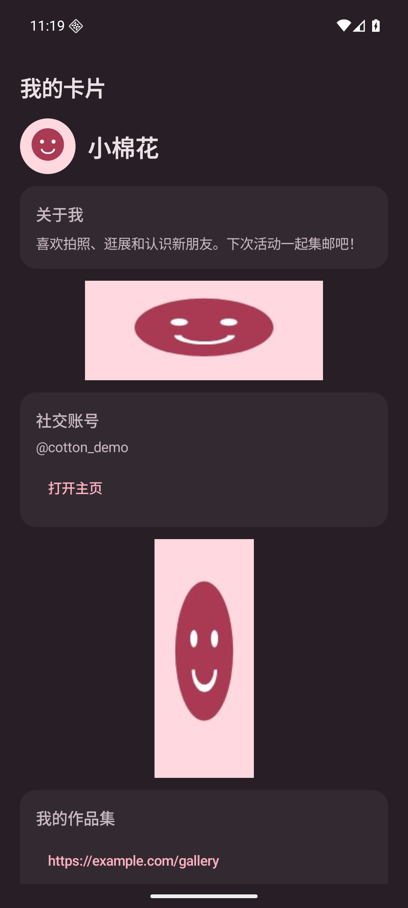 | 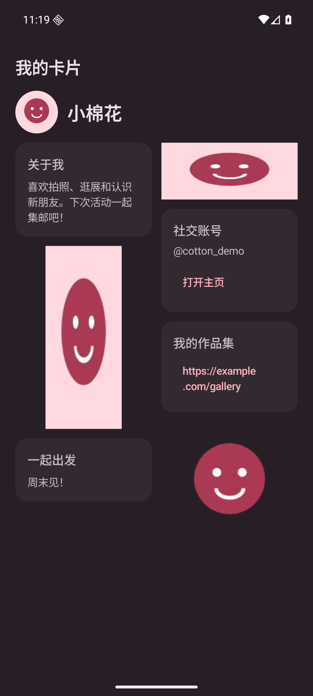 |
| 收到的卡片／浅色 | 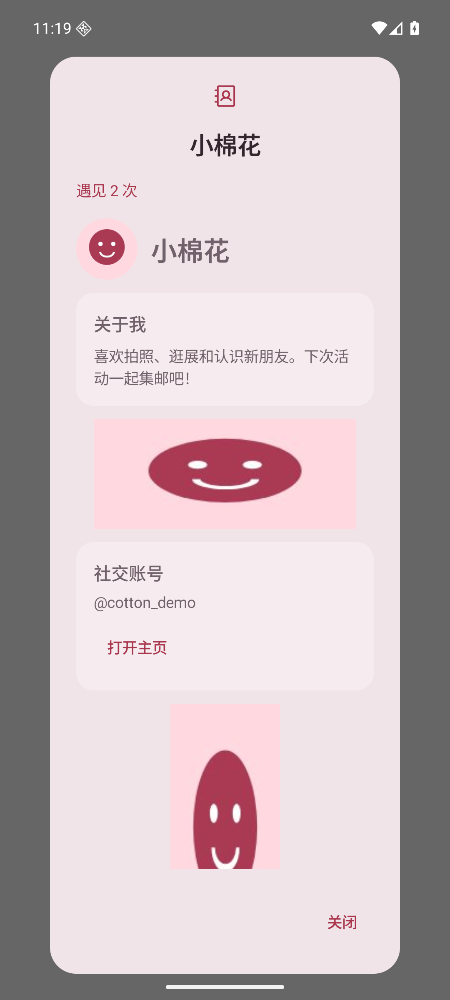 | 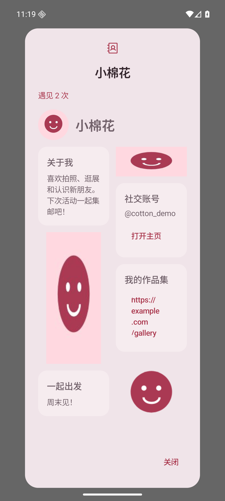 |
| 收到的卡片／深色 | 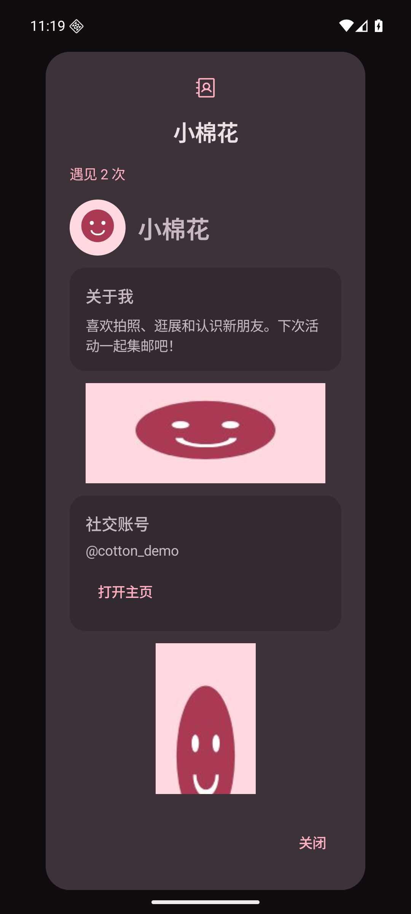 | 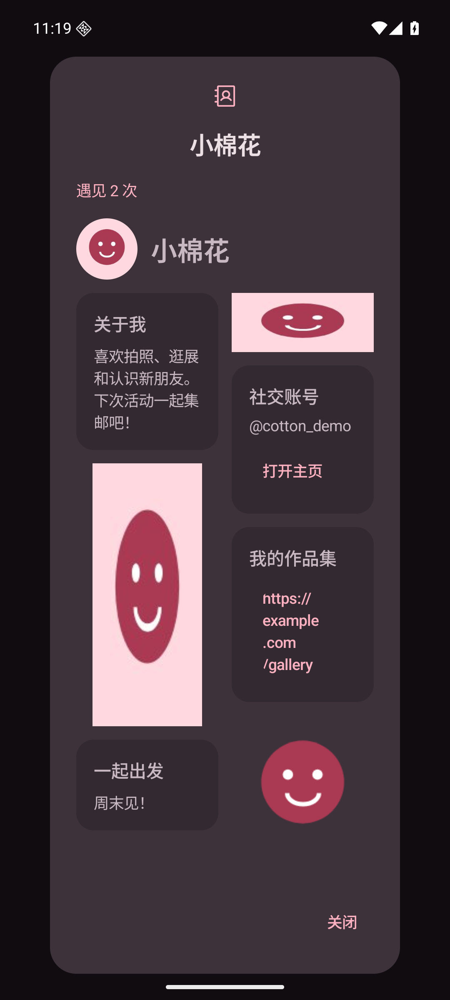 |
| 编辑预览／浅色 | 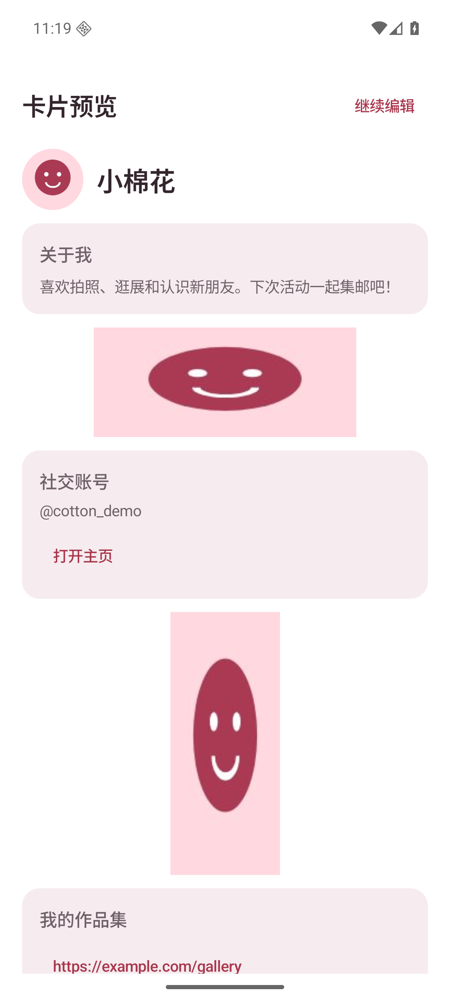 | 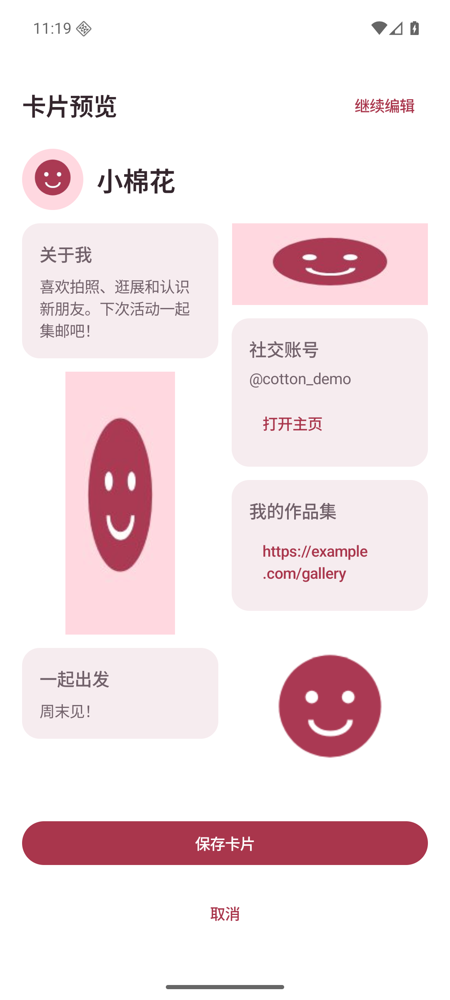 |
| 编辑预览／深色 | 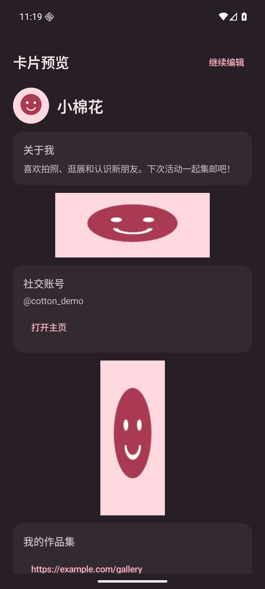 | 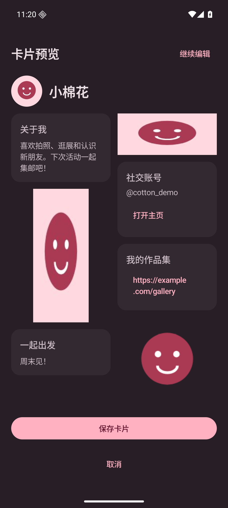 |

## 屏幕适配

窄屏大字体：[卡片](card-narrow-large-font.png)、[收到的卡片](received-narrow-large-font.png)。

宽屏三列：[卡片](card-wide.png)。

## 验证

- `testDebugUnitTest assembleDebug lintDebug` 成功，180 项现有单元测试通过，Lint 无 error。
- 模拟器检查普通屏的两列错落布局、窄屏大字体的单列回退和宽屏三列布局。
- 卡片页、详情弹窗、编辑页预览均运行正常，沿用外层滚动，不产生嵌套无限高度错误。
- 图片维持原比例和透明轮廓，内容块排序与传输格式不变。
- 本次为展示布局调整；双真机 BLE / NFC / 扫码链路验收仍按原 PR 未验证项保留。
