# 名片独立详情页

“查看我的卡片”和集邮册联系人现在进入独立页面，顶部提供返回入口，系统返回键回到原页面。自己的名片可直接编辑，保存后回到详情；详情与编辑期间隐藏底部导航。集邮册详情保留卡片、照片、相遇次数、时间与 ID，返回列表时保留滚动位置。

依赖 [照片功能 PR #40](https://github.com/xh321/PengWa/pull/40)，目标分支为 `feat/contact-photos`。保留当前主线的引导流程、头像加载和名片入口。

## 运行截图（供 PR 描述引用）

设备：Android Emulator `PengWaSignal` / `emulator-5556`，`sdk_gphone64_x86_64`，Android 16 / API 36，1080 × 2400，420 dpi，字体 1.0。图片通过运行中的 Debug APK 使用 `adb exec-out screencap -p` 获取。所有内容都是固定合成测试数据“小棉花”、演示账号与 `example.com` 链接。

变更前基于照片 PR #40 的 `e5ecb6f` 构建，变更后来自本 PR 的独立分支构建。自己的名片使用临时调试入口呈现原 HomeScreen 的同款弹窗；联系人使用原 `ContactDetails`。两组均使用相同的 `sampleCard()` 数据，不包含真实用户信息。

| 页面／状态 | 变更前 | 变更后 |
|---|---|---|
| 我的卡片，浅色 | 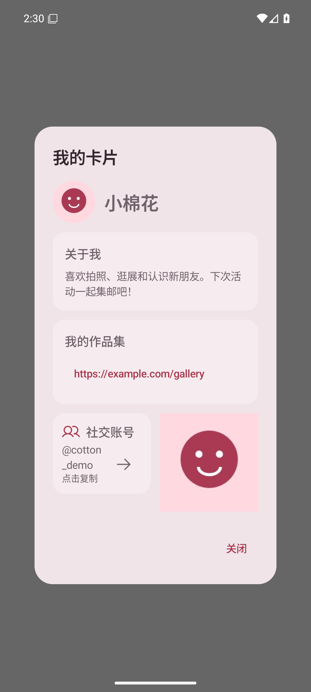 | 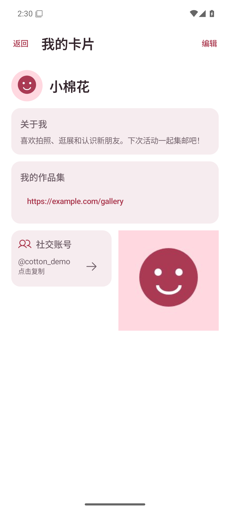 |
| 我的卡片，深色 | 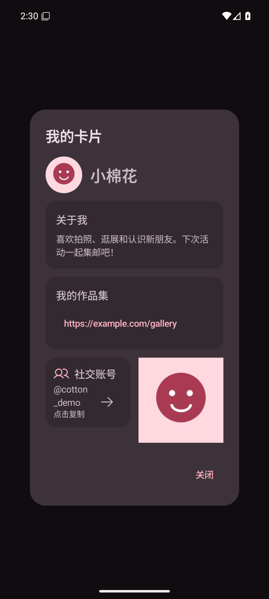 | 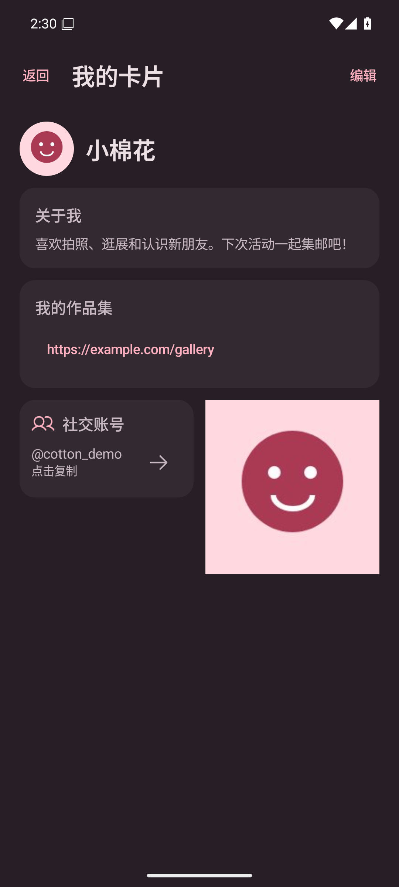 |
| 集邮册名片详情，浅色 | 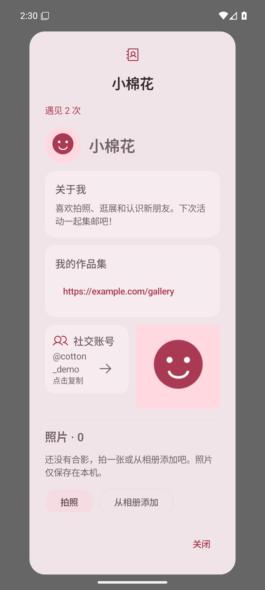 | 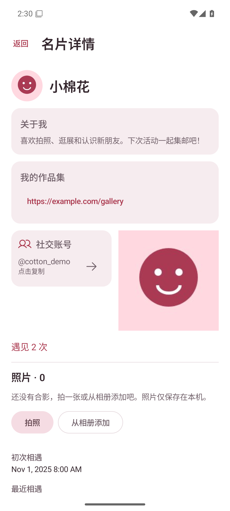 |
| 集邮册名片详情，深色 | 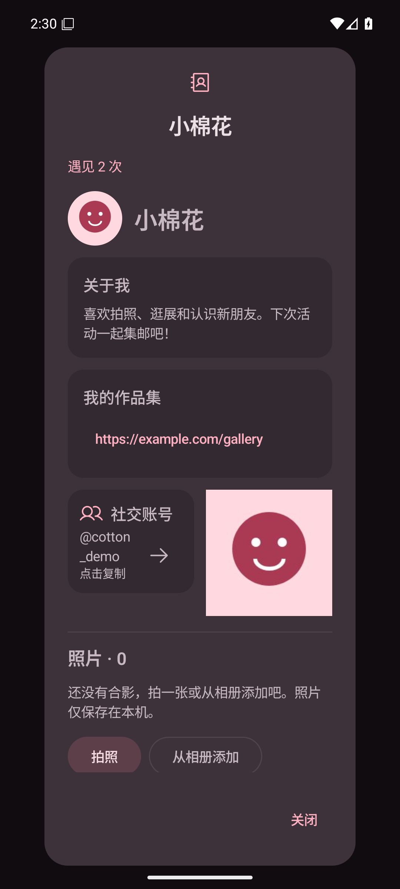 | 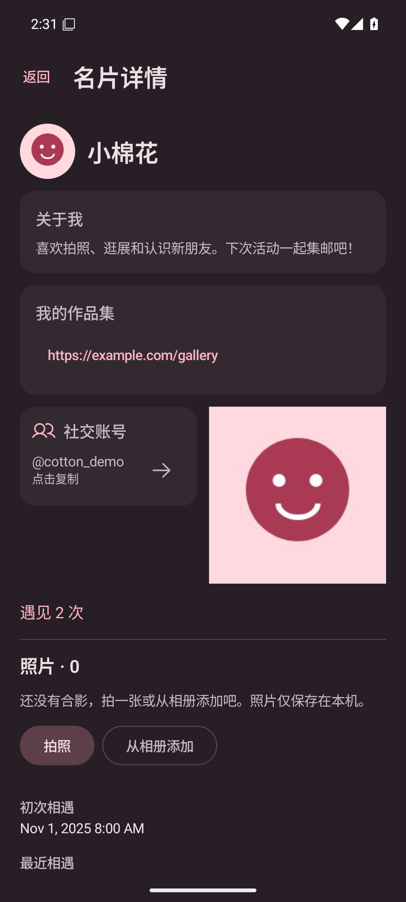 |

## 复现

1. 运行 `bash ./gradlew :app:assembleDebug :app:lintDebug testDebugUnitTest :core:model:test :core:protocol:test` 并安装 `app/build/outputs/apk/debug/app-debug.apk`。
2. 运行 `adb shell am start -n app.pengwa.debug/app.pengwa.ui.UiPreviewActivity --es screen my-card` 查看固定测试名片；将 screen 换成 `card-received` 查看联系人详情。调试预览的按钮回调为空，仅用于截图。
3. 用 `adb shell cmd uimode night yes` / `no` 切换主题；使用 `adb exec-out screencap -p > screenshot.png` 截图。
4. 正常启动应用，设置测试显示名，点击“查看我的卡片”，确认没有模态遮罩与底部导航。点击“编辑”并保存，应回到更新后的名片详情；顶部返回或系统返回应回到扩列页并恢复底部导航。
5. 集邮册点击联系人，确认进入名片详情。滚动查看照片与相遇记录，使用系统返回或顶部返回回到列表。

## 验证

- 218 项测试全部通过。Debug 构建、`:app:lintDebug`、全模块 `testDebugUnitTest` 与 `:core:model:test :core:protocol:test` 和 `git diff --check` 通过。
- 在正常应用中验证自己的名片入口、编辑保存回详情、系统返回、顶部返回，以及底部导航隐藏与恢复；测试身份为新建的 `TestCard`。
- 在运行中的集邮册固定测试场景验证联系人详情的顶部返回与系统返回。
- 补充截图：375dp 手机（984 × 1968、420 dpi）、320dp／字体 2 倍（840 × 1680）、640 × 320dp 横屏（1680 × 840），均为浅色。大字体允许标题换行，正文可滚动，返回与编辑仍可触达。

| 适配状态 | 我的卡片 | 集邮册详情 |
|---|---|---|
| 375dp 手机 | 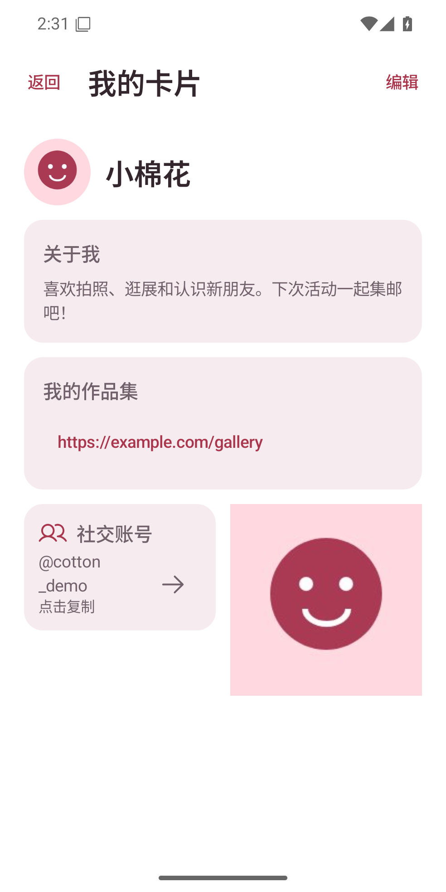 | 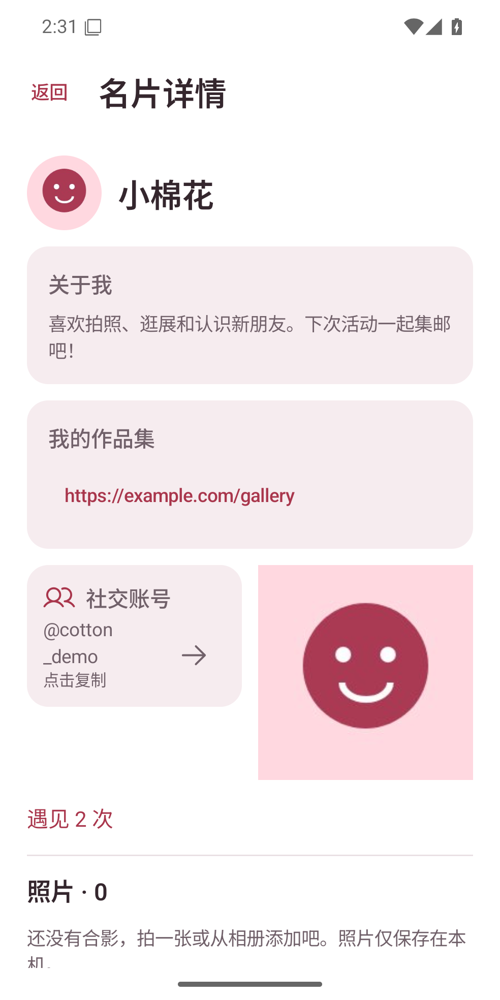 |
| 320dp／2 倍字体 | 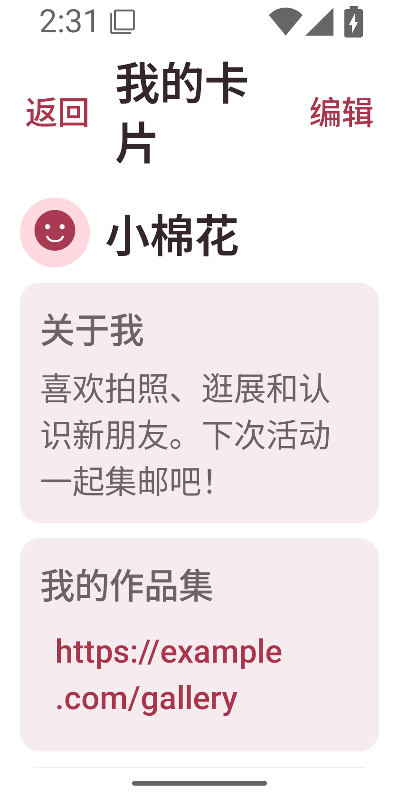 | 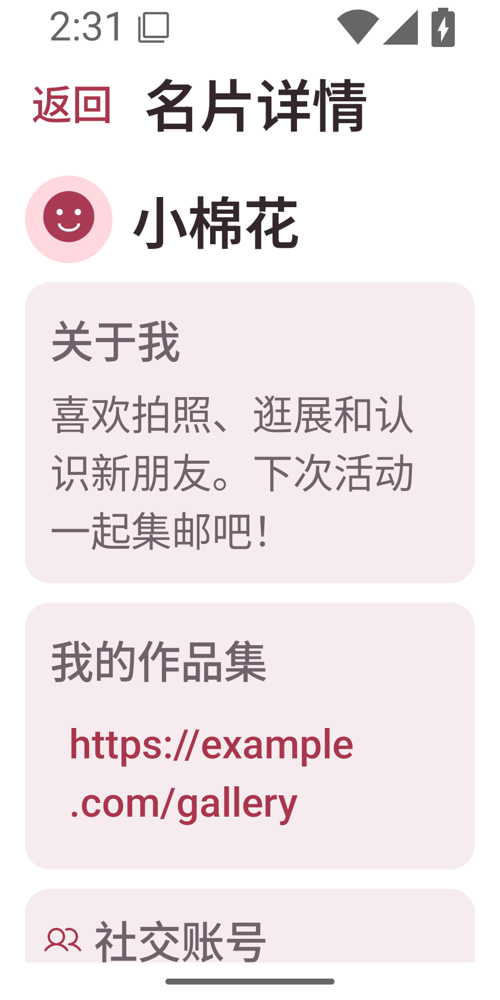 |
| 横屏 | 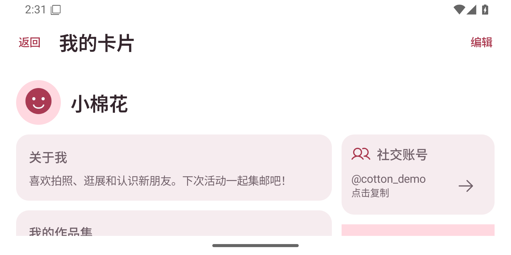 | 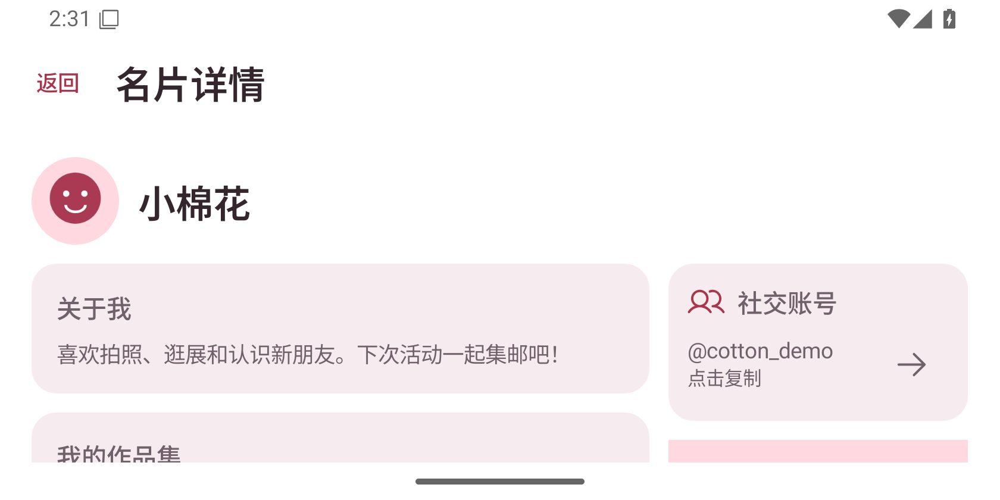 |

- 硬件交换、TalkBack 与真实相机拍摄不在本次复测范围。
