# 将查看卡片入口移入顶部

主页移除单独占一行的“查看我的卡片”文字按钮，在顶部头像和名字区域右侧加入眼睛图标，与编辑、设置并排。点击仍打开原有“我的卡片”弹窗。图标使用随应用打包的 Phosphor Regular Eye 矢量资源，跟随主题颜色；无障碍说明为“查看我的卡片”。

## 设备与复现

- Android Emulator `sdk_gphone64_x86_64`，AVD `PengWaIcon`，Android 16 / API 36。
- 普通屏 1080×2400，density 420，字体 1.0；窄屏 840×1680，字体 1.5；横屏紧凑布局 2400×1080，字体 1.0。
- 全部截图来自运行中的 Debug APK / 实际 MainActivity，通过 adb screencap 获取。
- `CottonTest`、UUID、账号、链接和图片均为之前创建的合成测试数据，无真实用户信息。

```sh
adb -s emulator-5554 install -r app/build/outputs/apk/debug/app-debug.apk
adb -s emulator-5554 shell am force-stop app.pengwa.debug
adb -s emulator-5554 shell am start -n app.pengwa.debug/app.pengwa.MainActivity
# 使用合成测试身份。查看主页右上方眼睛图标，点击打开“我的卡片”，再关闭。
adb -s emulator-5554 shell cmd uimode night yes # no 恢复浅色
# 窄屏：wm size 840x1680；settings put system font_scale 1.5
# 横屏：wm size 2400x1080；settings put system font_scale 1.0
# 最后恢复：wm size reset；settings put system font_scale 1.0
```

## 同场景前后截图

| 页面／状态 | 变更前 | 变更后 |
| --- | --- | --- |
| 主页／浅色 | 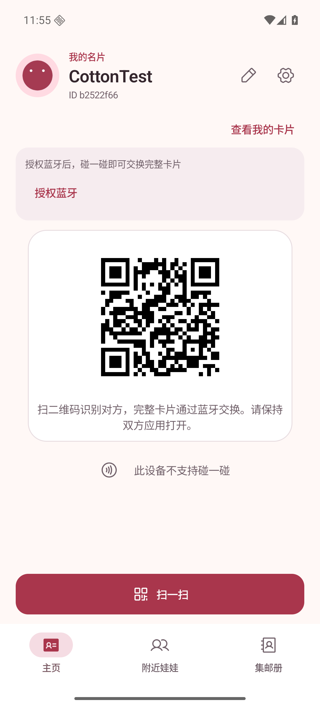 | 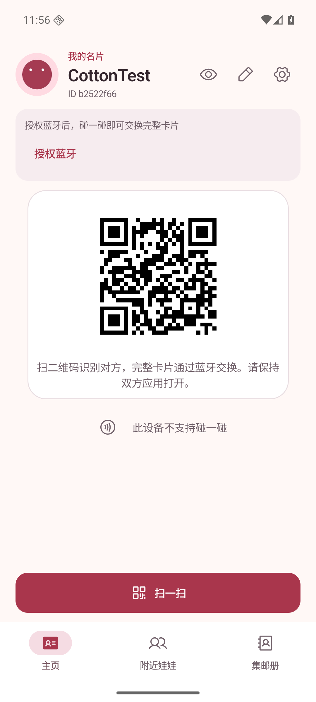 |
| 主页／深色 | 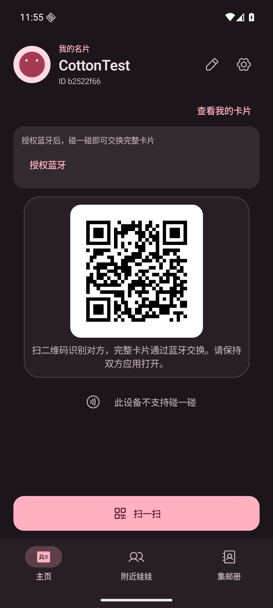 | 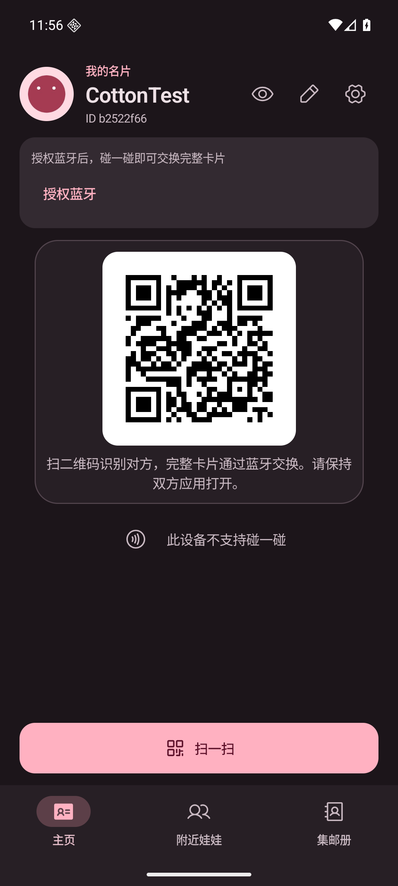 |
| 查看卡片弹窗／浅色 | 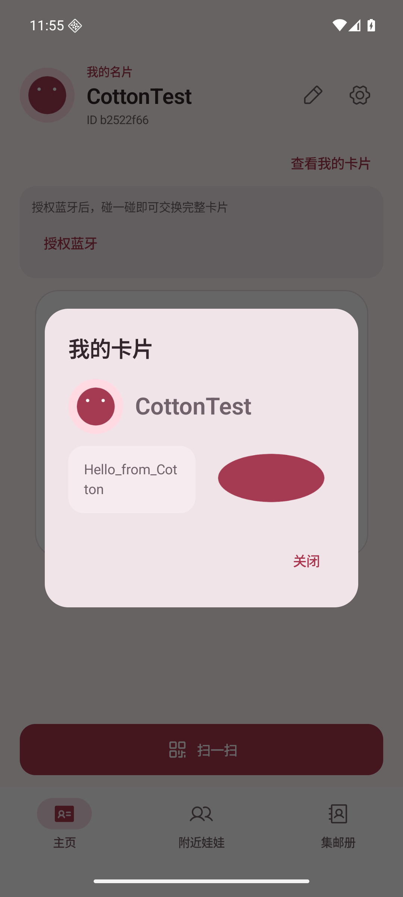 | 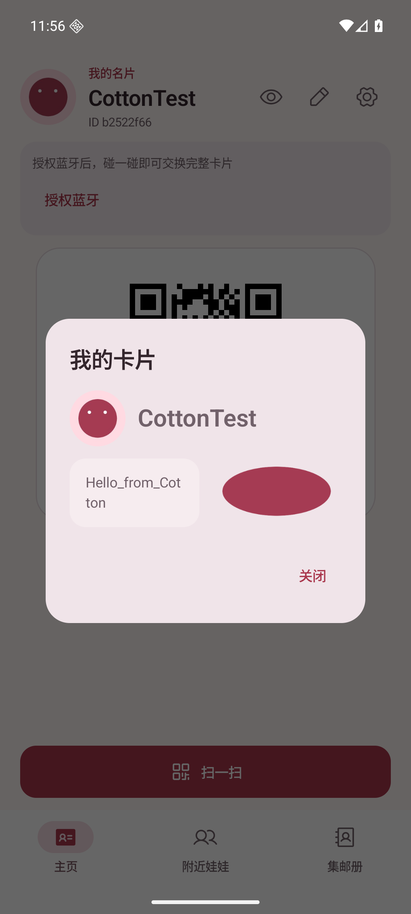 |
| 查看卡片弹窗／深色 | 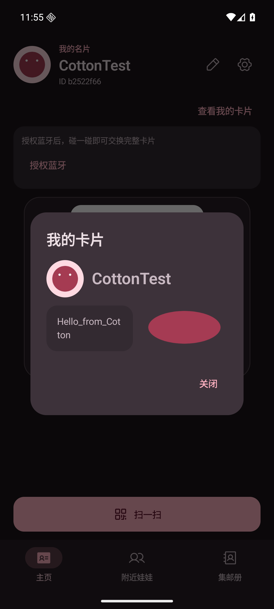 | 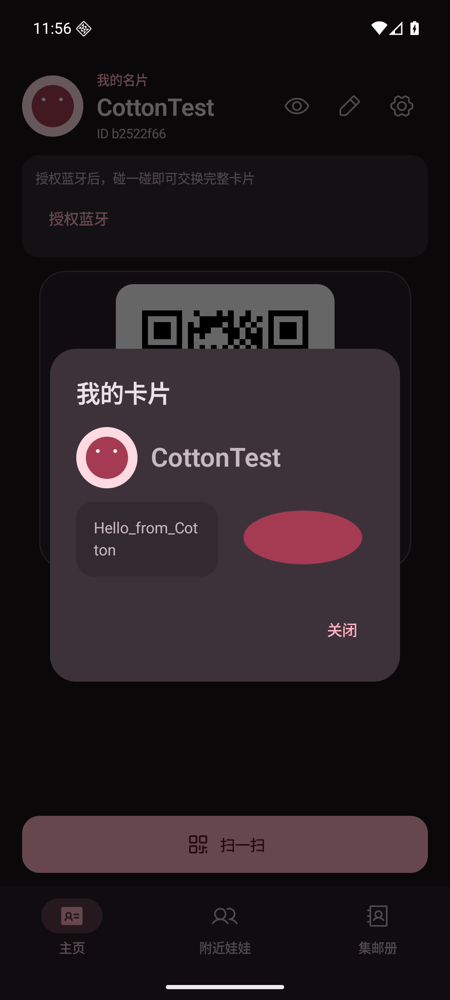 |
| 主页／窄屏大字体 | 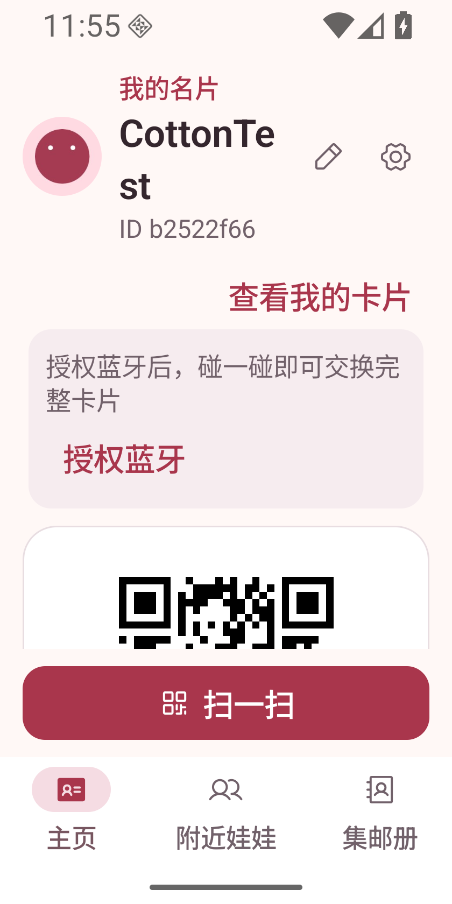 | 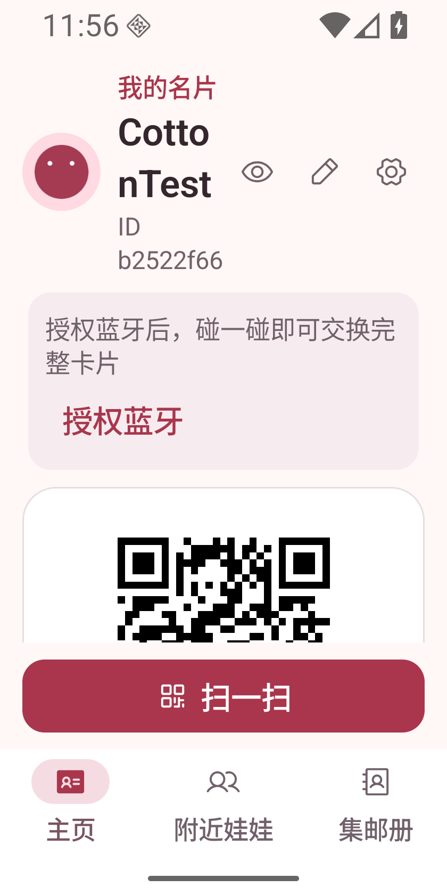 |
| 主页／横屏紧凑布局 | 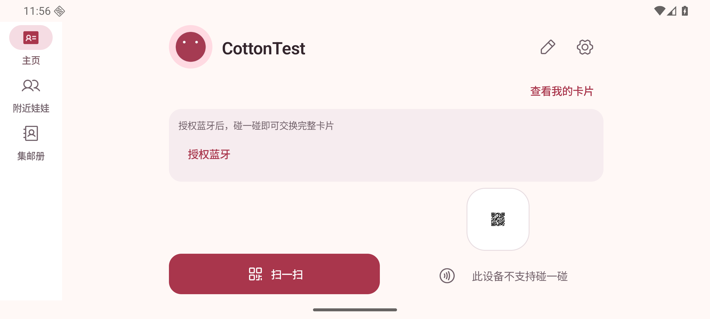 | 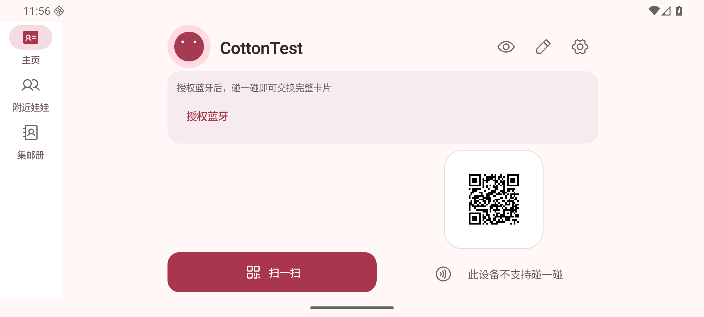 |

## 验证

- `testDebugUnitTest assembleDebug lintDebug` 通过，188 项现有单元测试通过，Lint 无 error。
- 模拟器核对顶部右侧眼睛按钮、原按钮行移除、深浅主题和窄屏大字体／横屏布局。
- 点击眼睛图标可打开原有卡片弹窗，点击“关闭”返回主页。
- 同机操作核对编辑名片与设置（后台蓝牙广播）仍可打开，退出后返回主页。
