# 主页扫码与自动碰一碰

- 删除底部通栏“扫一扫”，改为右上角的取景框式扫码图标（Phosphor Scan）；保留 48dp 触控区域和“扫一扫”无障碍名称。
- 编辑入口收进名片预览：点击眼睛图标“查看我的卡片”，再点“编辑”；保存后返回预览。同步更新首次创建名片的说明。
- 二维码使用圆角气泡卡片；二维码本身保留四模块识别静区，取消原来额外的圆角白色内框。
- 碰一碰改为二维码上方的醒目状态卡，显示“碰一碰，交换名片”及贴近手机 NFC 区域的说明；关闭、不支持 NFC 时显示对应指引。
- 移除“出示／读取”模式选择，不增加开始按钮。双方保持主页打开，由应用自动协调 NFC 角色；引导图解同步更新。

## 运行截图

截图通过运行中的 Debug APK 使用 `adb exec-out screencap -p` 获取。变更前为 `409ffb6`，变更后为本分支。设备：Android Emulator `emulator-5556`，`sdk_gphone64_x86_64`，Android 16 / API 36，1080 × 2400，420dpi，字体 1.0。

主页预览使用固定合成身份“小棉花”与 `00000000`；引导、编辑和相机流程使用新建或既有测试身份 `TestCard`。没有真实用户资料。模拟器不具备 NFC 硬件，NFC 就绪／关闭的展示由固定调试场景呈现，不代表真实双机 NFC 验证。

| 页面／状态 | 变更前 | 变更后 |
|---|---|---|
| 主页／自动碰一碰，浅色 | 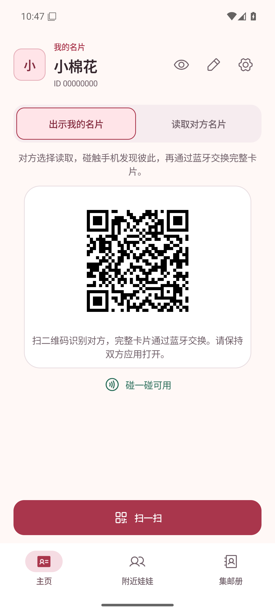 | 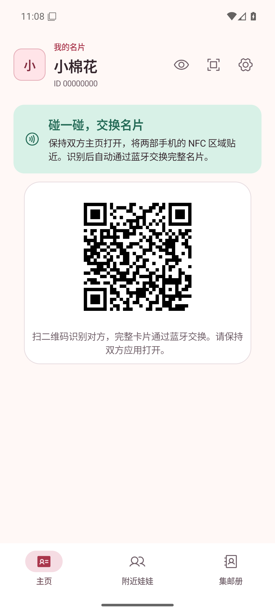 |
| 主页／自动碰一碰，深色 | 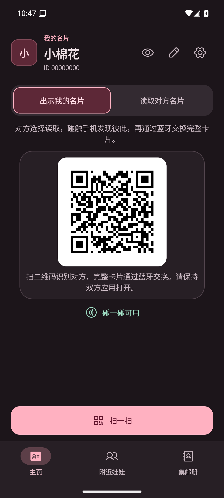 | 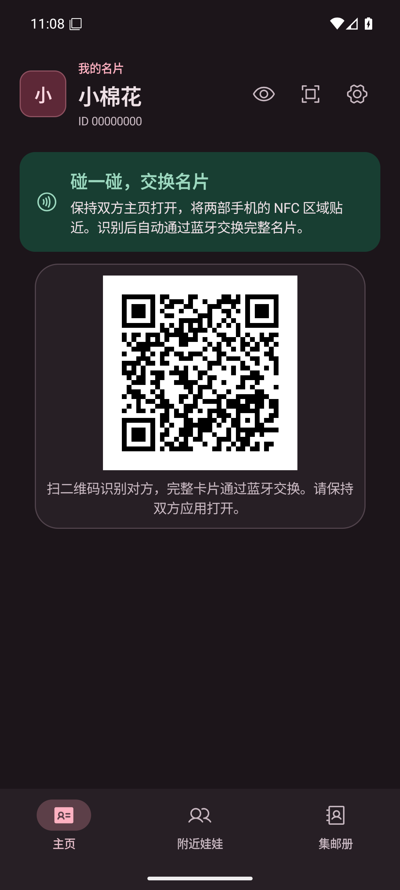 |
| NFC 未开启，浅色 | 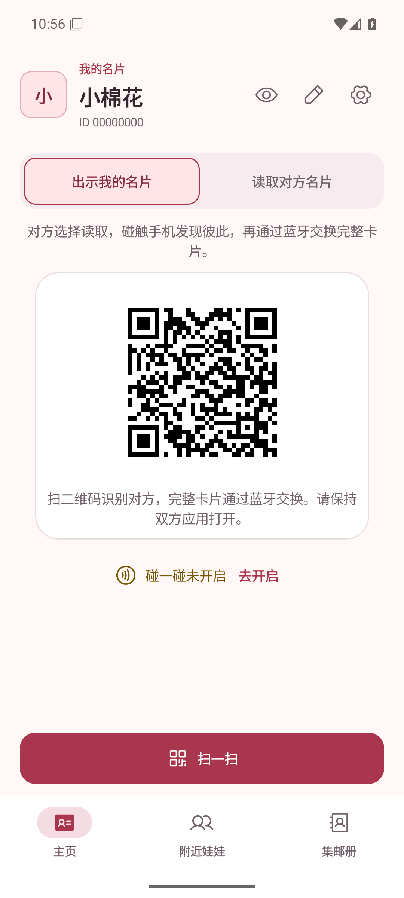 | 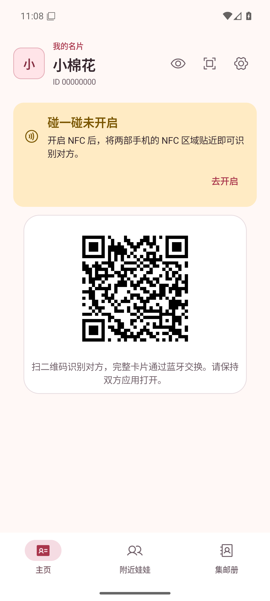 |
| NFC 未开启，深色 | 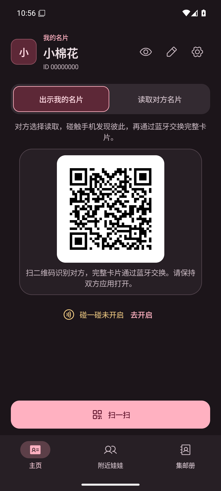 | 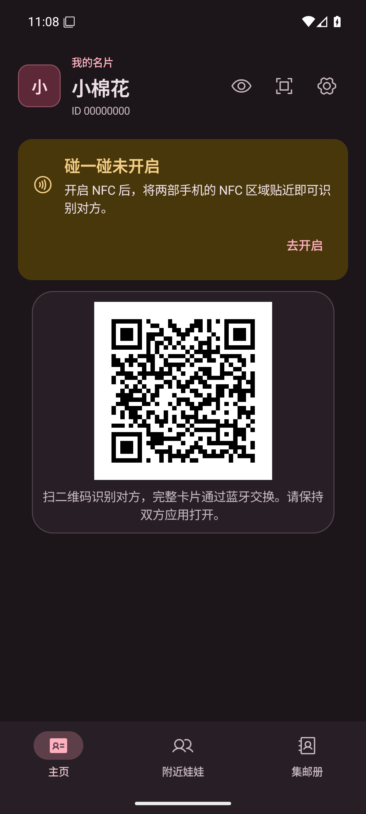 |
| 不支持 NFC，浅色 | 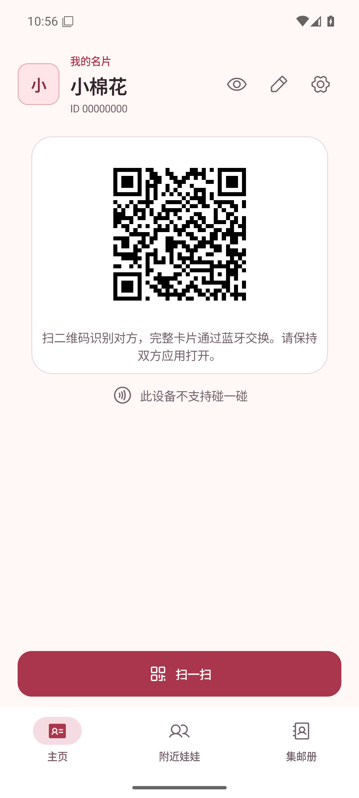 | 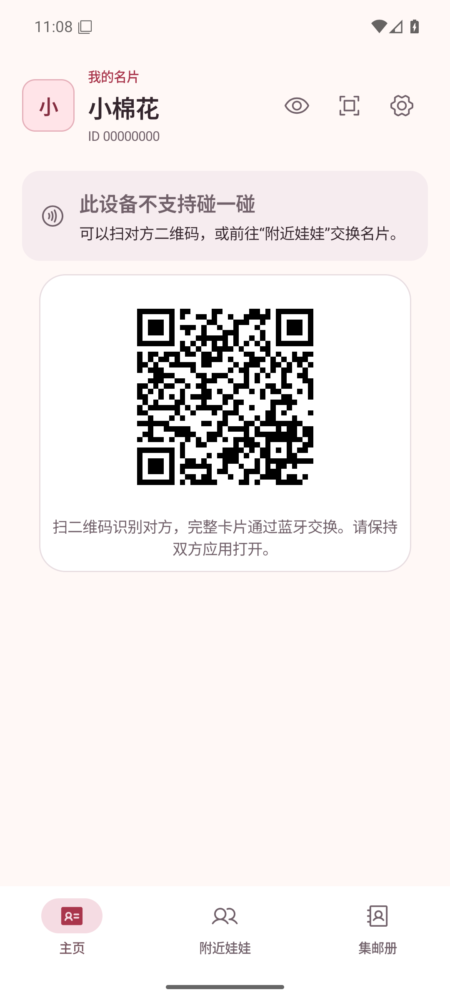 |
| 不支持 NFC，深色 | 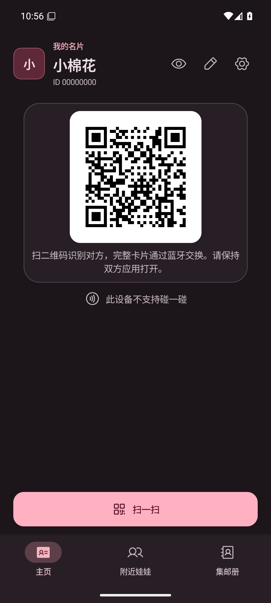 | 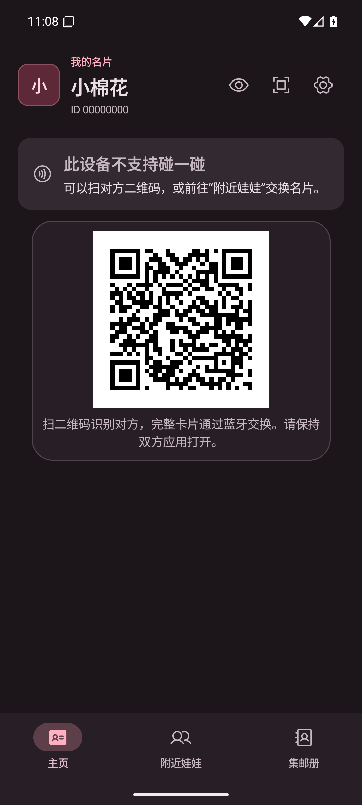 |
| 名片预览内编辑入口，浅色 | 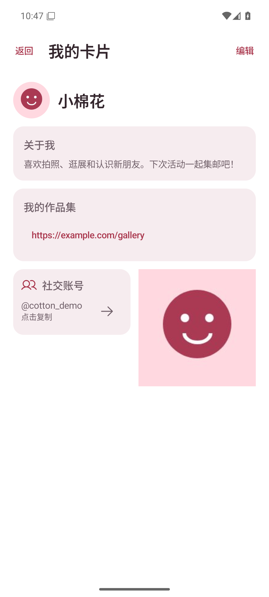 |  |
| 名片预览内编辑入口，深色 | 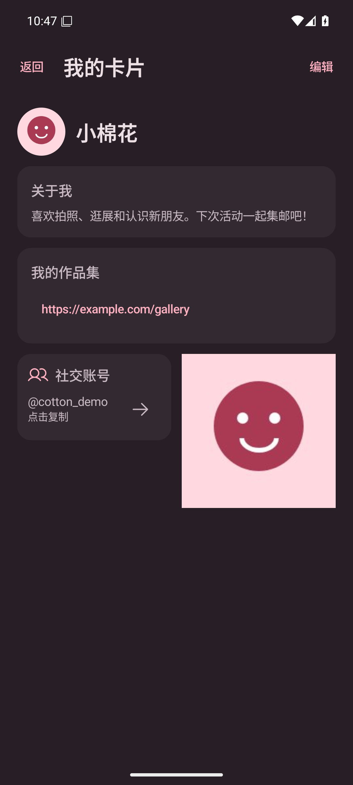 |  |
| 创建名片后的编辑说明，浅色 | 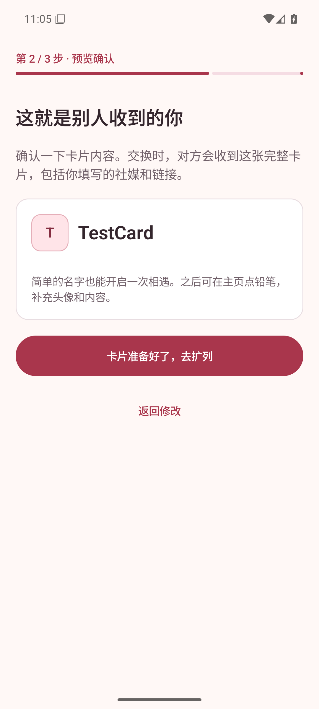 | 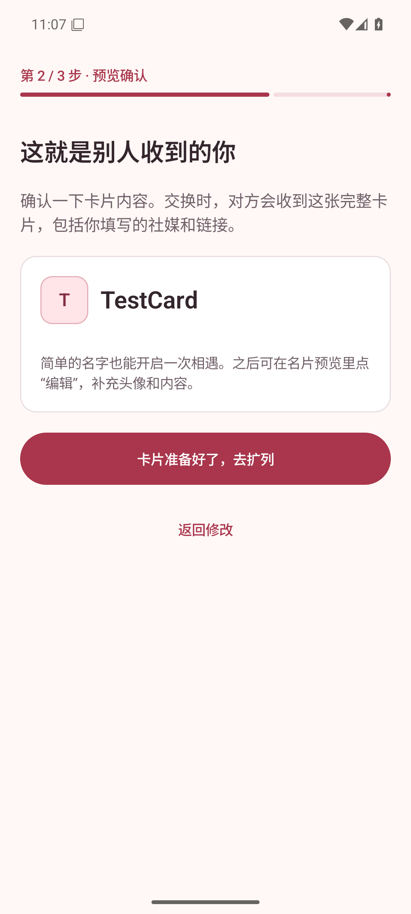 |
| 创建名片后的编辑说明，深色 | 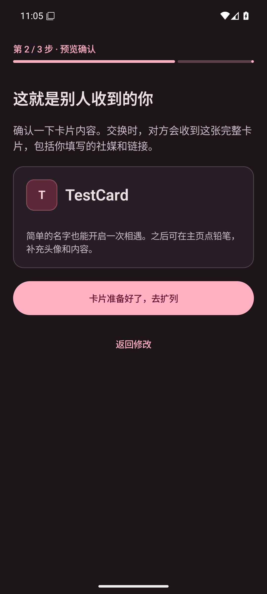 | 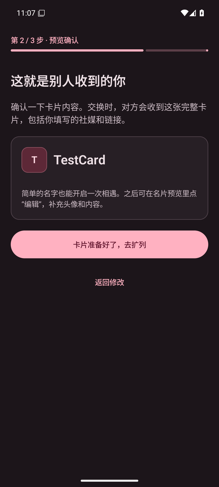 |
| 碰一碰引导，浅色 | 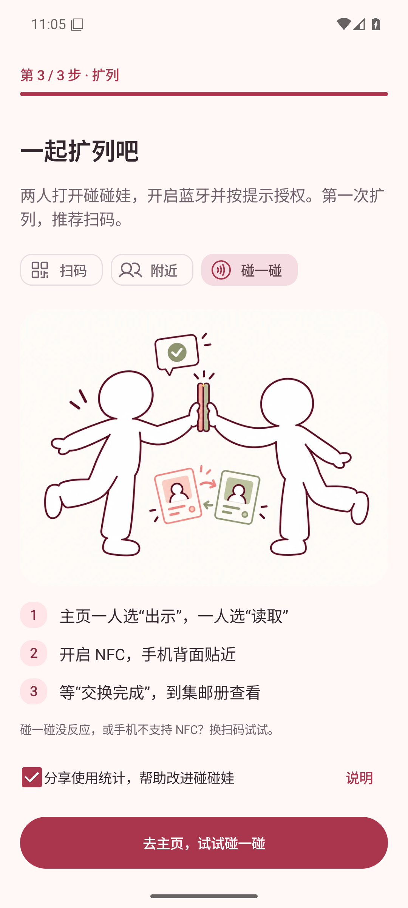 |  |
| 碰一碰引导，深色 | 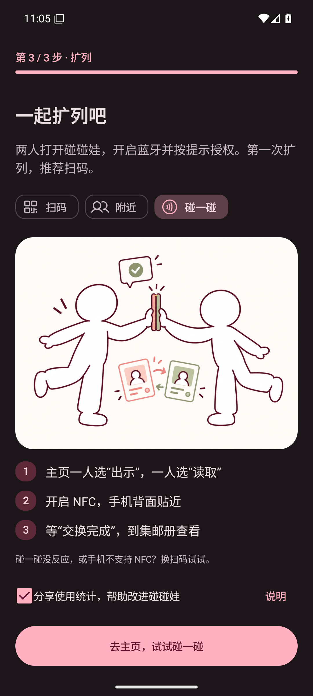 | 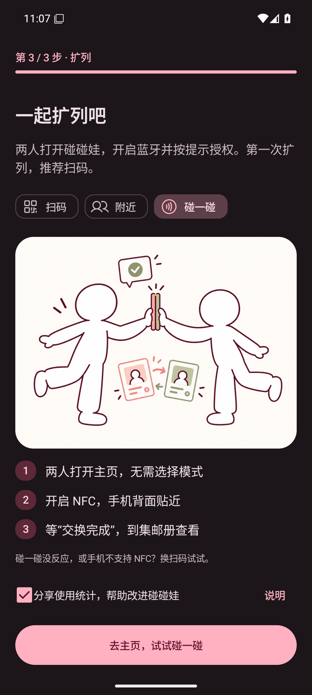 |
| 放大二维码，浅色 |  |  |
| 放大二维码，深色 |  | 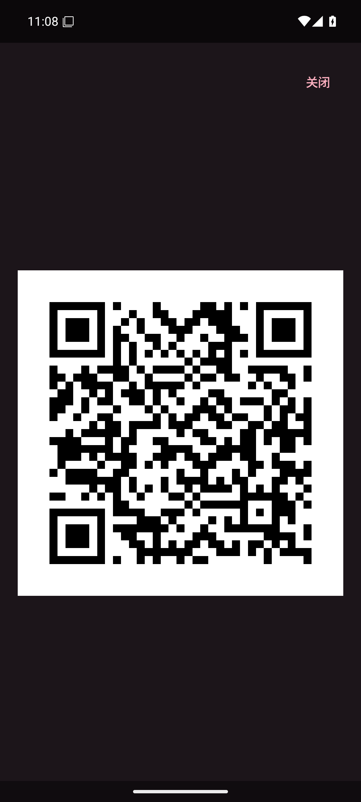 |

补充状态：[相机扫码](after-scanner-light.png)、[375dp 手机](after-home-phone-375.png)、[320dp／2 倍字体](after-home-large-text.png)、[640 × 320dp 横屏](after-home-landscape.png)。适配截图均为浅色、420dpi，分辨率依次为 984 × 1968、840 × 1680、1680 × 840；大字体下正文允许滚动。

## 复现与验证

1. `bash ./gradlew :app:assembleDebug :app:lintDebug :app:testDebugUnitTest :core:protocol:test`，安装 `app/build/outputs/apk/debug/app-debug.apk`。
2. 启动 `adb shell am start -n app.pengwa.debug/app.pengwa.ui.UiPreviewActivity --es screen home --ei sample 1`，查看 NFC 就绪且已设置钱包的固定场景；sample 3 为 NFC 未开启，4 为设备不支持。应没有角色选项或开始按钮。
3. 将 screen 改为 `my-card` 查看预览内编辑入口；点击主页二维码查看放大状态。使用 `adb shell cmd uimode night yes`／`no` 切换主题。
4. 正常启动应用，使用测试身份完成首次创建。检查名片预览内的编辑说明，进入扩列图解并选择“碰一碰”，确认无需选择模式的文案。
5. 在主页点击右上角“扫一扫”，允许相机权限后应进入取景界面；点击“关闭”或系统返回，应恢复二维码。点击眼睛图标“查看我的卡片”，点击“编辑”，保存后应回到预览；点击“返回”回到主页。
6. 直接解码运行截图，核对主页及放大二维码在深浅主题、375dp 手机和横屏下均可识别。
7. 用 `wm size` 切换上述尺寸、`settings put system font_scale 2.0` 验证大字体；结束后恢复尺寸及字体。

构建、Lint、应用单元测试、协议测试及 `git diff --check` 通过。自动调度单元测试覆盖通信锁定、重复 Reader 回调、离开页面使旧回调失效、旧清理不影响新页面、无 HCE 回退、APDU 会话重建及 500 对独立随机时序的确定性模拟。模拟只验证角色窗口会错开，不代替 NFC 射频识别测试。

真实双机 NFC → BLE、钱包兼容、射频角色切换时序、蓝牙端到端交换、实物相机识别与 TalkBack 未完成本轮复测。自动碰一碰需在支持 NFC 的两台 Android 真机上验证后才能宣称硬件验收通过；两台均不支持 HCE 的设备无法互相模拟名片，可使用二维码／附近交换。

自动角色调度与会话保护见 [协议说明](../../protocol.md#nfc-iso-dep--hce)。
