# Coil 图片加载验证

设备：Android Emulator PengWaSignal（sdk_gphone64_x86_64），Android 16 / API 36。
使用 UiPreviewActivity 内置合成数据，无真实用户信息。变更前为 661e145，变更后为本分支。

步骤：安装对应 Debug APK，执行 `adb shell cmd uimode night no`（浅色）或 `yes`（深色），再运行：

```
adb shell am force-stop app.pengwa.debug
adb shell am start -n app.pengwa.debug/app.pengwa.ui.UiPreviewActivity --es screen <场景>
adb exec-out screencap -p > screenshot.png
```

等待图片加载完成后截屏。核对圆形头像、横竖图片的原始比例、透明背景、编辑与详情页；加载失败继续显示原有回退内容。

## 我的卡片（头像与内容块） / light（card）

| 变更前 | 变更后 |
|---|---|
|  | 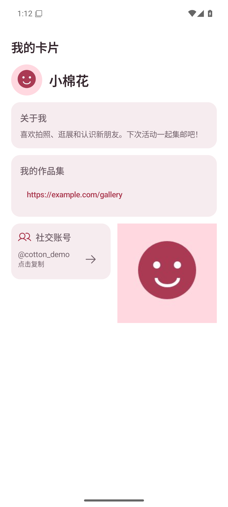 |

## 我的卡片（头像与内容块） / dark（card）

| 变更前 | 变更后 |
|---|---|
|  | 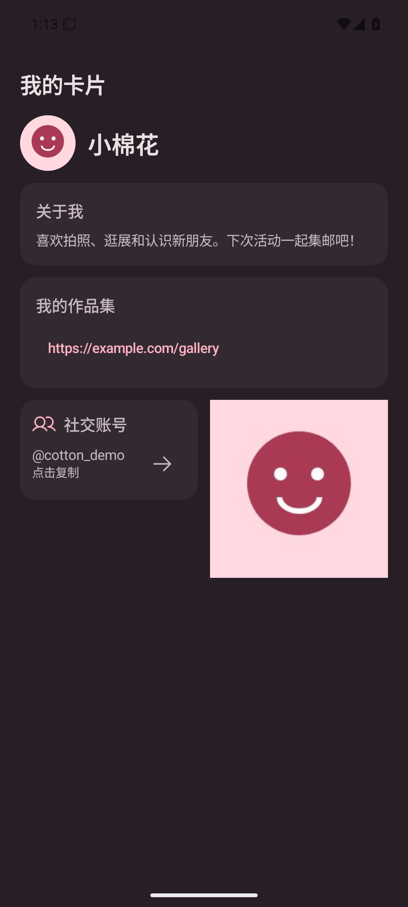 |

## 编辑卡片（头像） / light（card-editor）

| 变更前 | 变更后 |
|---|---|
|  | 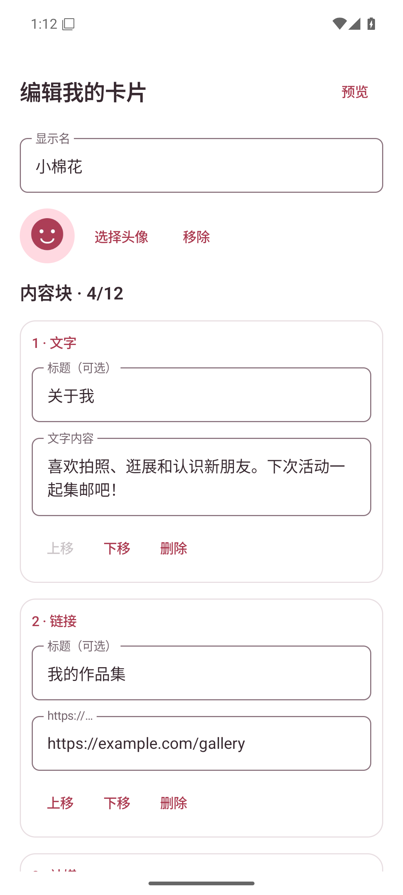 |

## 编辑卡片（头像） / dark（card-editor）

| 变更前 | 变更后 |
|---|---|
| 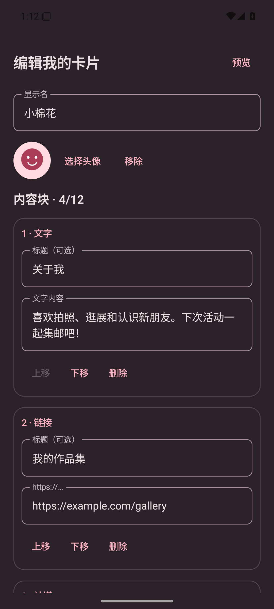 | 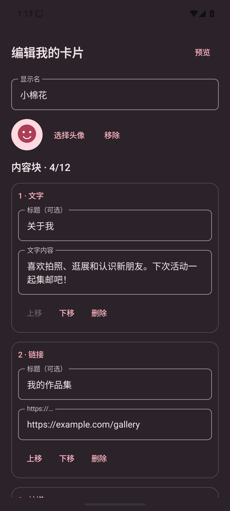 |

## 图片比例与透明背景 / light（card-images）

| 变更前 | 变更后 |
|---|---|
| 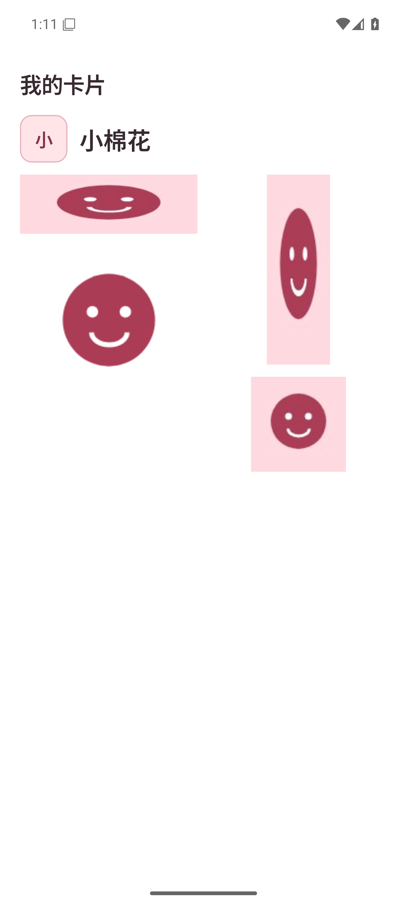 | 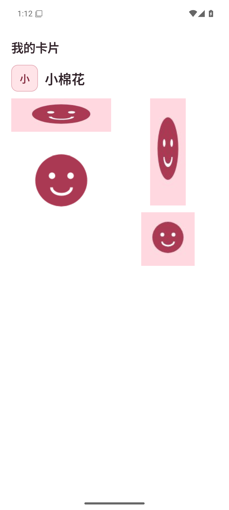 |

## 图片比例与透明背景 / dark（card-images）

| 变更前 | 变更后 |
|---|---|
|  | 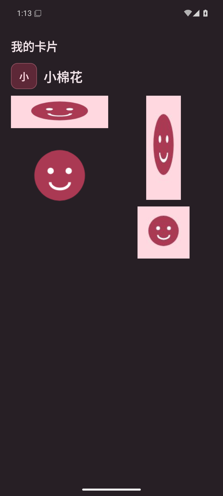 |

## 编辑图片卡片 / light（card-images-editor）

| 变更前 | 变更后 |
|---|---|
| 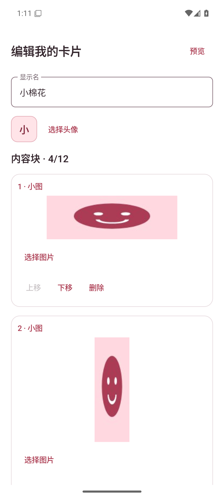 |  |

## 编辑图片卡片 / dark（card-images-editor）

| 变更前 | 变更后 |
|---|---|
| 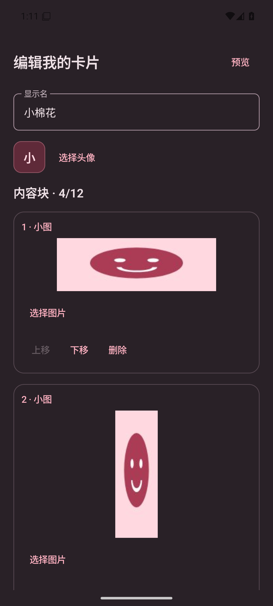 | 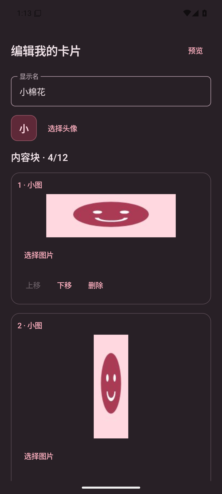 |

## 收到的图片卡片详情 / light（card-images-received）

| 变更前 | 变更后 |
|---|---|
| 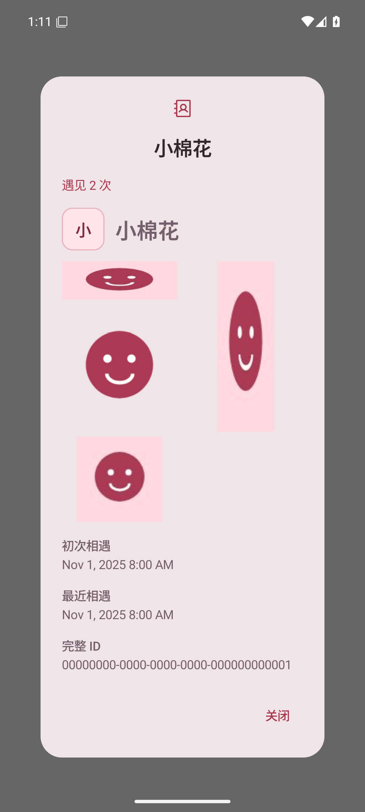 | 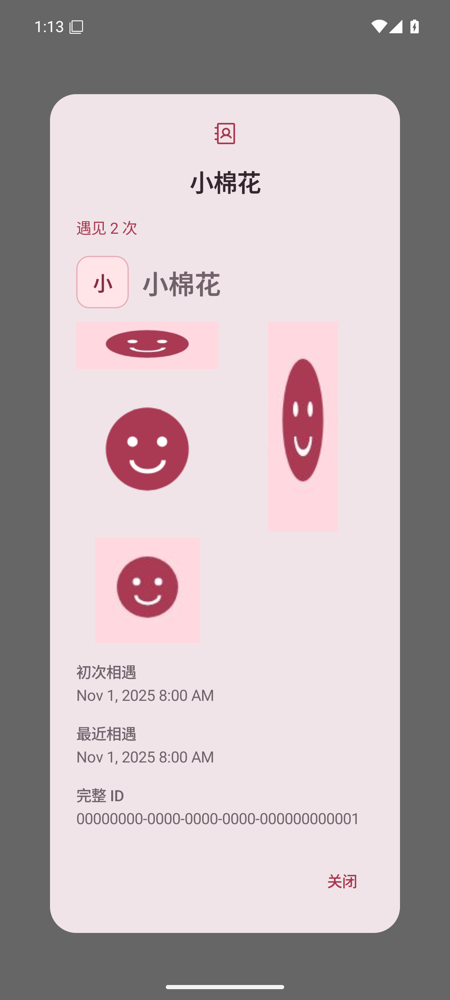 |

## 收到的图片卡片详情 / dark（card-images-received）

| 变更前 | 变更后 |
|---|---|
| 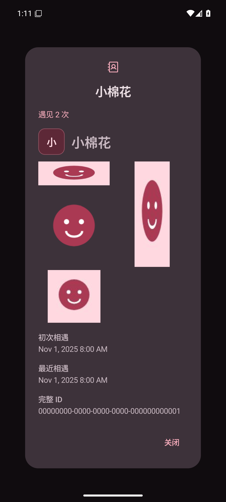 |  |

