# 娃友名片下的照片区

集邮册 → 点开娃友 → 名片下方显示照片数量、空状态、拍照与从相册添加入口。添加后显示横向滚动的缩略图，点按查看大图；移除需要二次确认。

原图按娃友 UUID 保存在 `files/contact_photos/<UUID>/`，不重新编码，不随名片交换。预览在 IO 线程按尺寸解码并处理照片方向。移除不影响相册原文件。此处拍摄仅保存在应用中，卸载或清除数据会删除；列表右下角原有拍照入口仍保存到 `Pictures/PengWa`。

## 设备、数据与复现

- Android Emulator，AVD `PengWaSignal`，`emulator-5556`，Android 16 / API 36，1080 × 2400，420 dpi，字体 1.0。
- 另覆盖 840 × 1680 / 字体 2.0，以及 1680 × 840 横屏。
- 截图均来自运行中的 Debug APK，通过 `adb exec-out screencap -p` 获取。变更前为本次修改前工作区构建。
- 使用 `UiPreviewActivity` 合成娃友（“小棉花”“名字很长很长的娃友”、固定测试 UUID）；导入图为两块几何图形，拍照使用模拟器虚拟场景，无真实个人信息。
- 安装后运行：`adb -s emulator-5556 shell am start -W -n app.pengwa.debug/app.pengwa.ui.UiPreviewActivity --es screen details`。
- 点击“从相册添加”，选择测试图；点缩略图查看大图、移除并确认；强制停止后重开，验证照片仍在。
- 改用参数 `--es screen contacts --ei sample 1`，分别点开两位娃友检查隔离。
- 点“拍照”，授权、拍摄并确认，检查数量增加；再次拍照后取消，检查数量不变。

## 前后截图（供 PR 描述使用）

| 状态 | 变更前 | 变更后 |
| --- | --- | --- |
| 同一娃友，浅色，空照片 | 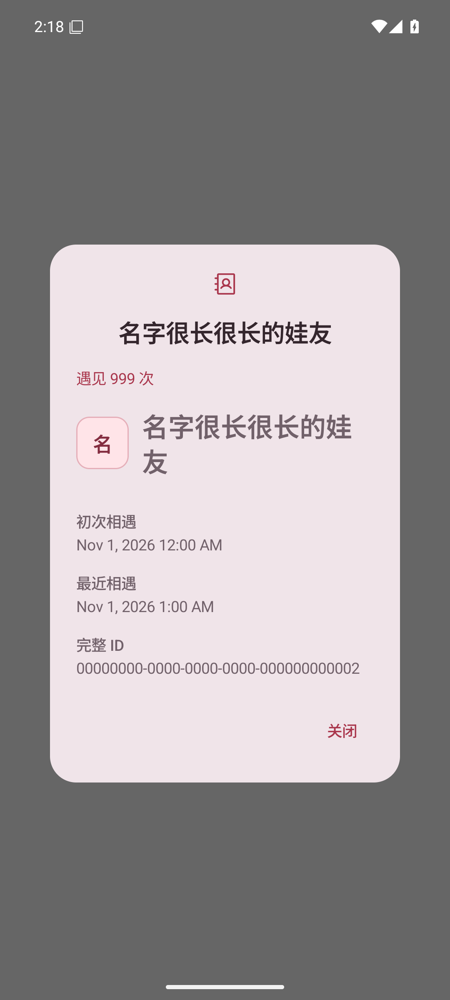 | 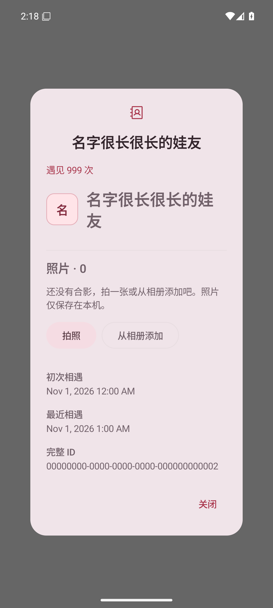 |
| 同一娃友，深色，空照片 | 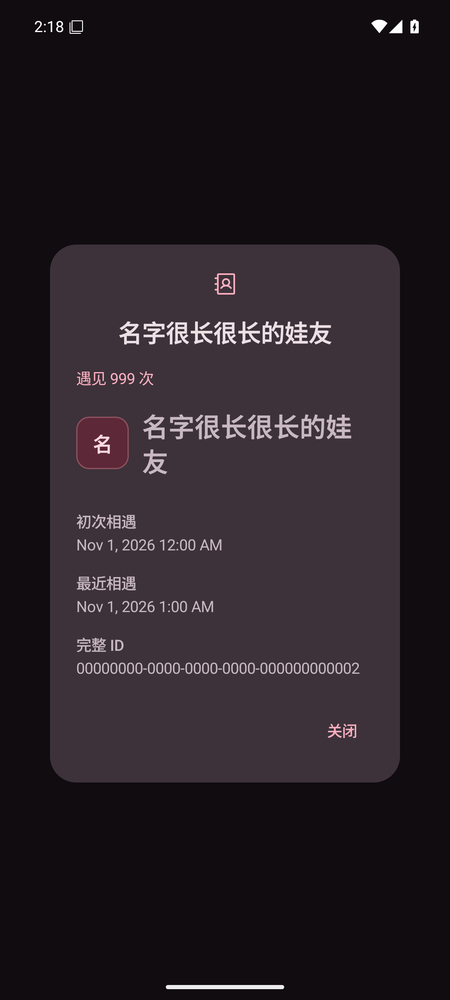 | 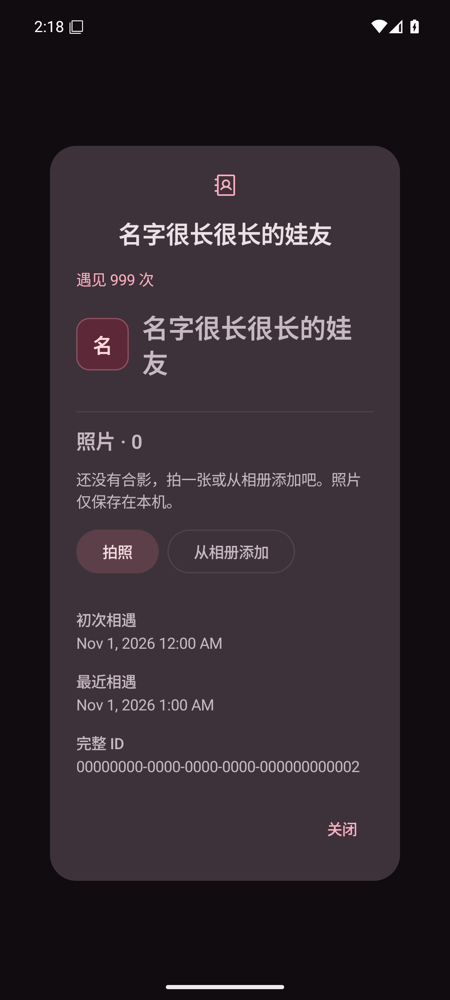 |

| 新增状态 | 运行截图 |
| --- | --- |
| 添加照片，浅色 | 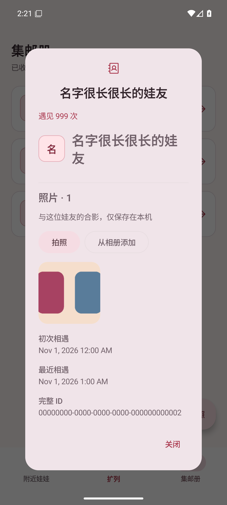 |
| 添加照片，深色 | 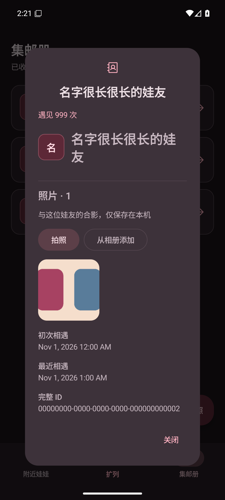 |
| 查看合影 | 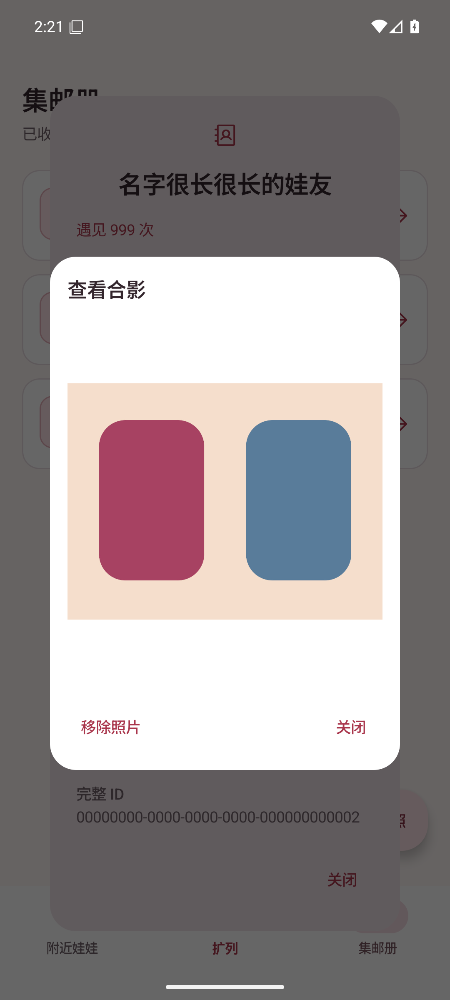 |
| 移除确认 | 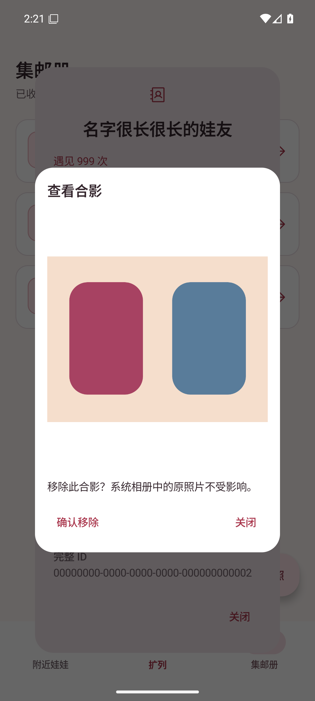 |
| 系统相机回传，数量增加 | 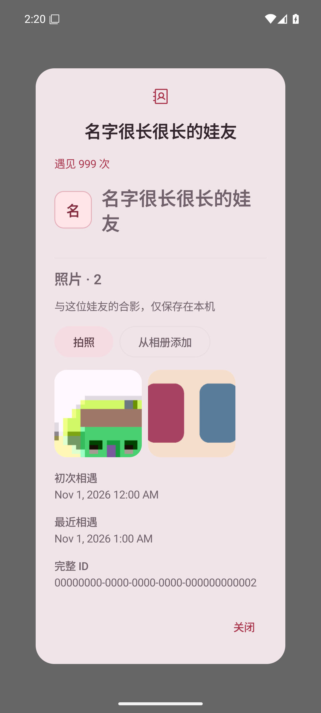 |
| 另一位娃友照片数为零 | 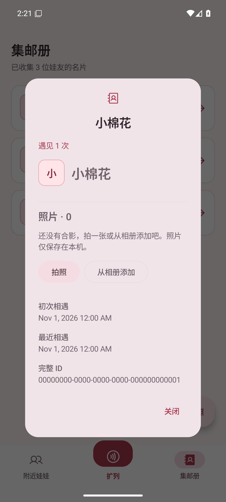 |
| 窄屏、2 倍字体 | 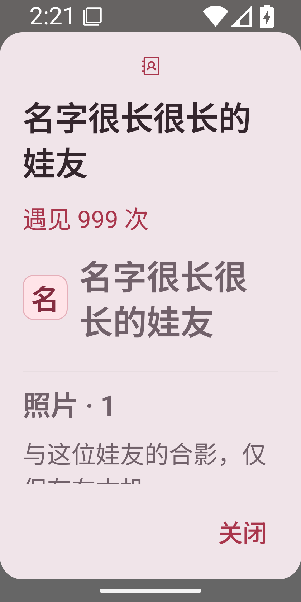 |
| 窄屏滚动后 | 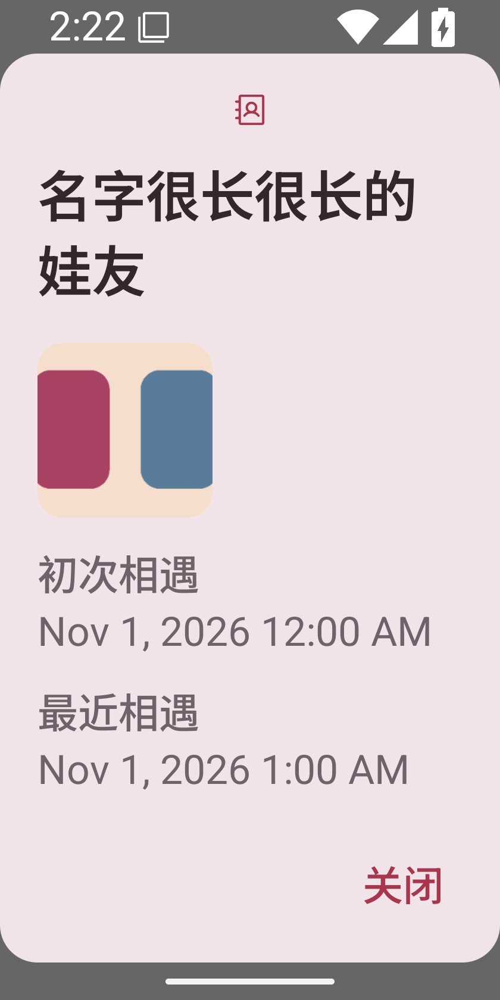 |
| 横屏滚动至照片 | 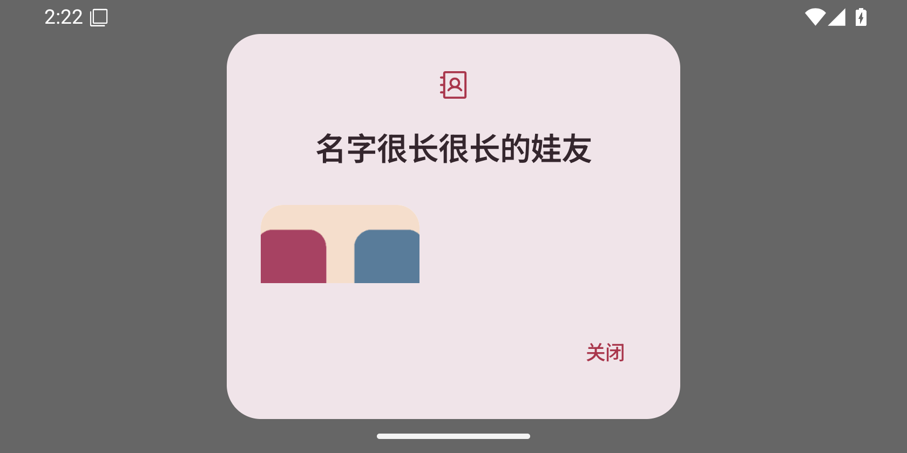 |
| 横屏大图滚动至操作按钮 | 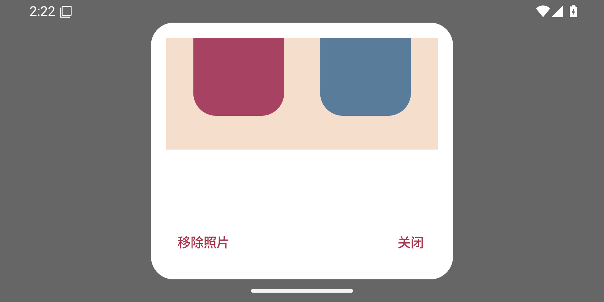 |

## 验证与边界

- `:app:assembleDebug :app:testDebugUnitTest :app:lintDebug` 通过；lint 无错误，保留已有警告。
- 导入文件 SHA-256 与源图片一致，确认未重编码。
- 模拟器验证：相册导入、缩略图、大图、确认移除、强制停止后重开、娃友隔离、相机授权、拍摄确认和取消。
- 使用现有 Material 主题，按钮至少 48dp 触控高度。详情及大图弹窗支持纵向滚动。
- 参照 [Android Photo Picker 官方说明](https://developer.android.com/training/data-storage/shared/photo-picker)；UI/UX Pro Max 触控查询匹配 Android 48dp 和相邻控件留白规则。
- 未实测真实手机厂商相机兼容性、拍照期间被系统杀进程、磁盘写满、云端媒体下载失败；不据模拟器结果宣称这些项已通过。
