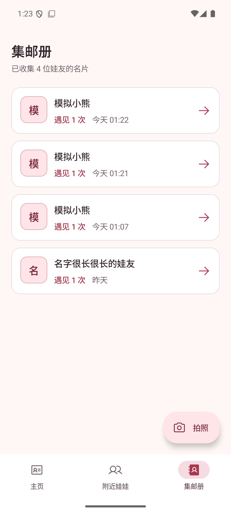
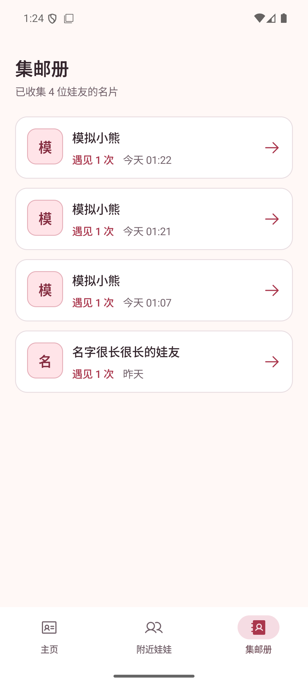

# 集邮册快捷拍照入口移除验证

## 设备、数据和范围

- Android Emulator，AVD `PengWaSignal`，`sdk_gphone64_x86_64`，Android 16 / API 36，`emulator-5554`。
- 1080 × 2400，浅色主题，运行中的 Debug APK；两张截图使用同一组模拟集邮册数据。
- 变更前保留右下角“拍照”悬浮按钮；变更后移除按钮及其专属点击逻辑，不影响扫码和名片详情内的合影功能。

| 集邮册 · 浅色 | 变更前 | 变更后 |
| --- | --- | --- |
| 同一组模拟名片 |  |  |

## 复现与验证

1. 执行 `bash ./gradlew :app:installDebug`，启动 `app.pengwa.debug`。
2. 点击底部“集邮册”，确认右下角不再显示“拍照”按钮。
3. 点击原按钮所在的右下角空白区域，确认仍停留在集邮册，未打开相机。
4. 执行 `bash ./gradlew :app:testDebugUnitTest :app:lintDebug`，均已通过。
