# 自定义卡片首版：运行截图与验证记录

关联需求：[#15](https://github.com/xh321/PengWa/issues/15)。自定义用户卡片首版实现。

## 环境和数据

- 设备：Android Emulator `sdk_gphone64_x86_64`（AVD `PengWaIcon`），Android 16 / API 36。
- 默认分辨率 1080×2400，density 420；窄屏为 840×1680（320×640 dp），字体比例 1.5。
- 截图来自运行中的 Debug APK，通过 `adb exec-out screencap -p` 获取；不是 Layoutlib 渲染图。
- “小棉花”、`@cotton_demo`、`example.com` 链接、UUID `000…001` 和笑脸图片均为合成数据。
  实际主页验证使用新建的测试身份 `CottonTest`，该 ID 来自模拟器测试安装，无真实用户信息。
- before 取自本次修改前的 HEAD 构建；after 取自本次实现构建。基础页面使用相同的固定场景和设备。
- `UiPreviewActivity` 中的卡片场景使用真实 Compose 编辑／展示组件，隔离真实联系人和交换硬件。
  硬件链路验证不包含在这些固定场景截图内。

## 已有界面对比

| 页面／状态 | 变更前 | 变更后 |
|---|---|---|
| 主页，出示且已为默认钱包，浅色 | 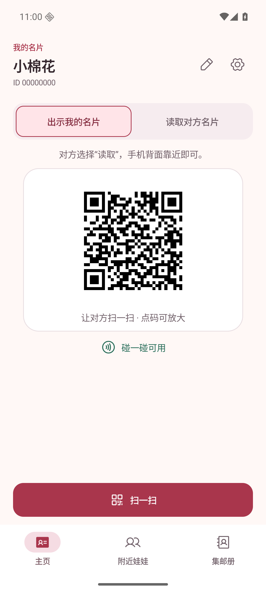 | 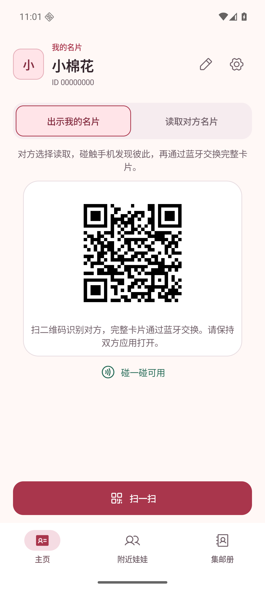 |
| 主页，同场景深色 | 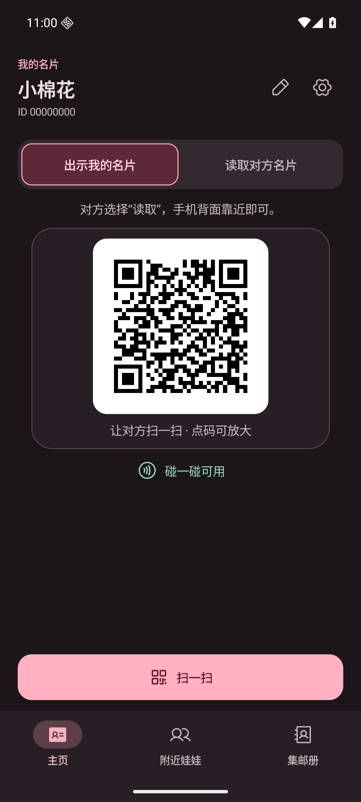 | 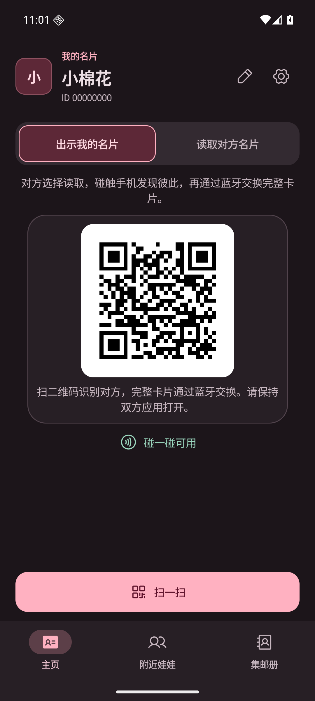 |
| 主页，默认钱包提示，浅色 | 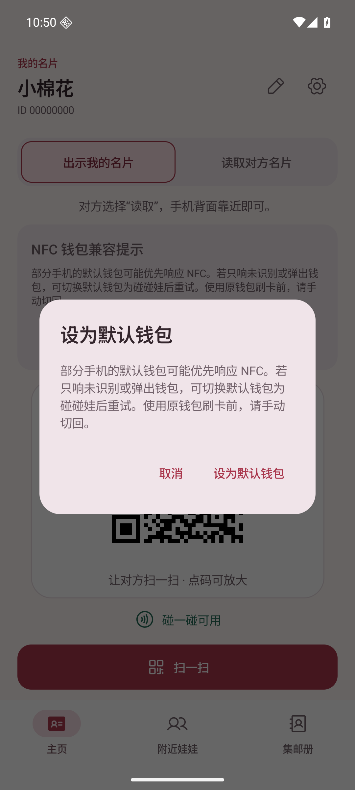 | 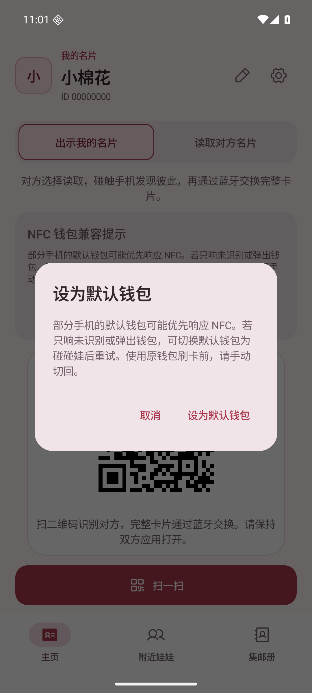 |
| 基础联系人详情，浅色 | 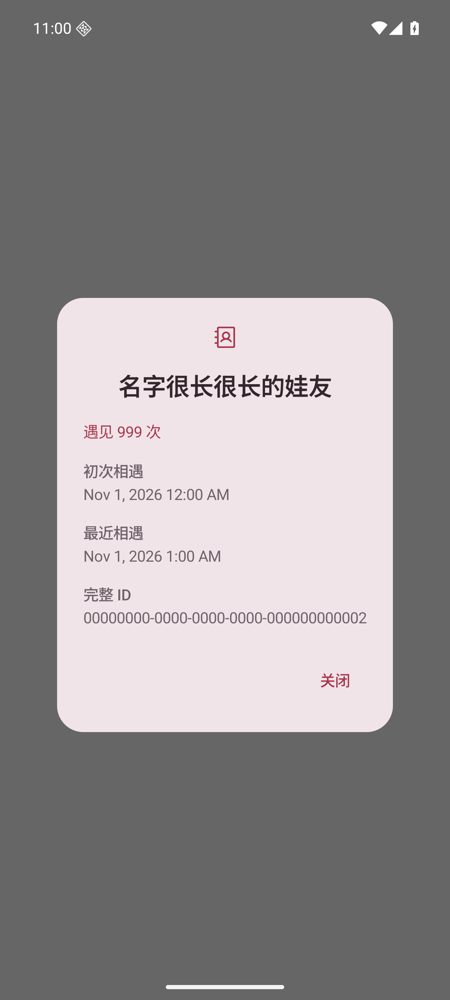 | 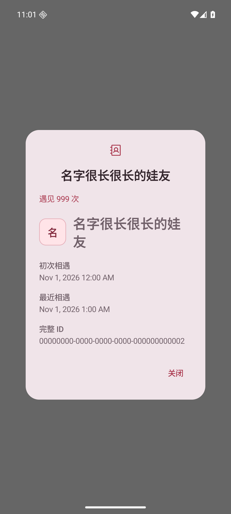 |
| 基础联系人详情，深色 | 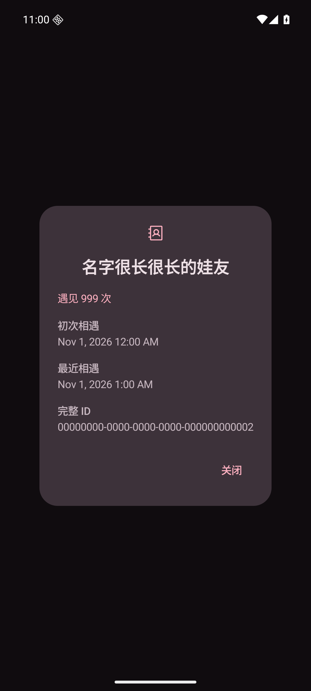 | 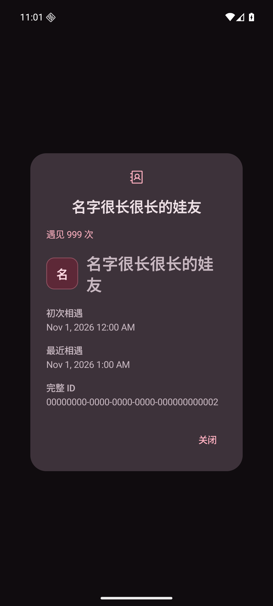 |

主页固定场景复现：

```sh
adb shell am force-stop app.pengwa.debug
adb shell am start -n app.pengwa.debug/app.pengwa.ui.UiPreviewActivity --es screen home --ei sample 1
# sample 0 为默认钱包提示；详情用 --es screen details
# 深色：adb shell cmd uimode night yes；浅色：adb shell cmd uimode night no
```

## 新增页面和状态

| 页面／状态 | 截图 |
|---|---|
| 卡片编辑，头像、文字和链接块，浅色 | 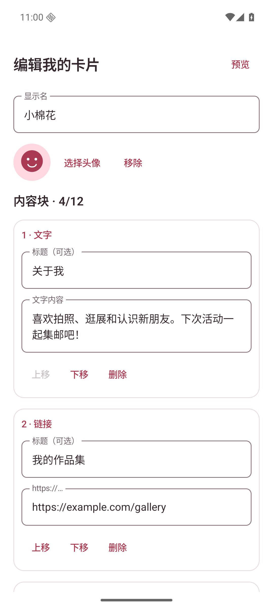 |
| 卡片编辑，深色 | 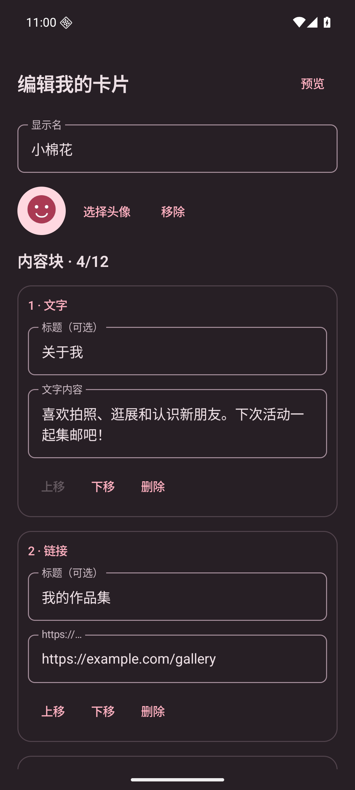 |
| 编辑页底部，小图、添加内容块和保存入口 | 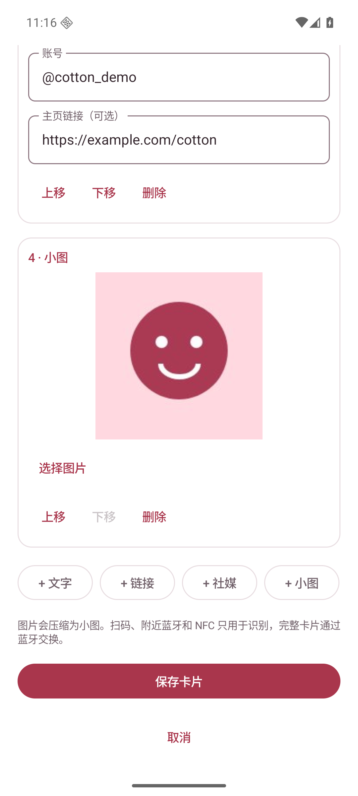 |
| 实际编辑页，空链接保存被拒绝且保留草稿 | 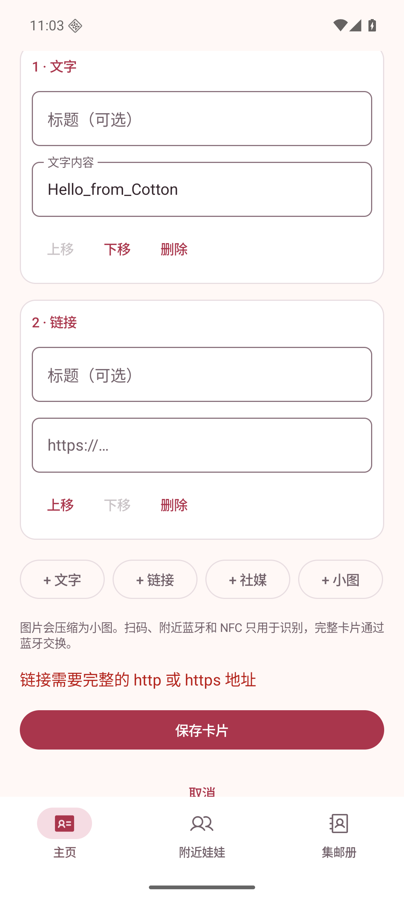 |
| 完整卡片预览，四种块，浅色 | 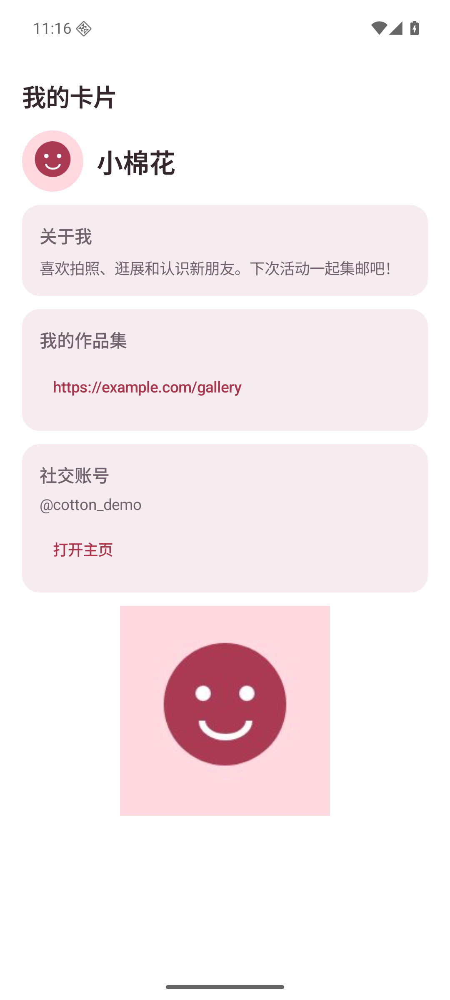 |
| 完整卡片预览，深色 | 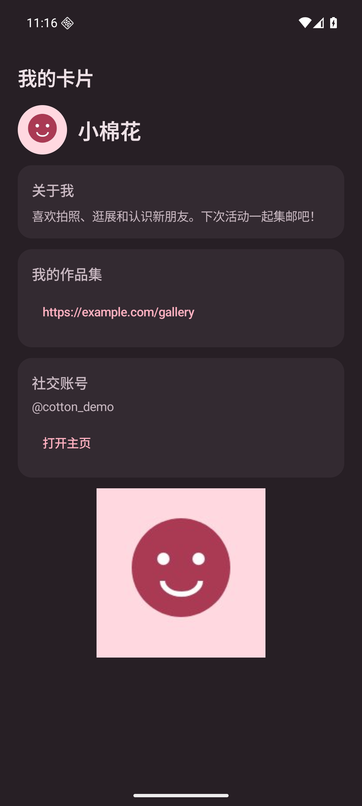 |
| 收到的完整卡片详情，浅色 | 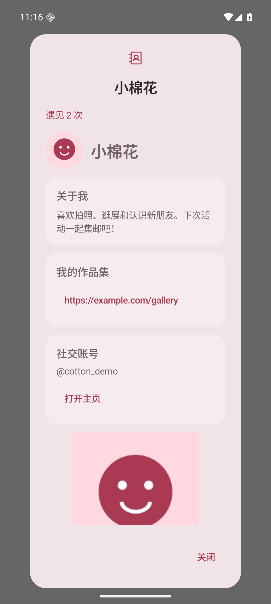 |
| 收到的完整卡片详情，深色 | 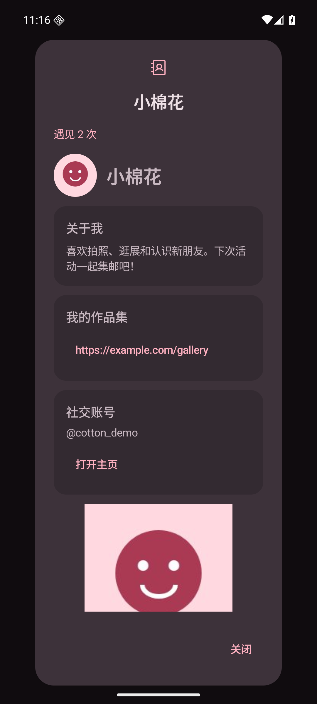 |
| 320 dp 窄屏、1.5 倍字体，编辑 | 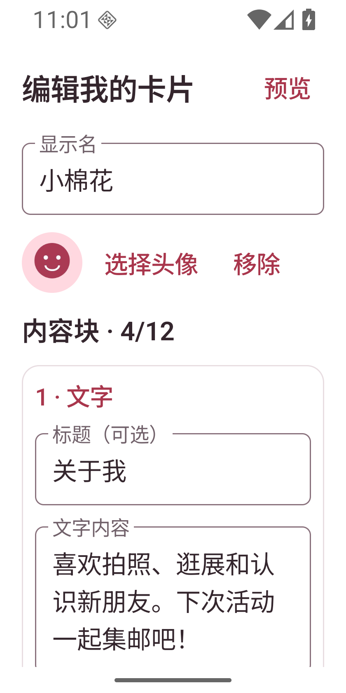 |
| 320 dp 窄屏、1.5 倍字体，预览 | 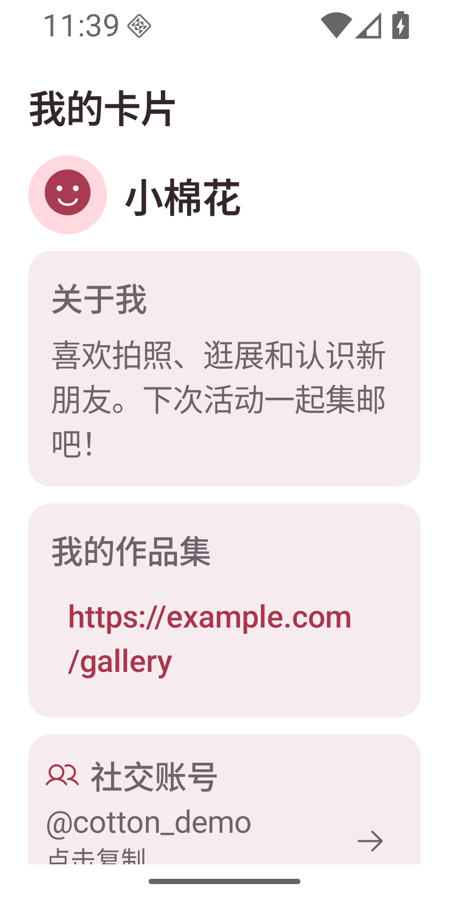 |
| 实际 MainActivity 主页，蓝牙未授权、NFC 不支持 | 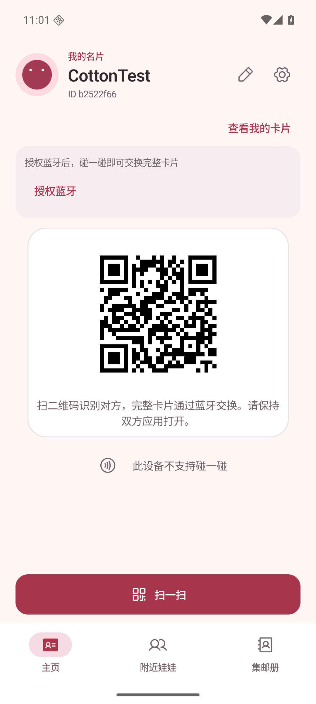 |

固定卡片场景复现：

```sh
adb shell am force-stop app.pengwa.debug
adb shell am start -n app.pengwa.debug/app.pengwa.ui.UiPreviewActivity --es screen card-editor
# card 为完整预览；card-received 为完整联系人详情。
# 编辑页向上滑动可查看其余块、排序／删除和保存按钮。
adb shell wm size 840x1680
adb shell settings put system font_scale 1.5
# 重开同一场景，完成后恢复：
adb shell wm size reset
adb shell settings put system font_scale 1.0
```

## 已验证

- `testDebugUnitTest`：180 项通过，0 失败。覆盖原有逻辑及完整卡片编解码、96 KiB 总限额、
  12 KiB 图片参与的多包传输、MTU 23/64/247/517、重复／跳包／总长变更／超限拒绝、
  不安全链接、NFC 仅含标识、旧 NFC 不兼容、新二维码不包含卡片字段、旧二维码仅提取标识。
- `assembleDebug`、`lintDebug` 成功；Lint 没有 error，仍有 SDK／资源／依赖等 warning。
- 实际 MainActivity：创建测试身份，添加文字块，保存，force-stop 后重开并查看卡片，文字仍保留。
- 实际 MainActivity：系统照片选择器选择合成图片作为头像，保存、force-stop 后重开，头像和文字均保留。
- 实际 SQLite 升级：在测试模拟器植入含 `MigrationTest`、相遇 3 次的 v1 数据库，
  由实际集邮册页面打开；数据库升级为 v2，增加 `card BLOB`，原记录、名字和相遇次数保留，旧卡片可展示。
- 运行中检查浅色／深色卡片与联系人详情、编辑页滚动和窄屏大字体布局。
- 固定卡片编辑场景点击“下移”，第一块由文字变成链接；删除第一块后计数从 4 变为 3，文字恢复为第一块。
- 实际 MainActivity 添加空链接后保存，显示地址校验错误并保留草稿；取消并放弃后，已保存的头像和文字不受影响。

构建命令（环境中的 Gradle Wrapper 文件没有可执行位，因此用 bash）：

```sh
JAVA_HOME=/tmp/pengwa-tools/jdk-21.0.13+9 \
ANDROID_HOME=/tmp/pengwa-tools/android-sdk \
bash gradlew testDebugUnitTest assembleDebug lintDebug --console=plain
```

## 尚未验证，不能标为完成

当前仅有一个不支持 NFC 的 Android 模拟器，没有两台可实际碰触的 Android 真机。
因此以下仍是交付前的硬件验收项：

1. NFC 读取／出示双向识别后，蓝牙自动连接、完整传输头像及四类内容块；换角色后重试。
2. 一方展示二维码，另一方用真实相机识别，蓝牙匹配正确设备，展示方同意后双方入册。
3. 附近列表手动申请，前台／后台确认，完成多包双向传输。
4. 传输中关闭蓝牙、撤销权限、退后台或移远后的反馈与重试；超时、拒绝不产生不完整记录。
5. 最大卡片在不同 MTU、不同品牌上的耗时和可靠性，以及双向同时申请。
6. 真实 NFC 钱包路由、NDEF 系统拉起、Android 10–15 的权限和设备差异。

后续 PR 描述应内嵌上述已有界面对比与新增页面截图，并明确保留这些未验证项；
这些截图证明运行界面和本地操作，不代表双机通信已验收。

小图纯图片展示、透明 PNG 导入和自由比例的补充验证见 [小图截图](../image-only/README.md)。
