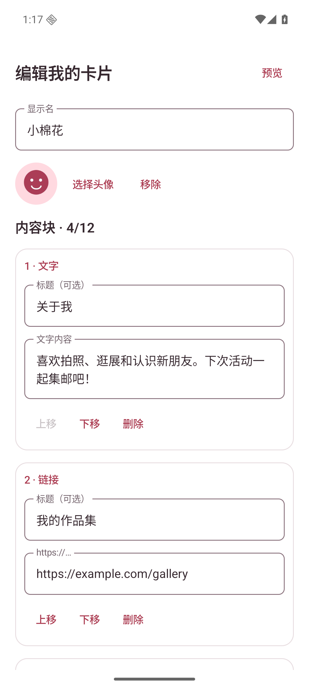
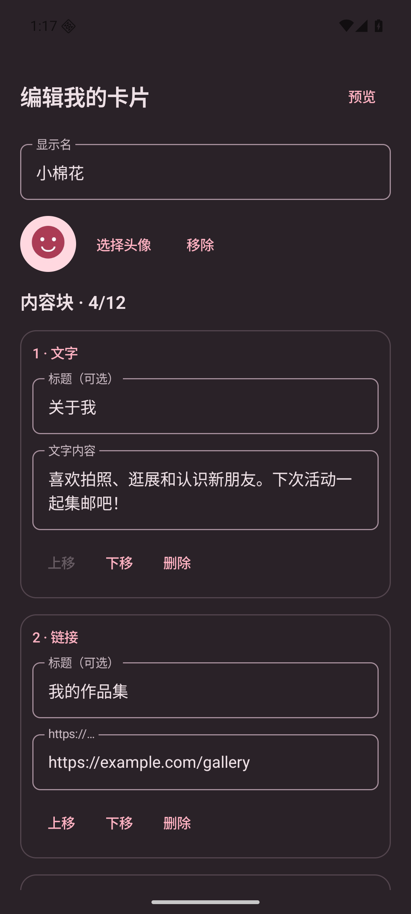
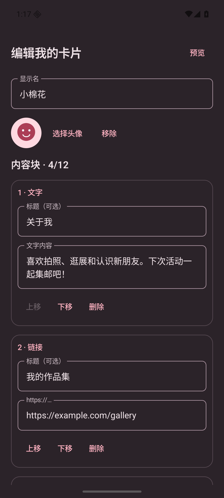
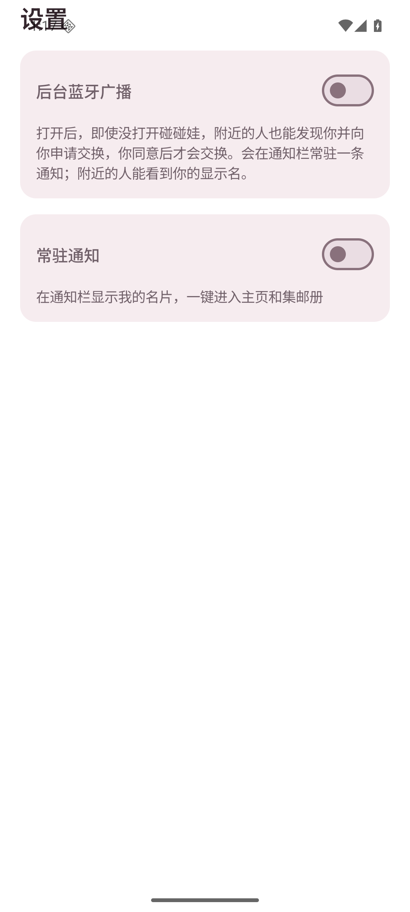
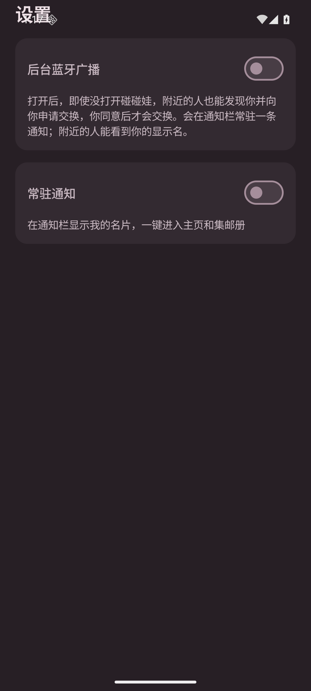

# DataStore 存储替换验证

设备：Android Emulator PengWaIcon（sdk_gphone64_x86_64），Android 16 / API 36。
截图使用 UiPreviewActivity 内置合成数据，无真实身份或联系人信息。变更前为 main 661e145，变更后为本分支。

复现：安装相应 Debug APK，执行 `adb shell cmd uimode night no` / `yes` 切换浅色／深色；关闭应用后执行：

```
adb shell am start -n app.pengwa.debug/app.pengwa.ui.UiPreviewActivity --es screen card-editor
adb shell am start -n app.pengwa.debug/app.pengwa.ui.UiPreviewActivity --es screen settings
adb exec-out screencap -p > screenshot.png
```

核对卡片编辑和设置页面的显示。异步保存期间禁止重复提交；保存结束后才进入下一步。磁盘和迁移行为由 IdentityMigrationTest 验证：旧 GUID、完整卡片、引导进度与两个布尔开关迁移、迁移后写回、并发首次初始化与已有用户兼容。主 Activity 已在模拟器上验证能在存储就绪后正常进入主页。

## 卡片编辑 / light

| 变更前 | 变更后 |
|---|---|
|  |  |

## 卡片编辑 / dark

| 变更前 | 变更后 |
|---|---|
|  |  |

## 设置 / light

| 变更前 | 变更后 |
|---|---|
|  |  |

## 设置 / dark

| 变更前 | 变更后 |
|---|---|
|  |  |

