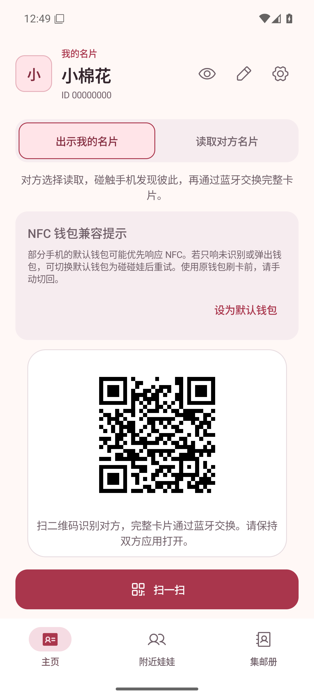
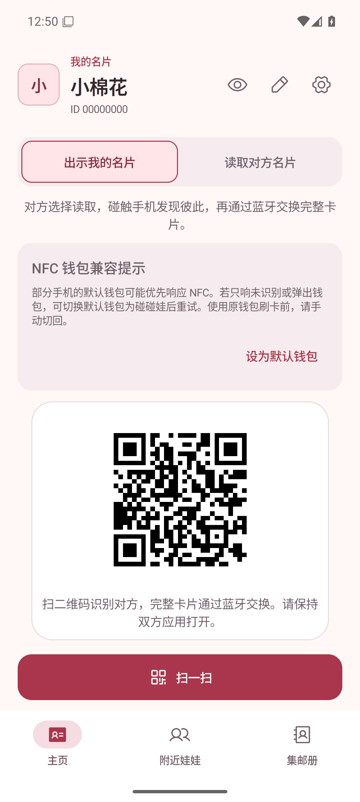
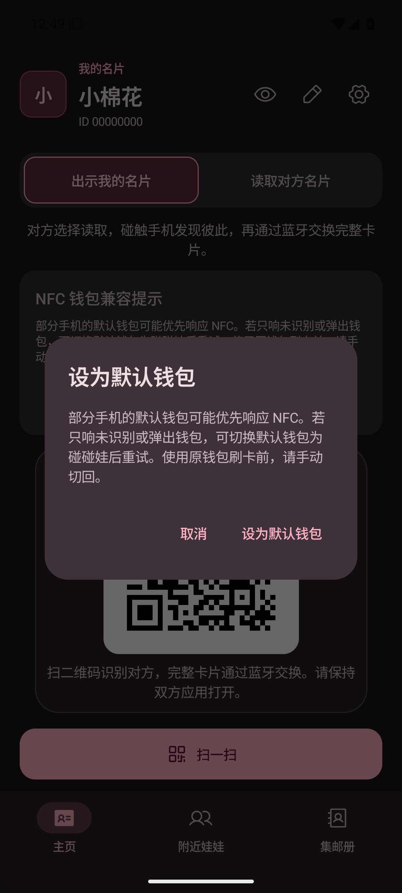
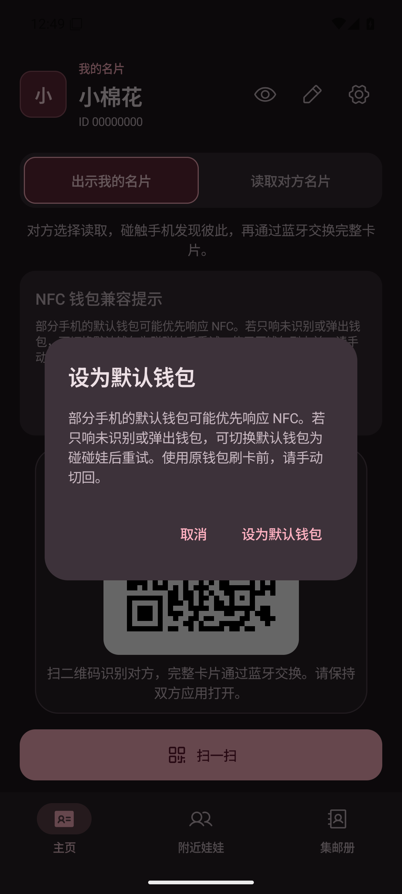

# 交换性能协议 V3：二维码载荷版本更新

设备：Android Emulator sdk_gphone64_x86_64，emulator-5556；Android 16（API 36）。
截图来自安装 APK 后运行中的 UiPreviewActivity，使用内置测试身份，无真实用户信息。

步骤：安装 V2 / V3 APK，设置系统浅色或深色，启动：
`adb shell am start -n app.pengwa.debug/app.pengwa.ui.UiPreviewActivity --es screen home --ei sample 0`

| 状态 | V2 | V3 |
|---|---|---|
| 主页二维码／浅色 |  |  |
| 主页二维码／深色 |  |  |

二维码像素随 D3 载荷改变，布局没有调整。截图仅验证运行中的显示，不证明 NFC / BLE 识别、确认或真实传输性能；双真机验证待补。

## V4：申请先于图片上传

同设备、Android 16 / API 36。`qr-v4-before/after-{light,dark}.png` 为 V3/V4 的主页二维码；
`qr-request-v4-before/after-{light,dark}.png` 为同版本的确认弹窗，启动参数改为 `--es screen request`。
弹窗内容和布局未调整。静态测试场景只能验证显示，申请先于图片的时序仍需双真机日志核验。

## V5：直接匹配与连接复用

同设备、Android 16 / API 36，`qr-v5-before/after-{light,dark}.png` 对应 V4/V5 的主页二维码。
启动方式和主题切换同 V3，使用内置测试身份。定位符在每次进程启动时随机产生，因此重新启动二维码像素也会变化。
截图不验证蓝牙广播、连接复用或实际交换性能，双真机验证待补。

## V6：窗口通知下载

同设备、Android 16 / API 36，`qr-v6-before/after-{light,dark}.png` 对应 V5/V6 的主页二维码；
`qr-received-v6-before/after-{light,dark}.png` 对应 V5/V6 的收到的带图卡片测试场景，启动参数为 `--es screen card-images-received`。
固定测试卡片含横图、竖图及透明 PNG。图文布局未调整。图片来自固定测试场景，不能当作真实蓝牙接收证据；端到端传图及实际提速需双真机补验。
