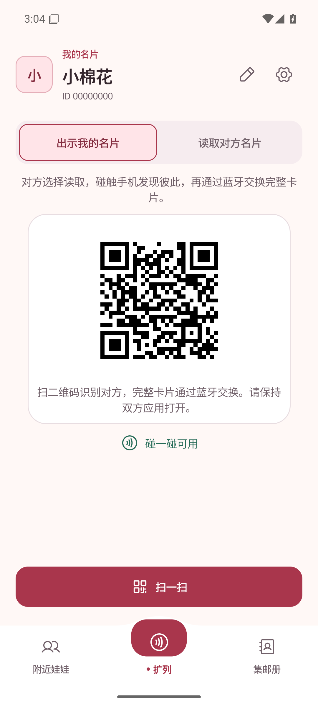
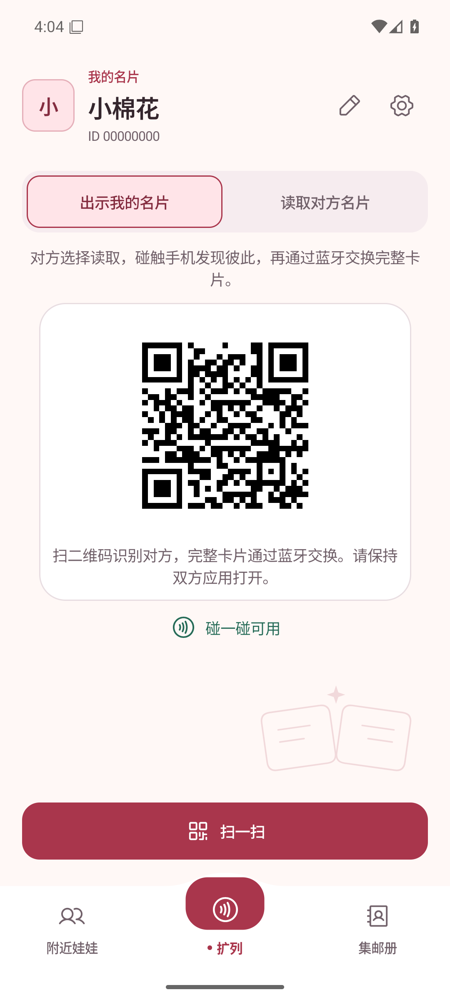
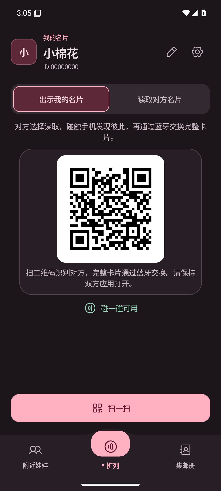
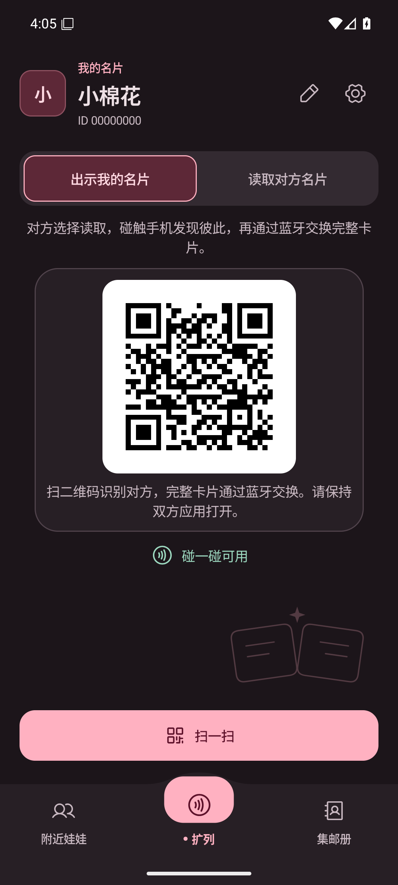
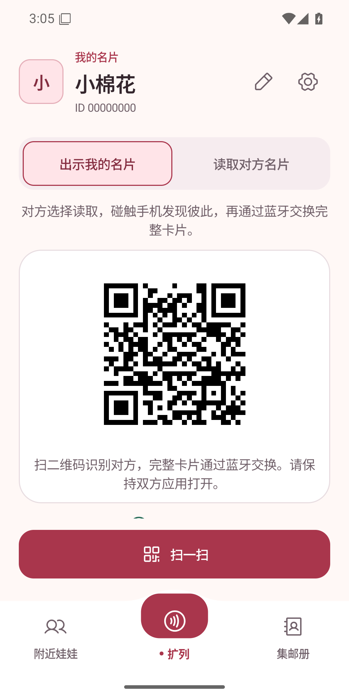
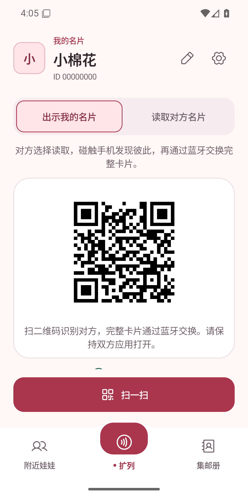
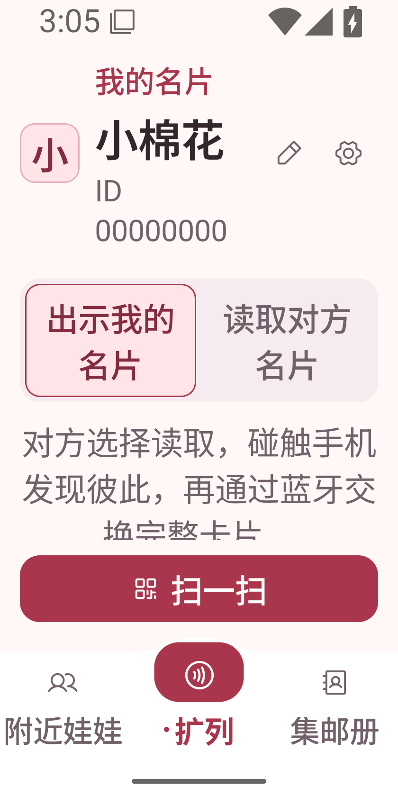
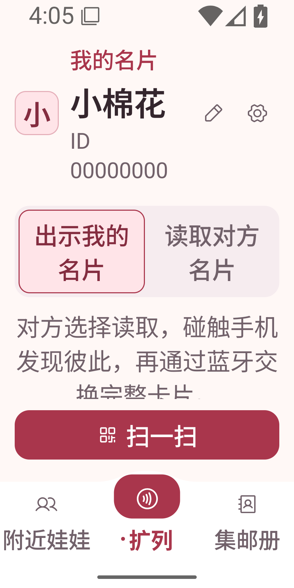
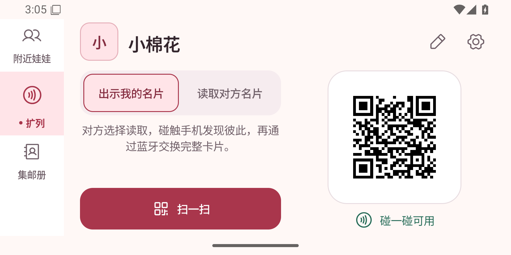
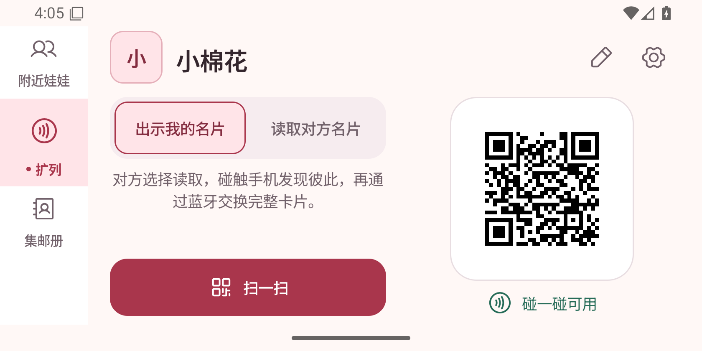

# 主页面背景装饰

主页面交换区新增由两张无头像线框名片与一颗四角闪光组成的几何标记，仅表达“相遇”，不引入人物或额外视觉故事。装饰位于右下角、扫一扫按钮上方，不参与布局、点击或无障碍朗读；显示宽度为 168dp。二维码继续使用不透明白底。

资源：[`home_encounter_mark.xml`](../../../app/src/main/res/drawable/home_encounter_mark.xml)，240 × 160 viewport 的 Vector Drawable。运行时统一着主题 `primary` 色，浅色透明度 16%，深色透明度 24%；不再使用位图或生成图。交换区高度不足 440dp 时隐藏，避免短窗口里装饰与说明争抢空间。没有新增动画。

## 运行截图（PR 描述附录）

Android Emulator，`emulator-5570`，`sdk_gphone64_x86_64`，Android 16 / API 36，420 dpi。全部来自运行中的 Debug APK，通过 `adb exec-out screencap -p` 获取，使用 `UiPreviewActivity` 的固定合成身份“小棉花 / 00000000”，无真实用户信息。变更前后均为当前工作区代码，仅背景装饰不同。

| 页面／状态 | 变更前 | 变更后 |
| --- | --- | --- |
| 主页面，出示，1080 × 2400，浅色 |  |  |
| 主页面，出示，1080 × 2400，深色 |  |  |
| 主页面，出示，984 × 1968（375dp），浅色 |  |  |
| 主页面，出示，840 × 1680（320dp），2 倍字体，浅色 |  |  |
| 主页面，出示，1680 × 840，横屏，浅色 |  |  |

## 复现

1. 执行 `bash ./gradlew :app:assembleDebug :app:lintDebug`，安装 `app/build/outputs/apk/debug/app-debug.apk`。
2. 执行 `adb -s emulator-5570 shell am start -n app.pengwa.debug/app.pengwa.ui.UiPreviewActivity --es screen home --ei sample 1`。此入口复用生产页面的 `FaceToFacePageContent` 与装饰组件，不启动交换硬件。
3. 使用 `shell cmd uimode night yes/no` 切换主题；每次等待页面重绘后截图。
4. 使用 `shell wm size 984x1968` 验证小手机；`shell wm size 840x1680` 和 `shell settings put system font_scale 2.0` 验证大字；恢复字体后用 `shell wm size 1680x840` 验证横屏。短窗口隐藏插画，控件继续沿用原有滚动布局。
5. 使用 `adb -s emulator-5570 exec-out screencap -p > screenshot.png` 保存图片。结束后执行 `shell wm size reset`、`shell settings put system font_scale 1.0`、`shell cmd uimode night no` 恢复。

## 验证边界

`:app:assembleDebug` 和 `:app:lintDebug` 通过。上述运行截图用于核对装饰位置、主题与布局；没有修改交换逻辑，未进行双机 NFC／蓝牙或真实扫码交换验证。
