# 小图仅展示图片与自由形状

PR #16 的后续调整：小图在预览和联系人详情中移除标题、底框、内边距和裁切，保留原始宽高比。
编辑页仅提供图片选择／排序／删除，不再提供图片标题输入；旧标题仍保留在数据中作为无障碍描述。
透明图片使用 PNG 导入并随卡片传输，保持不规则轮廓；超过单图 12 KiB 时继续按比例缩小。

## 运行截图

Android Emulator `sdk_gphone64_x86_64` / AVD `PengWaIcon`，Android 16 / API 36，1080×2400，density 420。
全部为运行中的 Debug APK，通过 adb screencap 获取；复用实际编辑／展示组件，非 Layoutlib 截图。
所有数据为固定合成姓名、UUID 和测试图片，无真实用户信息。对比使用同一组图片：
横图 240×80、竖图 64×192、透明圆形 PNG 160×160、方图 96×96。

| 页面／状态 | 变更前 | 变更后 |
| --- | --- | --- |
| 图片卡片／浅色 | 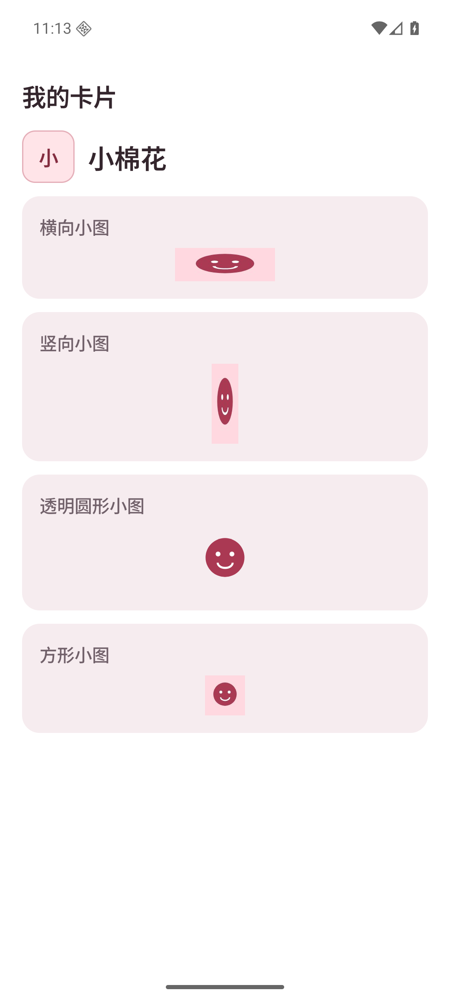 | 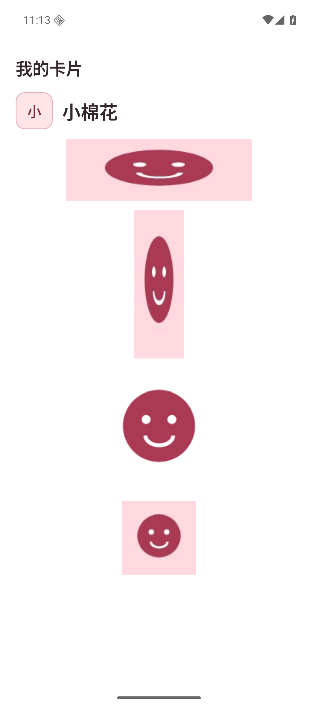 |
| 图片卡片／深色 | 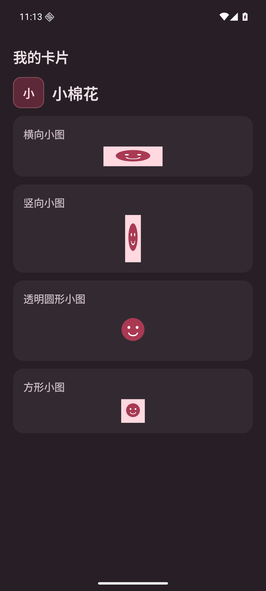 | 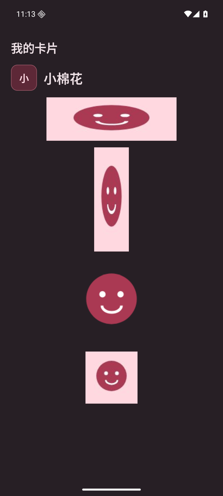 |
| 编辑／浅色 | 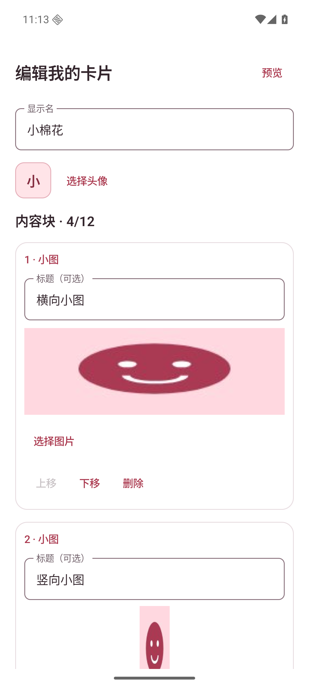 | 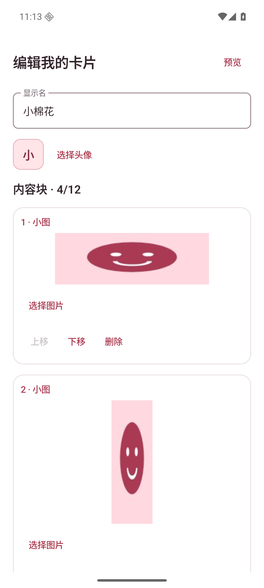 |
| 编辑／深色 | 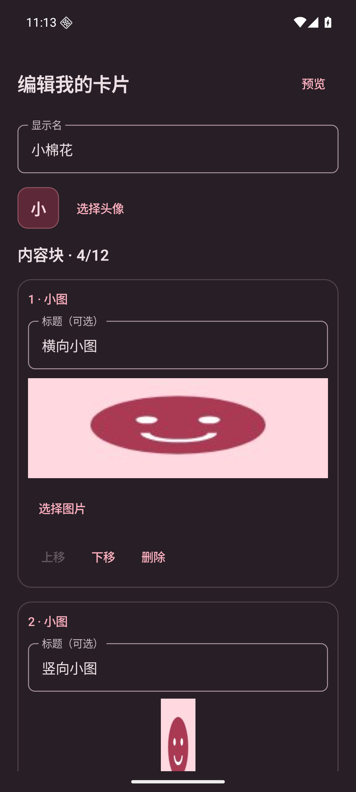 | 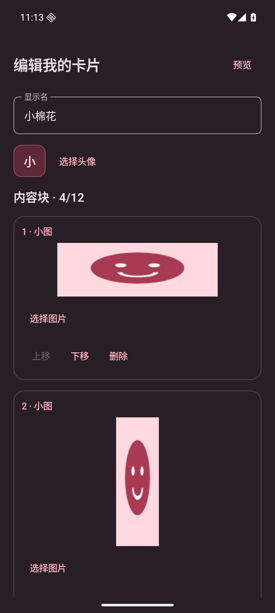 |
| 收到的卡片／浅色 | 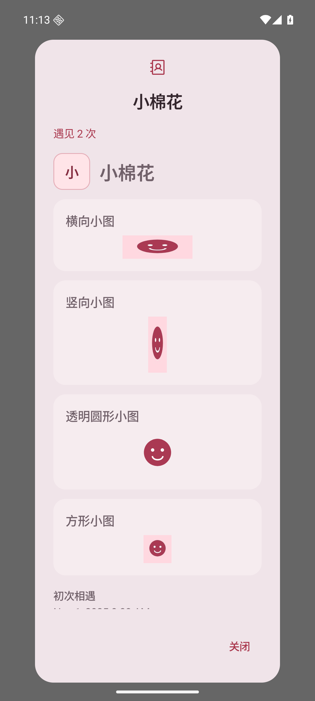 | 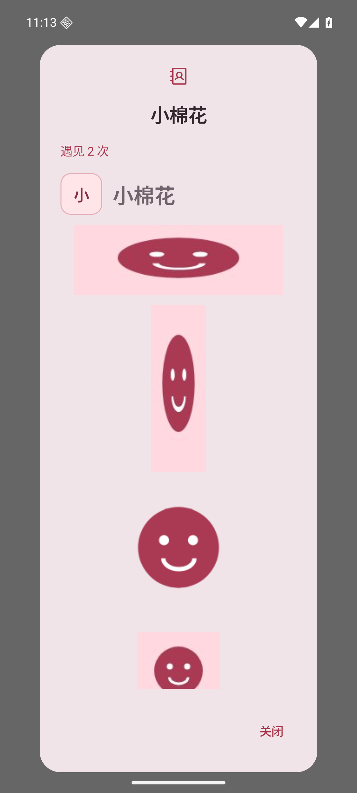 |
| 收到的卡片／深色 | 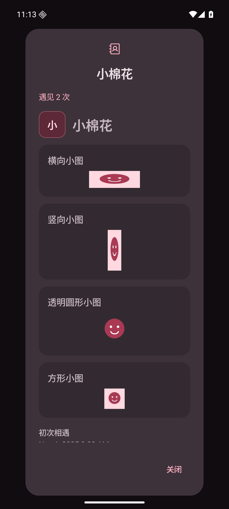 | 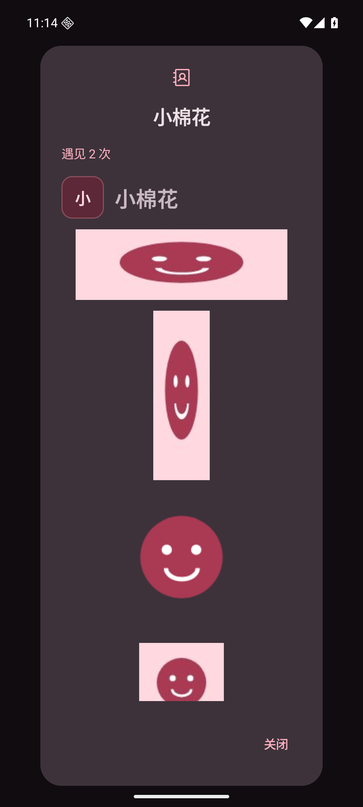 |

窄屏（320×640 dp、1.5 倍字体）：[图片展示](shapes-narrow-large-font.png)、[编辑](editor-narrow-large-font.png)。

复现：

```sh
adb shell am force-stop app.pengwa.debug
adb shell am start -n app.pengwa.debug/app.pengwa.ui.UiPreviewActivity --es screen card-images
# card-images-editor 为编辑；card-images-received 为收到的卡片。
# 深色：adb shell cmd uimode night yes；浅色：adb shell cmd uimode night no。
```

## 验证

- `testDebugUnitTest assembleDebug lintDebug`：180 项单元测试通过，构建与 Lint 无 error。
- 新测试验证透明 PNG 内容经卡片编码完整保留，损坏的 PNG 首尾被拒绝。
- 模拟器检查横图、竖图、方图与透明圆形的完整轮廓，深浅主题下不出现额外底框或标题。
- 编辑页移除图片标题字段，图片预览与卡片展示使用同一组件。
- 实际 MainActivity 通过系统照片选择器导入 480×240 的透明 PNG，保存并强制结束后重开；存储结果为 384×192 PNG，保持 2:1 原比例，透明角像素 alpha=0，大小小于 12 KiB。

实际导入、保存和重启后的测试卡片：

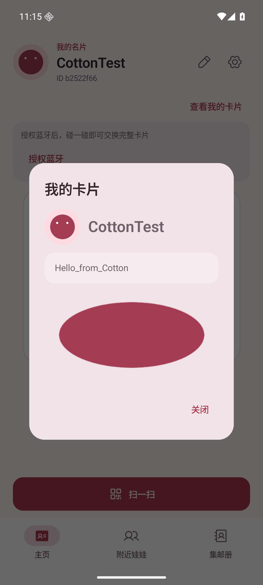

本次不改变 BLE 传输流程；双真机完整链路仍待原 PR 所列硬件验收。
