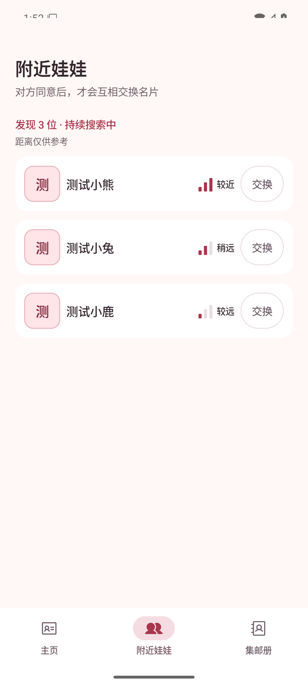
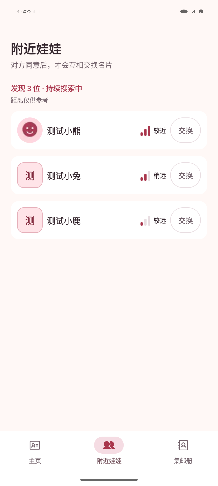
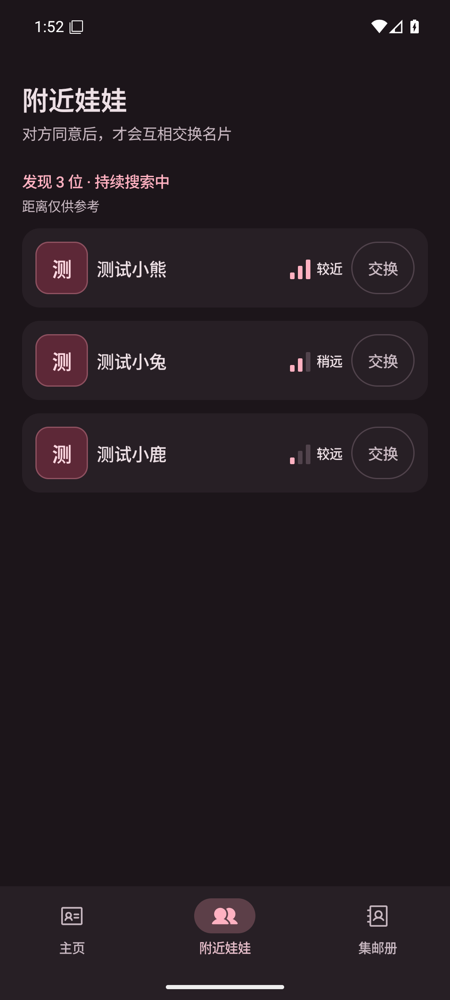
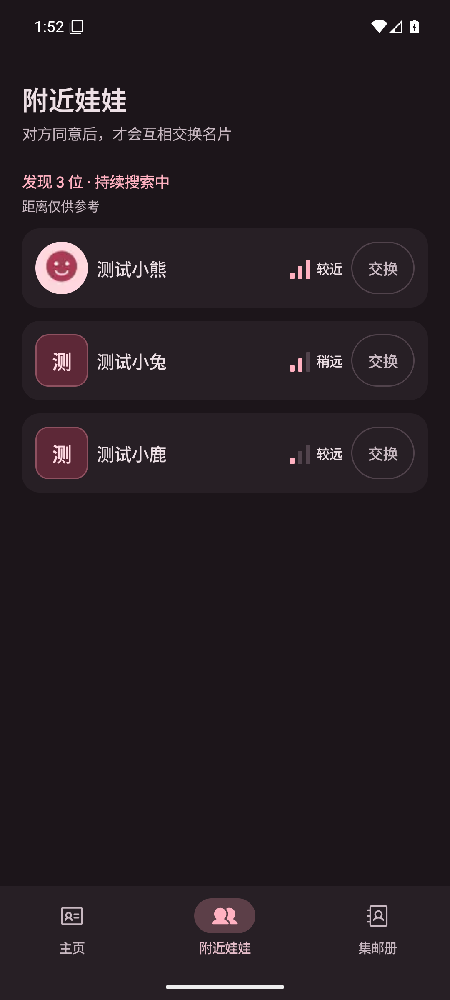
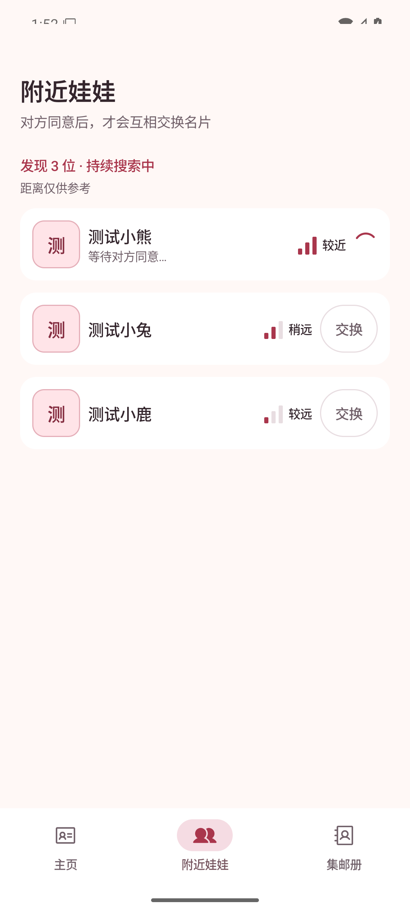
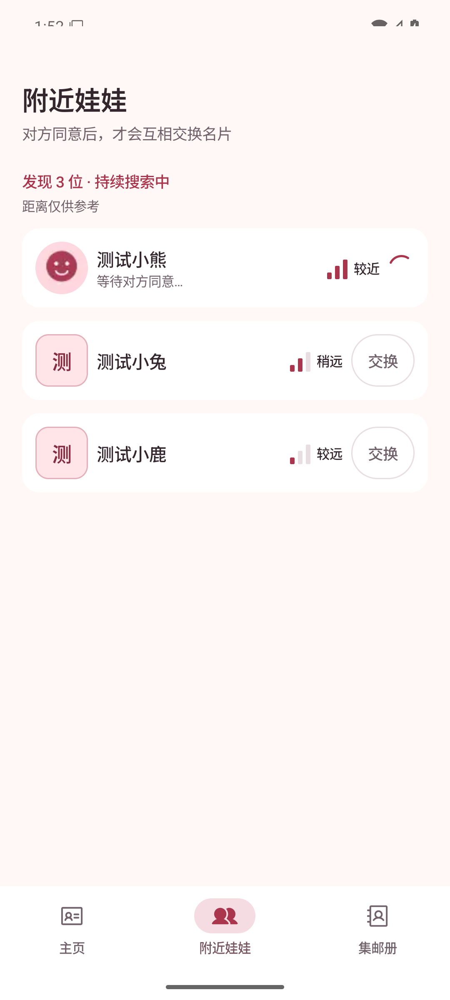
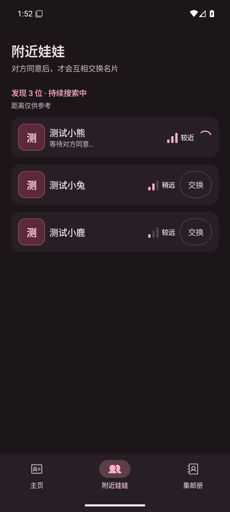
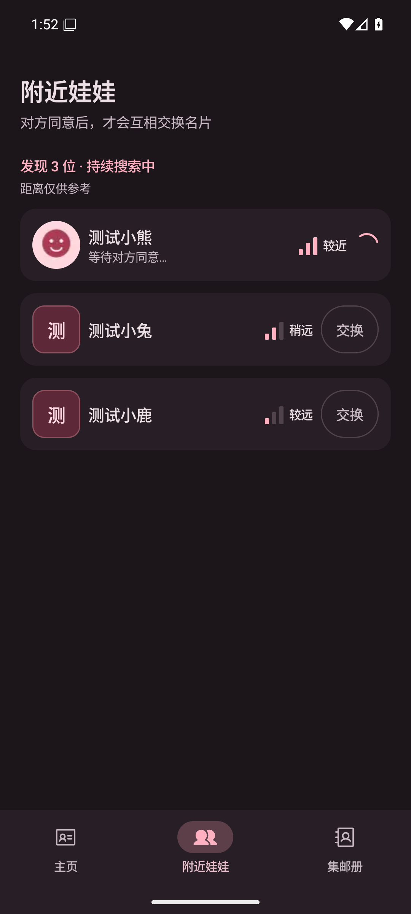
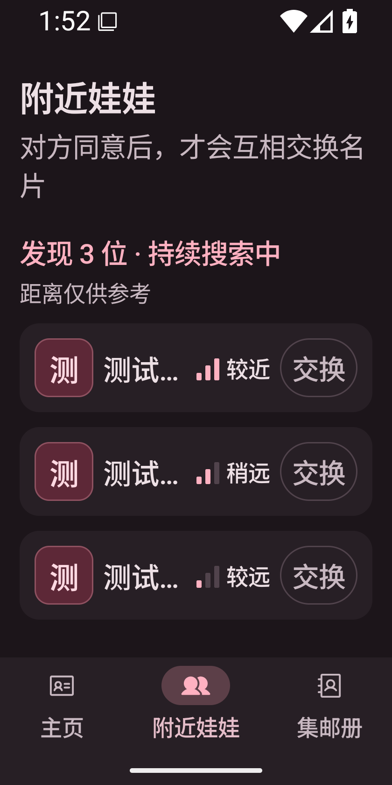
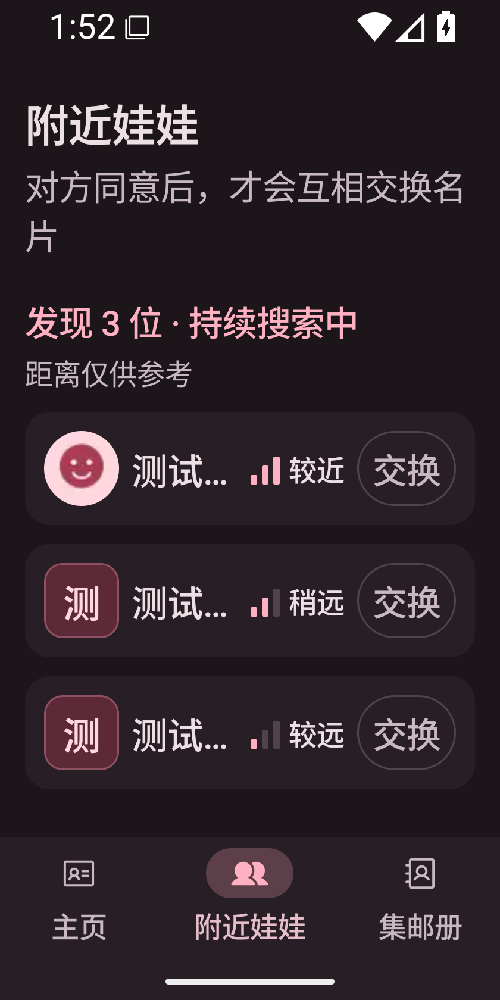

# 附近娃娃显示头像

基于 #36 的去重与稳定排序，加入可选公开头像预览。测试小熊使用程序生成的笑脸，测试小兔无头像，测试小鹿的损坏图片必须回退为文字头像；同一身份换蓝牙地址仍只有一行，等待同意时保持头像和状态。

## 环境与来源

- 独立 Android Emulator `PengWaAvatar`，`emulator-5558`，`sdk_gphone64_x86_64`，Android 16 / API 36。
- 常规 1080 × 2400，420 dpi，字体 1.0 倍；浅色和深色。
- 窄屏 840 × 1680，420 dpi，字体 1.5 倍，深色。
- 全部截图来自运行中的 Debug APK，通过 `adb exec-out screencap -p` 获取，无真实照片、姓名或用户 ID。
- 调试入口 `nearby-avatar` 使用真实列表模型和现有 Coil 解码器。变更前对照用同一组虚构人名和状态，不注入头像，展示与 #36 相同的文字头像；变更后注入实际压缩生成的头像及损坏图片。截图未经过修改，不代表实体 BLE 收图已测；GATT 验证另见 [开销报告](../../nearby-avatar-overhead.md)。

## 前后对比（可直接用于 PR 描述）

| 页面 / 状态 | 变更前 | 变更后 |
|---|---|---|
| 附近娃娃，浅色，头像 / 无头像 / 损坏回退 |  |  |
| 附近娃娃，深色，同一身份换地址仍一行 |  |  |
| 附近娃娃，浅色，等待同意 |  |  |
| 附近娃娃，深色，等待同意 |  |  |
| 附近娃娃，深色，窄屏大字 |  |  |

## 复现

1. `bash ./gradlew :app:assembleDebug`，安装 `app/build/outputs/apk/debug/app-debug.apk`。
2. `adb -s emulator-5558 shell cmd uimode night no` 为浅色，`yes` 为深色。
3. 每次场景切换先强制停止应用，再启动：

   ```sh
   adb -s emulator-5558 shell am force-stop app.pengwa.debug
   adb -s emulator-5558 shell am start -n app.pengwa.debug/app.pengwa.ui.UiPreviewActivity --es screen nearby-avatar --ei sample 1
   ```

   `sample 10` 为变更前常规状态，`1` 为变更后；`12` 为变更前等待状态，`2` 为变更后。所有场景保持 3 人；变更后只有第一行显示头像，其余回退文字头像，等待状态没有重复申请按钮。
4. 窄屏使用 `adb -s emulator-5558 shell wm size 840x1680` 和 `adb -s emulator-5558 shell settings put system font_scale 1.5`，确认头像、名字、信号与申请按钮可见。
5. 稳定后执行 `adb -s emulator-5558 exec-out screencap -p > screenshot.png`。完成后 `wm size reset` 并恢复字体 1.0 倍。

UI 截图验证已完成；实体手机的无线耗时、功耗和低端机表现仍待实测。
