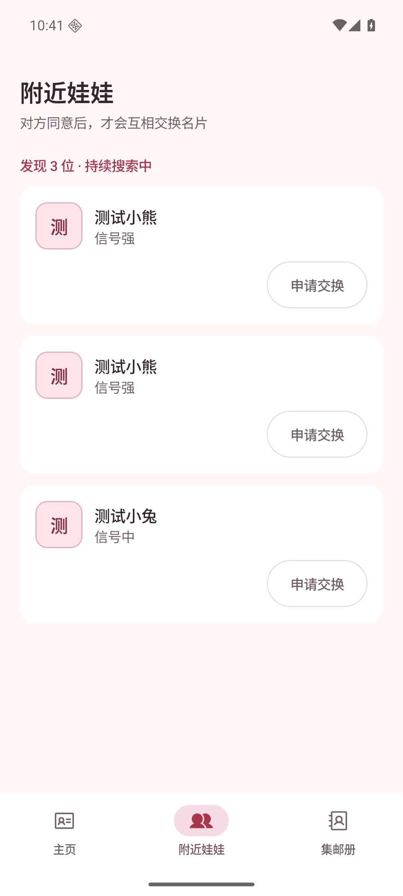
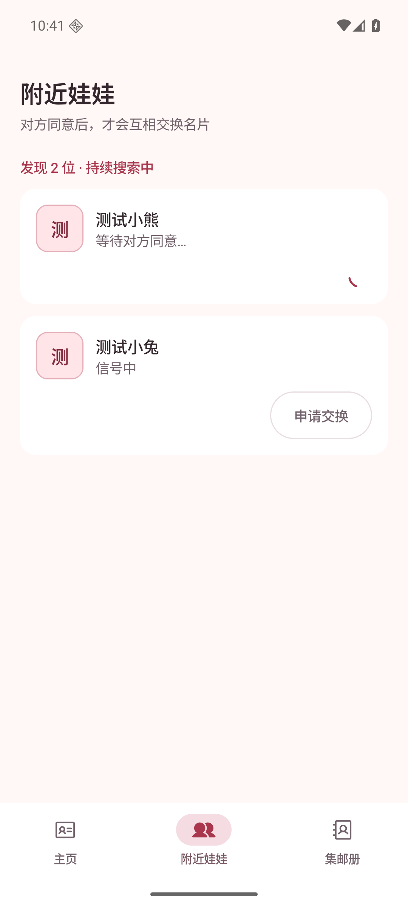

# 附近娃娃按用户身份去重

## 变更与验证

附近列表优先读取由用户 UUID 派生的稳定身份摘要，同一身份的多个蓝牙地址合并成一行。完整 UUID 的读取仍需要同意。名字相同但身份不同的设备保留两行；已有申请等待时保留连接地址和等待状态，阻止通过另一地址重复申请。

截图来自运行中的 Debug 应用，使用 `UiPreviewActivity` 的确定性测试数据，未使用 Layoutlib 渲染，也不含真实用户信息。

- 设备：Android Emulator `PengWaIcon`，`sdk_gphone64_x86_64`。
- Android：16；屏幕：1080 × 2400；浅色主题。
- 变更前：基于提交 `9c52d2c`，仅加入相同的调试场景入口，列表仍使用原来的地址去重逻辑。
- 变更后：当前代码，相同的输入设备、姓名、扫描时间和信号强度。
- 主场景输入：地址 `02:00:00:00:00:01` 和 `02:00:00:00:00:02` 属于 UUID `00000000-0000-0000-0000-000000000001`（测试小熊）；地址 `02:00:00:00:00:03` 属于 UUID `00000000-0000-0000-0000-000000000002`（测试小兔）。

## 前后对比（可用于 PR 描述）

| 页面 / 状态 | 变更前 | 变更后 |
|---|---|---|
| 附近娃娃，同一身份出现两个地址 |  |  |

其他关键状态：

| 同名不同身份仍显示 2 行 | 合并后保持等待状态，共 2 行 |
|---|---|
|  |  |

## 复现步骤

1. 构建并安装 Debug APK：`bash ./gradlew assembleDebug`，`adb install -r app/build/outputs/apk/debug/app-debug.apk`。
2. 运行主场景：

   ```sh
   adb shell am force-stop app.pengwa.debug
   adb shell am start -n app.pengwa.debug/app.pengwa.ui.UiPreviewActivity --es screen nearby-dedup --ei sample 0
   ```

3. 页面稳定后执行 `adb exec-out screencap -p > after.png`，确认只有测试小熊和测试小兔各一行，计数为 2。
4. 将 `sample` 改为 `1`，重新启动，确认两个不同身份都叫测试小熊，仍显示 2 行。
5. 将 `sample` 改为 `2`，重新启动，确认测试小熊合并为一行，显示“等待对方同意…”，没有重复申请按钮。
6. 变更前使用同一调试数据入口，但 `NearbyList.onPreview` 只传名字、不传身份摘要，运行原地址去重实现；主场景显示 3 行。

## 检查结果与边界

- `testDebugUnitTest`：171 项通过，包括跨地址去重、同名不同身份、等待状态、防重复申请、旧版交换后去重、旧地址清理、重试失败状态及新旧预览编解码。
- `assembleDebug`、`lintDebug` 通过。
- 截图验证的是运行中界面和实际列表模型，测试数据由调试入口注入；不代表真实 BLE 扫描或 GATT 通信已实测。
- 待双机验证：新特征发现和读取、实际地址变化、申请与完整名片交换，以及新版与旧版双向兼容。
- 旧版设备不提供稳定身份摘要，在交换前无法按身份去重；需要双方升级才能在预览阶段获得完整去重效果。
- 身份摘要可被主动读取者关联，也可被伪造，不提供身份认证；详见 `docs/protocol.md`。
