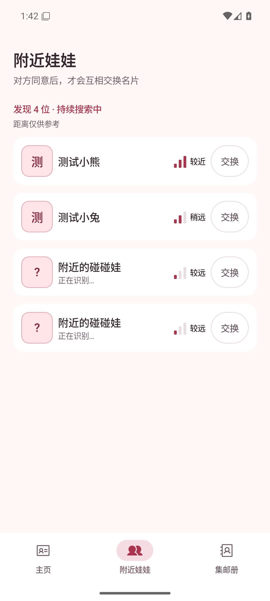
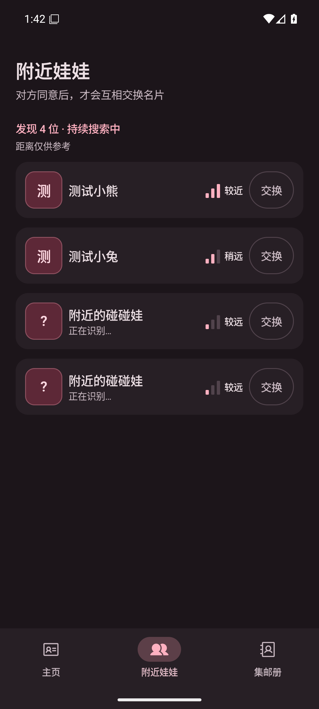
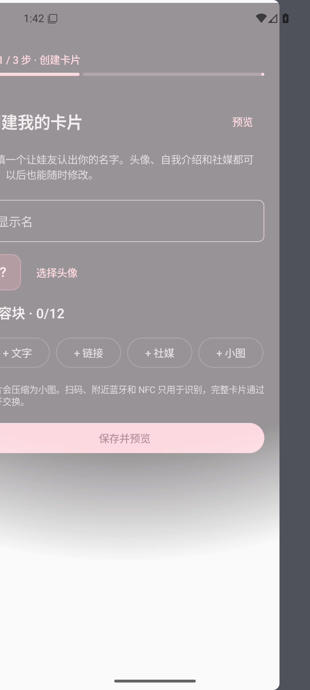
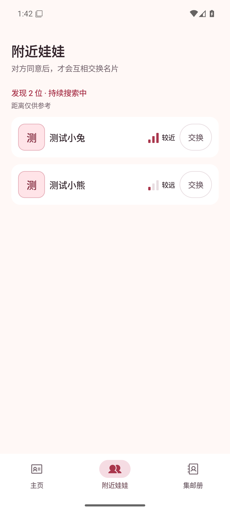
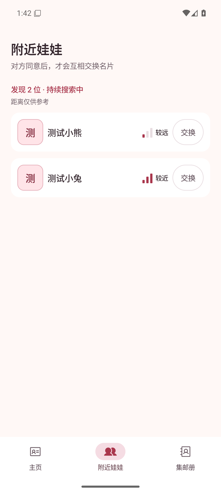
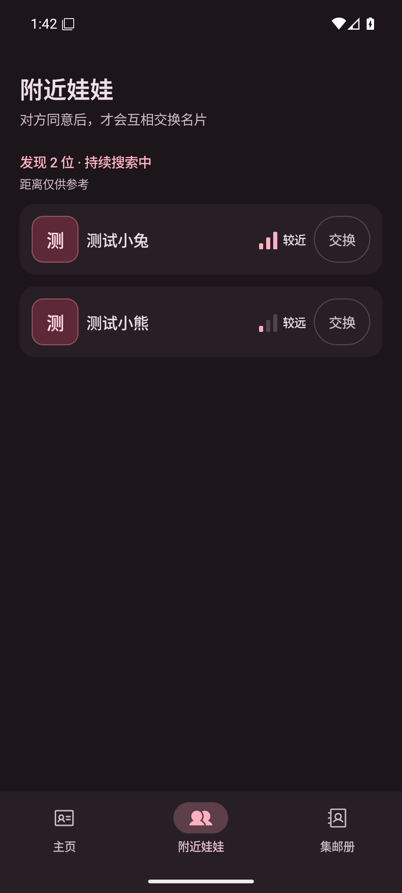
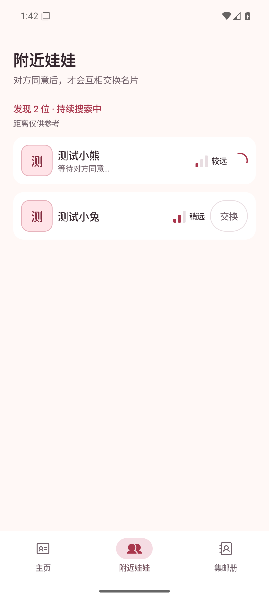
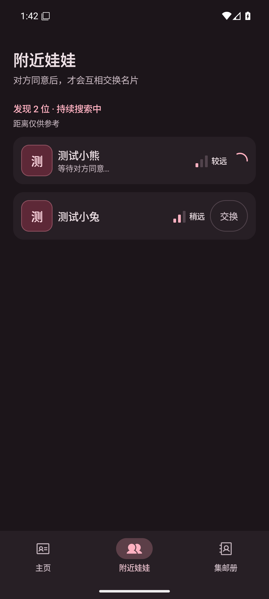
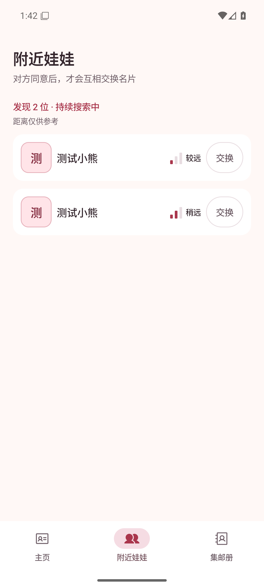
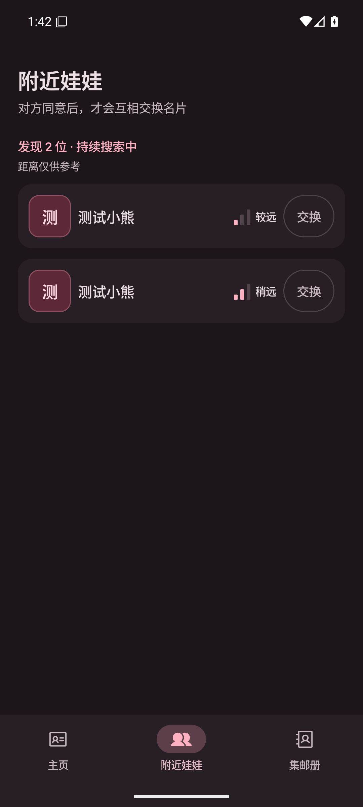

# 附近娃娃：扫描副本与列表跳动修复

新扫描到的地址仍进入内部发现列表并排队读预览，但读取成功前不显示临时人员行。读到身份摘要后沿用原来的身份合并逻辑，同一个人换地址只更新一行。首次展示按信号排序，之后维持已出现人员的位置，新人追加到末尾；信号格和连接地址继续更新。预览排队、交换、等待中的设备不会被过期清理或容量淘汰，避免预览还未完成就被删除、重扫、重新排队。

## 运行环境

- Android Emulator，AVD `PengWaSignal`，`emulator-5556`，Android 16 / API 36，`sdk_gphone64_x86_64`。
- 1080 × 2400，420 dpi，字体 1.0 倍；浅色和深色主题。
- 截图来自基于最新 main 的独立 PR 分支运行中的 Debug 应用，通过 `adb exec-out screencap -p` 获取。数据均为虚构测试数据，无真实姓名或用户 ID。
- 入口为 `UiPreviewActivity` 的 `nearby-refresh`。修复前对照使用原来的 `NearbyList.snapshot()` 展示方式；修复后使用控制器当前采用的 `snapshotForDisplay()`。两者运行相同的扫描及预览事件，修复后在后续事件之前发布一次初始列表以建立展示顺序。未替换页面布局或截图内容。

## 前后截图（可用于 PR 描述）

| 页面 / 状态 | 变更前 | 变更后 |
|---|---|---|
| 附近娃娃：新地址预览未完成，浅色 |  |  |
| 附近娃娃：新地址预览未完成，深色 |  |  |
| 附近娃娃：地址轮换和信号强弱反转，浅色 |  |  |
| 附近娃娃：地址轮换和信号强弱反转，深色 |  |  |

关键状态：

| 页面 / 状态 | 浅色 | 深色 |
|---|---|---|
| 同一个人多个地址合并，等待对方同意 |  |  |
| 同名但不同身份 |  |  |

## 复现与验证

1. 构建并安装 Debug APK：

   ```sh
   bash ./gradlew :core:protocol:test :app:testDebugUnitTest :app:assembleDebug :app:lintDebug
   adb -s emulator-5556 install -r app/build/outputs/apk/debug/app-debug.apk
   ```

2. 切换主题：`adb -s emulator-5556 shell cmd uimode night no` 为浅色，`yes` 为深色。
3. 对每个测试场景重新启动调试入口，修改 `sample`：

   ```sh
   adb -s emulator-5556 shell am force-stop app.pengwa.debug
   adb -s emulator-5556 shell am start -n app.pengwa.debug/app.pengwa.ui.UiPreviewActivity --es screen nearby-refresh --ei sample 0
   ```

   | sample | 状态 | 预期 |
   |---|---|---|
   | 10 / 0 | 修复前 / 后，新地址正在读预览 | 4 行 / 2 行 |
   | 12 / 2 | 修复前 / 后，预览读完且小兔信号变强 | 小兔跳到首行 / 小熊保持首行；均为 2 人 |
   | 3 | 修复后，申请后换地址 | 合并为 2 人，小熊仍等待同意 |
   | 4 | 修复后，同名不同身份 | 两行同名测试小熊 |

4. 页面稳定后截图：`adb -s emulator-5556 exec-out screencap -p > screenshot.png`。

## 检查结果与边界

- `:core:protocol:test`：160 项通过，含新增 6 项回归测试；`:app:testDebugUnitTest`：12 项通过。
- `:app:assembleDebug`、`:app:lintDebug` 通过。
- 运行中界面已验证上述浅色 / 深色场景。截图使用确定性数据注入真实列表模型，不代表真实 BLE 扫描、GATT 连接或双机交换已实测；真实硬件地址轮换和长时间扫描仍待双机验证。
- 对方旧版本若仅提供姓名、没有身份摘要，无法安全区分“同一个人换地址”和“不同人同名”。继续按地址保留这些已识别设备，避免误合并；双方升级到支持身份预览的版本后才能在交换前跨地址去重。
- 读取失败的设备不会显示为可申请的人员，内部仍按既有次数上限重试。
