# 附近娃娃：信号与距离参考

附近列表新增三格信号指示和“较近／稍远／较远”距离参考，不显示 dBm 数字或重复的信号文字。交换状态独立保留，等待、失败、已交换时仍可查看信号；不可用的信号显示空格和“距离未知”。头像、名字、信号格、距离与交换操作排列在同一行；状态位于名字下方，长名字单行省略。信号信息提供合并后的无障碍描述，按钮读屏仍为“申请交换”。

距离仅根据信号强弱粗略判断，不代表测量出的物理距离。未获取或校准一米参考功率，因此不展示米数。沿用原有强度分界：RSSI ≥ -60 为强／较近，-75 至 -61 为中／稍远，低于 -75 为弱／较远。有效范围依据 [Android ScanResult.getRssi 文档](https://developer.android.com/reference/android/bluetooth/le/ScanResult#getRssi()) 为 -127 至 126，范围外显示未知。

## 运行环境与测试数据

- 设备：Android Emulator，AVD `PengWaSignal`（Pixel 6 配置），`sdk_gphone64_x86_64`，Android 16 / API 36。
- 常规截图：1080 × 2400，420 dpi，字体 1.0 倍；浅色和深色主题。
- 窄屏截图：840 × 1680，420 dpi（320 × 640dp），字体 1.5 倍；浅色主题。
- 截图均来自运行中的 Debug APK，通过 `adb exec-out screencap -p` 获取，没有使用 Layoutlib 或修改截图内容。
- 数据全部虚构：测试小熊 -48 dBm、测试小兔 -68 dBm、测试小鹿 -88 dBm；额外场景包含长名字、127（未知信号）、等待、失败、已交换。
- 变更前使用本次 UI 修改之前的 `BluetoothPage`，仅加入与变更后完全相同的 Debug 测试数据（`bluetooth` 的 sample 5、6）。

## 前后截图（可用于 PR 描述）

| 页面／状态 | 变更前 | 变更后 |
|---|---|---|
| 附近娃娃，浅色，强／中／弱 | 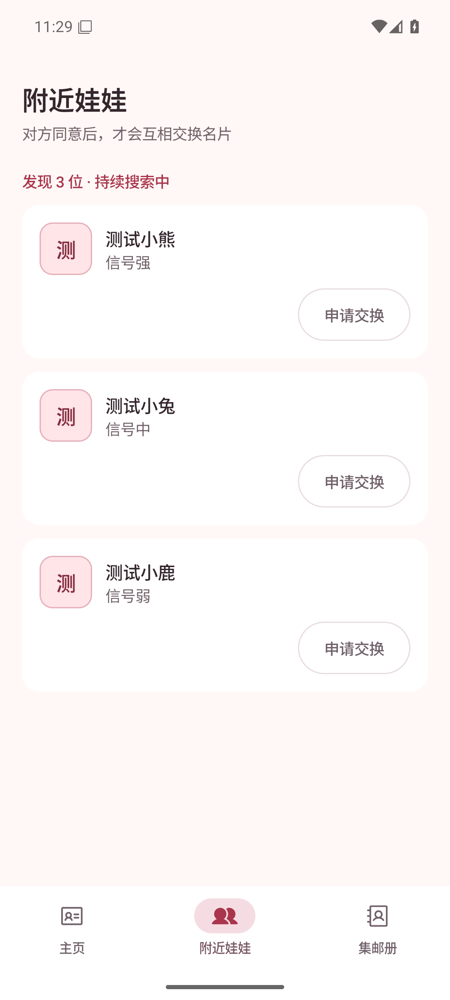 | 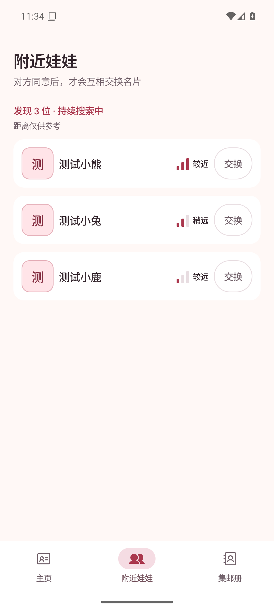 |
| 附近娃娃，深色，强／中／弱 | 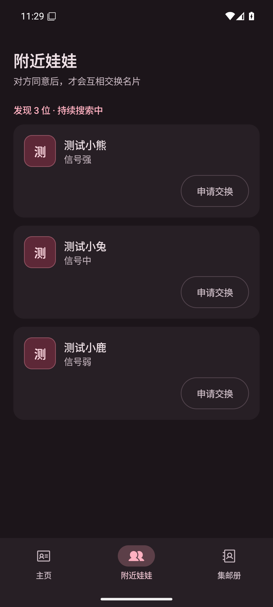 | 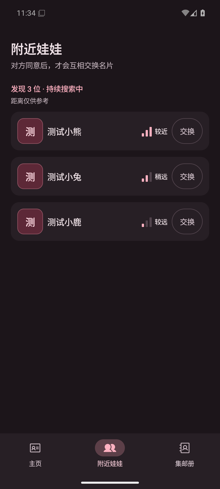 |
| 附近娃娃，320dp／1.5 倍字体 | 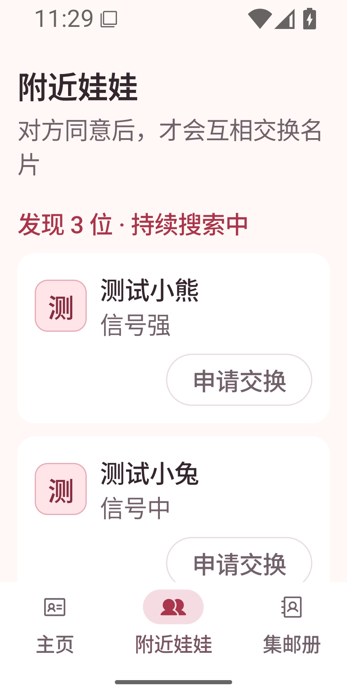 | 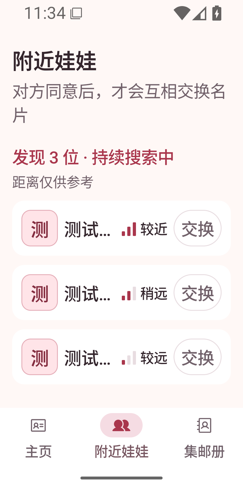 |
| 长名字、等待、失败、已交换 | 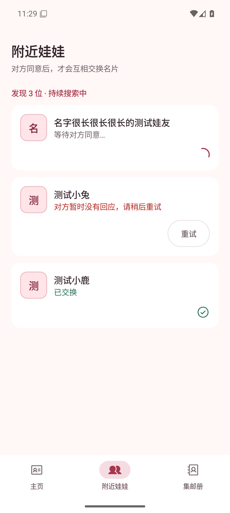 |  |

紧凑布局可直接展示三位娃友，补充主题与状态截图：

| 浅色完整列表 | 深色完整列表 | 窄屏列表 | 交换状态列表 |
|---|---|---|---|
| 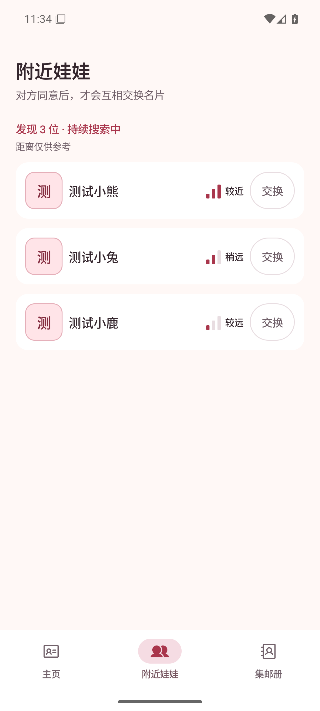 | 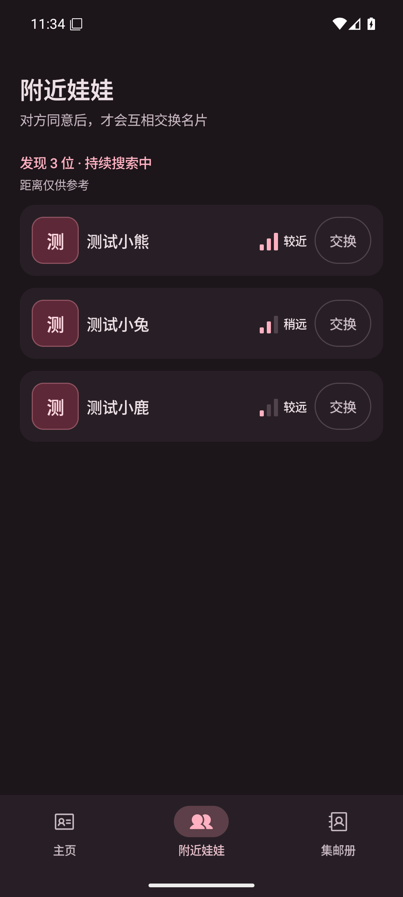 | 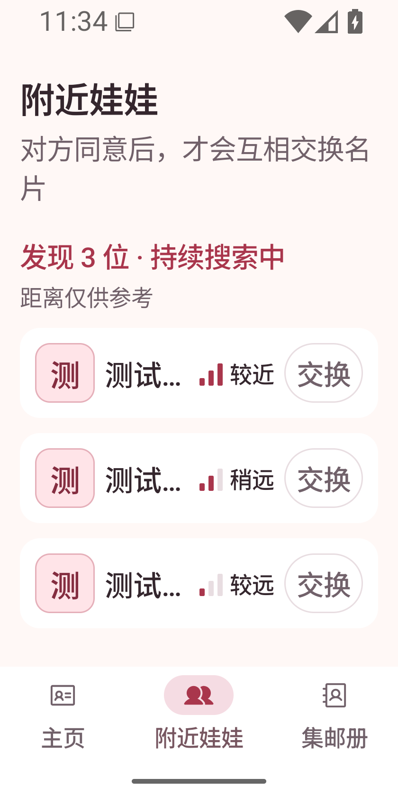 | 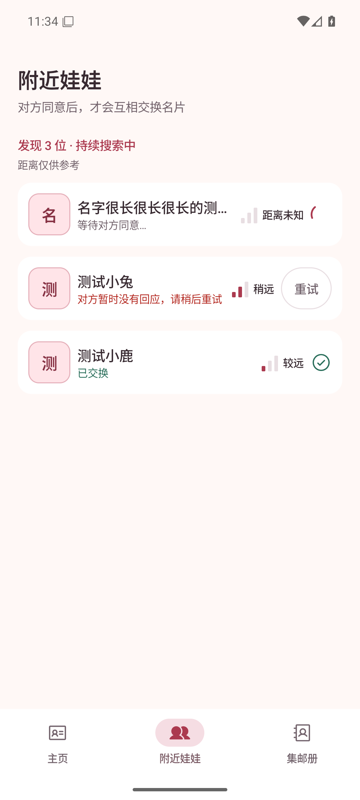 |

窄屏大字体交换状态：

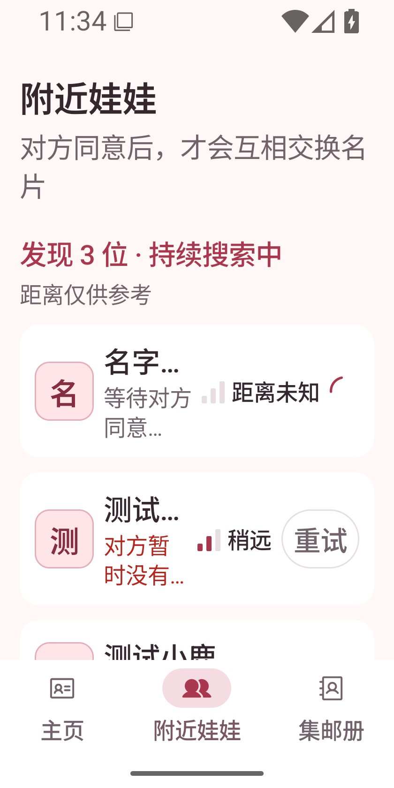

## 复现步骤

1. 构建：`bash ./gradlew testDebugUnitTest assembleDebug lintDebug`。
2. 安装：`adb -s emulator-5556 install -r app/build/outputs/apk/debug/app-debug.apk`（按实际设备替换序列号）。
3. 打开固定信号场景：

   ```sh
   adb -s emulator-5556 shell am force-stop app.pengwa.debug
   adb -s emulator-5556 shell am start -n app.pengwa.debug/app.pengwa.ui.UiPreviewActivity --es screen bluetooth --ei sample 5
   ```

4. 确认三格／两格／一格分别对应较近／稍远／较远，页面不显示 dBm 数字；滚动后能看到第三人的信号和申请按钮。
5. 将 sample 改为 6 并重新启动，确认未知信号为空格且不显示 127 dBm，长名字单行省略且无障碍节点保留全名；等待显示进度、失败可重试、成功显示勾选，三种状态都保留信号信息。
6. 用 `adb -s emulator-5556 shell cmd uimode night yes` 切换深色（`no` 恢复浅色）。
7. 窄屏验证：`adb -s emulator-5556 shell wm size 840x1680`，`adb -s emulator-5556 shell settings put system font_scale 1.5`；滚动确认文字和按钮可查看。完成后执行 `wm size reset` 并将 `font_scale` 恢复为 `1.0`。
8. 截图：`adb -s emulator-5556 exec-out screencap -p > screenshot.png`。

## 验证结果与边界

- 173 项单元测试通过，包括信号各档边界、有效 RSSI 全范围及非法数值回退；Debug 构建、lint 和 `git diff --check` 通过。
- 已检查上述运行中截图，窄屏主信息横向排列，状态最多两行、超长省略，操作按钮可见。
- 已检查 UI Automator 节点，距离和信号强弱合并为一条描述；没有进行 TalkBack 语音实测。
- 截图场景仅注入测试数据，不启用蓝牙硬件；真实双机扫描、走近走远时的刷新、遮挡和不同手机对信号的影响仍待实测，不将其标记为完成。
