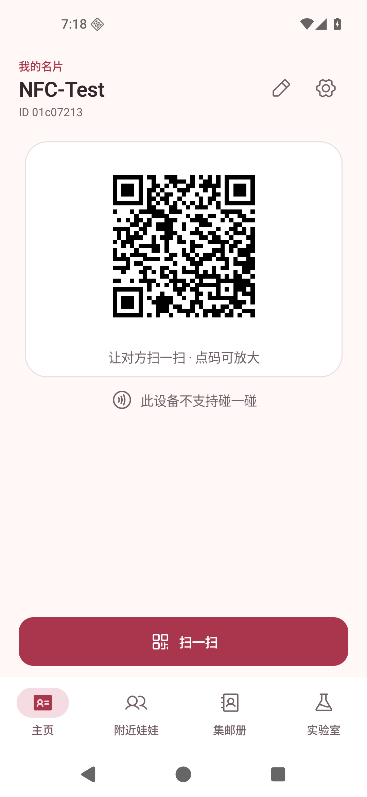
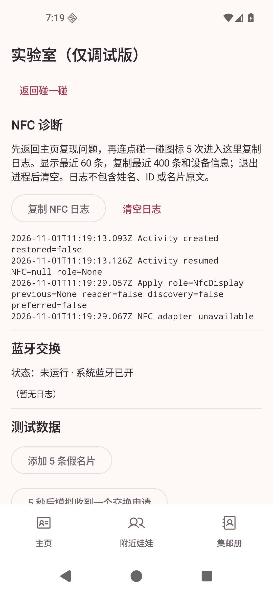
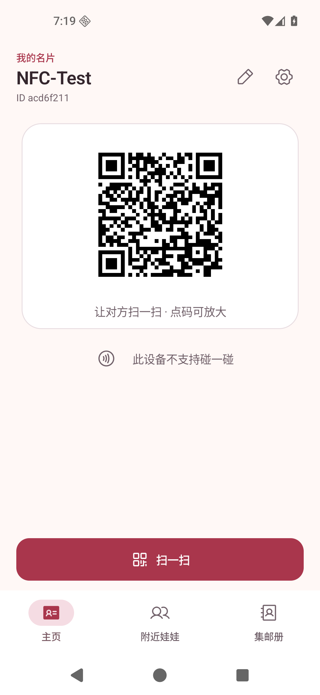
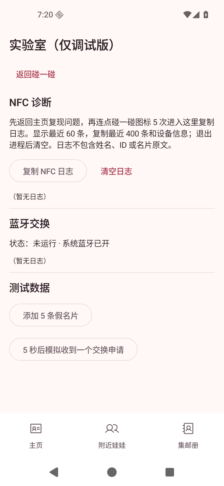

# NFC 诊断与隐藏入口：运行截图

- 设备：Pixel 5 配置的 ARM64 Android Emulator，1080 × 2340，440 dpi。
- 系统：Android 16 / API 36；截图来自运行中的应用，使用本次生成的测试名片 NFC-Test，无真实联系人。
- 变更前：main Nightly CI #15（20df75e）；变更后：本 PR Debug 构建。
- 模拟器没有 NFC 硬件，状态显示“不支持”，隐藏入口在该状态下仍可使用。两台 vivo 的真实交换仍待安装 Nightly 后复测。

| 页面 / 状态 | 变更前 | 变更后 |
| --- | --- | --- |
| 主页导航与 NFC 状态图标 |  |  |
| 实验室 |  |  |
| 连点前四次 | 不适用（新增手势） |  |
| 清空 NFC 日志 | 不适用（新增） |  |

验证步骤：

1. 安装 Debug APK，设置测试显示名；主页只有主页、附近娃娃、集邮册三个目的地。
2. 连点 NFC 图标四次仍在主页，第五次进入实验室。相邻点击超过 1.5 秒会重新计数。
3. 点“复制 NFC 日志”，在未保存的编辑框中粘贴，核对包含设备信息、构建标识和记录事件，不包含测试名片姓名或 GUID；取消编辑。
4. 清空日志，确认 NFC 区域显示“暂无日志”；返回按钮和系统返回键均回到主页。
5. 安装另行用本机测试密钥签名的 Release APK，确认连点和 `tab=2` 页面参数均不能打开实验室。

本地验证：162 项单元测试通过，`assembleDebug`、`testDebugUnitTest`、`lintDebug`、`assembleRelease` 成功。真实双机 NFC 不在模拟器验证范围内。
