# 首次使用：创建卡片 → 预览确认 → 扩列

第三步以简笔插画为主体：扫码、附近、碰一碰各一张图，用小熊／兔子头套人物、几何服装和粉绿配色展示操作。每张图下只保留三句可缩放的原生短提示；插画包含无障碍描述。第三步名称为「扩列」，预览按钮为「卡片准备好了，去扩列」，设置重看入口为「扩列图解」。

创建、保存、预览、进度恢复及已有用户升级策略沿用 [首次引导记录](../onboarding/README.md)。首次教学和设置重看复用同一个插画页面，扫码／NFC 主按钮前往主页，附近主按钮进入附近娃娃。仍保留扫码与附近的申请／同意步骤、等待完整交换完成，以及 NFC 不可用时改用扫码的短提示。

## 插画资产

使用 imagegen 内置工具生成三张统一风格的插画，应用内离线打包为 WebP，最大 1024 × 768；三张合计约 184 KiB，不需要运行时下载。图片不包含文字，说明由 Compose 绘制，支持大字体；二维码为图示，无真实名片或个人信息。最终文件和完整生成提示词见 [资产记录](../../illustrations/onboarding-prompts.md)。

## 运行环境与测试数据

- Android Emulator，AVD `PengWaIcon`，`sdk_gphone64_x86_64`，Android 16 / API 36。
- 常规 1080 × 2400，420 dpi，字体 1.0；浅色和深色。
- 窄屏 840 × 1680，420 dpi（320 × 640dp），字体 1.5；浅色。
- 所有界面截图来自运行中的 Debug APK / MainActivity，经 `adb exec-out screencap -p` 截取，未修改截图内容。
- 使用虚构 `CottonTest`、`About` / `I like meeting new friends.` 及随机测试 UUID，无真实用户信息。
- 调整前为 PR #20 的 `8d394bd` 文字教学；调整后为本次插画页面。首次启动与主页对比仍见 [相对 PR #18 的截图](../onboarding/README.md)。

## UI 前后截图（可直接用于 PR）

| 页面／状态 | 文字教学 | 扩列图解 |
| --- | --- | --- |
| 扫码／浅色 | 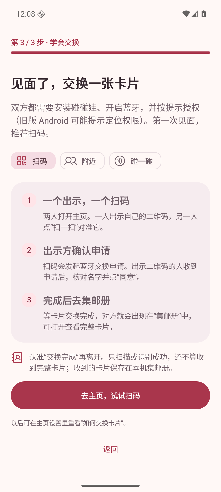 |  |
| 扫码／深色 | 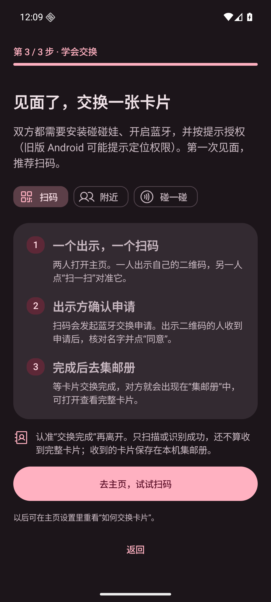 |  |
| 附近／浅色 | 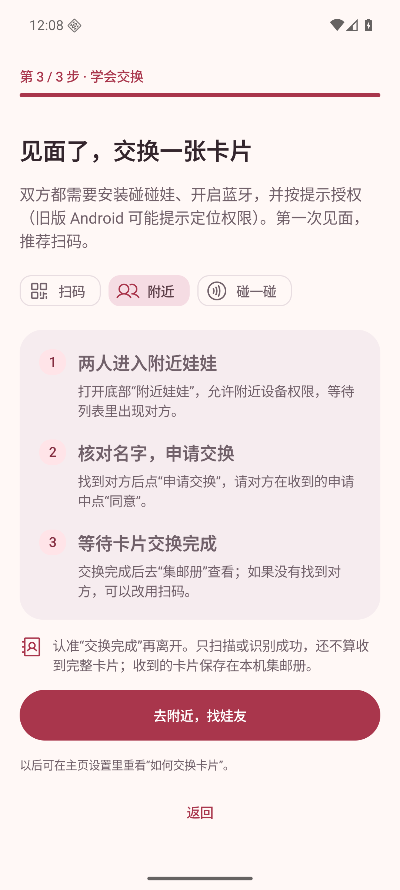 |  |
| 附近／深色 | 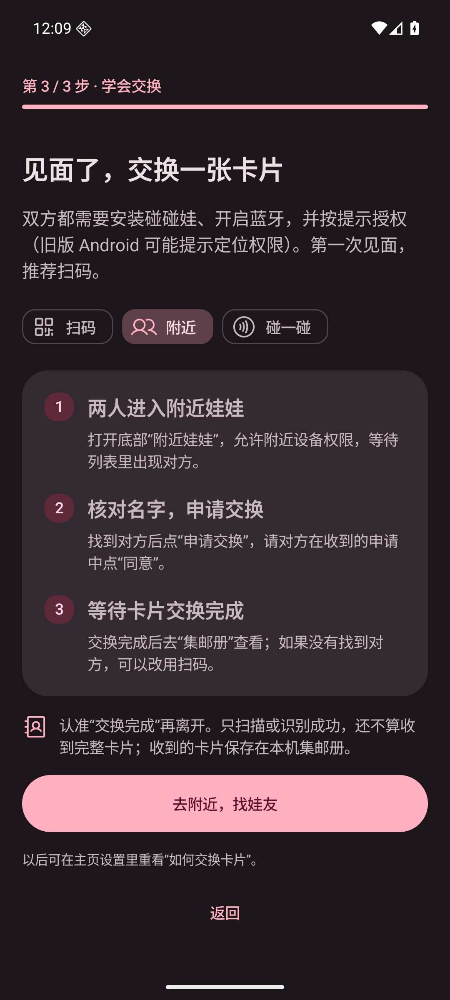 |  |
| NFC／浅色 | 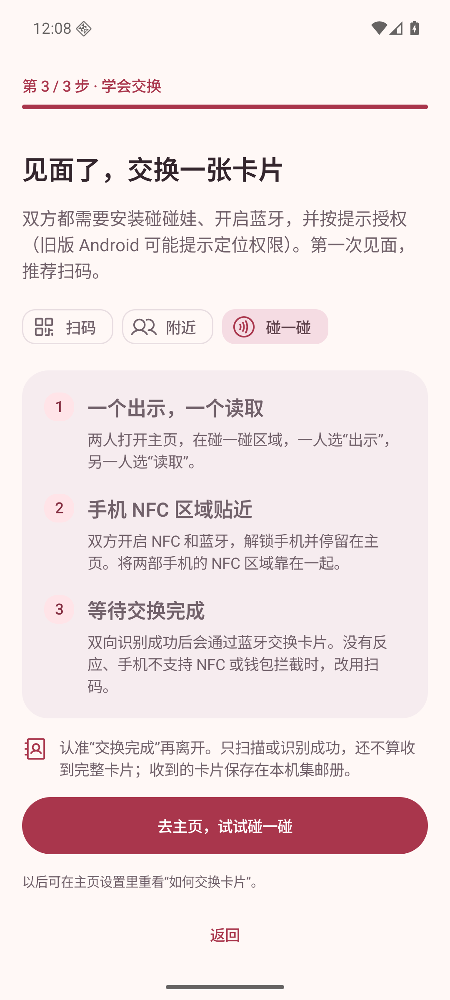 |  |
| NFC／深色 | 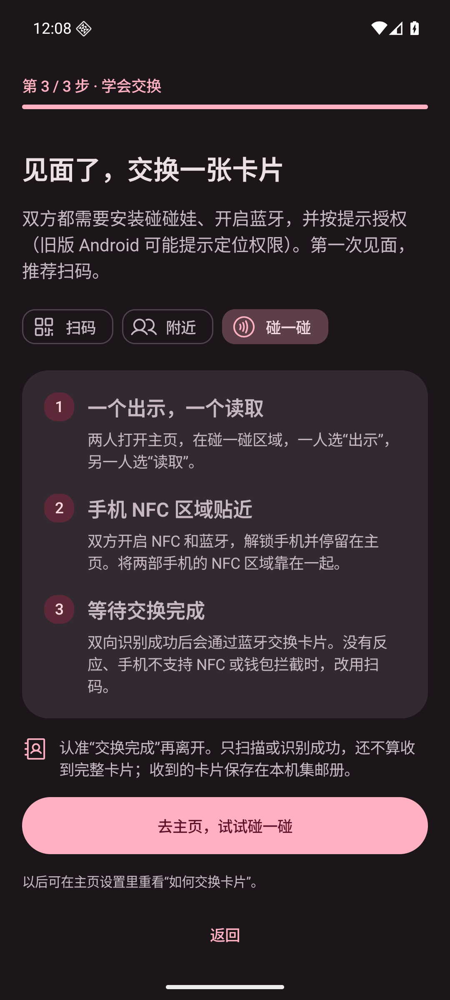 |  |
| 预览页继续按钮 |  | 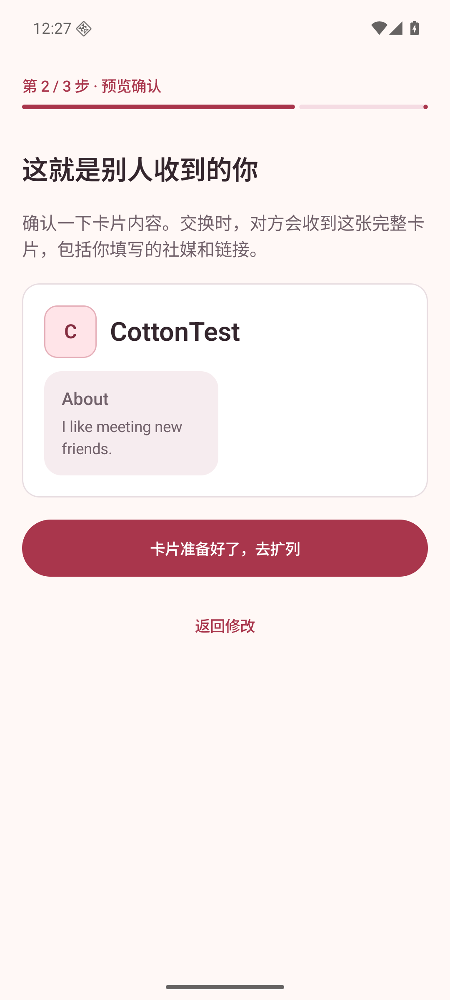 |
| 设置重看入口 | 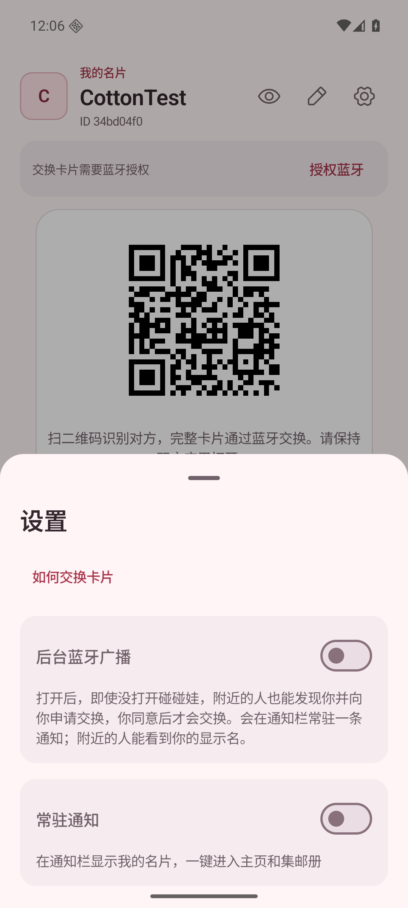 | 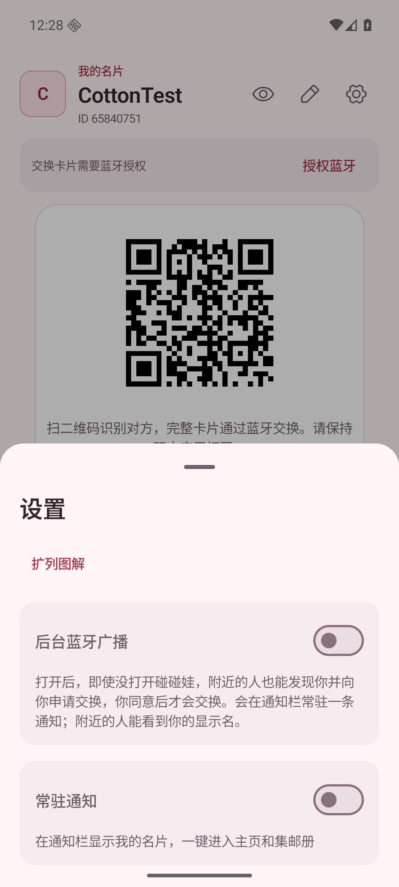 |
| 窄屏大字体／顶部 | 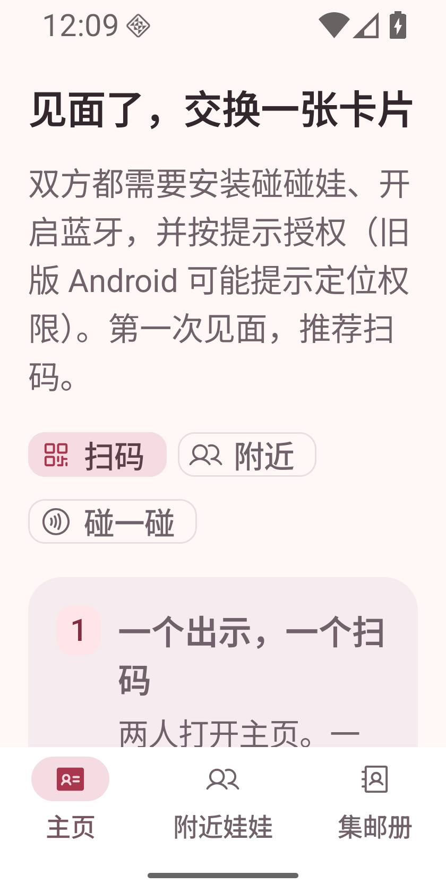 |  |
| 窄屏大字体／操作 | 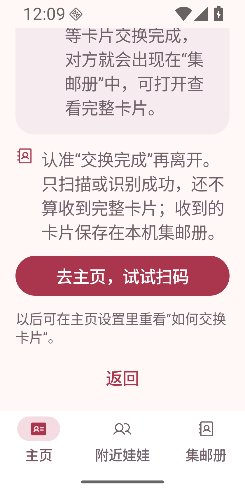 | 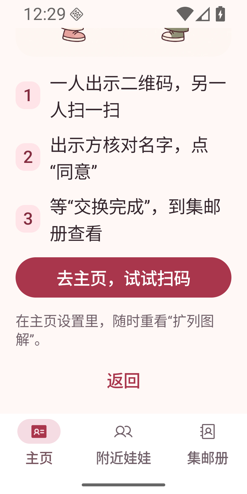 |

窄屏滚动查看插画：

## 复现步骤

1. 构建：`ANDROID_HOME=/path/to/sdk JAVA_HOME=/path/to/jdk-21 bash gradlew testDebugUnitTest assembleDebug lintDebug`。
2. 安装：`adb -s emulator-5554 install -r app/build/outputs/apk/debug/app-debug.apk`，序列号按测试设备替换。
3. 在专用模拟器首次安装，启动 `app.pengwa.debug/app.pengwa.MainActivity`。输入测试名字，可选添加文字，保存并预览；点「卡片准备好了，去扩列」。
4. 确认进度为「第 3 / 3 步 · 扩列」。切换扫码、附近、碰一碰，确认对应插画与三句短提示同步变化；图片不裁切人物与操作区域。强制停止并重开，确认仍回到扩列步骤。
5. 点击主按钮确认进入对应页面；完成后在主页设置点「扩列图解」重看，可返回或从图解进入附近列表。
6. 深色用 `adb -s emulator-5554 shell cmd uimode night yes`；窄屏用 `wm size 840x1680` 与 `settings put system font_scale 1.5`。滚动确认图片、字幕和按钮可访问。结束后 `wm size reset`，字体恢复 `1.0`，深色设为 `no`。
7. 截图：`adb -s emulator-5554 exec-out screencap -p > screenshot.png`。

## 验证结果与边界

- `testDebugUnitTest assembleDebug lintDebug` 通过：193 项单元测试，0 失败；`git diff --check` 通过。
- 运行中的 MainActivity 已验证：第三步命名、卡片保存与预览、强制停止后的扩列步骤恢复、三种插画切换及对应无障碍描述、完成引导、设置重看，以及扫码／附近／NFC 对应页面跳转。
- 已检查三种插画的深浅主题截图，以及 320dp／1.5 倍字体下的图片、短提示、滚动和操作可达性。图片使用 Fit 保持完整比例，不裁切动作。
- 未进行双机 BLE／NFC、实物扫码或 TalkBack 语音实测；无障碍验证为 UI 节点检查。
