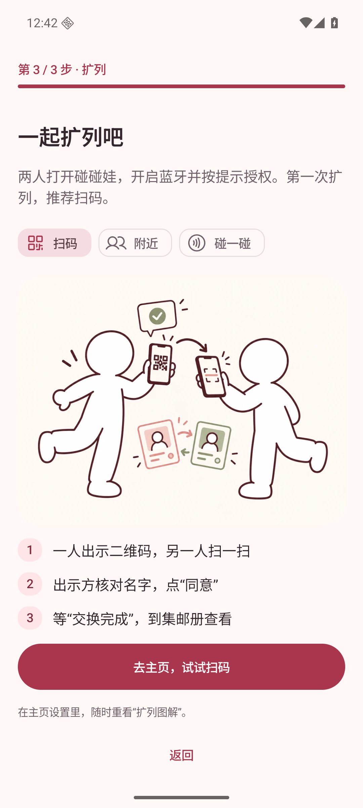
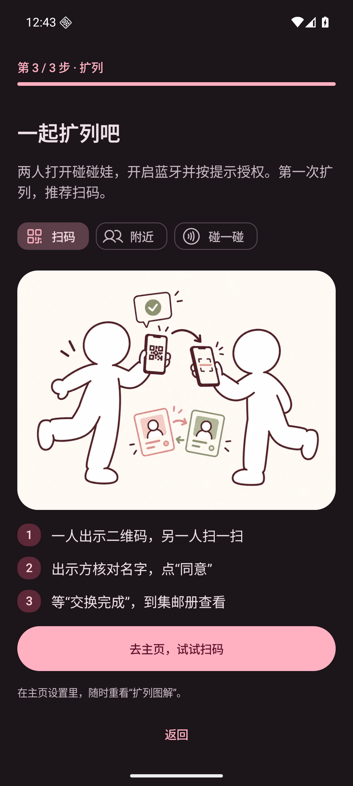
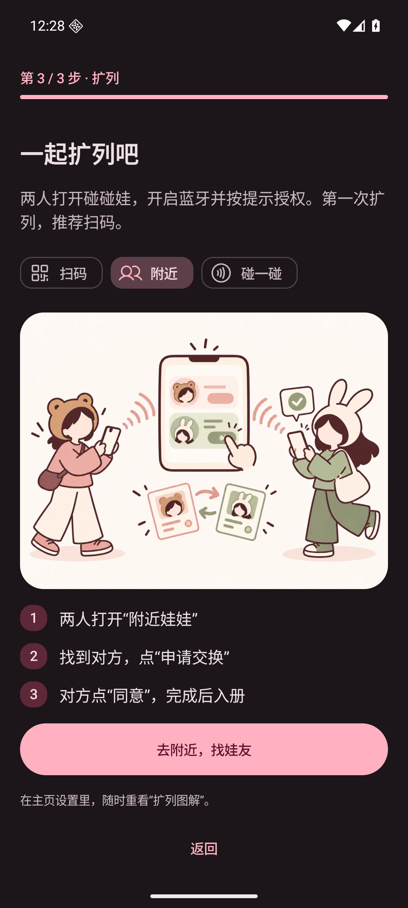
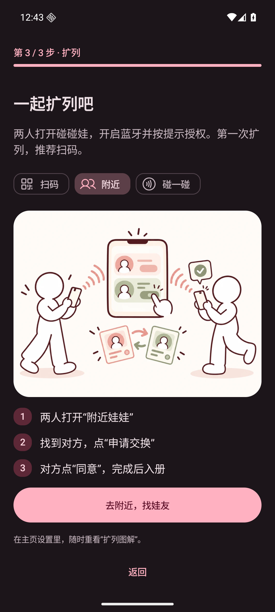
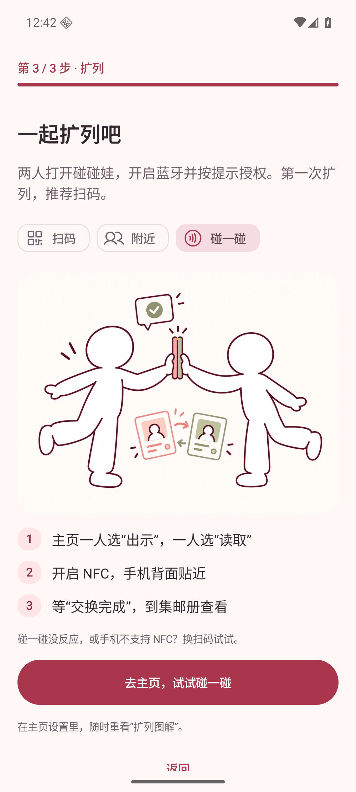
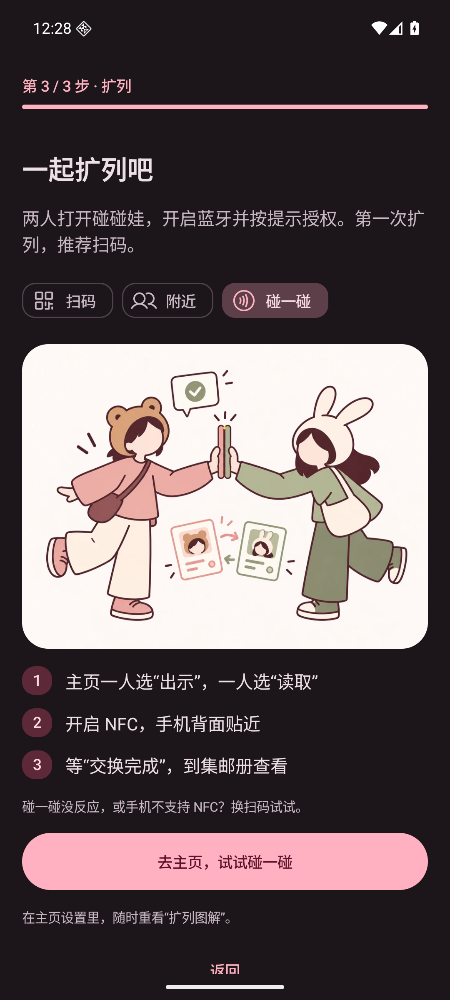
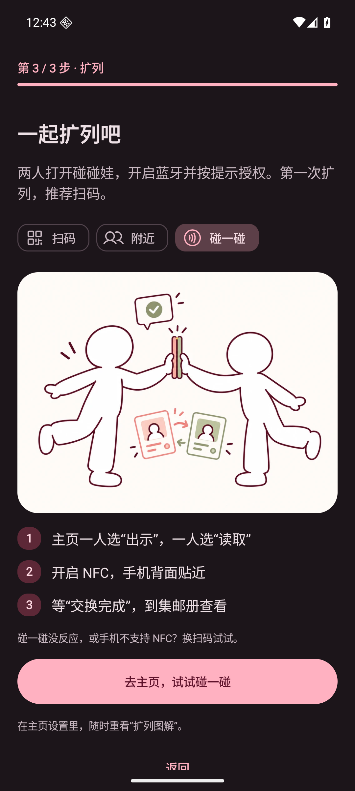
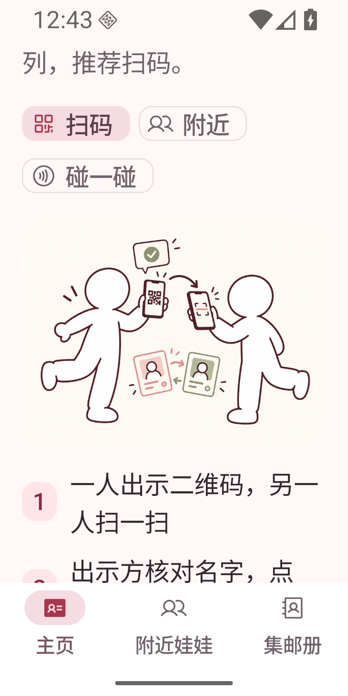
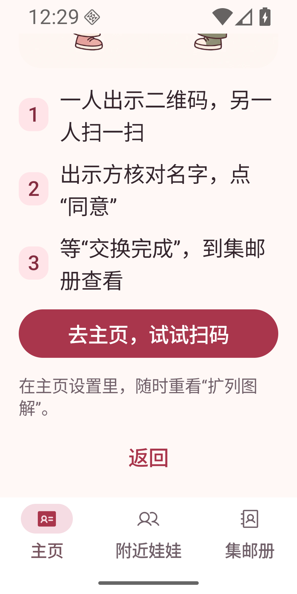
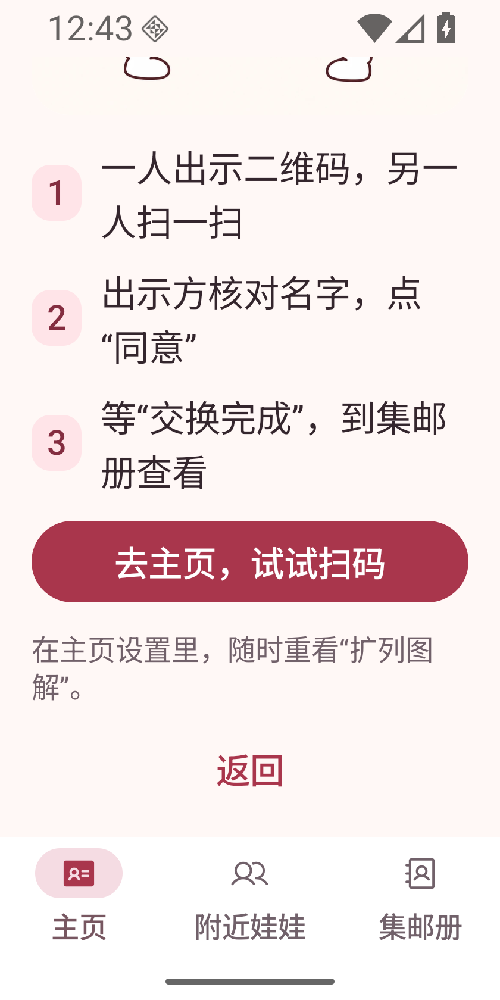

# 扩列插画：纯白小人

基于已合并的 PR #20（main `582da12`），将扫码、附近与 NFC 三张插画中的人物改为纯白、无五官的简笔小人。移除头发、动物耳朵、头套、衣着和配饰细节；卡片、附近列表里的头像也使用相同的通用白色轮廓。保留必要的手机持握／点击姿势、卡片、箭头和确认标记。扫码图的无障碍描述同步改为左／右侧小人。

## 运行环境与数据

- Android Emulator，AVD `PengWaIcon`，`sdk_gphone64_x86_64`，Android 16 / API 36。
- 常规 1080 × 2400，420 dpi，字体 1.0；浅色与深色。
- 窄屏 840 × 1680，420 dpi（320 × 640dp），字体 1.5；浅色。
- 变更前截图来自 PR #20 已记录的同场景运行中 MainActivity；直接引用原图保留对比。变更后来自本分支运行中的 Debug APK / MainActivity，均使用 `adb exec-out screencap -p`，未修改截图内容。
- 仅使用测试身份 `CottonTest` 与随机测试 UUID，无真实用户信息。
- 三张图片通过内置 imagegen 编辑后导出为 1024 × 768 WebP，离线打包；[资源路径与完整提示词](../../illustrations/onboarding-white-figures-prompts.md)。

## UI 前后截图（可用于 PR 描述）

| 页面／状态 | 变更前 | 变更后 |
| --- | --- | --- |
| 扫码／浅色 |  |  |
| 扫码／深色 |  |  |
| 附近／浅色 |  |  |
| 附近／深色 |  |  |
| NFC／浅色 |  |  |
| NFC／深色 |  |  |
| 窄屏大字体／顶部 |  |  |
| 窄屏大字体／完整插画 |  |  |
| 窄屏大字体／操作 |  |  |

## 复现步骤

1. 构建：`ANDROID_HOME=/path/to/sdk JAVA_HOME=/path/to/jdk-21 bash gradlew testDebugUnitTest assembleDebug lintDebug`。
2. 安装：`adb -s emulator-5554 install -r app/build/outputs/apk/debug/app-debug.apk`，序列号替换为测试设备。
3. 首次启动，输入测试名，保存预览，点「卡片准备好了，去扩列」；已有测试身份可通过主页设置 →「扩列图解」进入。
4. 分别选择扫码、附近、碰一碰，核对两个人物与所有头像均为纯白通用轮廓，手机动作和卡片交换含义清楚。检查扫码的 UI 无障碍描述不再提及头套。
5. 点击图解主按钮进入主页；从设置重看，选择附近并确认可进入附近列表。
6. 用 `adb -s emulator-5554 shell cmd uimode night yes` 切换深色（`no` 恢复）；用 `wm size 840x1680` 和 `settings put system font_scale 1.5` 检查窄屏滚动与按钮。结束后 `wm size reset`，字体恢复 `1.0`。
7. 截图：`adb -s emulator-5554 exec-out screencap -p > screenshot.png`。

## 验证结果与边界

- `testDebugUnitTest assembleDebug lintDebug` 通过：193 项单元测试，0 失败；`git diff --check` 通过。
- 已在运行中的 MainActivity 检查三种图片的深浅主题与无障碍节点；扫码描述已不再包含头套／小熊／兔子信息。
- 已验证完成引导、从设置重看并进入附近列表，以及 320dp／1.5 倍字体下完整插画、短提示和按钮的滚动可达性；已检查截图。
- 未进行 TalkBack 语音、双机 BLE／NFC 或实物扫码测试；本次验证覆盖图片、无障碍节点及导航。
