# 首次使用：创建卡片与学习交换（首版记录）

当前第三步已改为「扩列」，以简笔插画配合短提示说明操作。最新界面与验证见 [扩列图解](../onboarding-illustrated/README.md)。下文保留首版文字教学的截图与验证记录。

基于 [PR #18](https://github.com/xh321/PengWa/pull/18) 的提交 `21703a5`，分支 `feat/card-onboarding`。保留该 PR 的顶部眼睛预览入口、编辑与设置入口、紧凑蓝牙状态栏。

## 流程与交互

1. **创建卡片**：首次打开直接进入卡片编辑器。名字必填，头像、文字、链接、社媒和小图可选；不强迫用户凑齐内容。复用现有校验和图片选择功能，点击“保存并预览”保存第一张卡片。
2. **预览确认**：展示真实已保存卡片，说明交换会发送包括社媒和链接在内的完整内容。可返回修改，也可继续学习交换；只有名字的卡片同样可以继续。
3. **学会交换**：默认推荐扫码，可切换“附近”和“碰一碰”，各自给出三步操作。扫码／附近明确说明申请与同意，NFC 说明出示／读取的配合和无反应时改用扫码。所有方式都提醒等待完整交换完成，再去集邮册查看。

教学按钮直接进入对应页面：扫码／NFC 去主页，附近去附近娃娃。教学本身不申请权限、不启动交换硬件；实际使用时沿用现有授权流程。主页设置提供“如何交换卡片”，可随时重看。

卡片保存与首次进度写入同一笔提交，随后每步保存进度。强制关闭后从已保存的预览或教学步骤继续；尚未保存的草稿仅保留在 ViewModel 中，不承诺进程被杀后的恢复。完成后重启不再出现引导。升级时已有卡片且没有进度记录的用户直接进入主页；异常进度回退到已保存卡片的预览，无卡片则必须先创建。

## 运行环境

- Android Emulator，AVD `PengWaIcon`，`sdk_gphone64_x86_64`，Android 16 / API 36。
- 普通屏 1080 × 2400，420 dpi，字体 1.0；浅色与深色主题。
- 窄屏 840 × 1680，420 dpi（320 × 640 dp），字体 1.5；浅色主题。
- 截图均为运行中的 Debug APK / MainActivity，经 `adb exec-out screencap -p` 获取。未使用 Layoutlib，未修改截图内容。
- 数据为虚构测试名 `CottonTest`、测试介绍与本机随机生成的测试 UUID；无真实用户信息。

## UI 截图（可用于 PR 描述）

| 同一场景 | 变更前（PR #18） | 变更后 |
| --- | --- | --- |
| 首次启动／浅色 | 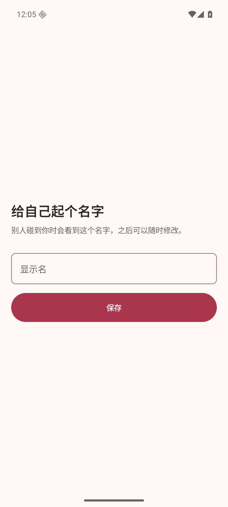 | 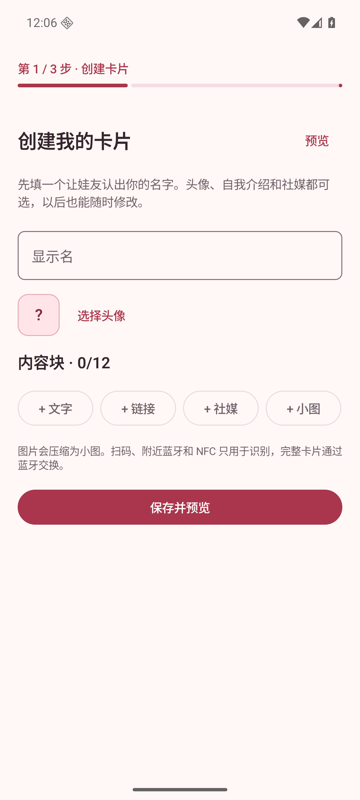 |
| 首次启动／深色 | 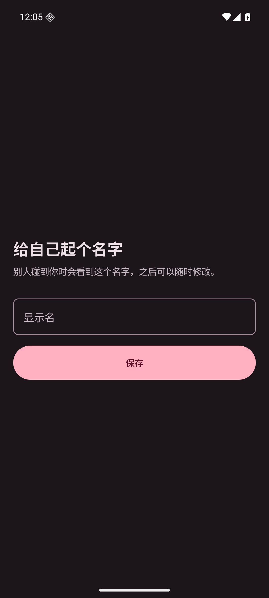 | 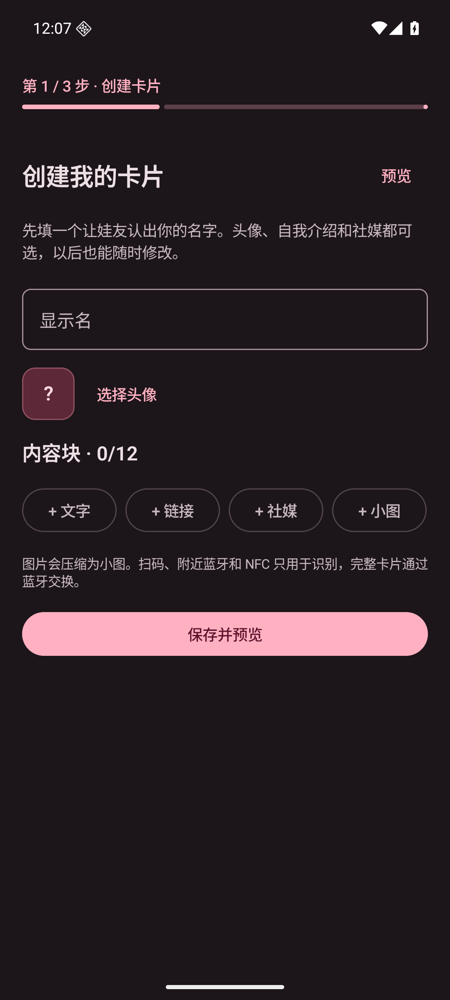 |
| 已有用户主页／浅色 | 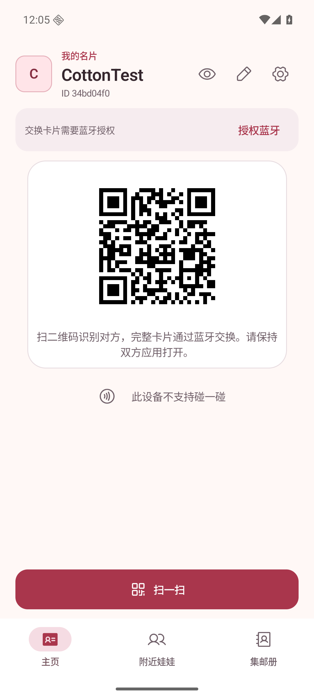 |  |
| 主页设置／浅色 | 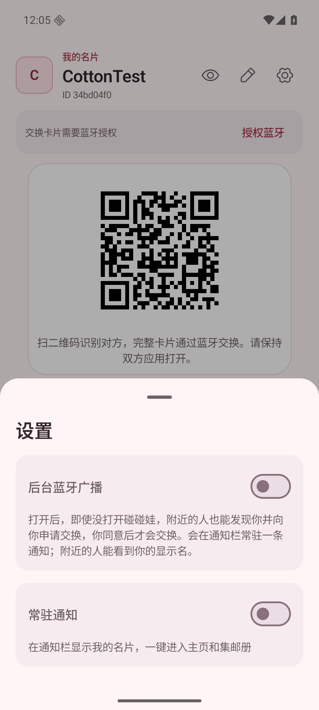 | 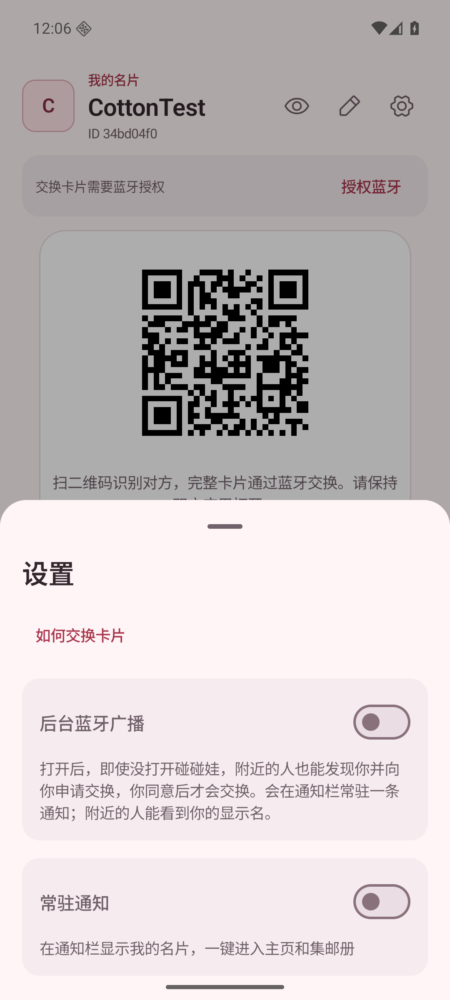 |

| 新增页面／状态 | 浅色 | 深色 |
| --- | --- | --- |
| 保存后的卡片预览 | 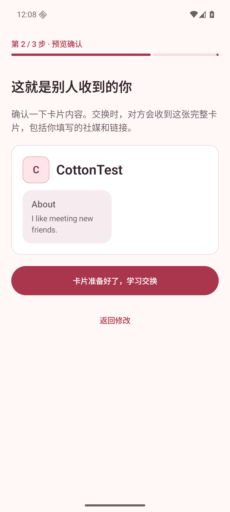 | 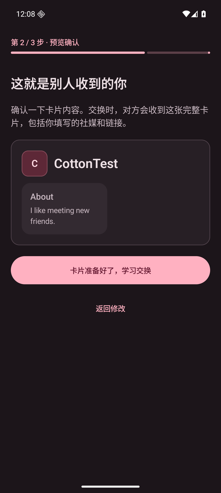 |
| 扫码教学 | 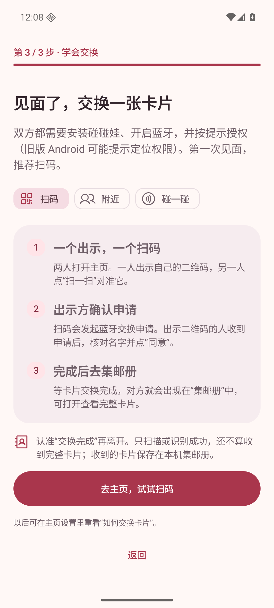 | 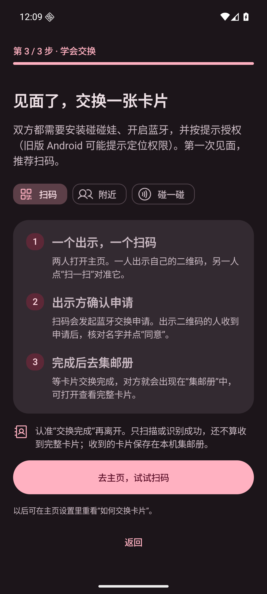 |
| 附近教学 | 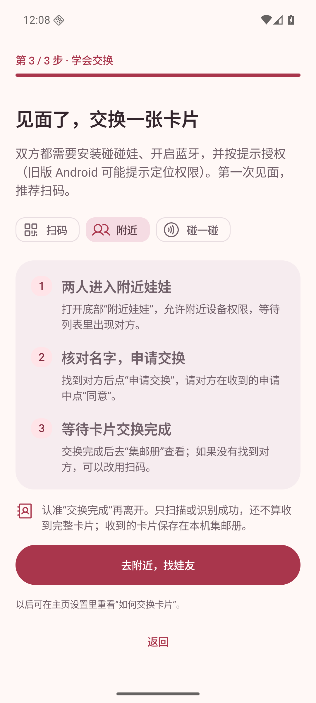 | 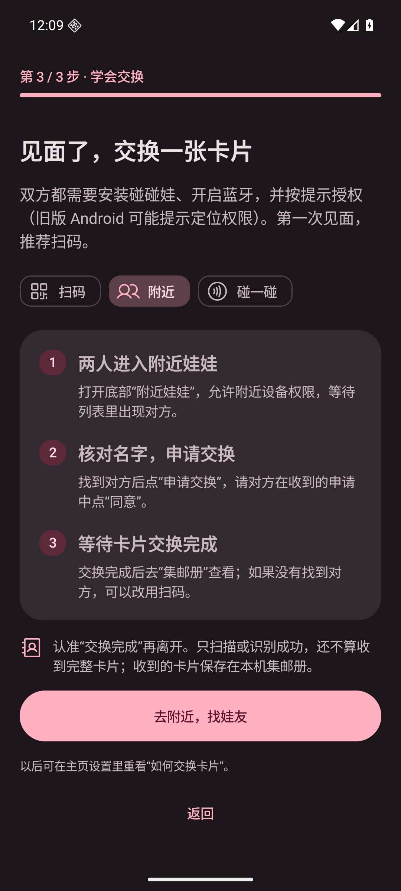 |
| NFC 教学 | 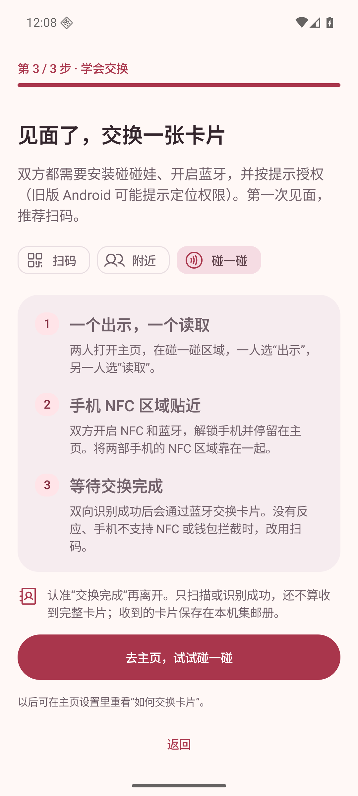 | 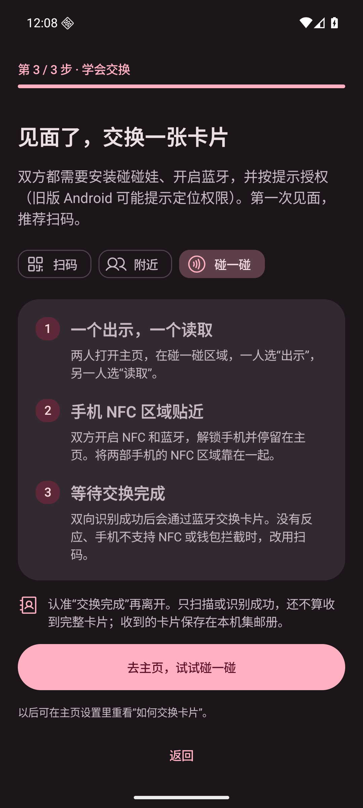 |

| 关键状态／适配 | 截图 |
| --- | --- |
| 名字为空时阻止保存 | 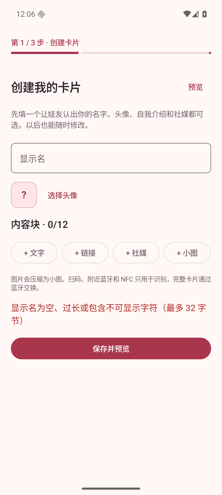 |
| 首次创建／窄屏大字体 | 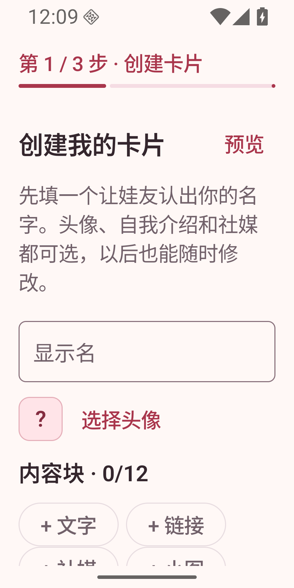 |
| 首次创建／窄屏滚动到保存与错误 | 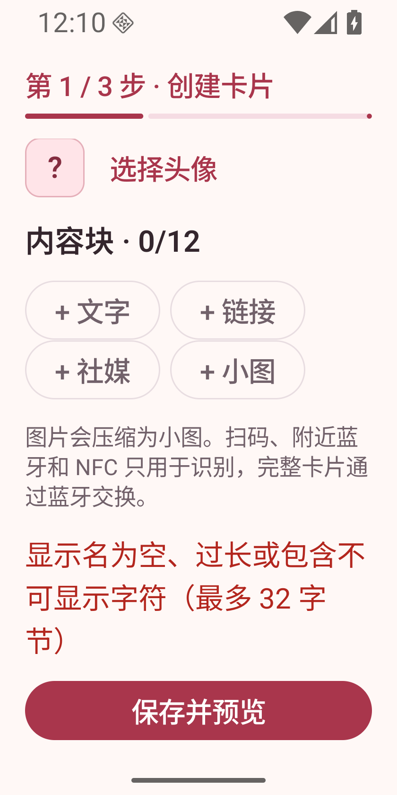 |
| 原有眼睛预览入口回归 | 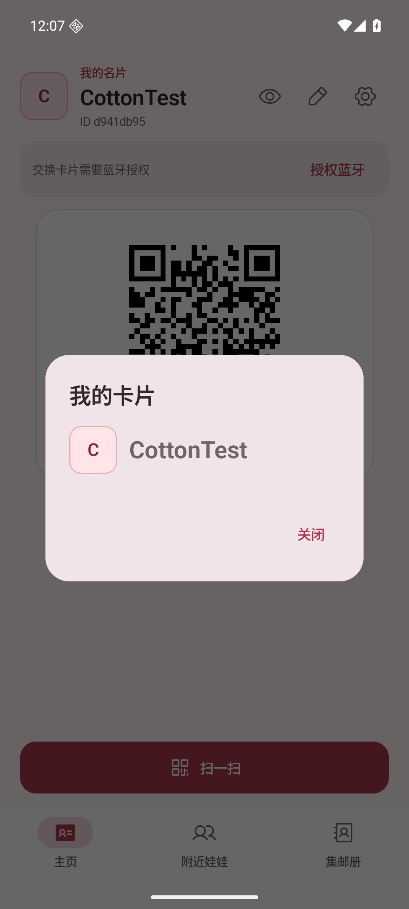 |
| 教学／窄屏大字体，顶部 | 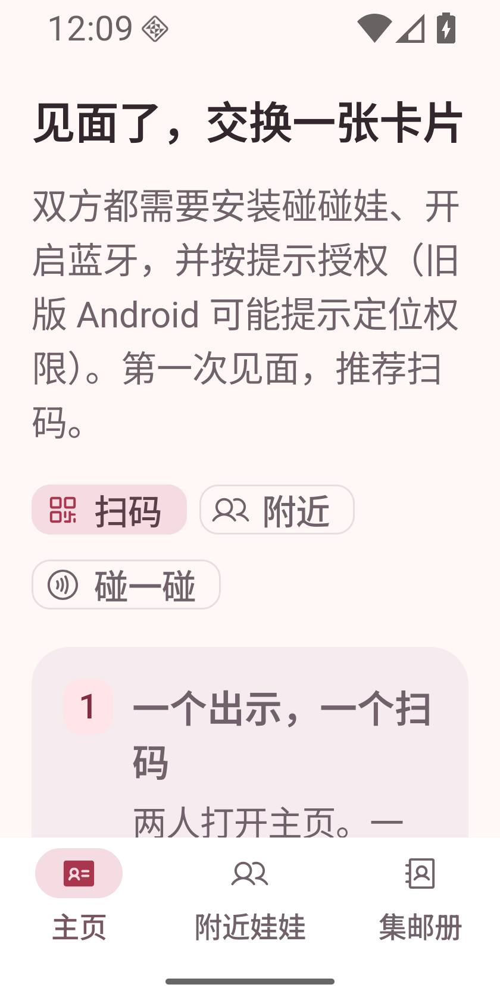 |
| 教学／窄屏大字体，滚动到操作 | 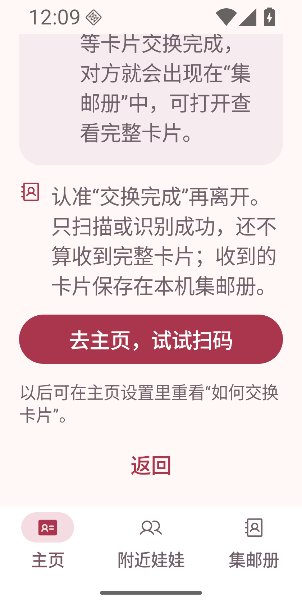 |

## 复现和验证步骤

1. 构建与检查：

   ```sh
   ANDROID_HOME=/path/to/android-sdk JAVA_HOME=/path/to/jdk-21 bash gradlew testDebugUnitTest assembleDebug lintDebug
   adb -s emulator-5554 install -r app/build/outputs/apk/debug/app-debug.apk
   ```

2. 在专用测试模拟器中首次安装（或清除该测试应用数据），启动 `app.pengwa.debug/app.pengwa.MainActivity`。先不填名字点“保存并预览”，确认错误提示且不能进入下一步。
3. 输入测试名，可选添加内容，保存后核对预览。强制停止并重新启动，确认仍停在预览；点“返回修改”，确认卡片保留，修改后重新保存。
4. 进入教学，在扫码／附近／碰一碰之间切换。强制停止再启动，确认仍在教学。点击教学中的主按钮，确认进入对应页面；再次重启确认不重复引导。
5. 在主页点击眼睛，确认卡片弹窗可打开和关闭；点铅笔，确认仍为正常编辑器。设置 →“如何交换卡片”，重看后返回主页，或选择附近并进入附近列表。
6. 升级路径：先运行 PR #18，设置 `CottonTest`，再覆盖安装本分支 APK，不清除数据，确认直接显示主页、卡片内容保留，且可通过设置重看教学。
7. 深色：`adb -s emulator-5554 shell cmd uimode night yes`；浅色恢复为 `no`。窄屏：`adb -s emulator-5554 shell wm size 840x1680` 与 `adb -s emulator-5554 shell settings put system font_scale 1.5`。在创建、预览和教学页滚动，确认文字、输入和操作可达。结束后 `adb -s emulator-5554 shell wm size reset`，字体恢复 `1.0`。

截图命令：`adb -s emulator-5554 exec-out screencap -p > screenshot.png`。多设备环境请替换为自己的测试设备序列号。

## 验证结果与边界

- `testDebugUnitTest assembleDebug lintDebug` 全部通过：193 项单元测试、0 失败，其中新增 5 项测试覆盖旧安装迁移、首次安装、保存步骤恢复、缺失卡片和异常进度回退。
- 实际 MainActivity 验证通过：从 PR #18 覆盖升级、首次空名字校验、只有名字／带文字内容的卡片保存与预览、返回修改、强制停止后恢复预览和教学、完成后重启不重复引导、眼睛预览与正常编辑器回归。
- 实际验证首次教学和设置重看都能进入附近列表；扫码教学可进入主页。深浅主题及 320dp／1.5 倍字体下，教学退出和创建保存操作均可通过滚动到达；已检查运行中截图。
- 没有进行双机 BLE／NFC、实物二维码或 TalkBack 语音实测。本次验证覆盖引导、保存、恢复与导航，不替代真实双机交换验证。
