# 扩列主导航入口

将碰一碰／二维码／扫一扫所在的默认页面从“主页”改为导航正中的“扩列”。导航顺序为“附近娃娃／扩列／集邮册”。导航栏中央使用 12dp 的低凸起，72 × 48dp 的扁平强调色圆角区域仅承载 28dp 图标；标签回到栏体底色上，用主题色与加粗文字强调，选中时额外显示圆点。强调色收在图标附近，系统手势区保留导航底色；整个入口无阴影，触控高度至少 80dp。横屏侧栏使用浅色背景与主题色图文，维持相同主次关系。默认页面与交换逻辑沿用现有实现。

## 设计依据

使用 [UI UX Pro Max](https://github.com/nextlevelbuilder/ui-ux-pro-max-skill) 的移动端规则进行复核。导航搜索结果偏向 Web，Compose 搜索也未匹配本次外观问题，因此采用技能自带 `pro-rules.md` 与 `quick-reference.md` 的原生导航规则，不将搜索结果视作匹配方案。

- 三个入口均保留图标与标签，选中状态使用圆点和语义，不仅依赖颜色。
- 采用现有 Phosphor 图标和 Material 主题 token，Android 最小触控尺寸不低于 48dp。
- 强调色限制在中央图标区域，减少大色块的视觉重量；轮廓贴合栏体，无阴影和悬浮间隙。
- 图标与强调色底的对比度：浅色 6.33:1、深色 7.71:1；标签与栏体为 6.33:1 / 9.40:1；侧栏为 5.28:1 / 6.75:1。


## 运行环境与测试数据

- Android Emulator，AVD `PengWaNavigation`，Pixel 6 配置，`sdk_gphone64_x86_64`，Android 16 / API 36。
- 常规：1080 × 2400、420 dpi、字体 1.0 倍；浅色与深色主题。
- 窄屏：840 × 1680、420 dpi（320 × 640dp）、字体 1.5 倍；浅色。
- 横屏短窗口：1680 × 840、420 dpi（640 × 320dp）、字体 1.0 倍；浅色。
- 补充适配：984 × 1968（约 375dp）、840 × 1680／字体 2.0、2100 × 2800（800 × 1067dp）、2800 × 2100（1067 × 800dp）；均为浅色主题。
- 最终截图关闭系统窗口、过渡和属性动画（动画倍率 0），完成后恢复原设置，确认布局不依赖动画。
- 全部图片来自运行中的 Debug APK，由 `adb exec-out screencap -p` 获取。使用原有 `UiPreviewActivity` 固定测试场景，没有真实用户姓名、ID 或联系人。
- 扩列场景为 `home` sample 1（合成身份“小棉花”，已是默认钱包）；附近场景为 `bluetooth` sample 0（未授权），集邮册为 `contacts` sample 0（空列表）。变更前来自 PR 基线 main（`a9ac122`），变更后来自本分支；使用相同数据与设备配置。

## 前后截图（可用于 PR 描述）

下表为原导航与一体式导航的对照。

| 页面／状态 | 变更前 | 变更后 |
|---|---|---|
| 扩列，浅色，选中 | 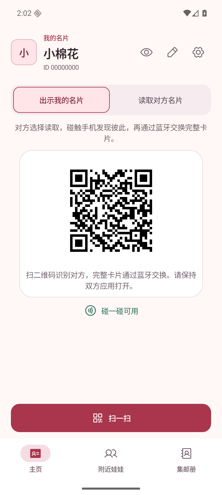 | 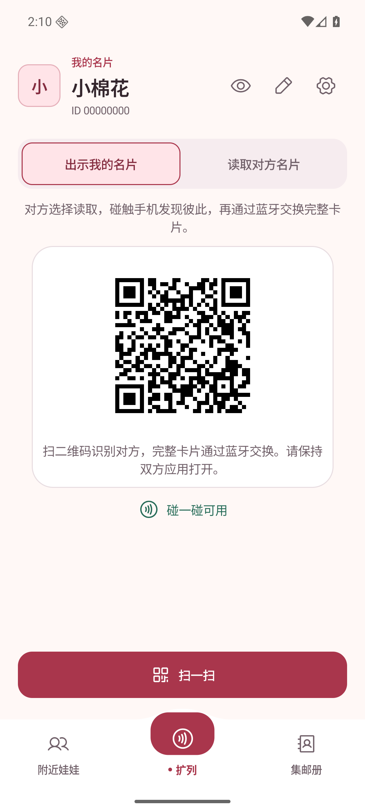 |
| 附近娃娃，扩列未选中 | 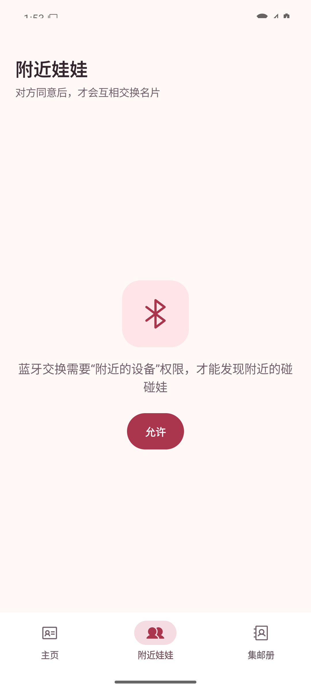 | 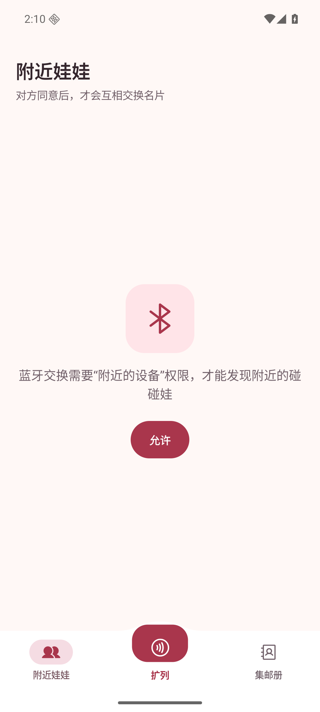 |
| 集邮册，扩列未选中 | 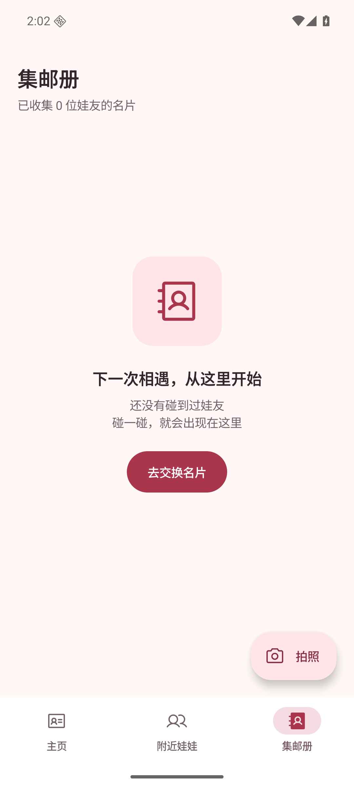 | 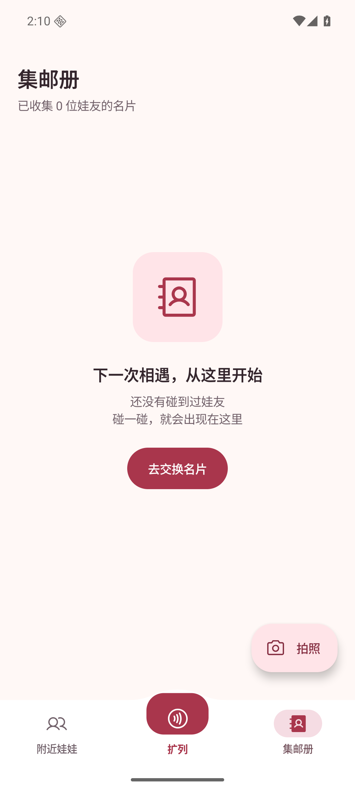 |
| 扩列，深色 | 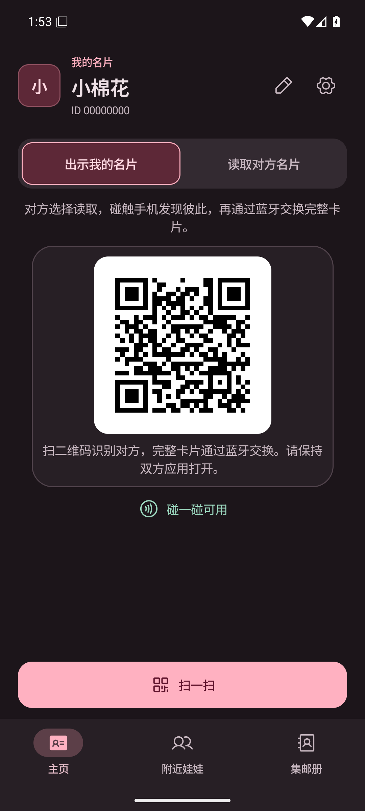 | 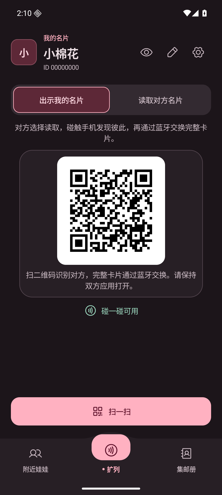 |
| 扩列，320dp／1.5 倍字体 | 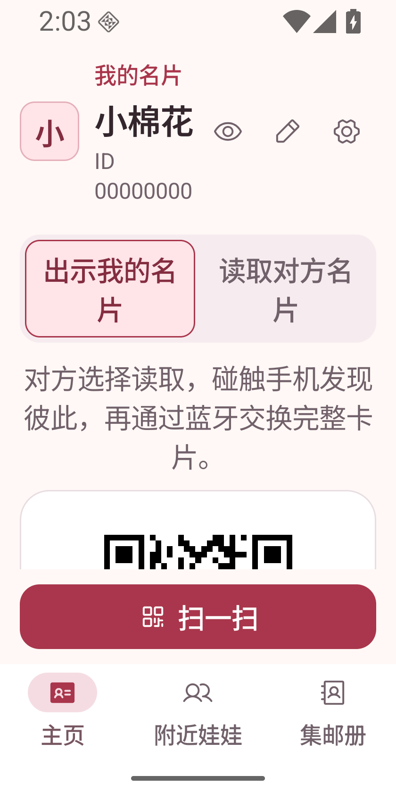 | 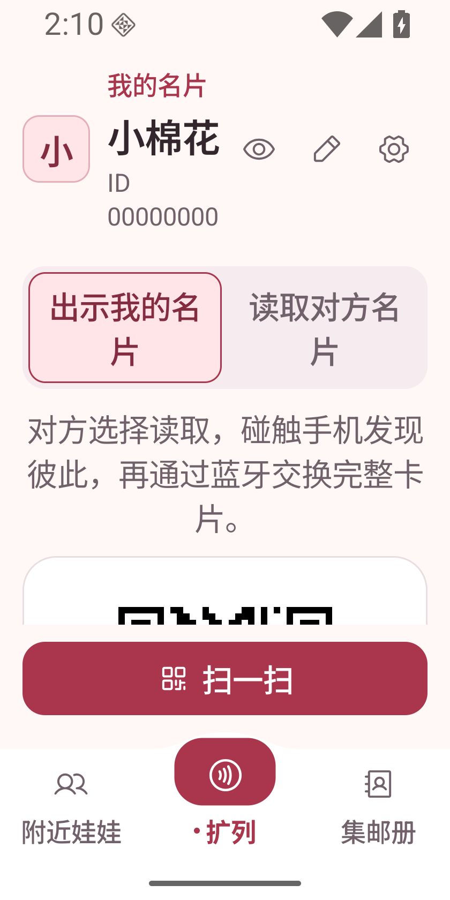 |
| 扩列，横屏侧栏 | 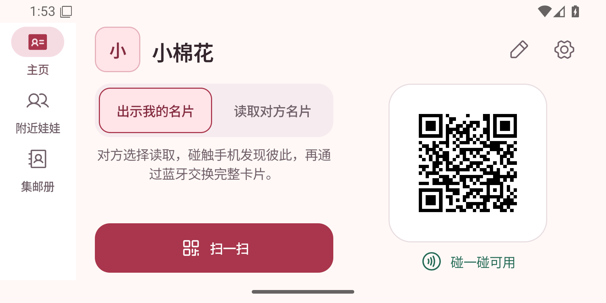 | 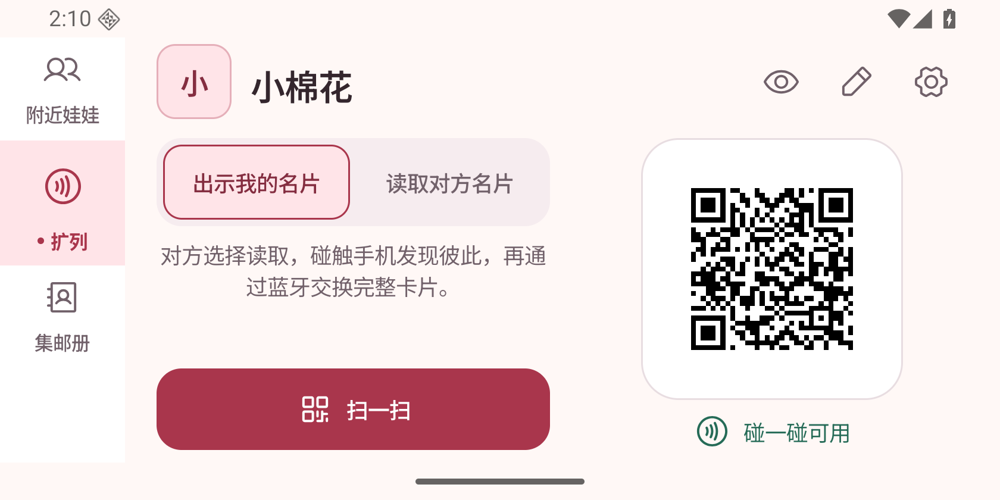 |
| 扩列，375dp 手机 |  | 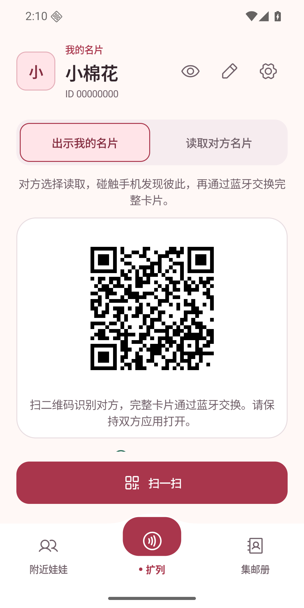 |
| 扩列，320dp／2 倍字体 | 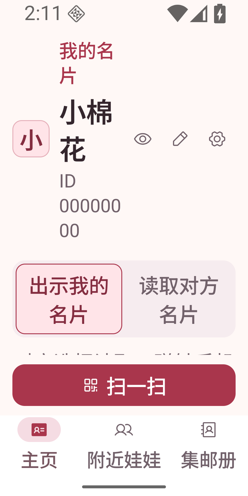 | 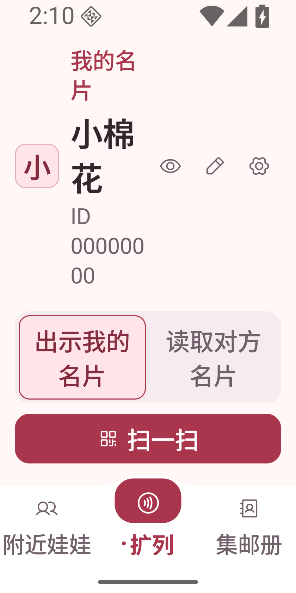 |
| 扩列，800dp 平板竖屏 | 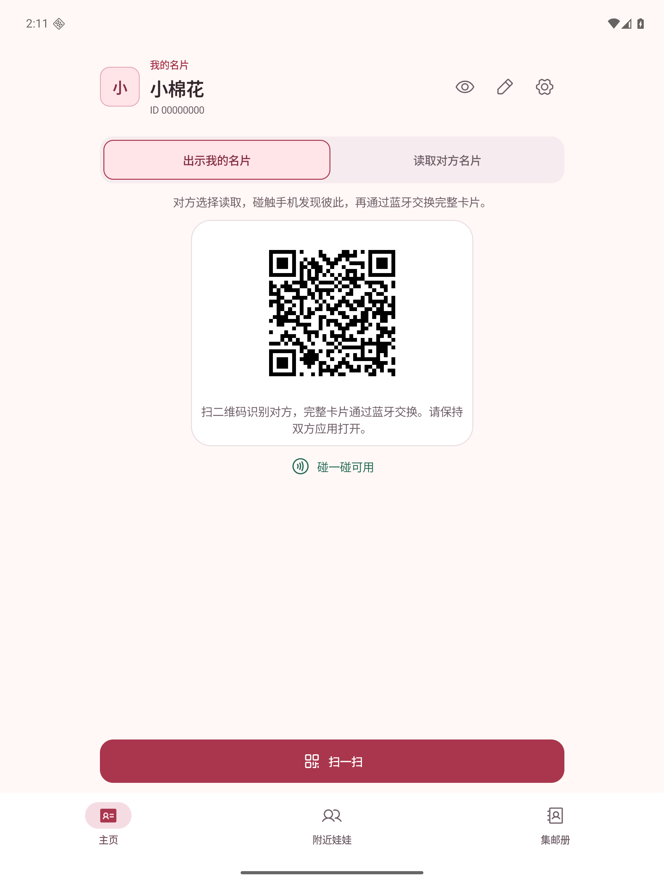 | 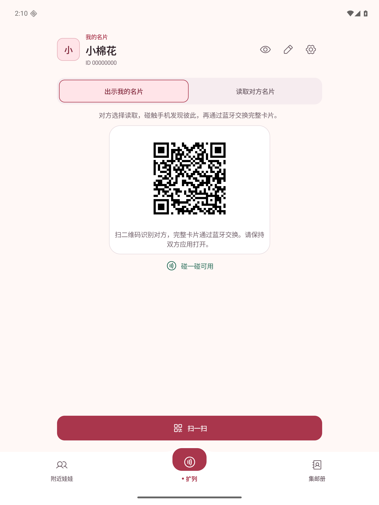 |
| 扩列，1067dp 平板横屏 | 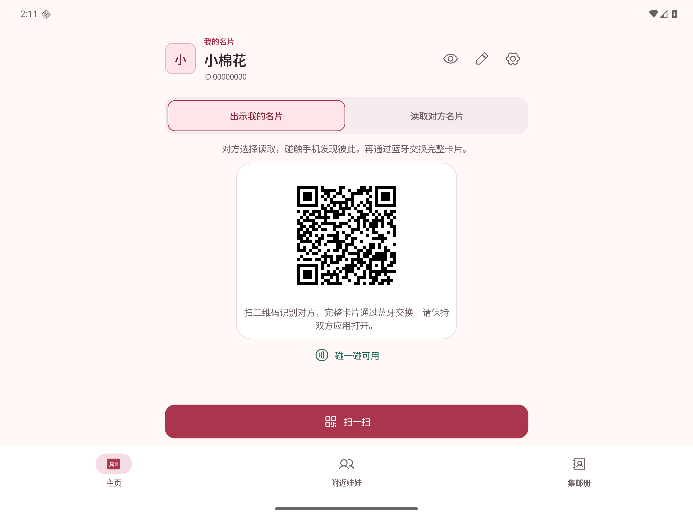 | 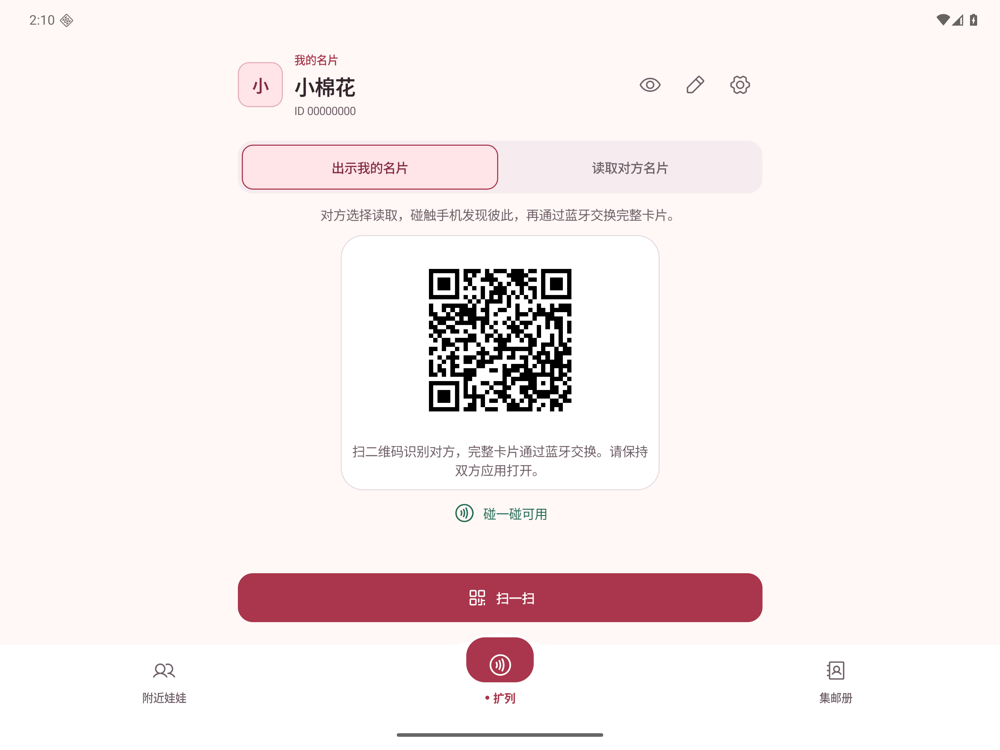 |

## 复现步骤

1. 执行 `bash ./gradlew assembleDebug lintDebug`，安装 `app/build/outputs/apk/debug/app-debug.apk`。
2. 打开合成扩列场景：

   ```sh
   adb -s emulator-5560 shell am force-stop app.pengwa.debug
   adb -s emulator-5560 shell am start -n app.pengwa.debug/app.pengwa.ui.UiPreviewActivity --es screen home --ei sample 1
   ```

3. 分别使用 `--es screen bluetooth --ei sample 0`、`--es screen contacts --ei sample 0` 打开两侧页面。确认扩列在导航栏正中凸起处，图标圆角区域使用强调色、标签回到栏体底色上并保持清晰对比，轮廓与栏体连续、没有悬浮阴影；仅选中扩列时标签前有圆点。
4. 用 `adb -s emulator-5560 shell cmd uimode night yes` 切换深色，`no` 恢复浅色。
5. 窄屏验证：`adb -s emulator-5560 shell wm size 840x1680`，`adb -s emulator-5560 shell settings put system font_scale 1.5`，确认三个入口及标签可见。
6. 字体恢复 `1.0`，使用 `wm size 1680x840` 验证横屏侧栏。完成后执行 `wm size reset`、`font_scale 1.0` 和 `cmd uimode night no` 恢复配置。
7. 用 `adb -s emulator-5560 exec-out screencap -p > screenshot.png` 截图。

## 验证结果与边界

- 原工作区的 Debug 构建、Android lint 与 `git diff --check` 通过。
- PR 独立分支的 `assembleDebug :app:lintDebug` 通过。
- PR 独立分支基于最新 main（`a9ac122`）构建；全模块 `lintDebug` 被已有蓝牙模块的两处 `WrongConstant` 错误阻挡，位置均在未修改的 `core/bluetooth/.../BleExchangeManager.kt:902`。PR 未修改该模块。
- 2 倍字体下三个导航标签完整可见；页面原有头部及 NFC 文案大幅增高，二维码需滚动查看，本次未调整正文布局。
- 已核对上述运行中应用的前后截图：导航顺序、扩列与导航栏连为一体的强调、选中圆点、浅深主题、窄屏大字体和横屏侧栏。
- 主入口使用 Tab 角色和 selected 语义，整个导航项可点击，最小高度 80dp。未进行 TalkBack 语音实测。
- 固定预览场景的导航回调为空，仅用于验证界面与各页面选中状态；真实 NFC、蓝牙交换与扫码硬件行为未在本次复测。
