# 应用内自更新验证

设置新增应用更新入口，支持手动检查、查看新版信息、下载校验和打开系统安装器。
本记录中的图片均来自运行中的 Android APK，使用 `adb exec-out screencap -p` 获取。

## 设备与数据

- Android Emulator，AVD `PengWaNavigation` 的独立只读实例，设备 `sdk_gphone64_x86_64`，Android 16 / API 36，端口 5562。
- 常规截图：1080 × 2400，420 dpi，字体 1.0；窄屏截图：840 × 1680，字体 1.5，深色主题。
- 正式页面使用新建测试身份 `UpdateTest`，UUID 为本次模拟器随机生成的测试 ID；没有真实用户信息。
- 变更前安装 `origin/main`（a9ac122）构建的 Debug APK，变更后安装本 PR 独立分支的 Debug APK，均在同一模拟器打开主页设置。
- 独立状态页由 Debug 专用 `UiPreviewActivity` 提供固定测试数据，渲染生产 `SettingsContent` / `AppUpdateContent`。
  其按钮无动作，仅证明对应状态的显示效果；不表示下载、校验或安装流程已经端到端通过。

## 设置面板前后对比

| 页面 / 状态 | 变更前 | 变更后 |
| --- | --- | --- |
| 主页 → 设置，浅色，默认面板高度 | 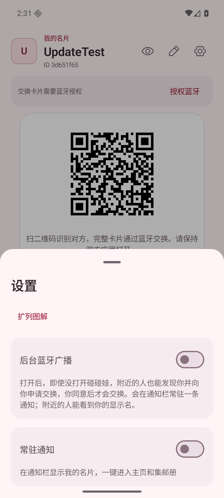 | 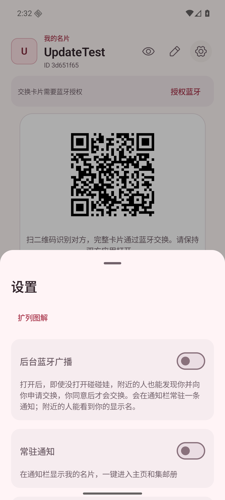 |
| 主页 → 设置，深色，默认面板高度 | 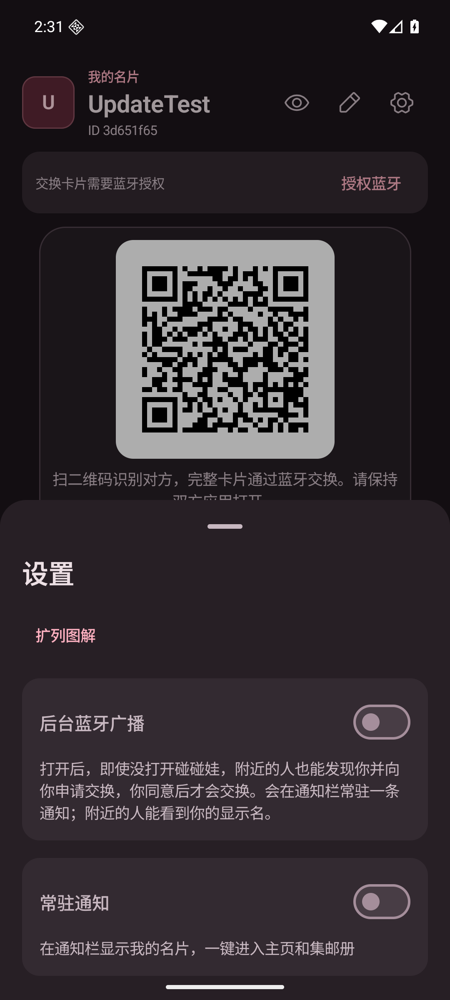 | 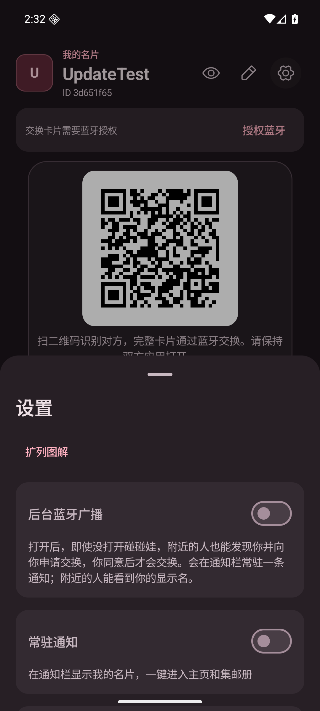 |

默认半高面板新增“应用更新”标题，上滑展开后可查看完整版本与按钮：

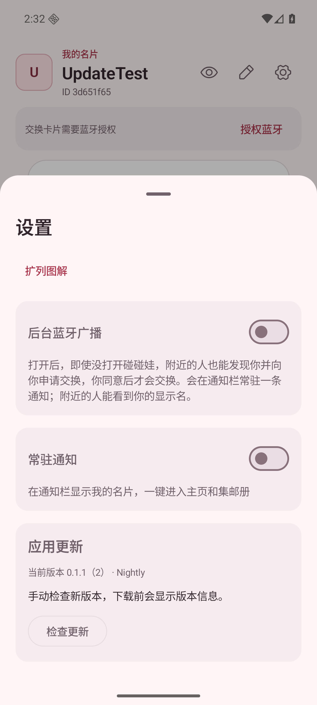

## 真实联网检查

当前公开 Nightly 尚未提供 `update.json`。在生产设置中点“检查更新”，实际 HTTPS 请求返回 404，
显示“此通道尚未发布支持应用内更新的版本，请稍后再试”，并可重试，没有把缺少清单当作“已是最新”。

| 浅色 | 深色 |
| --- | --- |
| 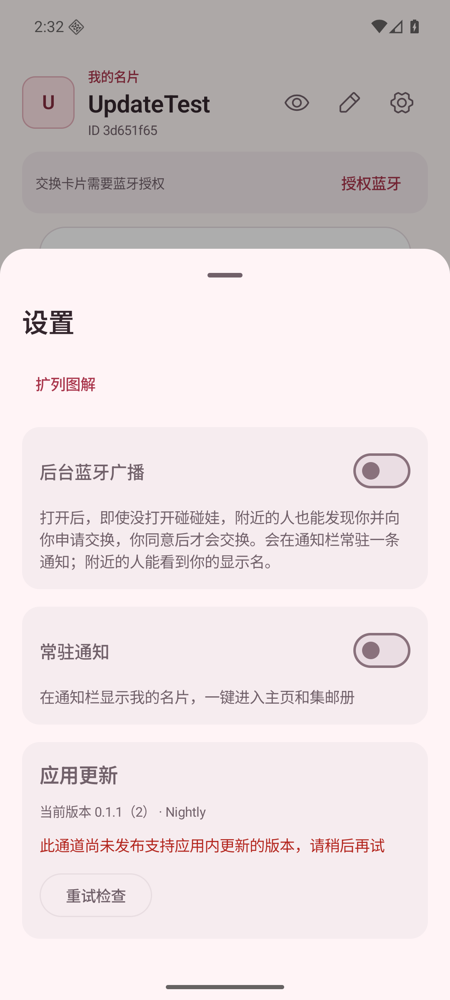 | 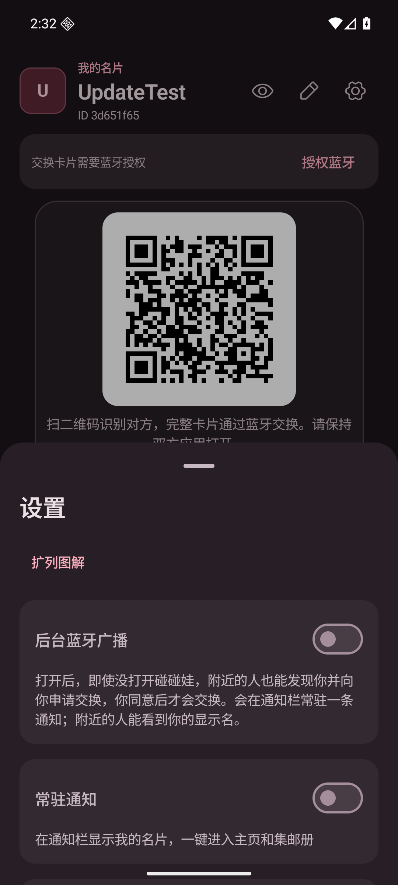 |

## 更新状态（模拟数据，运行中应用）

| 状态 | 浅色 | 深色 |
| --- | --- | --- |
| 初始入口 | 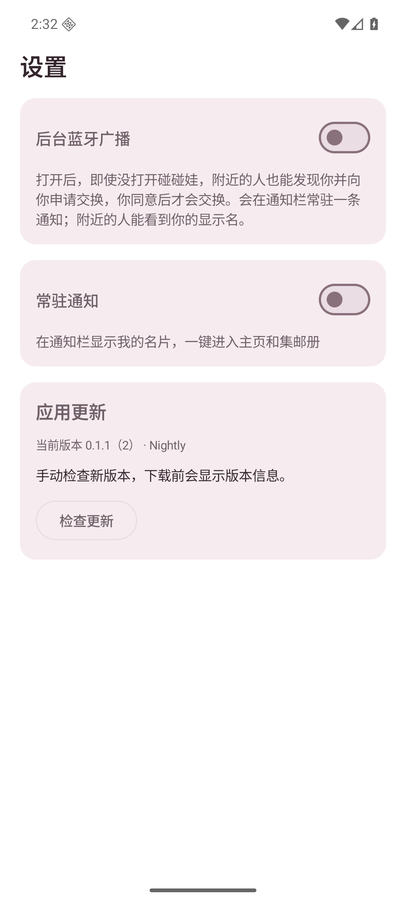 | — |
| 正在检查 | 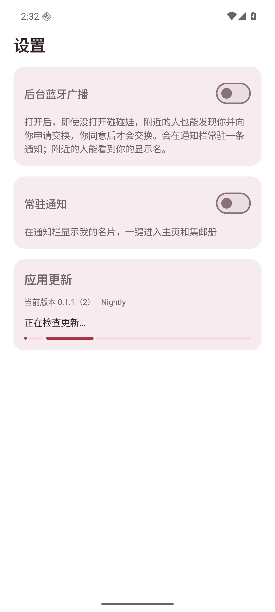 | — |
| 已是最新 | 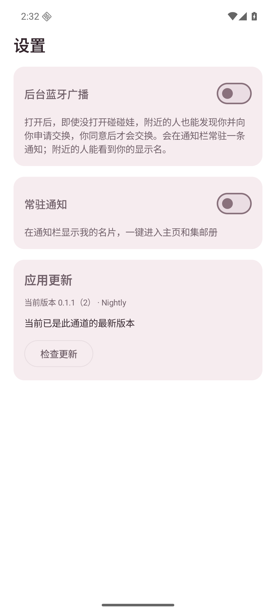 | — |
| 发现新版本、下载大小与说明 | 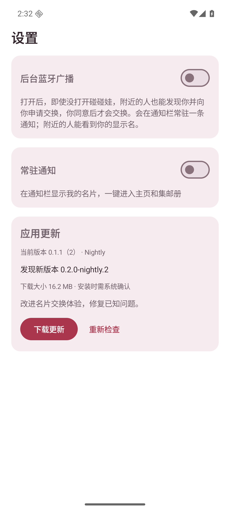 | 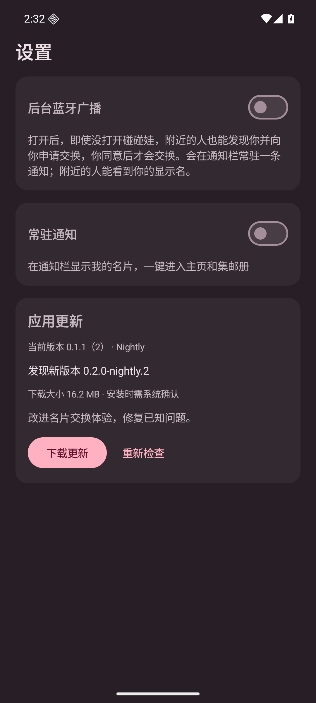 |
| 下载进度 46% | 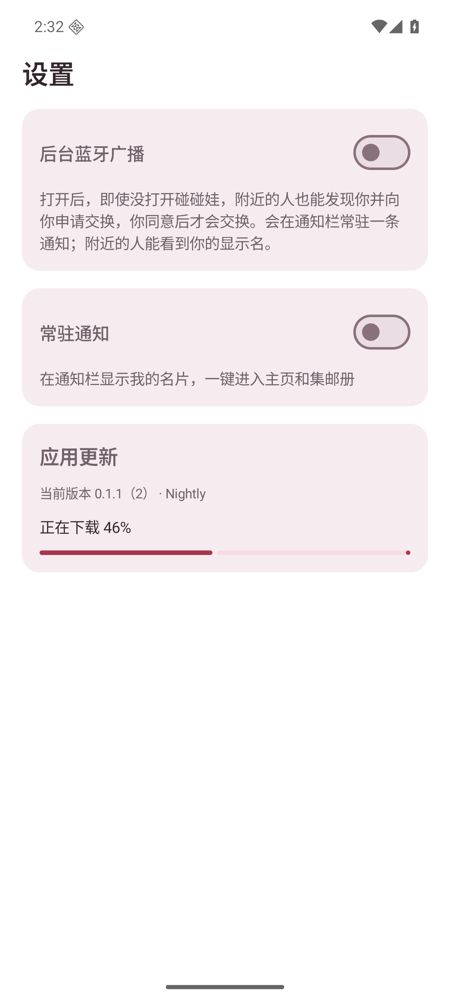 | — |
| 校验后待安装与首次授权说明 | 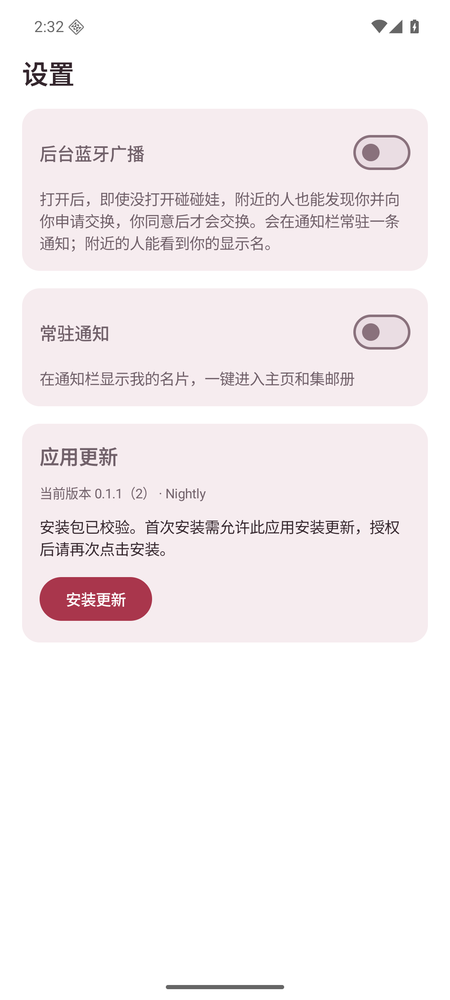 | 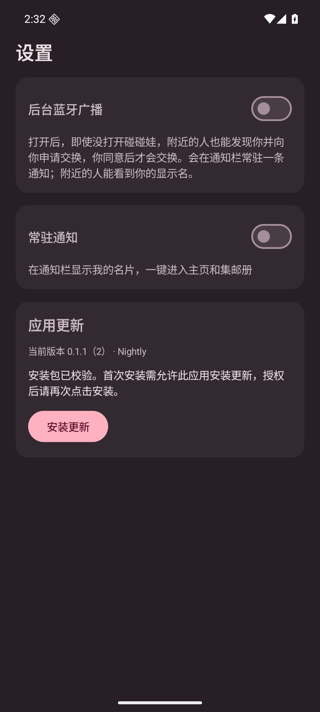 |
| 签名不同，阻止覆盖安装 | 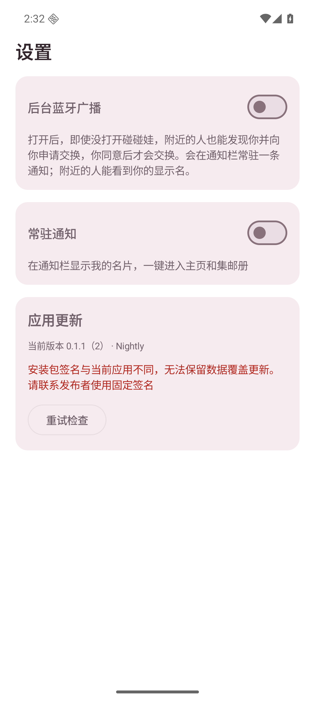 | 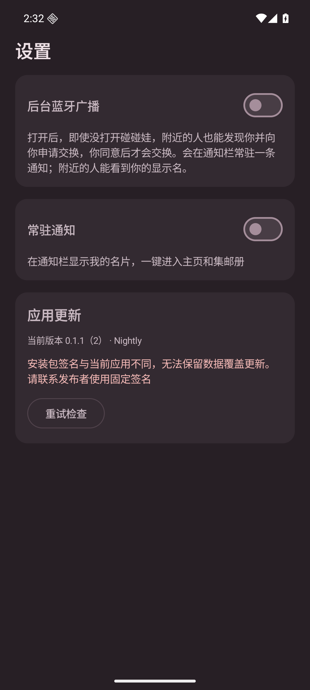 |

窄屏、大字体时，滚动至更新区；下载与重新检查按钮可换行，错误文案完整显示：

| 新版信息 | 签名错误 |
| --- | --- |
| 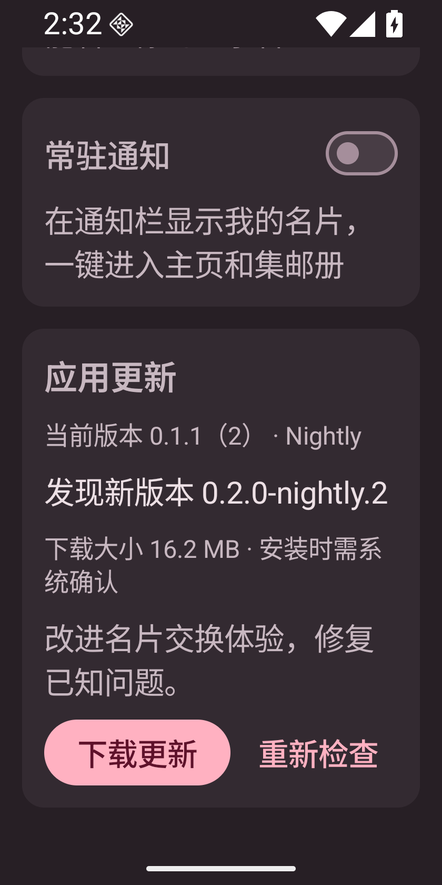 | 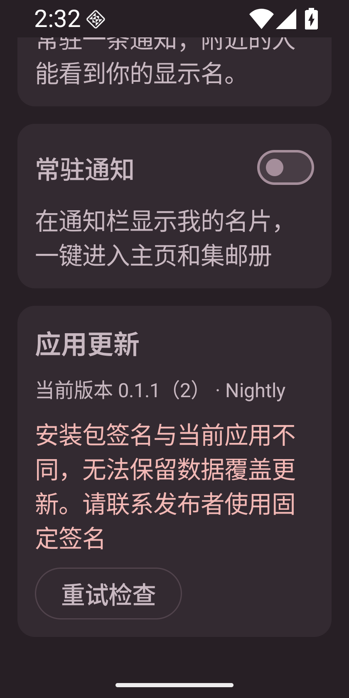 |

## 复现步骤

1. 构建并安装 Debug APK，首次启动创建测试身份，主页右上角设置中上滑展开面板。
2. 点击“检查更新”，确认缺少远端清单时显示可重试的提示；检查后关闭设置再打开，状态仍保留。
3. 固定状态复现：

   ```bash
   adb -s emulator-5562 shell am force-stop app.pengwa.debug
   adb -s emulator-5562 shell am start -W \
     -n app.pengwa.debug/app.pengwa.ui.UiPreviewActivity --es screen update --ei sample 2
   ```

   `sample`：0 初始、1 检查中、2 发现新版、3 下载中、4 待安装、5 签名错误、6 已是最新。
4. 深色切换：`adb -s emulator-5562 shell cmd uimode night yes`；`no` 恢复浅色。
5. 窄屏：`wm size 840x1680`，`settings put system font_scale 1.5`，上滑至更新区；结束后 `wm size reset`、字体恢复 `1.0`。

## 自动验证与未验证项

已通过：

- `:app:assembleDebug`、`:app:testDebugUnitTest`（15 项，包含新增更新规则 3 项）、`:app:lintDebug`。
- `python3 -m unittest discover -s scripts -p test_create_update_manifest.py`（2 项）。
- 用实际构建的 APK 和 Gradle `output-metadata.json` 运行清单生成脚本，校验版本字段、文件大小和 SHA-256 的输出。
- CI YAML 语法解析及本次 diff 空白检查。
- Android 16 实际打开设置、展开面板、联网检查缺少清单时的提示；运行中固定状态的浅色、深色与窄屏截图。

尚未完成，不能标为端到端更新验证通过：

- 远端尚无更新清单，没有执行从公开 Release 下载新版、校验同签名 APK、授权“安装未知应用”、
  系统安装确认/取消、安装完成后重启及数据保留的完整流程。
- 签名错误截图为固定状态，尚未在设备上用实际异签 APK 验证拦截；摘要错误与包名错误也未做设备注入测试。
- 尚未在 Android 10、其他系统版本或厂商安装器上验证授权与安装。
- 尚未运行 GitHub Actions 发布修改；维护者需先配置固定 Nightly 签名，并按发布文档生成两版同签名 APK，
  完成上述流程后再声明覆盖更新可用。现有临时签名旧版不能无损切换到另一签名。
