# 设置独立页面

设置入口仍位于扩列页右上角，点击后从底部弹层改为独立页面。设置页隐藏主导航，顶部固定显示“返回”和“设置”；返回按钮或 Android 系统返回键回到扩列页并恢复主导航。后台蓝牙广播、常驻通知、使用统计和应用更新沿用原有实现。内容在页面内纵向滚动，复用卡片详情页的布局与主题。

## 运行环境与测试数据

- Android Emulator，AVD `PengWaSettingsPage`（独立测试实例，端口 5570），Pixel 6，Android 16 / API 36，420 dpi。
- 全部截图来自运行中的 Debug APK / `MainActivity`，通过 `adb exec-out screencap -p` 采集。
- 合成测试账号 `SettingsTest`，ID 为模拟器中为测试生成的随机值，无真实用户资料。
- 基线为此次修改前的工作区构建，变更后为当前工作区构建；两者使用相同模拟器和测试数据。
- 常规为 1080 × 2400，浅色及深色，字体 1.0。
- 小屏为 984 × 1968（约 375dp），字体 1.0；大字体为 840 × 1680（320 × 640dp），字体 2.0；横屏短窗口为 1680 × 840（640 × 320dp），字体 1.0。

## 前后截图（可用于 PR 描述）

| 页面／状态 | 变更前：设置弹层 | 变更后：设置页面 |
|---|---|---|
| 浅色，初始位置 | 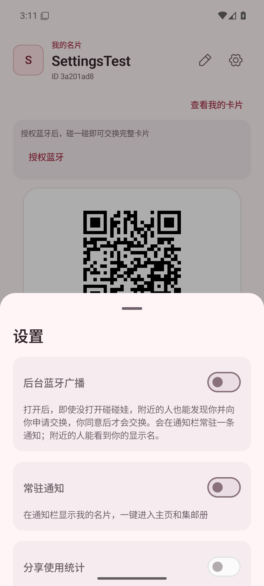 | 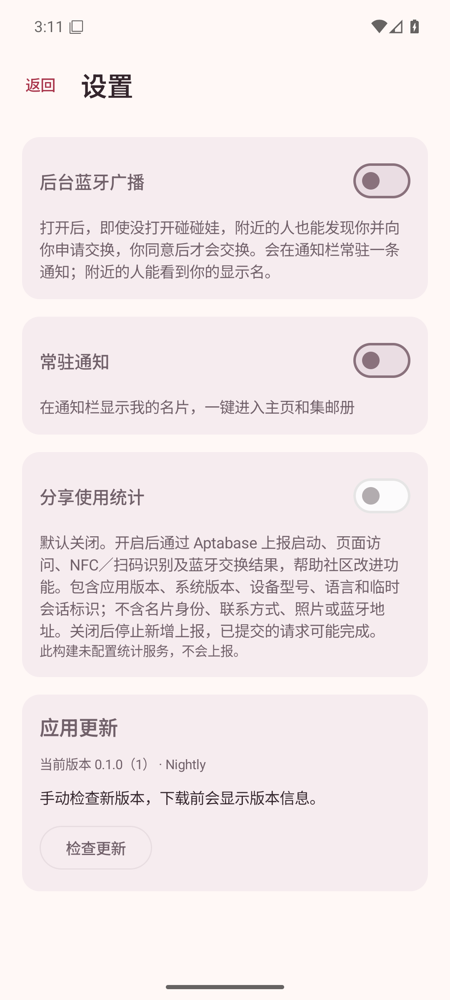 |
| 深色，初始位置 | 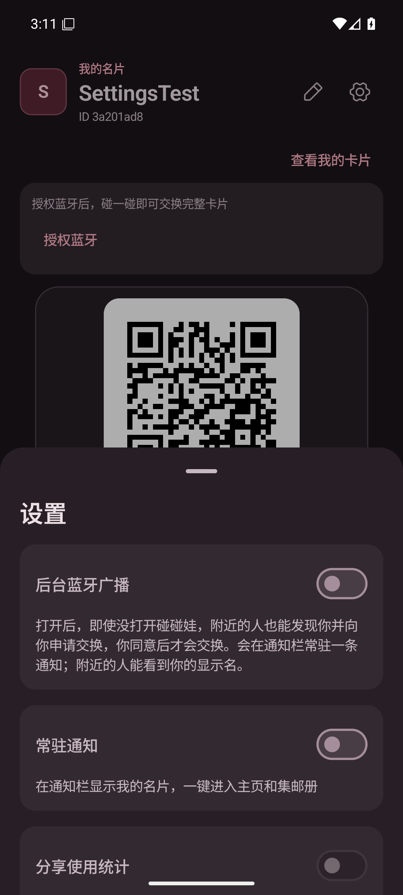 | 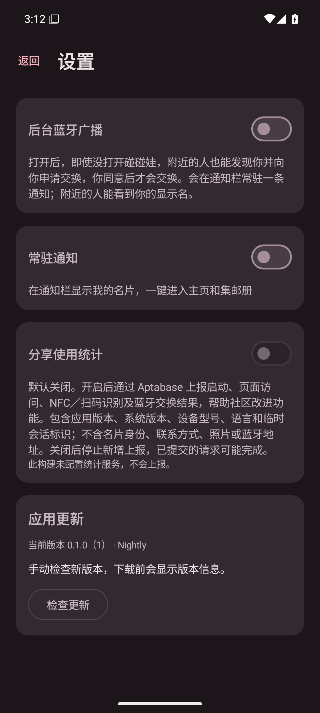 |
| 375dp 小屏 | 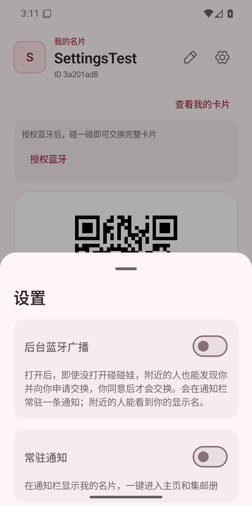 | 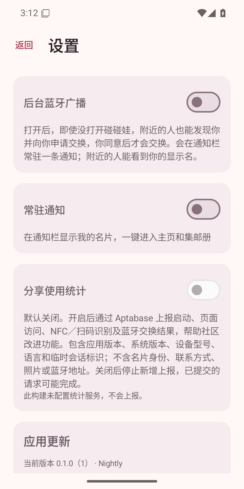 |
| 320dp，2 倍字体 | 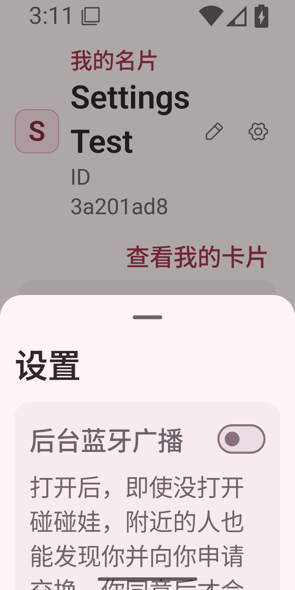 | 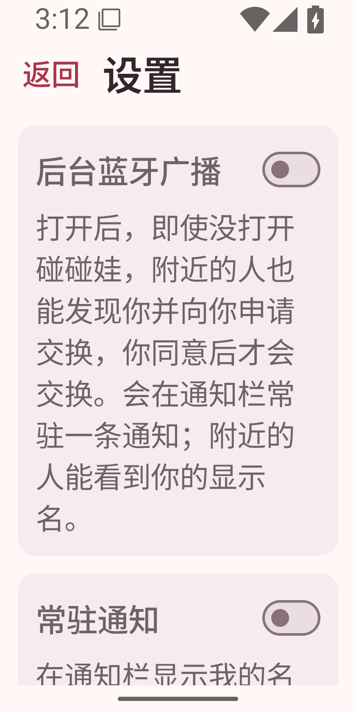 |
| 横屏短窗口 | 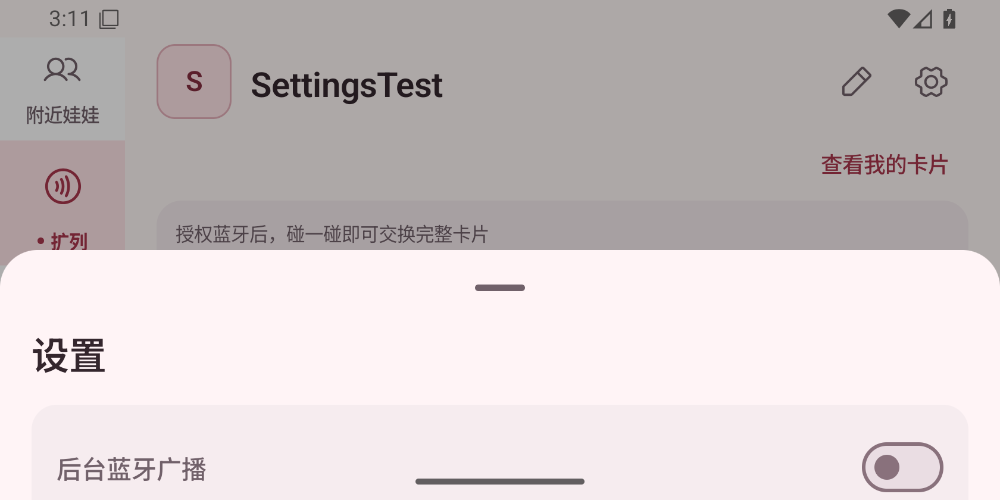 | 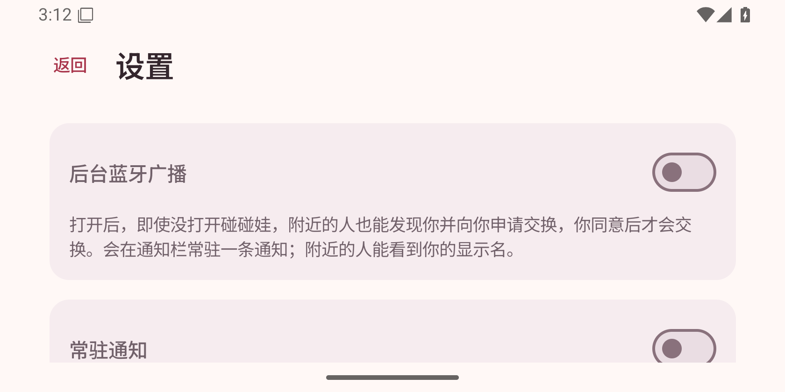 |

页面底部验证：

| 状态 | 滚动到底部，顶部返回仍可用 |
|---|---|
| 320dp，2 倍字体 | 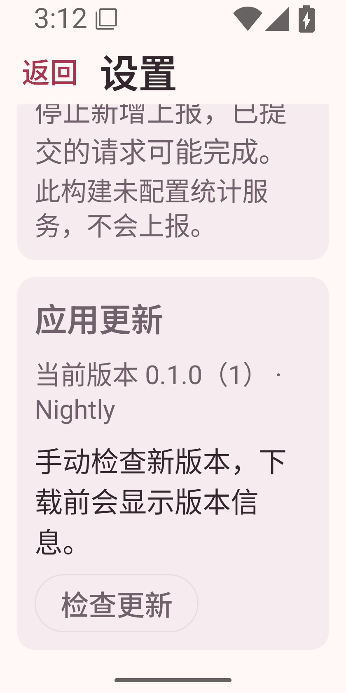 |
| 横屏短窗口 | 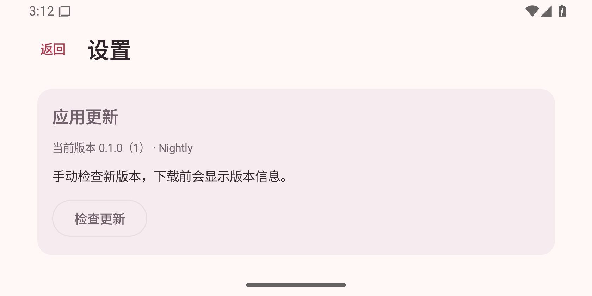 |

## 复现步骤

1. 构建 `bash ./gradlew assembleDebug :app:lintDebug`，安装 `app/build/outputs/apk/debug/app-debug.apk`。
2. 打开应用，首次使用时创建测试显示名；在扩列页点击右上角“设置”。
3. 确认设置为全屏页面，顶部有“返回”和“设置”，底部无主导航，四组设置保留。
4. 点击“返回”，确认回到扩列页并恢复三个导航入口；再次进入设置，使用系统返回键验证相同行为。
5. 使用 `adb shell cmd uimode night yes` 切换深色，`no` 恢复；通过 `adb shell wm size <尺寸>` 和 `adb shell settings put system font_scale <倍率>` 验证上述适配状态。窄屏及横屏滚动正文，确认顶部返回入口保持可见、可访问页面底部的更新区域。
6. 完成后执行 `adb shell wm size reset`、`adb shell settings put system font_scale 1.0`、`adb shell cmd uimode night no` 恢复设置。

## 验证

- `assembleDebug :app:lintDebug` 通过。
- `git diff --check` 通过。
- Android 16 模拟器实测：返回按钮、系统返回键、主导航隐藏及恢复通过；浅色、深色、375dp 小屏、320dp／2 倍字体、横屏初始位置均已截图核对。
- 大字体与横屏滚动到底部后，“检查更新”和顶部“返回”均可见。
- 本次只调整设置容器与导航，未改变权限申请、开关持久化和更新行为；未重新测试蓝牙/NFC 硬件交换、下载与安装更新。
- 未进行 TalkBack 语音实测及平板实测。
