# 六个社交平台与内置图标

支持 QQ、微信、bilibili、小红书、X、Telegram；编辑时直接选择平台，卡片展示图标、平台名与账号，提供复制账号按钮。

图标使用随应用打包的 Simple Icons 矢量资源，离线显示，颜色跟随应用主题。来源和许可见 [third_party](../../../third_party/README.md)。

- bilibili 数字 UID、X 与 Telegram 用户名可自动生成访问链接；显式填写的 HTTP(S) 分享链接优先。
- QQ、微信、小红书不根据账号猜测主页地址，支持复制账号及填写平台分享的主页链接。
- 保留“其他”平台；旧卡片的自定义平台名和账号不丢失。平台名仍使用已有 title 字段，不改变传输格式。
- WeChat、B站、Twitter、TG 等常见旧名称可自动匹配图标。

## 运行截图

Android Emulator `sdk_gphone64_x86_64` / AVD `PengWaIcon`，Android 16 / API 36，1080×2400、density 420。
全部截图来自运行中的 Debug APK，由 adb screencap 获取。姓名、UUID、账号与链接均为合成数据；不代表真实账号。

| 页面／状态 | 变更前 | 变更后 |
| --- | --- | --- |
| 六平台卡片／浅色 | 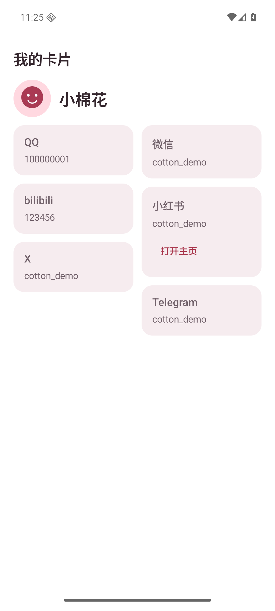 | 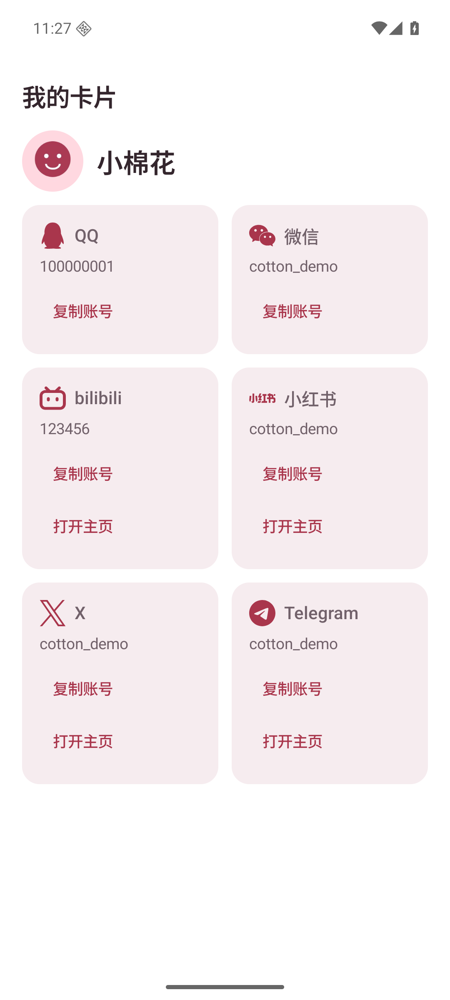 |
| 六平台卡片／深色 | 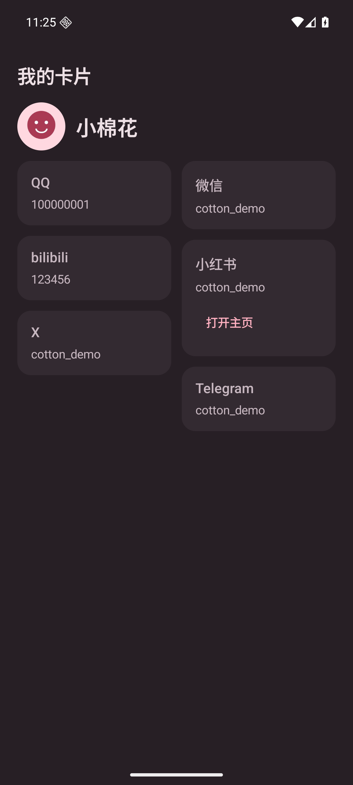 | 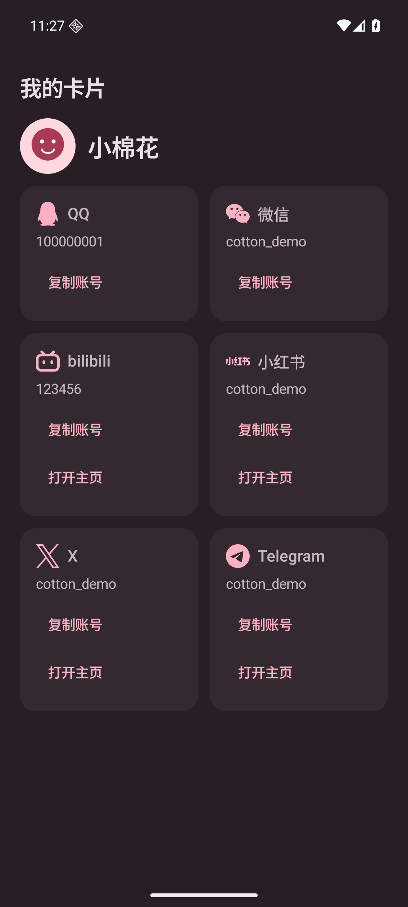 |
| 平台选择／浅色 | 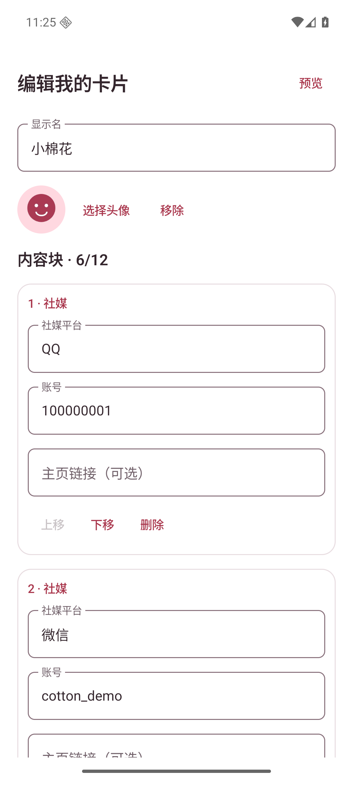 | 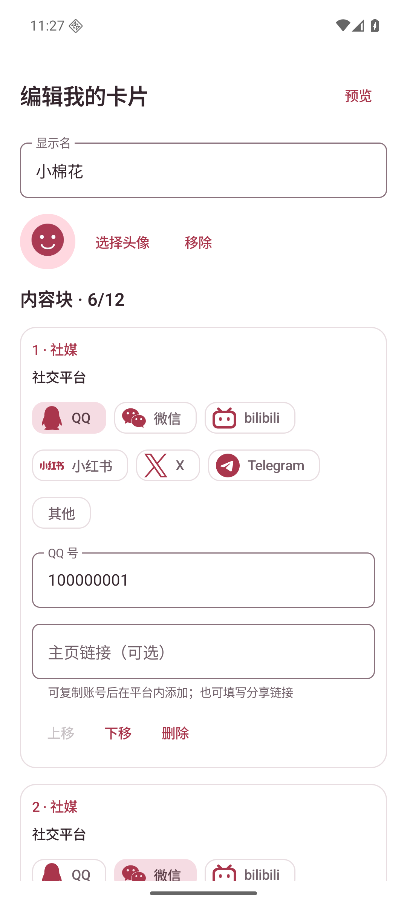 |
| 平台选择／深色 | 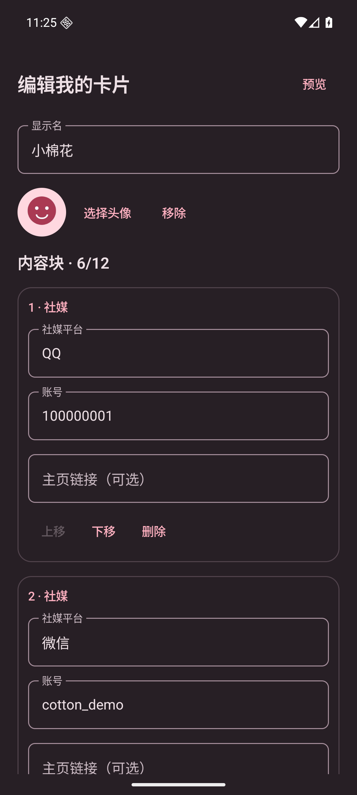 | 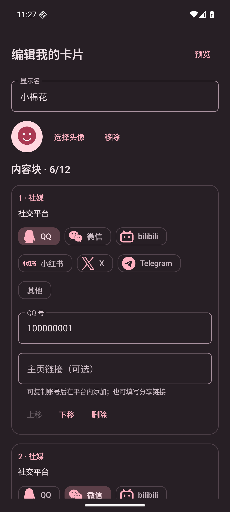 |
| 收到的卡片／浅色 | 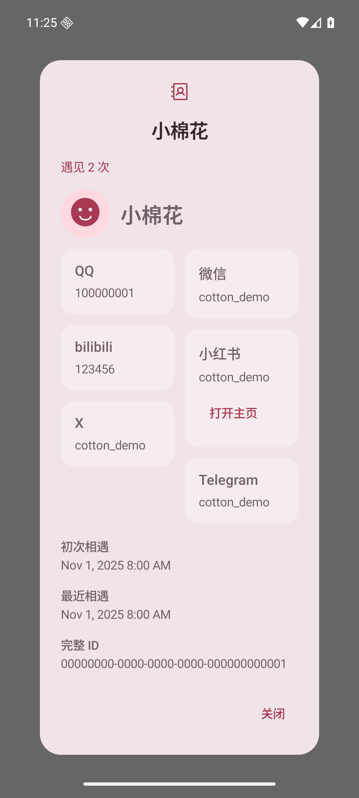 | 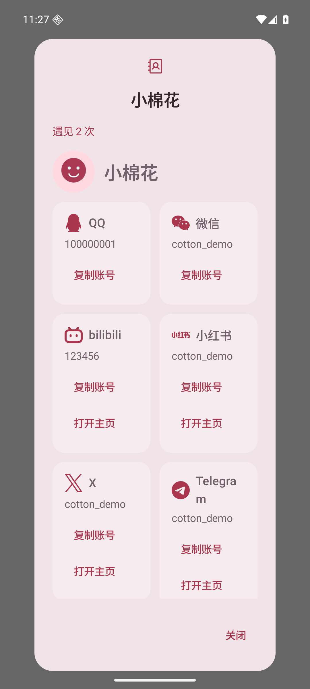 |
| 收到的卡片／深色 | 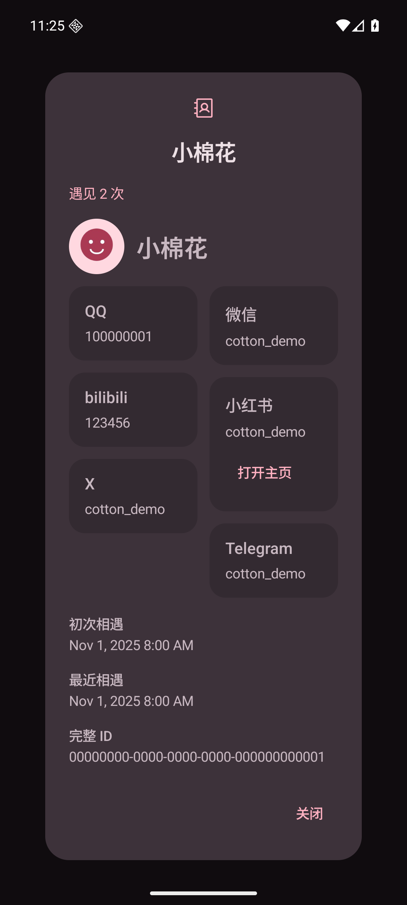 | 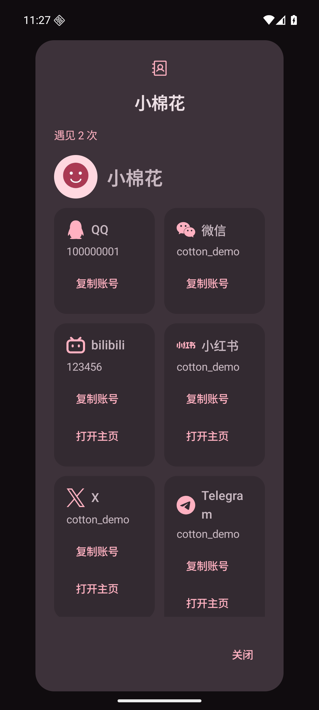 |

窄屏／1.5 倍字体：[卡片](card-narrow-large-font.png)、[平台选择](editor-narrow-large-font.png)。

```sh
adb shell am force-stop app.pengwa.debug
adb shell am start -n app.pengwa.debug/app.pengwa.ui.UiPreviewActivity --es screen card-social
# 编辑：card-social-editor；收到的卡片：card-social-received
adb shell cmd uimode night yes  # no 恢复浅色
```

## 验证

- `testDebugUnitTest assembleDebug lintDebug` 成功：183 项测试通过，Lint 无 error。
- 新测试覆盖旧平台名识别、链接生成与显式分享链接优先、不安全用户名不拼入链接，以及六个平台沿原格式编码往返。
- 模拟器检查六个平台图标、平台选择、复制按钮及深浅主题卡片展示。点击 QQ 的“复制账号”后显示“已复制”；编辑页从 QQ 切换 Telegram 后，账号字段标签同步变为“Telegram 用户名”。

复制反馈：[截图](account-copied.png)；切换平台：[截图](platform-selected.png)。
- 账号存在性、外部应用的登录／好友权限及真实平台跳转结果未验证；双真机交换仍按原 PR 未验证项保留。
