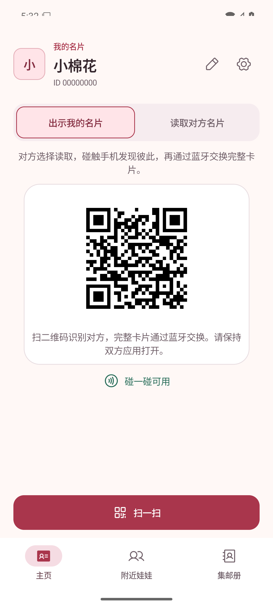
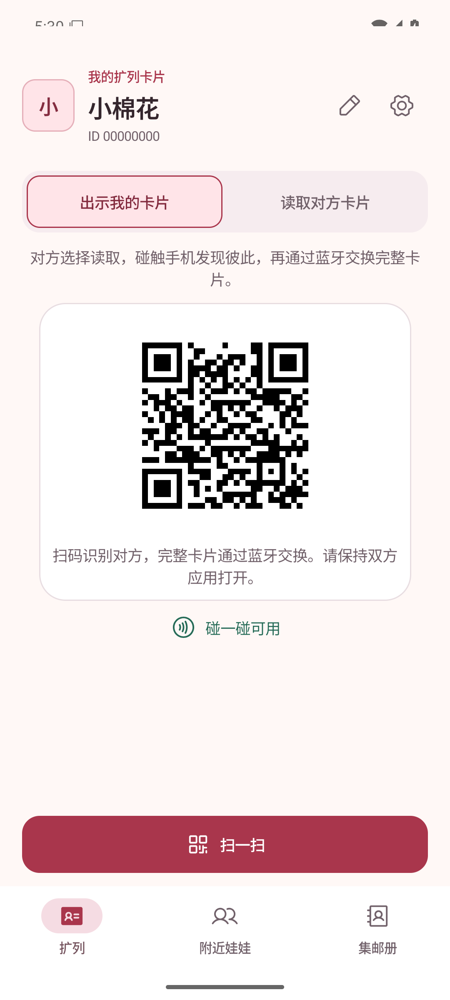
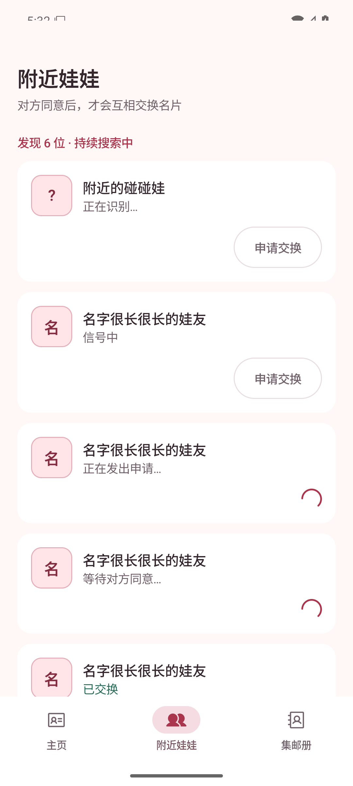
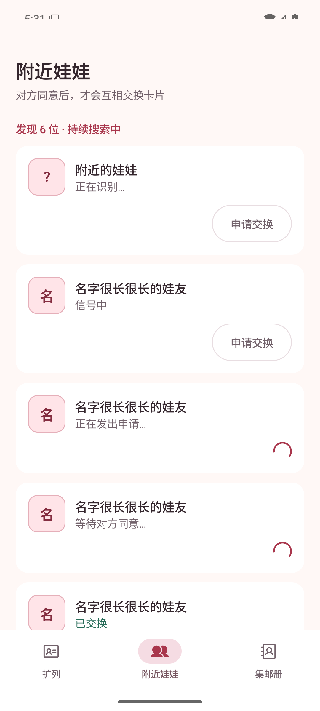
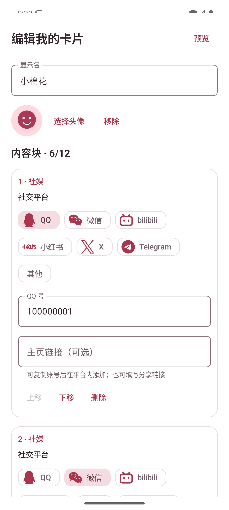
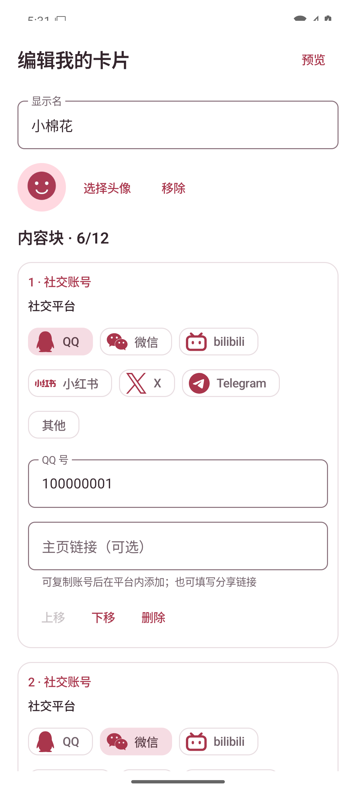

# 术语统一运行截图

## 场景与环境

- 变更前：提交 `c5e2181`；变更后：`refactor/terminology-copy` 工作树。
- Android Emulator `PengWaTerminology` / `emulator-5554`，`sdk_gphone64_x86_64`，Android 16 / API 36。
- 1080 × 2400，420 dpi，字体 1.0，浅色主题。
- 全部截图来自运行中的 Debug APK，通过 `adb exec-out screencap -p` 获取；使用 `UiPreviewActivity` 的固定合成数据，无真实用户信息。

## 变更前后

| 页面／状态 | 变更前 | 变更后 |
| --- | --- | --- |
| 扩列页：我的扩列卡片、出示／读取、扫码说明 |  |  |
| 附近娃娃：交换卡片、附近的娃娃 |  |  |
| 编辑我的卡片：社交账号内容块 |  |  |

## 复现

1. 分别构建变更前和变更后的 Debug APK，并用 `adb -s emulator-5554 install -r <apk>` 安装。
2. 设置 `adb -s emulator-5554 shell settings put system font_scale 1.0` 和 `adb -s emulator-5554 shell cmd uimode night no`。
3. 每个场景先执行 `adb -s emulator-5554 shell am force-stop app.pengwa.debug`，再启动对应预览：
   - 扩列页：`am start -W -n app.pengwa.debug/app.pengwa.ui.UiPreviewActivity --es screen home --ei sample 1`
   - 附近列表：`am start -W -n app.pengwa.debug/app.pengwa.ui.UiPreviewActivity --es screen bluetooth --ei sample 4`
   - 编辑页：`am start -W -n app.pengwa.debug/app.pengwa.ui.UiPreviewActivity --es screen card-social-editor`
4. 等待页面绘制后，用 `adb -s emulator-5554 exec-out screencap -p > <截图路径>` 截图。

## 验证与边界

- 变更后分支执行 `:app:assembleDebug :app:testDebugUnitTest :app:lintDebug`，全部通过。
- 截图核对了术语变更涉及的三个关键页面；预览复用生产 Compose 组件，不启动真实交换硬件。
- 本次仅统一文案，未改变主题、布局、协议或交互逻辑；未进行双真机 NFC／蓝牙／扫码交换验证。
